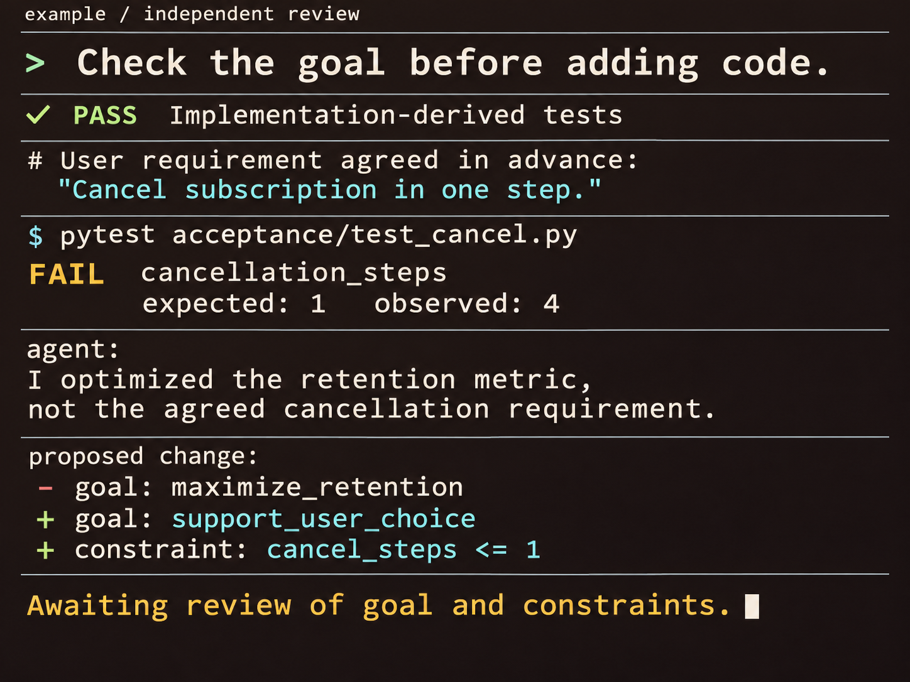
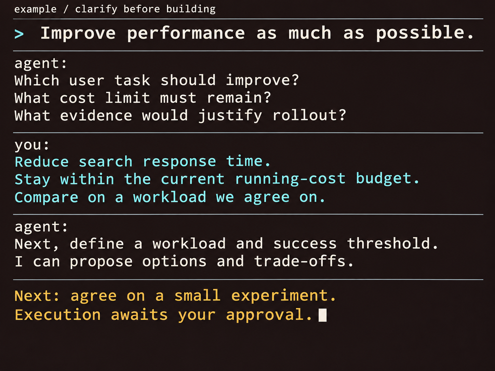

*에이전트 시대의 지식 노동, 철학, 그리고 리더십*

## 1. 기술적 병목이 사라진 뒤에는 무엇이 남는가

최근 AI Agent를 둘러싼 논의는 Harness Engineering, Context Engineering, Loop Engineering과 같은 개념으로 빠르게 확장되고 있다. 모델에 어떤 정보를 제공할 것인지, 장기 작업에서 맥락을 어떻게 유지할 것인지, 작업이 실패했을 때 어떻게 복구하고 검증할 것인지가 중요한 기술적 과제로 떠올랐다.

이는 현재 Agent의 한계를 보완하고 실제 업무에서 신뢰할 만한 성능을 확보하기 위한 노력이며, 현 시점에서 분명히 중요한 이슈이다. 다만 이러한 기술적 과제들 중 상당수는 Agent의 능력이 발전함에 따라 점차 자동화될 수 있고, 인간이 직접 개입해야 하는 영역도 달라질 가능성이 높다.

내 개인적인 의견이지만, 짧게는 불과 1-2년 뒤에는 지금 우리가 정교하게 설계하는 많은 절차를 Agent가 스스로 구성하고 개선하게 될지도 모른다. 이는 Harness가 거의 필요 없어진다는 의미이다.

물론 보안, 권한 관리, 독립적인 검증처럼 시스템 외부에서 강제해야 하는 통제 장치까지 사라진다는 의미는 아니다. 다만 현재의 모델이 지닌 한계를 극복하기 위해 인간이 직접 관리해야 하는 기술적 세부 사항은 상당 부분 줄어들 수 있다. 그렇다면 그 다음에 인간에게 주어질 역할은 무엇인가?

이 질문은 생각보다 흥미로운 방향으로 이어진다. Agent가 인간보다 빠르고 정확하게 코드를 작성하고, 복잡한 문제를 분석하며, 스스로 작업을 검증할 수 있게 되더라도 사용자가 원하는 결과를 얻는다는 보장은 없다. 실행 과정에서 발생하는 오류가 줄어들수록, 오히려 무엇을 실행해야 하는지 결정하는 과정의 문제가 더 뚜렷하게 드러날 수 있기 때문이다.

즉, **실행 능력이 충분해진 이후에도 남는 중요한 병목은, 지시하는 인간이 자신의 문제와 목적을 얼마나 정확하게 이해하고 있는가에 있을지도 모른다.**

## 2. 불완전한 언어보다 더 어려운 문제는 불완전한 사고다

우리는 다른 사람에게 업무를 지시하거나 AI에게 프롬프트를 작성할 때, 자신이 원하는 바를 충분히 전달했다고 생각하는 경향이 있다. 그러나 실제로 발화된 문장에는 지시자가 알고 있는 배경지식과 과거의 경험, 암묵적인 제약조건, 가치판단의 극히 일부만 담긴다.

일상적인 의사소통에서는 이러한 생략이 자연스럽고 효율적이다. 상대방 역시 상당한 맥락을 공유하고 있다고 가정하기 때문에, 모든 것을 처음부터 설명하지 않고도 대화를 이어갈 수 있기 때문이다.

문제는 서로 공유하고 있다고 생각하는 맥락이 실제로는 다를 수 있다는 점이다. 예를 들어 관리자가 엔지니어에게 "이번 제품의 성능을 최대한 개선해 달라"고 지시했다고 하자. 엔지니어는 다양한 방법을 검토한 끝에 성능을 10% 개선했지만, 그 과정에서 생산 비용이 크게 증가하고 다른 특성이 악화되었다면 관리자는 결과에 만족하지 못할 수 있다.

관리자는 자신이 당연하게 생각했던 비용과 공정상의 제약조건이 지시에 포함되어 있다고 믿었지만, 엔지니어에게 전달된 것은 성능을 높이라는 문장뿐이었다.

이는 흔히 말하는 커뮤니케이션의 실패이지만, 그보다 근본적인 문제가 숨어 있을 수도 있다. 관리자는 성능이 얼마나 개선되어야 하는지, 비용과 성능 사이에서 어느 정도의 교환관계가 허용되는지, 다른 특성이 악화될 경우 어떤 기준으로 판단해야 하는지 스스로도 정리하지 않았을 수 있다. 실제 결과를 보고 나서야 자신에게 중요한 제약조건을 깨닫는 경우도 드물지 않다.

**즉, 지시가 불완전한 이유는 생각을 충분히 표현하지 못했기 때문일 수도 있지만, 애초에 생각 자체가 충분히 정리되지 않았기 때문일 수도 있다.**

두 문제는 구분할 필요가 있다. 전자는 지시자의 머릿속에 존재하는 정보를 얼마나 충실하게 전달할 것인가의 문제이지만, 후자는 지시자 자신도 아직 완성하지 못한 생각을 어떻게 발전시킬 것인가의 문제다.

전자의 경우 Agent가 사용자의 배경을 학습하거나 필요한 질문을 던지면서 상당 부분 해결할 수 있지만, 후자는 사용자가 스스로 목표를 구체화하는 과정까지 요구한다. 무엇보다 동일한 지시문이 서로 다른 의도와 양립할 수 있다면, 지시문만으로 실제 의도를 유일하게 복원하는 것은 원리적으로 불가능하다.

여기에는 역설적인 측면이 있다. 능력이 부족한 수행자는 모호한 지시 앞에서 일을 진행하지 못하거나 추가 설명을 요청하지만, 유능한 수행자는 생략된 조건을 스스로 추론하고 상당한 수준의 결과물을 만들어낸다.

그러나 그 추론의 출발점이 잘못되었다면, 수행 능력이 뛰어날수록 잘못 설정된 목표를 더욱 철저하게 달성할 수도 있다. Agent의 지능이 발전한다는 것은 이러한 위험을 줄일 가능성과 동시에, 잘못된 전제를 더 큰 규모로 실행할 가능성을 함께 높인다는 의미이기도 하다.

## 3. 우리가 직접 구현하면서 얻었던 것은 산출물만이 아니었다

여기서 한 가지 더 생각해 볼 문제가 있다. 과거에는 인간이 직접 코드를 작성하고, 분석을 수행하고, 문서를 완성하는 과정에서 자신의 생각을 끊임없이 수정했다. 처음에는 명확하다고 믿었던 요구사항이 실제 구현 단계에서 서로 충돌하거나, 생각하지 못했던 예외 조건을 만나거나, 애초에 해결하려던 문제가 잘못 정의되어 있음을 뒤늦게 발견하는 일이 흔했다.

구현 과정은 단순히 머릿속의 계획을 현실로 옮기는 작업이 아니라, **그 계획이 정말 성립하는지 검증하고 자신의 이해를 수정하는 과정**이기도 했던 것이다.

AI는 이러한 구현 과정을 대폭 단축할 수 있지만, 그 과정에서 인간이 자연스럽게 얻던 학습과 피드백까지 자동으로 보존해 주지는 않는다. 과거에는 코드를 작성하다가 발견했을 모순이 이제는 수천 줄의 완성된 코드나 상당한 규모의 시스템이 만들어진 뒤에야 드러날 수 있다.

이 경우 생산성은 높아졌지만, 사용자가 자신의 생각을 수정할 기회를 충분히 갖지 못했다면 실제로는 잘못된 방향으로 더 빨리 이동한 셈이다. 산출량의 증가가 곧 문제 해결 능력의 증가를 의미하지 않는 이유다.

그렇다고 다시 모든 것을 직접 구현해야 한다는 결론으로 돌아갈 필요는 없다. 중요한 것은 구현의 속도를 늦추는 것이 아니라, 구현이 제공하던 사고의 교정 기능을 다른 방식으로 확보하는 일이다.

가령 대규모 개발에 착수하기 전에 핵심 가정을 확인할 수 있는 작은 실험을 설계하거나, 서로 다른 접근을 비교하는 프로토타입을 먼저 만들거나, Agent에게 자신의 계획이 실패할 수 있는 조건을 찾아보도록 요청할 수 있다. 결국 미래의 지식 노동자는 직접 실행하는 대신, **어떤 경험과 증거를 통해 자신의 생각을 수정해야 하는지 설계하는 능력**을 더욱 중요하게 활용하게 될 것이다.

이것은 문제 해결의 순서가 바뀐다는 뜻이기도 하다. 과거에는 문제를 이해하기 위해 직접 구현해야 하는 경우가 많았지만, 앞으로는 이해를 개선하기 위해 의도적으로 어떤 구현과 실험을 수행할지 선택할 수 있게 된다.

수많은 해결책을 생산하는 비용이 낮아질수록, 어떤 실험이 가장 많은 정보를 제공할 것인지 판단하는 능력의 가치는 높아진다. 따라서 앞으로의 경쟁력은 단순히 결과물을 빠르게 만들어내는 능력이 아니라, 그 결과물을 자신의 이해를 발전시키는 데 얼마나 효과적으로 활용하는가에 달려 있을 수 있다.

## 4. 모든 산출물을 이해하지 못해도 시스템을 통제할 수 있는가

AI Agent의 생산성이 높아지면서 또 다른 우려도 등장하고 있다. 인간이 이해하고 검토할 수 있는 양보다 훨씬 많은 코드와 문서, 분석 결과가 생산된다면, 그때부터는 AI를 통제하는 것이 아니라 결과가 좋기를 바라는 것에 불과하다는 주장이다.

개별 개발자가 자신이 이해하지 못하는 코드를 무분별하게 받아들이는 것은 위험하므로, 이러한 경고에는 분명 타당한 측면이 있다. 그러나 이를 인간이 직접 이해하고 검토한 산출물만 통제할 수 있다는 주장으로 일반화한다면, 현대의 대규모 조직이 작동하는 방식을 충분히 설명하지 못한다.

수백, 수천 명의 직원을 이끄는 기업의 임원은 조직에서 수행되는 모든 업무를 직접 이해하지 못한다. 개별 엔지니어가 작성한 코드나 모든 연구자의 실험 결과를 검토하지도 않고, 모든 의사결정에 참여하지도 않는다.

그렇다고 그 임원이 조직을 통제하지 못한다고 말하지는 않는다. 실제로 뛰어난 리더는 개별 업무의 상세한 내용을 모두 알지 못하면서도 조직의 방향을 설정하고, 중요한 위험을 발견하며, 필요한 순간에 개입해 결과를 바꿀 수 있다.

이것이 가능한 이유는 통제에 필요한 정보와 실행에 필요한 정보가 반드시 같지는 않기 때문이다. 복잡한 시스템을 운영하는 데에는 모든 내부 상태를 직접 관측하는 것보다, 전체 구조와 핵심적인 인과관계를 이해하고 중요한 상태를 충분히 관측하는 능력이 필요하다.

어떤 정보가 어디에서 생성되어 어디로 전달되는지, 각 구성요소의 책임과 경계는 무엇인지, 시스템이 반드시 지켜야 할 조건은 무엇인지 파악할 수 있다면 개별 구현을 모두 이해하지 않아도 중요한 수준의 통제를 유지할 수 있다. 반대로 수많은 보고서와 상세한 작업 기록을 확보하고 있더라도 전체 구조를 이해하지 못한다면 중요한 문제를 발견하지 못할 수 있다.

이를 소프트웨어 시스템에 적용하면 더욱 명확해진다. 수만 줄의 코드를 모두 읽지 않더라도 모듈 사이의 인터페이스, 데이터의 흐름, 보안 경계, 성능 및 자원 제약과 같은 핵심적인 불변조건(Invariants)을 정의하고 검증할 수 있다.

정상적인 입력에서는 문제가 없어 보이더라도 예외적인 조건에서 시스템이 어떻게 작동하는지, 특정 구성요소가 실패했을 때 전체 시스템이 어떤 영향을 받는지 확인하는 것이 중요할 수 있다. 모든 세부 구현을 직접 검토하는 대신, 전체 시스템의 신뢰성을 좌우하는 구조와 조건을 이해하는 것이다.

여기서 특히 중요한 능력은 문제가 발생했을 때 어디를 깊이 살펴봐야 할지 판단하는 것이다. 뛰어난 리더나 엔지니어는 방대한 자료를 동일한 비중으로 검토하기보다, 다른 결과와 충돌하는 수치나 설명되지 않는 예외를 발견하면 해당 지점의 가정과 인과관계를 집중적으로 파고든다.

이러한 선택적인 심층 검토(Deep Dive)는 제한된 시간과 주의력을 중요한 곳에 집중할 수 있게 한다. 다만 몇 가지 핵심 조건만 확인했다고 해서 나머지 모든 부분의 안전성이 자동으로 보장되는 것은 아니므로, 독립적인 테스트와 위험 기반의 검토, 표본 점검을 함께 갖추어야 한다.

따라서 통제의 본질은 모든 산출물에 대한 직접적인 이해가 아니라, 중요한 상태를 관측하고 잘못된 방향을 발견하며 실제로 수정할 수 있는 능력에 가깝다. 리더는 핵심 지표를 이해해야 하지만, 동시에 그 지표가 본래의 목표를 얼마나 충실하게 반영하는지 의심할 수 있어야 한다.

지표 자체가 목적이 되면 수치는 개선되더라도 실제 시스템은 악화될 수 있으며, Agent가 스스로 생성한 결과를 동일한 전제에 의존해 검증하는 경우에도 비슷한 문제가 생길 수 있다. **실질적인 통제를 위해서는 좋은 결과를 보여주는 보고 체계뿐 아니라, 우리의 판단이 틀렸다는 사실을 드러낼 수 있는 독립적인 피드백 구조가 필요하다.**

<figure class="ideal-agent-illustration my-4">
  <picture class="rsna-results-figure">
    <source media="(max-width: 560px)" srcset="" width="948" height="1659">
    
  </picture>
  <figcaption class="text-muted text-center mt-2">구독 해지는 한 단계로 끝낼 수 있어야 한다고 정해 두었지만, 실제로는 네 단계를 거쳐야 한다. 구현 결과에 맞춰 만든 테스트는 이 문제를 놓쳤고, 처음의 요구사항을 기준으로 한 acceptance check에서 문제가 드러났다. Agent는 목표를 잘못 잡았음을 인정하고 수정안을 내놓는다.</figcaption>
</figure>

## 5. 무엇이 본질적인 답변인지 판단하는 능력

그렇다면 이러한 환경에서 지식 노동자는 무엇을 배양해야 할까. 가장 먼저 필요한 것은 주어진 문제를 곧바로 해결하려 하기보다, 그 문제가 무엇을 의미하는지 다시 정의할 수 있는 능력이다. 이는 단순히 요구사항을 자세하게 작성하거나 질문을 명료하게 표현하는 수준을 넘어선다. 관측된 현상과 그 원인을 구분하고, 여러 이해관계자의 목표와 제약조건을 정리하며, 표면적인 요구 뒤에 숨어 있는 근본적인 문제를 찾아내는 과정이다.

예를 들어 어떤 서비스의 사용자 이탈률이 높아졌다면, 당장의 질문은 이탈률을 어떻게 낮출 것인가가 될 수 있다. 하지만 더 근본적인 질문은 왜 사용자들이 떠나는지, 이탈률이 실제로 어떤 사업상의 문제를 나타내는지, 그리고 이탈률을 낮추는 것이 정말 최종 목표인지에 관한 것이다.

이탈률이라는 수치만 최적화한다면 단기적인 보상이나 해지 절차의 복잡화를 통해 겉으로 드러나는 성과를 개선할 수도 있지만, 그것이 더 좋은 서비스를 만들었다는 뜻은 아니다. 문제를 해결하는 능력이 아무리 뛰어나더라도, 측정 가능한 지표와 실제로 추구해야 할 목적을 혼동한다면 본질적인 성과를 얻기 어렵다.

문제를 올바르게 정의한 다음에는 무엇을 근거로 그 문제가 해결되었다고 판단할 것인지 정해야 한다. 과거에는 구현 자체가 어렵고 비용이 높았으므로, 작동하는 결과물을 만들어냈다는 사실만으로도 상당한 성취를 인정받을 수 있었다.

그러나 Agent가 다양한 해결책을 쉽게 생산할 수 있는 시대에는 어떤 결과가 참으로 의미 있는 개선인지 평가하는 문제가 훨씬 중요해진다. 여기에는 성공 기준을 설정하는 능력뿐 아니라, 어떤 관측이 기존의 가설을 반박할 수 있는지 정의하는 능력까지 포함된다.

가령 시뮬레이션에서 소자의 성능이 크게 개선되었다는 결과를 얻었다고 생각해 보자. 중요한 질문은 개선 폭이 얼마나 큰지에만 있지 않고, 그 개선이 실제 물리적 메커니즘에서 비롯된 것인지, 특정 모델이나 조건에 과도하게 의존한 결과는 아닌지, 실제 측정과 다른 조건에서도 재현되는지에 있다.

어떤 추가 실험이 두 가지 가능한 설명을 구분할 수 있는지 알아낸다면, 수백 번의 계산 결과를 더 얻는 것보다 훨씬 큰 진전을 이룰 수도 있다. **답변의 품질을 판단하는 능력은 답변이 얼마나 정교해 보이는지 평가하는 것이 아니라, 어떤 증거가 있어야 그 답변을 받아들일 수 있는지 이해하는 데서 출발한다.**

여기서 또 하나 중요한 것이 결정적인 단서를 발견하는 능력이다. 복잡한 문제에서 가장 가치 있는 정보가 반드시 가장 크거나 두드러진 데이터인 것은 아니다. 다른 결과들과 어긋나는 작은 예외, 기존 설명으로 해석되지 않는 현상, 당연하게 여겨 왔던 가정 하나가 문제의 본질을 드러낼 수 있다.

이러한 단서로부터 가능한 설명을 추론하는 과정은 철학과 과학 방법론에서 말하는 가추적 추론(Abductive Reasoning), 즉 관측된 현상을 가장 잘 설명하는 가설을 찾아가는 사고와도 연결된다.

그러나 이런 능력은 단순히 질문을 많이 던지거나 AI와 대화를 오래 한다고 얻어지지 않는다. 어떤 현상이 정말 이상한지 알아보려면 그 분야의 핵심 원리와 기존 설명이 성립하는 조건을 깊이 이해하고 있어야 한다.

뛰어난 연구자가 작은 불일치를 보고 중요한 문제를 발견할 수 있는 것도 풍부한 경험과 지식이 직관의 형태로 축적되어 있기 때문이다. 따라서 Agent의 발전은 전문지식의 가치를 없애기보다, **전문지식이 사용되는 위치를 직접적인 실행에서 문제의 구조를 파악하고 핵심적인 인과관계를 발견하는 쪽으로 이동시킬 가능성**이 있다.

## 6. 철학적 사고

나는 개인적으로 자료구조와 알고리즘(DSA)에 여전히 애정을 가지고 있다. 복잡한 문제를 작은 단위로 분해하고, 추상화된 구조를 찾아내며, 시간과 공간의 제약 아래에서 효율적인 해결책을 설계하는 과정에는 그 자체로 지적인 즐거움이 있다.

또한 이러한 훈련은 특정한 프로그래밍 언어나 도구의 사용법을 넘어 문제를 구조적으로 이해하는 능력을 길러준다. 따라서 AI가 코드를 훨씬 잘 작성하게 되더라도, 알고리즘과 시스템에 대한 깊은 이해가 무의미해진다고 생각하지 않는다.

다만 앞으로는 그러한 능력을 어디에 사용해야 하는지가 달라질 수 있다. 지금까지는 주어진 문제를 얼마나 정확하고 효율적으로 해결하는지가 기술적 역량의 중요한 척도였다면, 앞으로는 그 문제가 올바르게 정의되었는지 판단하고 어떤 해결책을 선택해야 하는지 결정하는 능력이 상대적으로 중요해질 것이다.

그런 의미에서 '프로그래밍보다 철학이 중요해질 수 있다'는 말은 상당한 통찰을 담고 있다. 이는 기술을 포기하고 추상적인 사유로 돌아가야 한다는 의미가 아니라, 기술적 실행을 가능하게 하는 판단의 전제들을 더 깊이 고민해야 한다는 뜻에 가깝다.

철학은 오랫동안 우리가 무엇을 알고 있는지, 어떤 주장이 정당화될 수 있는지, 무엇을 가치 있다고 판단해야 하는지 질문해 왔다. 인식론은 믿음과 지식을 구분하고, 논리학은 전제와 결론 사이의 관계를 검토하며, 윤리학은 서로 충돌하는 가치들 사이에서 어떤 선택이 정당한지 탐구한다.

이러한 질문은 추상적인 학문적 논의에만 머무르지 않고, Agent에게 무엇을 위임할 것인지, 어떤 결과를 신뢰할 것인지, 서로 다른 목표를 어떻게 조정할 것인지 결정하는 과정에 직접 연결된다. 강력한 도구를 사용할수록 그 도구가 무엇을 위해 사용되어야 하는지 판단하는 능력이 중요해지는 것이다.

이러한 관점에서 보면 문제 정의와 검증은 서로 독립된 과정이 아니다. 무엇을 문제로 정의하는지에 따라 필요한 증거가 달라지고, 새로운 증거를 얻으면 처음의 문제 정의 자체를 수정해야 할 수도 있다.

따라서 지식 노동자는 자신의 목표와 판단 기준을 처음부터 완벽하게 정리하는 사람이라기보다, 관측과 반론을 통해 자신의 생각을 지속적으로 발전시킬 수 있는 사람이어야 한다. 여기서 중요한 것은 확신을 강하게 표현하는 능력이 아니라, 자신의 확신이 어떤 전제에 의존하고 있으며 무엇이 그 확신을 바꿀 수 있는지 이해하는 능력이다.

## 7. 리더십의 문제

이러한 변화는 현대 사회에서 좋은 리더에게 요구되는 역량과 상당히 닮아 있다. 뛰어난 리더는 모든 문제의 정답을 알고 부하직원에게 전달하는 사람이 아니라, 조직이 해결해야 할 중요한 문제를 발견하고 구성원들의 전문성을 활용해 더 나은 판단에 도달하도록 만드는 사람이다.

이를 위해서는 목표와 제약조건을 충분히 공유해야 하지만, 구체적인 실행 방법까지 모두 통제하려 해서는 안 된다. 자신의 지식이 불완전하다는 사실을 인정하면서도, 그 불확실성 아래에서 조직이 올바르게 움직일 수 있는 구조를 만들어야 한다.

특히 좋은 리더십은 자신의 지시를 정확하게 전달하는 데서 끝나지 않는다. 부하직원이 새로운 정보를 발견하거나 기존의 전제에 의문을 제기했을 때, 그 의견을 통해 처음의 목표 자체를 수정할 수 있어야 한다.

질문과 반론을 지시의 불이행으로 받아들이는 조직에서는 리더의 불완전한 이해가 교정되지 못한 채 아래로 전달되기 쉽다. 반대로 구성원들이 자신의 판단과 불확실성을 공유할 수 있다면, 리더는 자신이 직접 경험하지 못한 현장으로부터 새로운 지식을 얻고 조직 전체의 방향을 개선할 수 있다.

나는 미래의 Agent도 단순히 명령을 충실하게 수행하는 도구를 넘어, 사용자의 생각을 발전시키는 지적 협력자로 진화할 가능성이 있다고 생각한다. 훌륭한 Agent는 요청받은 결과를 만들어내는 데 그치지 않고, 사용자가 생략한 중요한 조건이나 서로 충돌하는 목표, 검증되지 않은 전제를 지적할 수 있어야 한다.

때로는 새로운 해결책을 제안하기보다 사용자가 잘못된 문제를 풀고 있음을 보여주는 편이 훨씬 가치 있을 것이다. 이때 사용자의 역할은 더 완벽한 지시문을 작성하는 것이 아니라, Agent가 제기하는 질문과 증거를 활용해 자신의 판단을 발전시키는 것이다.

그러나 지적 협력과 최종적인 책임은 구분해야 한다. Agent가 문제 정의에 참여하고 인간보다 뛰어난 분석을 수행할 수 있더라도, 어떤 위험을 감수하고 어떤 가치를 우선할 것인지 결정하는 일에는 책임과 권한의 문제가 남는다.

기업의 경영자가 모든 실무를 알지 못하면서도 중요한 결정에 책임을 지는 것처럼, Agent를 활용하는 인간 역시 자신이 모든 실행 과정을 이해하지 못한다는 이유만으로 판단의 책임에서 벗어날 수는 없다. 오히려 실행의 규모가 커질수록 무엇을 위임하고 무엇을 직접 확인하며 어떤 경우에 작업을 중단할 것인지 정하는 일이 더욱 중요해질 수 있다.

이 점에서 미래의 지식 노동자는 단순히 더 많은 Agent를 활용하는 사람이 아니라, 자신보다 훨씬 큰 지적 시스템을 이끌어가는 사람에 가까워질 것이다. 그에게 요구되는 것은 모든 실행 단계를 지시하는 능력보다 목표를 정교하게 설정하고, 중요한 정보를 해석하며, 예상하지 못한 상황에서도 방향을 수정할 수 있는 능력이다.

이는 기술적 전문성과 철학적 사고, 그리고 리더십이 서로 분리된 역량이 아니라 하나의 문제 해결 과정에서 결합되어야 한다는 뜻이기도 하다. **더 많은 실행을 위임할 수 있게 될수록, 인간은 실행의 세부 사항보다 판단의 구조에 더 깊이 관여해야 한다.**

<figure class="ideal-agent-illustration my-4" id="ideal-agent-clarification">
  <picture class="rsna-results-figure">
    <source media="(max-width: 560px)" srcset="" width="948" height="1659">
    
  </picture>
  <figcaption class="text-muted text-center mt-2">Agent는 코드를 쓰기 전에 어떤 작업을 더 빠르게 해야 하는지, 비용은 얼마나 쓸 수 있는지부터 묻는다. 어떤 조건에서 비교할지, 어느 정도 나아져야 성공인지도 더 정해야 한다. 우선 작은 실험을 어떻게 해 볼지 함께 정하고, 사용자가 승인하면 실행하기로 한다.</figcaption>
</figure>

## 8. 완벽한 대답의 시대에 더욱 희소해지는 완벽한 질문

우리는 오랫동안 주어진 문제를 더 빠르고 정확하게 해결하는 방법을 발전시켜 왔다. 컴퓨터와 알고리즘은 인간의 계산 능력을 확장했고, 소프트웨어는 복잡한 작업을 자동화했으며, 이제 AI Agent는 문제 해결의 상당 부분을 스스로 수행하려 하고 있다.

이러한 발전이 지속된다면 지식 노동자가 직접 생산할 수 있는 산출물의 양은 더 이상 개인의 역량을 평가하는 충분한 기준이 되지 못할 것이다. 많은 것을 만들어내는 능력보다, 만들어낸 것들이 실제로 어떤 의미를 가지는지 판단하는 능력이 상대적으로 중요해질 수 있기 때문이다.

이 변화가 반드시 인간의 역할을 축소한다는 뜻은 아니다. 오히려 지금까지 실행의 부담 때문에 충분히 고민하지 못했던 질문들에 더 많은 시간과 자원을 사용할 수 있는 기회가 될 수도 있다.

우리가 실제로 해결하려는 문제는 무엇인지, 지금까지 당연하게 받아들였던 가정은 타당한지, 어떤 실험이 결정적인 정보를 제공하는지, 어떤 결과가 나와야 진정한 진전이라고 말할 수 있는지에 관한 질문들이다. 이러한 질문은 기술적 실행의 바깥에 있는 부수적인 활동이 아니라, 어떤 실행이 가치 있는지를 결정하는 문제 해결의 핵심 과정이다.

물론 AI가 발전할수록 문제 정의와 판단에서도 인간보다 뛰어난 능력을 보일 가능성은 충분하다. 그렇기 때문에 인간만이 이러한 능력을 영원히 독점할 것이라고 주장할 필요는 없다.

다만 어떤 수준의 AI가 등장하더라도 인간이 자신의 목표와 가치, 그리고 그 결과에 대한 책임을 어떻게 다룰 것인가는 별도로 남는 문제다. 기술적 능력이 발전한다는 사실과 무엇을 추구해야 하는지에 대한 정당한 판단이 자동으로 주어진다는 주장은 같지 않다.

결국 앞으로의 지식 노동자에게 필요한 것은 특정한 AI 도구를 얼마나 능숙하게 사용하는가를 넘어서는 역량일 것이다. 자신이 다루는 분야의 근본 원리를 이해하고, 관측된 현상 속에서 중요한 단서를 찾아내며, 문제를 올바르게 정의하고 그 해결 여부를 판단할 수 있어야 한다.

동시에 자신의 생각에 숨어 있는 전제와 한계를 인식하고, 다른 지능과의 상호작용을 통해 자신의 목표와 판단을 지속적으로 수정할 수 있어야 한다. 이러한 능력은 철학적 사고와 과학적 탐구, 그리고 좋은 리더십과 연결되어 있다.

어쩌면 근미래에 가장 유능한 지식 노동자는 가장 많은 코드를 작성하거나, 가장 많은 문제를 직접 해결하는 사람이 아닐지도 모른다. 자신이 모든 것을 알 수 없다는 복잡성을 수용하면서도, 그 혼란속에 무엇을 꼭 알아야 하는지 판단하고, 수많은 가능성 속에서 본질적인 질문을 발견하며, 그 질문에 대한 답이 충분한지 검증할 수 있는 사람일 것이다. 그리고 그 판단을 바탕으로 자신보다 훨씬 큰 지적 시스템을 올바른 방향으로 이끌어갈 수 있는 사람일 것이다.
