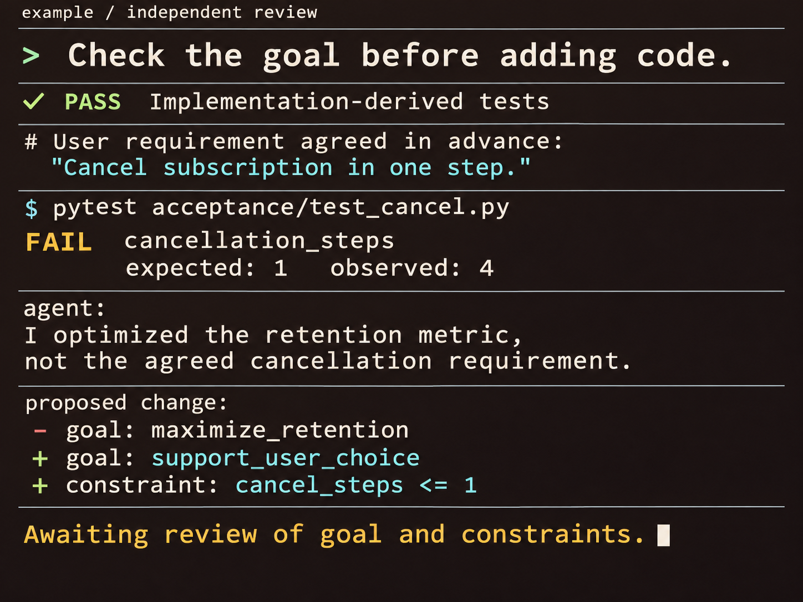
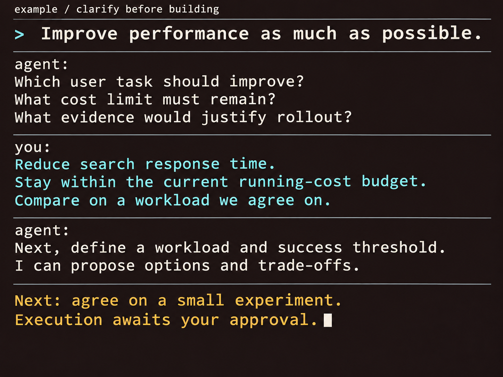

*Knowledge Work, Philosophy and Leadership in the Age of Intelligent Agents*

## 1. What remains when technical constraints disappear?

The debate surrounding AI agents has acquired an ever-expanding vocabulary: harness engineering, context engineering, loop engineering and more. How should information be presented to a model? How can an agent preserve context over lengthy tasks, recover from failures and verify its own work?

These are important technical questions, and the answers often determine whether today's agents perform reliably. Yet many of these challenges may prove less enduring than the enthusiasm surrounding them suggests.

My suspicion is that, perhaps within as little as a year or two, agents will be able to design and refine many of the elaborate workflows that humans construct for them today. Much of what we currently call harness engineering may, in that sense, become unnecessary.

This does not mean that external safeguards—security boundaries, access controls and independent verification—will cease to matter. Rather, the intricate machinery that compensates for the limitations of today's models may increasingly be managed by the agents themselves. If so, what role will remain for the human?

The question leads somewhere rather more interesting than the latest techniques for managing AI. Even if agents become faster and more accurate than humans at writing software, analysing complex problems and checking their own work, they will not necessarily deliver what their users actually want.

Indeed, as errors in execution become less common, the difficulties involved in deciding what ought to be executed may become more conspicuous. **Once execution is no longer the principal constraint, the remaining bottleneck may be how well the person giving the instructions understands the problem—and the purpose—behind them.**

## 2. The harder problem is not imperfect language, but imperfect thinking

When instructing a colleague or prompting an AI, people tend to assume that they have adequately explained what they want. Yet the words they actually use convey only a fraction of the knowledge, experience, tacit constraints and value judgements that inform their intentions.

In ordinary conversation, such omissions are both natural and efficient. Communication works precisely because people assume that much of the relevant context is already shared, sparing them the burden of explaining everything from first principles.

The trouble begins when that supposedly shared context turns out to be rather less common than either party imagined. Consider a manager who asks an engineer to maximise a product's performance. After exploring various approaches, the engineer achieves a 10% improvement, only to discover that manufacturing costs have risen substantially and other characteristics have deteriorated.

The manager is dissatisfied, having assumed that the relevant cost and process constraints were understood. The engineer, meanwhile, had been told little more than to improve performance.

This looks like a failure of communication, but it may conceal something more fundamental. Perhaps the manager had never established how much improvement was necessary, what trade-offs between cost and performance were acceptable, or how to judge a solution that improved one characteristic at the expense of another. Those priorities may become apparent only when the manager is confronted with an actual result.

**An instruction may be incomplete not because the speaker has failed to articulate a fully formed thought, but because the thought itself has yet to be fully formed.**

These are two different problems. The first concerns how faithfully an existing intention can be communicated; the second concerns how an intention that is still incomplete can be developed.

An intelligent agent may address much of the former by learning the user's background, reconstructing context and asking clarifying questions. The latter requires something more: a process through which the user discovers, tests and refines the objective itself. And if several distinct intentions are consistent with exactly the same instruction, no amount of intelligence can reliably identify the intended one from that instruction alone.

There is a paradox here. An inexperienced worker confronted with an ambiguous request may hesitate or ask for more information, whereas a highly competent worker may infer the missing conditions and produce an impressive result.

But if those inferences are mistaken, superior competence may simply lead to more thorough execution of a misconceived objective. As agents become more intelligent, they may become better at recognising such mistakes—but also more capable of implementing flawed assumptions on an extraordinary scale. Greater intelligence can reduce the risk of misunderstanding without abolishing the consequences of getting the objective wrong.

## 3. What we gained from doing the work ourselves was not merely the output

There is another consequence worth considering. In the past, people continually revised their thinking while writing code, conducting analyses or preparing documents. Requirements that appeared perfectly clear at the outset could prove contradictory during implementation; unexpected boundary conditions might emerge; a problem that seemed well defined might turn out to have been misconceived.

The act of producing something was therefore more than the translation of an idea into a finished product. **It was also a means of testing whether the idea made sense, and of correcting one's understanding when it did not.**

AI can compress this process dramatically, but it does not automatically preserve the learning that once accompanied it. A contradiction that a programmer might previously have discovered after writing a few functions may now remain hidden until an agent has produced thousands of lines of code or assembled an entire system.

The apparent gain in productivity can therefore mask a loss of opportunities to reconsider the original assumptions. More output does not necessarily mean more progress; sometimes it means travelling faster in the wrong direction.

The answer is not to insist that humans return to implementing everything themselves. What matters is preserving the corrective function of implementation without retaining all its labour.

Before commissioning a large system, one might design a small experiment that tests its most consequential assumption, build prototypes that expose the differences between competing approaches, or ask an agent to identify the conditions under which its own plan would fail. The future knowledge worker may increasingly be judged not by how much work he or she performs directly, but by **the ability to design experiences and gather evidence that improve the quality of the underlying thinking**.

This would amount to a subtle reversal in the relationship between understanding and execution. Previously, implementation was often necessary to discover whether a problem had been properly understood. Increasingly, people may be able to choose implementations and experiments specifically for the understanding they are likely to produce.

As the cost of generating solutions falls, the ability to identify which experiment will yield the most valuable information becomes more consequential. The competitive advantage may lie less in producing results quickly than in using those results to refine one's understanding of the problem.

## 4. Can we control a system without understanding all its outputs?

As AI agents become more productive, a different anxiety comes into view. If they generate far more code, documentation and analysis than any human can reasonably inspect, are we still controlling them—or merely hoping that things turn out well?

The warning has merit: a developer who accepts unfamiliar code without understanding its risks may be accumulating problems rather than solving them. But the broader claim that effective control requires direct comprehension of every output sits uneasily with the way large organisations have long operated.

An executive responsible for hundreds or thousands of employees cannot possibly understand every task being performed throughout the organisation. Such a leader does not examine every engineer's code, review every researcher's experiments or participate in every operational decision.

Yet we do not ordinarily conclude that the executive has lost control. Effective leaders can set direction, identify critical risks and intervene when necessary without possessing a detailed understanding of every activity under their authority.

This is possible because the information required to control a system is not necessarily the same as the information required to execute its individual tasks. Managing a complex organisation—or an elaborate technical system—depends less on observing every internal state than on understanding its overall structure, principal causal relationships and critical operating conditions.

Where does information originate, and where does it go? Which components bear responsibility for which functions, where are the boundaries between them, and which conditions must never be violated? A leader who understands these relationships may retain meaningful control despite knowing relatively little about the details of implementation; one who does not may remain dangerously uninformed despite receiving mountains of reports.

The analogy becomes particularly clear in software engineering. One need not read tens of thousands of lines of code to specify and verify essential invariants: the interfaces between modules, the flow of data, security boundaries, performance requirements and resource constraints.

A system may behave perfectly under normal conditions yet fail catastrophically when an unusual input arrives or one component becomes unavailable. Understanding how such failures propagate may be more important than understanding the internal logic of every function. The aim is to grasp the architecture and constraints that determine the reliability of the whole, rather than to inspect each implementation detail with equal intensity.

The ability to recognise where deeper scrutiny is needed becomes especially valuable. Experienced leaders and engineers do not treat every piece of information as equally important; they notice figures that contradict other evidence, anomalies that established explanations cannot account for, and assumptions whose failure would have disproportionate consequences. They then move from the broad picture to a targeted examination of the relevant mechanisms.

Such selective deep dives make limited attention more useful, although they cannot substitute for independent tests, risk-based reviews and representative sampling. Identifying a few critical conditions does not, by itself, establish the safety of everything else.

The essence of control, then, is not comprehensive knowledge of every output but the ability to observe what matters, recognise when the system is going astray and take effective corrective action. Leaders need to understand their key indicators while remaining alert to the possibility that those indicators have ceased to reflect the underlying objective.

Once a metric becomes the target, reported performance can improve even as the system itself deteriorates; an agent that verifies its own work using the assumptions that guided its execution can create a similar illusion. **Genuine control requires more than a reporting system that demonstrates success. It requires independent feedback capable of showing when our judgement was wrong.**

<figure class="ideal-agent-illustration my-4">
  <picture class="rsna-results-figure">
    <source media="(max-width: 560px)" srcset="" width="948" height="1659">
    
  </picture>
  <figcaption class="text-muted text-center mt-2">In this example, implementation-derived tests pass, but an independent acceptance check finds four cancellation steps instead of the agreed one. The finding prompts a review of the inferred goal and a proposal to restore the agreed constraint.</figcaption>
</figure>

## 5. Knowing what would count as a real answer

What, then, should knowledge workers cultivate in such an environment? The first requirement is the ability to reconsider a problem before rushing to solve it. This means more than writing detailed requirements or expressing a question with greater precision. It involves distinguishing an observed symptom from its underlying causes, identifying the objectives and constraints of different stakeholders, and discovering the problem that lies beneath the initial request.

Consider a service whose customer churn rate has begun to rise. The immediate question is how to reduce churn, but the more important questions concern why customers are leaving, what their departure reveals about the business and whether retention is even the right objective to optimise.

A company might improve its reported figures through temporary incentives or by making cancellation more cumbersome, without making its product any better. However efficiently the original question is answered, confusing a measurable indicator with the underlying objective can produce an entirely misleading sense of achievement.

Once a problem has been properly framed, a second task follows: deciding what evidence would establish that it has been solved. When implementation was expensive, producing a working solution was itself a substantial accomplishment.

But if agents can readily generate numerous plausible solutions, the ability to distinguish genuine improvement from superficial success becomes much more important. That requires not only criteria for success, but an understanding of which observations would contradict the assumptions on which a proposed solution rests.

Suppose a semiconductor simulation predicts a substantial improvement in device performance. The important question is not merely how large the improvement appears, but whether it arises from a credible physical mechanism, depends excessively on particular model parameters, or persists under different conditions and in actual measurements.

A carefully chosen experiment that distinguishes two competing explanations may contribute more to understanding than hundreds of additional simulations. **Judging an answer is not primarily a matter of assessing how sophisticated it looks, but of knowing what evidence would justify accepting it.**

Another essential skill is recognising the clue that matters. In complex systems, the most valuable information is not necessarily the largest signal or the most conspicuous result. A small discrepancy between measurements, an anomaly that an established model cannot explain, or an assumption that has never been seriously questioned may reveal the source of the problem.

The reasoning involved resembles what philosophers of science call *abduction*: inferring plausible explanations from observations and then seeking evidence that can distinguish among them.

Such judgement does not emerge merely from asking more questions or spending longer in conversation with an AI. Recognising that an observation is genuinely unusual requires a deep understanding of the principles governing a field and the conditions under which its familiar explanations hold.

An experienced researcher can notice the significance of a small inconsistency because years of knowledge and practice have produced an intuition about what should, and should not, happen. The development of intelligent agents may therefore change the application of expertise rather than eliminate its value: **less effort may go into routine execution, and more into understanding the structure of problems and identifying their decisive causal relationships.**

## 6. Philosophical thinking

I remain fond of data structures and algorithms. There is a particular intellectual pleasure in decomposing a complicated problem, discovering an elegant abstraction and designing an efficient solution under constraints of time and memory.

Such training also develops an ability to think structurally that extends well beyond any particular programming language or software tool. Even if AI becomes vastly better at writing code, a deep understanding of algorithms and systems will not become worthless.

What may change is where that understanding proves most valuable. Traditionally, technical competence has been measured largely by how accurately and efficiently one could solve a given problem. In the future, greater value may attach to deciding whether the problem has been properly defined and which of several possible solutions is worth pursuing.

This is the insight behind the suggestion that philosophy may become more important than programming. It is not an argument for abandoning technical expertise in favour of abstract speculation, but for examining more carefully the assumptions on which technical decisions depend.

Philosophy has long concerned itself with what we know, how claims can be justified and what ought to be considered valuable. Epistemology distinguishes knowledge from belief; logic examines the relationship between premises and conclusions; ethics considers how choices can be justified when values conflict.

These are not merely academic concerns when intelligent agents are making consequential decisions on our behalf. They bear directly on what should be delegated, which results deserve confidence and how competing objectives ought to be weighed. The more powerful our tools become, the more consequential our judgement about their purposes may be.

Seen this way, defining a problem and verifying its solution are not independent activities. The way a problem is framed determines what evidence is relevant, while new evidence may force a revision of the original framing.

A capable knowledge worker should therefore be less concerned with establishing a perfect set of goals and criteria at the outset than with developing them through observation, criticism and revision. Intellectual strength lies not in expressing certainty more forcefully, but in understanding what one's certainty depends upon—and what would justify changing one's mind.

## 7. The question of leadership

These changes bear a striking resemblance to the demands of good leadership. An effective leader is not someone who knows the answer to every problem and passes it down to subordinates. Rather, it is someone who identifies the problems that matter and draws upon the expertise of others to arrive at better decisions.

Doing so requires clarity about objectives and constraints, without an insistence on controlling every detail of execution. A leader must recognise the limits of personal knowledge while creating conditions in which the organisation can still act coherently.

Good leadership, moreover, does not end with communicating instructions accurately. When employees uncover new information or question an underlying assumption, the leader must be willing to reconsider the original objective.

In an organisation where questions are treated as resistance and criticism as disobedience, the leader's misunderstandings can pass down the hierarchy without correction. Where people can share their reasoning and uncertainties, leaders gain access to knowledge they could never acquire directly, allowing the organisation to refine its course.

Future agents may likewise evolve beyond obedient instruments into intellectual collaborators capable of improving their users' thinking. A valuable agent would not merely produce the requested result, but also identify important constraints that have been overlooked, objectives that conflict and assumptions that have never been tested.

Sometimes its greatest contribution may be to show that the user is solving the wrong problem rather than to suggest another solution. The user's task would then be not to compose ever more elaborate instructions, but to use the agent's questions and evidence to develop better judgement.

Yet intellectual collaboration must be distinguished from ultimate responsibility. Even if an agent participates in defining the problem and produces analyses superior to those of its human supervisor, questions remain about who has the authority to accept risks and decide which values take precedence.

Corporate leaders remain accountable for consequential decisions despite lacking detailed knowledge of much of the work performed beneath them. Similarly, users cannot escape responsibility for decisions simply because they no longer understand every step of an agent's execution. As the scale of delegated work grows, it may become more important to decide what can be entrusted to the system, what requires independent scrutiny and when intervention is necessary.

In this respect, the future knowledge worker may come to resemble the leader of an intellectual organisation far larger than any one person's capacity for direct action. The essential skill will be less the ability to specify every step than to define coherent goals, interpret critical information and adjust direction when circumstances change.

Technical expertise, philosophical reasoning and leadership will increasingly appear not as separate disciplines, but as complementary parts of the same endeavour. **The more execution we can delegate, the more closely we must attend to the structure of the decisions that guide it.**

<figure class="ideal-agent-illustration my-4" id="ideal-agent-clarification">
  <picture class="rsna-results-figure">
    <source media="(max-width: 560px)" srcset="" width="948" height="1659">
    
  </picture>
  <figcaption class="text-muted text-center mt-2">An underspecified performance request becomes a discussion of the user task, cost constraints and evidence needed for rollout. The workload, success threshold and experiment still need agreement; execution is pending approval.</figcaption>
</figure>

## 8. The perfect question in an age of perfect answers

For generations, technological progress has been measured by our ability to solve problems more quickly and accurately. Computers and algorithms extended our powers of calculation, software automated increasingly complex processes, and AI agents are now beginning to undertake substantial parts of problem-solving itself.

If this trajectory continues, the volume of work an individual can produce directly will become an increasingly inadequate measure of professional capability. What may matter more is the ability to determine whether all that work has produced anything of genuine significance.

This need not diminish the human role. On the contrary, it could create room to devote more attention to questions that the demands of execution have often pushed aside.

What problem are we actually trying to solve? Are the assumptions we have taken for granted justified? Which experiment would provide decisive information, and what outcome would constitute meaningful progress? Such questions are not peripheral to the technical work; they determine which technical work is worth undertaking in the first place.

There is every reason to believe that AI may eventually surpass humans in many aspects of problem formulation and judgement, just as it is becoming increasingly capable at execution. We need not assume that these intellectual abilities will remain the exclusive preserve of human beings.

Nevertheless, the question of how people should understand their own objectives and values, and how responsibility for the consequences of their decisions should be assigned, remains distinct from the question of technical competence. An intelligence capable of producing excellent answers does not automatically settle what ought to be pursued—or who is entitled to decide.

The abilities required of future knowledge workers may therefore extend far beyond proficiency with particular AI tools. They will need to understand the fundamental principles of their disciplines, recognise consequential clues in complex observations, define problems with care and judge whether proposed solutions genuinely address them.

Equally important will be the ability to identify the assumptions and limitations of their own thinking, and to refine their objectives through interaction with other intelligences. These abilities lie at the intersection of philosophical reasoning, scientific inquiry and effective leadership.

Perhaps the most capable knowledge workers of the near future will no longer be those who write the most code or solve the greatest number of problems by themselves. They may instead be those who can accept the complexity of not knowing everything, discern what must nevertheless be understood, identify the essential question amid a multitude of possibilities and determine whether it has been answered convincingly. And, on the strength of that judgement, they may be able to guide intellectual systems far larger and more capable than themselves towards a worthwhile purpose.
