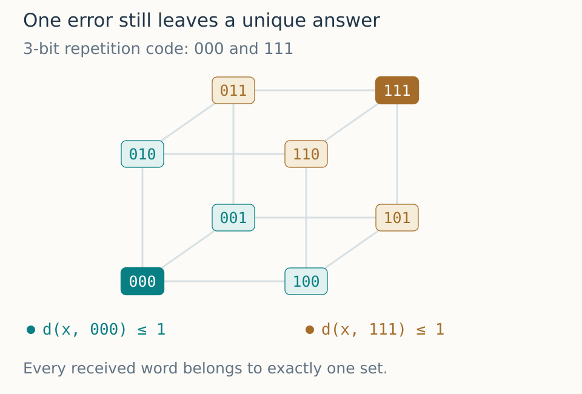
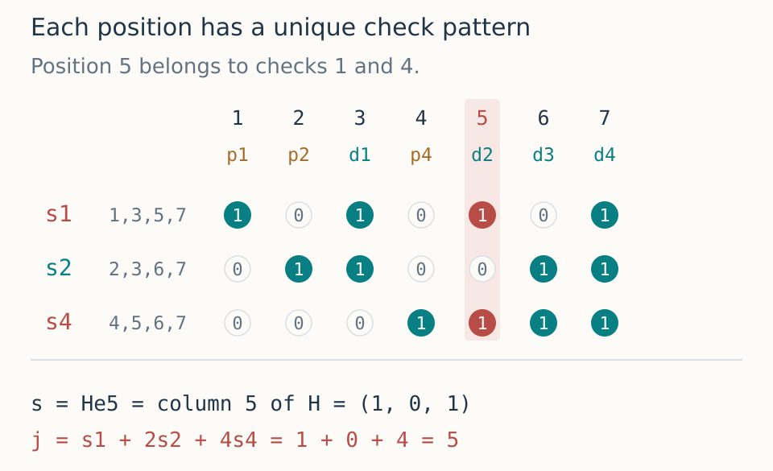
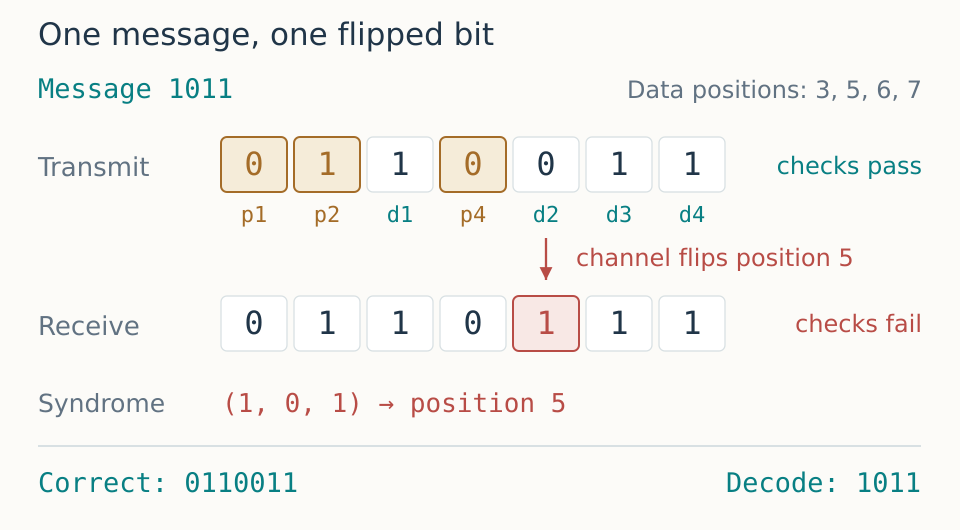
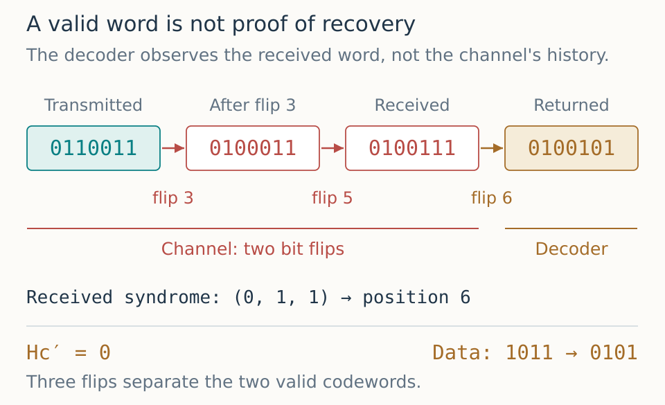

[Read in Korean]({{ site.baseurl }}/posts/Error-Correcting-Codes-From-Scratch-KR/) · [Python reference implementation]({{ site.baseurl }}/assets/code/error-correcting-codes.py) · [Executable notebook]({{ site.baseurl }}/assets/notebooks/error-correcting-codes-en.ipynb)

A receiver gets `1011`. Did the sender transmit `1011`, or did a bit flip in `1001`? If every four-bit string is a possible message, the received string alone cannot settle the question. A corrupted message can look exactly like another legitimate message.

Error correction changes what we transmit. Instead of allowing every transmitted string, we choose a smaller collection of valid strings, called **codewords**. A message is encoded as one of them. The unused strings give the receiver room to recognize and sometimes repair corruption.

The receiver is not given a separate correct answer to compare against. Instead, the transmitted bits obey relationships chosen before transmission. If those relationships are chosen carefully, their failures reveal the error's location.

For example, four information bits `1011` will become the seven-bit codeword `0110011`. After position 5 flips, the receiver sees `0110111`. Three parity checks identify position 5, allowing the receiver to recover the codeword and then the message. The guarantee is precise: this construction repairs **any one bit-flip in a seven-bit block**, including a flip in a check bit. Two flips require a different response.

## 1. Bits are vectors, but the arithmetic is different

A **bit** has value 0 or 1. For coding, addition wraps around after 1:

$$
\begin{aligned}
0+0&=0,&\qquad0+1&=1,\\
1+0&=1,&\qquad1+1&=0.
\end{aligned}
\tag{1}
$$

This is addition **modulo 2**, also called **XOR**, written $a\oplus b$. Multiplication is ordinary multiplication of 0 and 1. These operations form the two-element field $\mathbb F_2$: a field is a number system with the usual arithmetic rules and division by every nonzero element. Here the only nonzero element is 1, whose inverse is 1.

You can use familiar vector and matrix operations over $\mathbb F_2$, provided every sum uses this arithmetic. For example,

$$
\begin{pmatrix}1&1&0\\0&1&1\end{pmatrix}
\begin{pmatrix}1\\1\\0\end{pmatrix}
=\begin{pmatrix}0\\1\end{pmatrix}.
\tag{2}
$$

The first component is $1\cdot1+1\cdot1+0\cdot0=0$ modulo 2, not 2. In Python, `a ^ b` is XOR for bits, and `sum(values) % 2` computes the XOR of all the values.

Let $c$ be a transmitted codeword, $r$ the received vector, and $e$ an **error vector**: its $i$-th component is 1 exactly when position $i$ flips. Then

$$
r=c+e,\qquad c=r+e.
\tag{3}
$$

Addition and subtraction are the same because $1+1=0$. Repairing a known error means flipping the same bit again. The hard part is discovering $e$, not undoing it.

A **block code** encodes a fixed number $k$ of information bits into $n$ transmitted bits. Its **rate** is $R=k/n$: the fraction of transmitted bits used for information. The remaining $n-k$ bits are redundancy. The channel here changes bit values; it does not insert, delete, or reorder positions. Those are different error models. [MIT 6.02][mit]

The sender's **encoder** maps a message to a codeword. The receiver's **decoder** tries to recover the message from the possibly corrupted word. Both sides agree on the code and the position order; the receiver does not know which message the sender chose.

A **word** is simply a bit string of this block length; only the words permitted by the code are codewords.

## 2. Repetition works, at a cost

The three-bit **repetition code** uses only two codewords:

$$
0\longmapsto000,\qquad 1\longmapsto111.
\tag{4}
$$

Decode by majority vote. If `000` becomes `010`, the two zeros recover the intended bit. The same works for a flip at any of the three positions. If `000` becomes `110`, majority vote gives 1 and is wrong.

The rule is not “most copies must be right because they agree.” Its guarantee comes from an explicit assumption: **at most one bit flips in this block**. Under that assumption, two matching bits must be correct. The rate is only $1/3$; protecting four information bits separately takes twelve transmitted bits.

For a probabilistic version, assume a **binary symmetric channel**, or **BSC**: each transmitted bit flips independently with the same probability $p$. Unlike the one-flip bound, this model allows two or even three flips. The decoder still repairs every pattern with at most one flip; its failure probability counts the patterns outside that recovery budget. A three-bit majority decoder fails when exactly two or all three bits flip:

$$
\begin{aligned}
P_{\mathrm{fail},3}
&=\binom32p^2(1-p)+p^3\\
&=3p^2-2p^3.
\end{aligned}
\tag{5}
$$

There are three choices for the unflipped bit in the first term. The second term has only one pattern. At $p=0.1$, the decoded information-bit error probability is $0.028$, rather than the uncoded $0.1$. This is not the probability that the transmitted block contains an error: some corrupted blocks decode correctly. [IBM's classical repetition-code lesson][ibm]

<details markdown="1">
<summary>Why does repetition help only on one side of 1/2?</summary>

Subtract the uncoded error probability:

$$
P_{\mathrm{fail},3}-p
=p(1-p)(2p-1).
\tag{6}
$$

It is negative for $0<p<1/2$, zero at $p=0,1/2,1$, and positive for $1/2<p<1$. This is about the stated majority decoder. If a BSC is known to flip more often than not, inverting every received bit first produces a channel with flip probability $1-p$.

For odd $n$, the same counting gives

$$
P_{\mathrm{fail},n}
=\sum_{j=(n+1)/2}^{n}
\binom nj p^j(1-p)^{n-j}.
\tag{7}
$$

The binomial coefficient counts which $j$ positions flip. Independence supplies the product of probabilities. **Burst errors**, in which errors are concentrated in a short contiguous stretch of positions, need not follow this independent-flip formula: a disturbance that flips every copy together defeats majority vote.

</details>

The Python examples use only the standard library. Run them in order: later examples reuse the encoder and checks defined earlier. The downloadable module is an independent implementation with richer diagnostic results, rather than an identical function-by-function API.

```python
from math import comb

def repetition_failure(n, p):
    """Exact information-bit error probability for odd n on a BSC."""
    if n < 1 or n % 2 == 0 or not 0 <= p <= 1:
        raise ValueError("Use a positive odd n and 0 <= p <= 1")
    # Sum the probabilities of all patterns with a wrong majority.
    return sum(comb(n, j) * p**j * (1 - p)**(n - j)
               for j in range(n // 2 + 1, n + 1))

assert abs(repetition_failure(3, 0.1) - 0.028) < 1e-12
```

First flip one copy manually, then two. Change the repetition length and compare the exact BSC error probability with the rate. The manual experiment shows a particular error pattern; the probability calculation averages over independent random patterns.



## 3. One parity bit detects errors but cannot locate them

Instead of repeating everything, append the XOR of the information bits. This produces **even parity**: every valid codeword contains an even number of ones.

For message `1011`, append $1\oplus0\oplus1\oplus1=1$. The codeword is `10111`. The receiver XORs all five bits. A result of 1 means that the received word is not valid.

Four information bits now use five transmitted bits, giving rate $4/5$. The redundancy is shared across the message, rather than repeating each information bit separately. The saving comes with a different guarantee: one parity check can report a violation, but cannot say which bit to repair.

Why does this work? The transmitted total is 0. Every flip toggles that total. An odd number of flips gives 1; an even number gives 0. A single parity bit therefore detects every odd-weight error and misses every nonzero even-weight error. It does not identify a location. [University of Michigan EECS 373][michigan]

For a concrete failure, flip positions 2 and 4 of `10111`. The result is `11101`, which still has even parity. It is a valid encoding of the different message `1110`.

Even one detected error cannot be located from this check alone. All five possible single-bit errors produce the same answer, 1. We need more than one yes-or-no check, and those checks must give different answer patterns for different positions.

Try a flip in the parity bit itself, then two information-bit flips. The demonstration can compare with the original because it simulated the transmission. A real receiver has only the received word and the check result.



## 4. Distance explains both detection and correction

Repetition and parity fail in different-looking ways, but both depend on how many flips can turn one codeword into another. Counting those changes gives one criterion for comparing the two constructions.

The **Hamming distance** $d_H(u,v)$ counts the positions where equal-length bit strings differ. The **weight** $w(u)$ counts the ones in $u$. XOR marks exactly the differing positions, so

$$
d_H(u,v)=w(u+v).
\tag{8}
$$

For instance, `0110011` and `0110111` differ only at position 5, so their distance is 1. The distance between `000` and `111` is 3. Distance here counts bit changes, not the physical length of a line in a drawing.

For a codebook $C$ with at least two codewords, define its **minimum distance**:

$$
d_{\min}=\min_{u\ne v,\ u,v\in C}d_H(u,v).
\tag{9}
$$

Codewords must be separated because noise moves the received word away from the transmitted one. The separation determines how far it can move before another message becomes plausible. These are the standard distance criteria for block codes. [Hamming, 1950][hamming] [MIT 6.02][mit]

### Detecting up to t flips requires minimum distance at least t + 1

A receiver detects an error by checking whether $r$ belongs to $C$. If $1\le w(e)\le t<d_{\min}$, the corrupted word cannot be a different codeword: that would give two codewords closer than $d_{\min}$. Thus every such error is detected.

Conversely, if $d_{\min}\le t$, take two closest codewords. Flipping exactly their differing positions transforms one into the other with at most $t$ flips. The received word is valid, so codeword membership cannot reveal the corruption. Therefore

$$
\begin{gathered}
\text{detect up to }t\text{ flips}\\
\Longleftrightarrow\quad d_{\min}\ge t+1.
\end{gathered}
\tag{10}
$$

### Correcting up to t flips requires minimum distance at least 2t + 1

Correction is harder: the receiver must determine which codeword was sent. Consider all received words within distance $t$ of a codeword, its **Hamming ball** of radius $t$.

If a received word $r$ were within distance $t$ of two distinct codewords $u,v$, the triangle inequality would give

$$
\begin{aligned}
d_H(u,v)&\le d_H(u,r)+d_H(r,v)\\
&\le2t.
\end{aligned}
\tag{11}
$$

That is impossible when $d_{\min}>2t$. The balls are disjoint, so the receiver can select the unique codeword within radius $t$.

Conversely, if two codewords differ in $d\le2t$ positions, construct $r$ by taking roughly half of those positions from each. Its distances to them are $\lfloor d/2\rfloor$ and $\lceil d/2\rceil$, both at most $t$. The symbols round down and up to the nearest integers: for $d=3$, the two distances are 1 and 2. Either codeword could have produced $r$ within the permitted error budget. No decoder can always distinguish them. Hence

$$
\begin{gathered}
\text{correct up to }t\text{ flips}\\
\Longleftrightarrow\quad d_{\min}\ge2t+1.
\end{gathered}
\tag{12}
$$

This is an existence criterion for a decoder, not a statement that every decoding algorithm will work. One suitable rule is to return the unique codeword within the allowed radius and report failure if none exists.

The two earlier codes illustrate the distinction. Repetition has $d_{\min}=3$: its codewords `000` and `111` differ in three positions, so it corrects one flip. A single-parity code has $d_{\min}=2$: changing one position breaks parity, but changing two preserves it. It detects one flip but cannot correct every one-flip pattern.

<figure class="ecc-figure">
<picture class="rsna-results-figure">
<source media="(max-width: 560px)" srcset="" width="480" height="595">

</picture>
<figcaption markdown="span">Figure 1. Every edge changes one bit. The radius-one neighborhoods of `000` and `111` do not overlap. Allowing two flips makes some received words compatible with both messages.</figcaption>
</figure>

Select a received word and change the error budget. With budget 2, find a word that could have come from either codeword. This is ambiguity in the available information, not a weakness that a cleverer implementation can remove.



<details markdown="1">
<summary>Why is the triangle inequality true for bit strings?</summary>

At each position where $u$ and $v$ differ, $r$ cannot agree with both. That position contributes at least one to $d_H(u,r)+d_H(r,v)$. Summing over positions proves (11). There is no need to introduce Euclidean geometry or square roots.

</details>

## 5. How many check bits are needed to locate one error?

Suppose a block contains $n$ bits, including its check bits. A single-error decoder must distinguish $n+1$ possibilities: no flip, or a flip at any of the $n$ positions.

With $a$ binary checks, at most $2^a$ distinct check-result patterns are available. Consequently,

$$
2^a\ge n+1.
\tag{13}
$$

This count includes corruption of the check bits. They are transmitted through the same channel; treating them as magically reliable would change the problem.

With four information bits and $a$ check bits, the total length is $n=4+a$. Two check bits would give a six-bit block, but only four check-result patterns for seven possibilities. Three check bits are the first choice that can fit the required labels.

For four information bits and three check bits, $n=7$ and $2^3=8=n+1$. The count fits exactly. It does not by itself construct a working code: we still need checks whose patterns distinguish all seven positions.

There is also a code-independent counting argument. With $M$ codewords, every radius-one ball contains $1+n$ words. Disjoint balls must fit among the $2^n$ possible received strings:

$$
M(1+n)\le2^n.
\tag{14}
$$

For four information bits, $M=2^4=16$. At $n=6$, $16\cdot7>64$, so no fixed-length binary code can carry all sixteen messages in six bits and correct every single flip. At $n=7$, $16\cdot8=128=2^7$. The Hamming construction achieves this bound. [Hamming, 1950][hamming]

<details markdown="1">
<summary>The general Hamming bound, and a useful erasure comparison</summary>

A radius-$t$ ball contains $\sum_{j=0}^t\binom nj$ strings, since an error of weight $j$ chooses $j$ of the $n$ positions. Unique correction therefore requires

$$
M\sum_{j=0}^{t}\binom nj\le2^n.
\tag{15}
$$

This is a necessary bound, not a universal recipe for constructing a code that attains it.

An **erasure** is different from a flip: the receiver knows which position is unavailable, for example `01?0`. If at most $v<d_{\min}$ positions are erased, two codewords cannot agree on all the remaining positions; otherwise they would differ in at most $v$ positions. Thus up to $d_{\min}-1$ erasures can be uniquely recovered. Unknown error locations consume more separation than known missing locations. More generally, $2t+v<d_{\min}$ guarantees correction of up to $t$ unknown flips together with $v$ known erasures.

</details>

## 6. Build the checks from the binary position numbers

Number positions from 1 through 7. Assign the check bits to positions 1, 2, and 4, and put the four information bits in the remaining positions:

$$
c=(p_1,p_2,d_1,p_4,d_2,d_3,d_4)^T.
\tag{16}
$$

The superscript $T$ means transpose: this compact list represents a column vector. The label $p_4$ refers to position 4, not a fourth check bit.

Let the first check include positions whose binary label has its 1-bit set; let the second use the 2-bit; let the third use the 4-bit:

| Check | Positions included | Required XOR |
| :--- | :--- | :---: |
| $s_1$ | 1, 3, 5, 7 | 0 |
| $s_2$ | 2, 3, 6, 7 | 0 |
| $s_4$ | 4, 5, 6, 7 | 0 |

Position 5 has binary label `101`, so it belongs to checks 1 and 4, but not 2. Position 3 belongs to checks 1 and 2. Every position has a distinct nonempty combination of memberships. That is exactly the distinction we needed.

Positions 1, 2, and 4 have labels `001`, `010`, and `100`. Each therefore appears in exactly one of the three checks. Putting the parity bits there lets us choose each one to satisfy its own check without changing the other two checks.

For example, the first check requires $p_1+d_1+d_2+d_4=0$. Moving the information-bit terms to the other side uses the same modulo-2 addition. Solve each check equation for its own parity bit:

$$
\begin{aligned}
p_1&=d_1+d_2+d_4,\\
p_2&=d_1+d_3+d_4,\\
p_4&=d_2+d_3+d_4.
\end{aligned}
\tag{17}
$$

All sums are modulo 2. For message $m=(1,0,1,1)^T$, these give $p_1=0$, $p_2=1$, $p_4=0$, and therefore `0110011`. A code that leaves the information bits directly visible in known positions is called **systematic**. Check bits may be interleaved with information bits; systematic does not require a particular ordering. This position-number construction is the standard Hamming construction. [MIT 6.02, §6.4][mit]

```python
def as_bits(values, length):
    """Validate a bit sequence; strings such as '1011' are accepted."""
    values = tuple(values)
    if len(values) != length or any(
        not ((type(x) is int and x in (0, 1))
             or (type(x) is str and x in ("0", "1"))) for x in values
    ):
        raise ValueError(f"Expected {length} bits")
    return tuple(int(x) for x in values)

def encode_hamming(message):
    d1, d2, d3, d4 = as_bits(message, 4)
    # Each parity bit makes one overlapping check sum to zero.
    p1 = d1 ^ d2 ^ d4
    p2 = d1 ^ d3 ^ d4
    p4 = d2 ^ d3 ^ d4
    return (p1, p2, d1, p4, d2, d3, d4)

assert encode_hamming("1011") == (0, 1, 1, 0, 0, 1, 1)
```

## 7. A parity-check matrix collects the constraints

The parity-check matrix does not impose a new encoding rule. It collects the same three check equations into a single matrix equation:

$$
\begin{gathered}
H=\begin{pmatrix}
1&0&1&0&1&0&1\\
0&1&1&0&0&1&1\\
0&0&0&1&1&1&1
\end{pmatrix},\\
Hc=0.
\end{gathered}
\tag{18}
$$

$H$ is a **parity-check matrix**. A 1 in row $i$, column $j$ means that check $i$ includes position $j$. Matrix multiplication XORs the included bits. The rows are constraints; the columns describe how an error at each position affects those constraints.

The code is the **kernel**, or **null space**, of this matrix:

$$
\begin{aligned}
C&=\ker H\\
&=\lbrace c\in\mathbb F_2^7:Hc=0\rbrace.
\end{aligned}
\tag{19}
$$

Here $\mathbb F_2^7$ is the set of all seven-bit column vectors, and kernel simply means all inputs that the matrix sends to the zero vector. Because matrix multiplication is linear, the sum of two codewords is another codeword: $H(u+v)=Hu+Hv=0$. A codebook with this vector-space structure is a **linear code**. [MIT MAS 160/510 notes][matrix-notes]

Columns 1, 2, and 4 form the $3\times3$ identity matrix, so the three rows are independent and $\operatorname{rank}H=3$. The rank–nullity relation, just as in introductory linear algebra, gives

$$
\begin{gathered}
\dim C=7-3=4,\\
|C|=2^4=16.
\end{gathered}
\tag{20}
$$

The vertical bars mean number of elements. Four independent binary coordinates give two choices each, hence sixteen vectors—not infinitely many as in a four-dimensional real vector space.

The encoder is also a linear map. Write the four information bits as the message column $m=(d_1,d_2,d_3,d_4)^T$. In our **column-vector convention**, its **generator matrix** is $7\times4$:

$$
\begin{gathered}
G=\begin{pmatrix}
1&1&0&1\\
1&0&1&1\\
1&0&0&0\\
0&1&1&1\\
0&1&0&0\\
0&0&1&0\\
0&0&0&1
\end{pmatrix},\\
c=Gm.
\end{gathered}
\tag{21}
$$

Each column is the encoding of one basis message: `1000`, `0100`, `0010`, or `0001`. Each row reproduces the corresponding formula in (17), or copies an information bit. The dimensions now explain the operations: a $7\times4$ matrix encodes four coordinates into seven; a $3\times7$ matrix checks those seven coordinates.

For message `1011`, the first, third, and fourth entries of $m$ are 1, so $Gm$ XORs columns 1, 3, and 4 of $G$. The result is again `0110011`, exactly as in `encode_hamming`. The matrix and the Python function perform the same encoding calculation.

<details markdown="1">
<summary>Why do G and H describe exactly the same sixteen codewords?</summary>

The check equations give $HG=0$, so every generated vector lies in $\ker H$. Rows 3, 5, 6, and 7 of $G$ form the identity: different messages therefore produce different codewords, and $G$ has rank 4. Its image is a four-dimensional subspace inside the four-dimensional kernel of $H$. They must be equal.

Some books use row messages, writing $c=mG$ with a $4\times7$ generator matrix. That is the transposed convention. Neither is more correct; changing conventions halfway through a calculation is the mistake to avoid.

</details>

## 8. The syndrome removes the unknown message

The receiver does not know $c$, so it computes checks on $r$ instead. Their result is the **syndrome** $s$:

$$
\begin{aligned}
s&=Hr\\
 &=H(c+e)\\
 &=Hc+He=He.
\end{aligned}
\tag{22}
$$

This cancellation is the central idea. Every valid codeword satisfies the same constraints, so the syndrome depends only on the error vector. It does not require knowing which message was transmitted.

If just position $j$ flips, $e$ has a 1 there and zeros elsewhere; call this single-error vector $e_j$. For example, $e_5=(0,0,0,0,1,0,0)^T$. Multiplying by $H$ picks out its $j$-th column:

$$
s=h_j,
\tag{23}
$$

where $h_j$ names column $j$. The seven columns are distinct and nonzero. Thus a single flip gives its position's unique label; no flip gives the zero label. [MIT MAS 160/510 notes][matrix-notes]

<figure class="ecc-figure">
<picture class="rsna-results-figure">
<source media="(max-width: 560px)" srcset="" width="480" height="725">

</picture>
<figcaption markdown="span">Figure 2. A flip toggles exactly the checks containing its position. Column 5 therefore produces the syndrome (1, 0, 1).</figcaption>
</figure>

For the running example, the corrupted word is `0110111`. Its three checks are

$$
\begin{aligned}
s_1&=0+1+1+1=1,\\
s_2&=1+1+1+1=0,\\
s_4&=0+1+1+1=1.
\end{aligned}
\tag{24}
$$

We list the tuple in the order $(s_1,s_2,s_4)$ and recover the position by

$$
j=s_1+2s_2+4s_4.
\tag{25}
$$

It gives $j=5$. Be careful with binary display order: the ordinary binary numeral for $j$ is $s_4s_2s_1$, not the tuple order. For example, syndrome $(1,1,0)$ means position 3, whose ordinary binary label is `011`.

Flipping position 5 again gives `0110011`. Read information positions 3, 5, 6, and 7 to recover `1011`.

<figure class="ecc-figure">
<picture class="rsna-results-figure">
<source media="(max-width: 560px)" srcset="" width="480" height="820">

</picture>
<figcaption markdown="span">Figure 3. Encoding adds constraints before transmission. Decoding uses those constraints to infer the error under the one-flip assumption; it does not compare with a separately supplied original.</figcaption>
</figure>

```python
H = (
    (1, 0, 1, 0, 1, 0, 1),
    (0, 1, 1, 0, 0, 1, 1),
    (0, 0, 0, 1, 1, 1, 1),
)

def syndrome(received):
    r = as_bits(received, 7)
    # A dot product over F2: multiply entries, then reduce the sum mod 2.
    return tuple(sum(a * b for a, b in zip(row, r)) % 2 for row in H)

def decode_assuming_one_error(received):
    r = list(as_bits(received, 7))
    s1, s2, s4 = syndrome(r)
    j = s1 + 2 * s2 + 4 * s4
    if j:
        r[j - 1] ^= 1       # Position labels are 1-based; lists are 0-based.
    # Return information bits, not the parity bits or the entire codeword.
    return tuple(r[i] for i in (2, 4, 5, 6))

assert syndrome("0110111") == (1, 0, 1)
assert decode_assuming_one_error("0110111") == (1, 0, 1, 1)
```

Start in Hamming mode with a single flip. Try all seven positions, including parity positions. Then select the two-flip and three-flip presets. The experiment knows the injected error pattern; the decoder receives only the word and does not have that knowledge.

Keep the decoder on **Hamming (7,4)** for this experiment. **Extended (8,4)** adds an overall parity bit; its extra check is explained with SECDED below.



## 9. Prove that this code really has minimum distance 3

For a linear code, subtracting two codewords gives another codeword. Equation (8) therefore turns the minimum-distance problem into a minimum-weight problem:

$$
d_{\min}=\min_{c\in C,\ c\ne0}w(c).
\tag{26}
$$

Now use the columns of $H$ rather than checking every pair of codewords.

1. A weight-one vector cannot be a codeword: its syndrome is one nonzero column.
2. A weight-two vector cannot be a codeword: its syndrome is the sum of two different columns, which is nonzero over $\mathbb F_2$.
3. A weight-three codeword does exist. Columns 1, 2, and 3 sum to zero, so `1110000` satisfies $Hc=0$.

Thus $d_{\min}=3$, exactly. The notation **$[7,4,3]$** records length 7, dimension 4, and minimum distance 3. It corrects every one-flip error. A membership check alone also detects every two-flip error, but that does **not** mean a one-error correcting decoder can distinguish one flip from two.

The sixteen radius-one balls are disjoint, and each contains eight words. Together they fill all 128 possible seven-bit strings without overlap or gaps. A code whose decoding balls fill the whole space this way is called a **perfect code**. Every received word is one flip or less from some codeword, so a standard single-error decoder has no leftover received strings on which to declare “outside every decoding ball.”

## 10. Two errors can make the decoder confidently wrong

Transmit `0110011`, but flip positions 3 and 5. The receiver gets `0100111`. Its syndrome is

$$
s=h_3+h_5=h_6.
\tag{27}
$$

The one-error decoder interprets this as a flip at position 6. It flips that bit and returns `0100101`, a valid codeword for message `0101`, not the original `1011`.

<figure class="ecc-figure">
<picture class="rsna-results-figure">
<source media="(max-width: 560px)" srcset="" width="480" height="890">

</picture>
<figcaption markdown="span">Figure 4. The two red flips belong to the channel. The final flip belongs to the decoder. The resulting word passes every check but encodes the wrong message.</figcaption>
</figure>

This is **miscorrection**. The syndrome is not broken: it correctly reports which checks fail. What fails is the assumption that the syndrome came from one error. The same check result can describe different multi-bit patterns.

Even syndrome zero means only that $r$ is a codeword. Flipping positions 3, 5, and 6 transforms `0110011` directly into `0100101`, with no failed check. Consequently, labels such as “no error detected” are justified; “no error occurred” is not justified without an error bound.

```python
def flip_positions(word, *positions):
    result = list(word)
    for j in positions:
        if not 1 <= j <= len(result):
            raise ValueError("Position outside the word")
        result[j - 1] ^= 1
    return tuple(result)

sent = encode_hamming("1011")
two_errors = flip_positions(sent, 3, 5)
assert two_errors == tuple(map(int, "0100111"))
assert syndrome(two_errors) == (0, 1, 1)  # 0 + 2 + 4 = 6
assert decode_assuming_one_error(two_errors) == (0, 1, 0, 1)
assert syndrome(flip_positions(sent, 3, 5, 6)) == (0, 0, 0)
```

## 11. One more parity bit distinguishes one flip from two

The three checks locate a single error, but the same syndrome can also come from two errors. One and two flips differ in another way: one changes the parity of the whole word, while two preserve it. An overall parity check supplies this missing distinction.

Append an overall parity bit $q$ to the seven-bit Hamming codeword:

$$
\begin{gathered}
q=c_1+c_2+\cdots+c_7,\\
\widetilde c=(c_1,\ldots,c_7,q)^T.
\end{gathered}
\tag{28}
$$

Every eight-bit codeword now has even weight. The running codeword becomes `01100110`.

Its minimum distance is 4. To see why, compare two original codewords at distance $d\ge3$. If $d$ is even, their appended parity bits agree, leaving distance $d\ge4$. If $d$ is odd, the appended bits differ, raising the distance to $d+1\ge4$. Original codewords at distance 3 exist, so extended ones at distance 4 exist. This gives the **extended Hamming $[8,4,4]$ code**. Hamming's original paper also develops single-error correction combined with double-error detection. [Hamming, 1950][hamming]

At the receiver, compute $s$ from the first seven positions and compute $z$, the XOR of **all eight received bits**. Under the assumption of **at most two flipped bits per eight-bit block**, the cases are:

| $s$ | $z$ | Meaning and action |
| :---: | :---: | :--- |
| $s=0$ | 0 | No flips. Leave the word unchanged. |
| $s\ne0$ | 1 | One flip in positions 1–7. Correct the position named by $s$. |
| $s=0$ | 1 | Only position 8 flipped. Correct the overall parity bit. |
| $s\ne0$ | 0 | Two flips. Report an uncorrectable block; do not guess a message. |
{: .ecc-decision-table }

Why is the last row reliable? Two distinct flips among positions 1–7 produce two distinct columns whose sum is nonzero. If one flip is at position 8, the other produces a nonzero syndrome by itself. Either way, two flips keep the overall parity even while making $s$ nonzero.

This decoding policy is **SECDED**: single-error correction, double-error detection. It corrects one error and flags two, rather than trying to correct both. A distance-four code can detect every nonzero error of weight up to three **if used only as a membership detector**. A SECDED decoder that corrects singles cannot also distinguish every triple error from a single: both give overall check $z=1$. Detection capability and a combined correction policy are different claims.

For example, flips at positions 3, 5, and 6 leave the seven-bit syndrome zero but make the overall check $z=1$. These are the same check results as a single flip at position 8. The SECDED rule therefore flips the overall parity bit even though the first seven bits encode the wrong message.

Return to the [Hamming workbench](#lab-ecc-hamming) and select **Extended (8,4)**. Compare a flip at position 5, one at position 8, and the pair at positions 3 and 5. Then try three flips to see why the assumption belongs beside the decision table.

<details markdown="1">
<summary>A compact SECDED implementation</summary>

```python
def encode_extended(message):
    c = encode_hamming(message)
    return c + (sum(c) % 2,)

def decode_extended(received):
    """Classification is guaranteed for at most two flips in eight bits."""
    r = list(as_bits(received, 8))
    s1, s2, s4 = syndrome(r[:7])
    j = s1 + 2 * s2 + 4 * s4
    z = sum(r) % 2
    if j and not z:
        return None, "detected double error"  # Refuse to guess.
    if z:
        r[(j - 1) if j else 7] ^= 1
        status = "corrected code bit" if j else "corrected overall parity"
    else:
        status = "no error detected"
    return tuple(r[i] for i in (2, 4, 5, 6)), status

extended = encode_extended("1011")
assert extended == tuple(map(int, "01100110"))
assert decode_extended(flip_positions(extended, 5))[0] == (1, 0, 1, 1)
assert decode_extended(flip_positions(extended, 8))[1] == "corrected overall parity"
assert decode_extended(flip_positions(extended, 3, 5))[0] is None
```

</details>

## 12. Verify the complete small problem, not just one example

There are only sixteen possible four-bit messages. For each, test no error and all seven one-bit errors. That is $16(1+7)=128$ transmission cases. Unlike random testing, this exhausts the specified input and error model.

```python
from itertools import product, combinations

messages = list(product((0, 1), repeat=4))
codebook = [encode_hamming(m) for m in messages]
assert len(set(codebook)) == 16
assert all(syndrome(c) == (0, 0, 0) for c in codebook)

def distance(a, b):
    return sum(x != y for x, y in zip(a, b))

assert min(distance(a, b) for a, b in combinations(codebook, 2)) == 3

tested = 0
for m in messages:
    c = encode_hamming(m)
    for positions in [()] + [(j,) for j in range(1, 8)]:
        r = flip_positions(c, *positions)
        assert decode_assuming_one_error(r) == m
        tested += 1
assert tested == 128
print("Verified:", tested, "clean or single-flip cases")
```

For SECDED, test zero, one, and two flips at all eight positions: $16(1+8+\binom82)=592$ cases. The [downloadable reference and its executable examples]({{ site.baseurl }}/assets/code/error-correcting-codes.py) use the same convention and distinguish “correction attempted under the one-error model” from a guarantee that the original was recovered. The accompanying repository tests also check all 336 two-flip Hamming cases: the standard single-error decoder miscorrects each one.

Exhaustive checks validate these finite implementations. The distance and syndrome arguments explain why the construction works and how to extend it; the tests do not replace those arguments.

## 13. Practice: reason about what the receiver can know

### A. Why is repeating twice not enough?

Encode 0 as `00` and 1 as `11`. The receiver gets `01`, with at most one flip allowed. List the possible transmitted codewords. Would a deterministic tie-breaking rule make both possibilities safe?

<details markdown="1">
<summary>Answer</summary>

Both are possible: `00` with a flip at position 2, or `11` with a flip at position 1. Choosing either must be wrong for the other transmission. The minimum distance is 2, below the 3 needed for one-error correction. A tie-breaking rule produces an answer; it does not create missing information.

</details>

### B. Decode a syndrome without reversing its order

The receiver gets `0010011`. Calculate $(s_1,s_2,s_4)$, locate the error, and recover the four information bits, assuming at most one flip. Use the check memberships in Figure 2 rather than comparing with the running example.

<details markdown="1">
<summary>Answer</summary>

The syndrome is $(0,1,0)$, so $j=2$. Flipping position 2 gives `0110011`; information positions 3, 5, 6, and 7 give `1011`. A parity bit was corrupted, but the same rule corrects it.

</details>

### C. Can a valid result certify the correction?

In Figure 4, `0100111` becomes `0100101` after a decoder flip. Every check now passes. What additional fact would justify claiming that the transmitted message has been recovered?

<details markdown="1">
<summary>Answer</summary>

The one-error guarantee needs at most one channel flip. Passing checks alone establishes only that the output is a codeword. In the illustrated transmission there were two flips, so the guarantee does not apply and the output is wrong. An independent stronger integrity check can provide additional evidence, but the same three parity checks cannot certify their own decoding assumption.

</details>

### D. Explain a SECDED refusal

In extended mode, transmit `01100110` and flip positions 3 and 5. What are $s$ and $z$? Why should the decoder refuse the correction that ordinary Hamming mode proposes?

<details markdown="1">
<summary>Answer</summary>

$s=(0,1,1)$ and $z=0$. The syndrome points to 6 under a one-error assumption, but even overall parity rules out exactly one flip. With at most two flips allowed, the only remaining possibility is two. SECDED detects this case and returns no message rather than miscorrecting.

</details>

The challenge guarantees exactly one flipped bit. Find its position, then recover the message. Use the hint to inspect the checks before revealing the answer. This guarantee is part of the problem; the decoder cannot infer it merely from a nonzero syndrome.



## 14. Coding exercise: decode without a 16-word lookup table

Implement `decode_single(received)`. The input is a tuple of seven bits in the position order $(p_1,p_2,d_1,p_4,d_2,d_3,d_4)$. It was produced by the encoder above, followed by **at most one flip**. Return the original four information bits as a tuple. A clean block must also work.

You may calculate the three parity checks directly or use a position-label XOR. Do not enumerate the sixteen codewords. A single pass over the received positions and constant extra storage are enough for this fixed seven-bit code.

```python
def decode_single(received):
    # Exercise starter. Preserve the original input.
    # 1. Find the syndrome's position label.
    # 2. Correct one bit if the label is nonzero.
    # 3. Extract positions 3, 5, 6, and 7.
    raise NotImplementedError("Complete the decoder")
```

The following test function accepts your implementation. Run it after completing the starter; it checks all 128 permitted transmissions, including errors in parity bits.

```python
def check_decoder(candidate):
    total = 0
    for m in product((0, 1), repeat=4):
        c = encode_hamming(m)
        for positions in [()] + [(j,) for j in range(1, 8)]:
            r = flip_positions(c, *positions)
            before = tuple(r)
            assert candidate(r) == m, (m, positions, r)
            assert r == before, "Do not mutate the input"
            total += 1
    return total

# After filling in the starter:
# assert check_decoder(decode_single) == 128
```

<details markdown="1">
<summary>Hint: each set bit contributes its position label</summary>

The syndrome is the sum of the columns corresponding to received 1-bits. Column $j$ is the three-bit label for $j$. Adding those columns over $\mathbb F_2$ is exactly the bitwise XOR of their integer labels. In Python, `label ^= j` XORs all three binary digits in parallel; it is not addition of the position numbers.

</details>

<details markdown="1">
<summary>Reference solution and proof</summary>

```python
def decode_single_reference(received):
    r = list(as_bits(received, 7))
    label = 0
    for j, bit in enumerate(r, start=1):
        if bit:
            label ^= j       # XOR labels, not bits or arithmetic positions.
    if label:
        r[label - 1] ^= 1
    return tuple(r[i] for i in (2, 4, 5, 6))

assert check_decoder(decode_single_reference) == 128
```

For a valid codeword, the XOR of the set-bit position labels is zero because $Hc=0$. Flipping position $j$ adds exactly label $j$, whether the bit changes from 0 to 1 or from 1 to 0: XORing the same label twice cancels it. Thus the accumulated label is zero for a clean block or the unique flipped position otherwise. Correcting it restores the codeword, and extracting the information positions restores the message.

The reference uses a different function name so running it does not overwrite your unfinished exercise.

</details>

## 15. What changes in larger systems?

The small code exposes three general design choices: which error patterns matter, how much redundancy is affordable, and what the decoder should do when evidence is insufficient.

**Longer Hamming codes.** Use all distinct nonzero $a$-bit columns as a parity-check matrix. There are $n=2^a-1$ columns, its rank is $a$, and the code has parameters $[2^a-1,\,2^a-1-a,\,3]$ for $a\ge2$. The single-error argument is unchanged. The rate approaches 1 as blocks grow, but the guarantee remains only one flipped bit per block. High rate does not mean a growing correction budget.

**Bursts and interleaving.** A burst can place several flips in one codeword. An interleaver rearranges bits from different codewords before transmission, potentially spreading a burst across several blocks after the inverse permutation. It adds no correction by itself; its benefit depends on the burst pattern and the underlying code. [MIT 6.02][mit]

**Reed–Solomon codes.** These operate on symbols from a larger finite field—a field with finitely many elements—rather than treating each bit as one symbol. A symbol may represent a byte, a group of eight bits. QR codes use Reed–Solomon redundancy, according to their developer DENSO WAVE. Their advertised restoration levels concern codewords, not a guarantee that any equally sized geometric region of the printed image can be destroyed. [DENSO WAVE][qr]

<details markdown="1">
<summary>Why a polynomial can protect symbols</summary>

A polynomial's **degree** is its largest exponent with a nonzero coefficient; for example, $a_0+a_1x+a_2x^2$ has degree 2 when $a_2\ne0$. A degree-less-than-$k$ polynomial is determined by its values at $k$ distinct points over a field. Encode its $k$ coefficients by evaluating it at $n$ distinct field elements, with $1\le k\le n$. Two different such polynomials differ by a nonzero polynomial of degree at most $k-1$, which has at most $k-1$ distinct roots. Their evaluation vectors therefore differ in at least $n-k+1$ places.

This evaluation construction has minimum distance exactly $n-k+1$: a polynomial with roots at $k-1$ selected evaluation points attains that distance. Consequently it can correct up to $\lfloor(n-k)/2\rfloor$ unknown symbol errors, or up to $n-k$ erasures. A larger alphabet changes what counts as one error; it does not evade the distance argument.

The polynomial root bound follows by repeatedly factoring out $(x-a)$ for a root $a$: each distinct root consumes one degree. Finite-field arithmetic is needed to turn these observations into a practical byte-based encoder; ordinary integer arithmetic modulo 256 is **not** a field. This evaluation viewpoint comes from Reed and Solomon's original construction. [Reed and Solomon, 1960][rs]

</details>

**Integrity is not authenticity.** Error-correcting codes protect against specified corruption patterns. Their public constraints do not prevent an adversary from replacing a codeword with another valid codeword. Cryptographic authentication addresses a different question: whether data came from an authorized sender without unauthorized modification. Passing parity checks does not establish that.

## 16. The essential idea

Without redundancy, every received string is a possible original. Encoding restricts legitimate strings; minimum distance separates them. Parity checks express that restriction as linear equations, and the syndrome cancels the unknown message to expose information about the error.

The Hamming decoder can repair a bit because each one-bit error has its own syndrome—not because the receiver somehow knows the original. Once several error patterns share the same syndrome, that knowledge is no longer available. A useful decoder must make its assumptions explicit and sometimes refuse to return a message.

## References and executable material

1. **R. W. Hamming (1950), “Error Detecting and Error Correcting Codes.”** *Bell System Technical Journal* 29(2), 147–160. [DOI][hamming] · [Paper scan][hamming-pdf]. Original distance, redundancy, and single-error-correcting constructions.
2. **MIT 6.02, Chapter 6, “Coping with Bit Errors using Error Correction Codes.”** [Lecture notes][mit]. Repetition, distance, parity checks, Hamming construction, and burst-error considerations.
3. **MIT MAS 160/510, “Additional Notes: Error-Correcting Codes.”** [Matrix derivation][matrix-notes]. Linear encoding, parity-check matrices, and syndrome decoding. Matrix orientation may differ from the column convention used here.
4. **IBM Quantum Learning, “Repetition codes,” classical sections.** [Lesson][ibm]. Classical majority decoding and its error probability under independent bit flips. The quantum sections concern additional error types and are not needed here.
5. **University of Michigan EECS 373, “Error detecting and correcting codes.”** [Course notes][michigan]. Parity and the distinction between detection and correction.
6. **DENSO WAVE, “Error Correction Feature.”** [QR code documentation][qr]. Reed–Solomon use and the meaning of restoration levels.
7. **I. S. Reed and G. Solomon (1960), “Polynomial Codes Over Certain Finite Fields.”** *Journal of the Society for Industrial and Applied Mathematics* 8(2), 300–304. [DOI](https://doi.org/10.1137/0108018) · [Paper scan][rs]. The polynomial-evaluation construction underlying the optional example.
8. **Companion implementation.** [Standard-library Python]({{ site.baseurl }}/assets/code/error-correcting-codes.py) · [Executed notebook]({{ site.baseurl }}/assets/notebooks/error-correcting-codes-en.ipynb) · [Source repository](https://github.com/pilkwangkim/pilkwangkim.github.io). The repository file `tools/test_error_correcting_codes.py` checks matrices, distances, decoder guarantees, and counterexamples.

[hamming]: https://doi.org/10.1002/j.1538-7305.1950.tb00463.x
[hamming-pdf]: https://zoo.cs.yale.edu/classes/cs323/doc/Hamming.pdf
[mit]: https://web.mit.edu/6.02/www/f2011/handouts/6.pdf
[matrix-notes]: https://courses.media.mit.edu/2007fall/mas160/error.pdf
[ibm]: https://quantum.cloud.ibm.com/learning/en/courses/foundations-of-quantum-error-correction/correcting-quantum-errors/repetition-codes
[michigan]: https://www.eecs.umich.edu/courses/eecs373.w05/lecture/errorcode.html
[qr]: https://www.qrcode.com/en/about/error_correction.html
[rs]: https://sites.math.rutgers.edu/~zeilberg/akherim/ReedS1960.pdf
