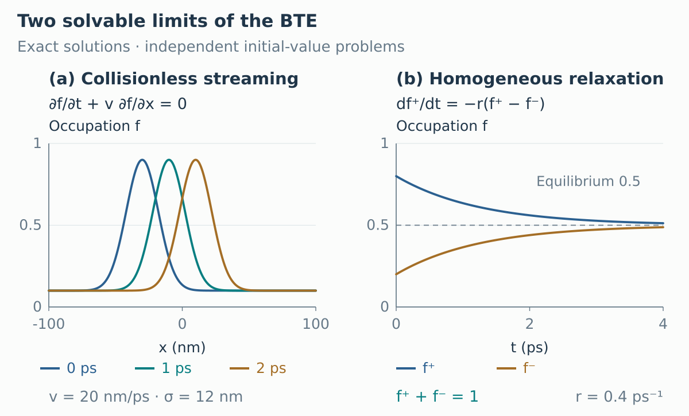
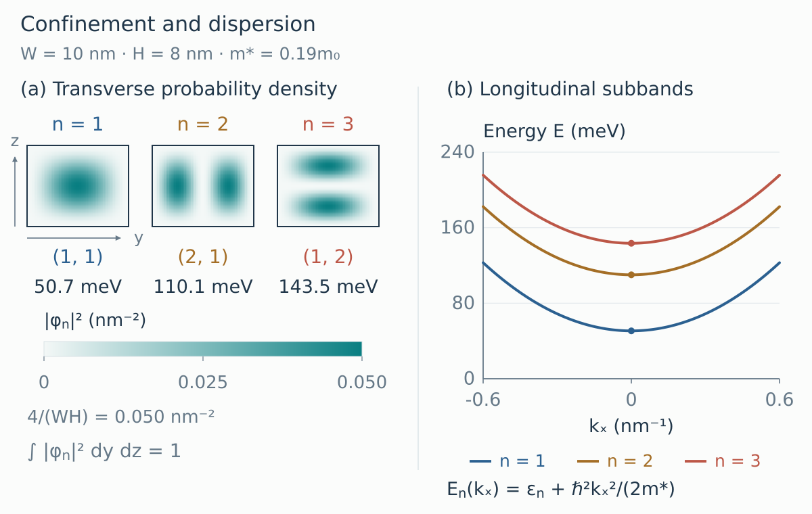
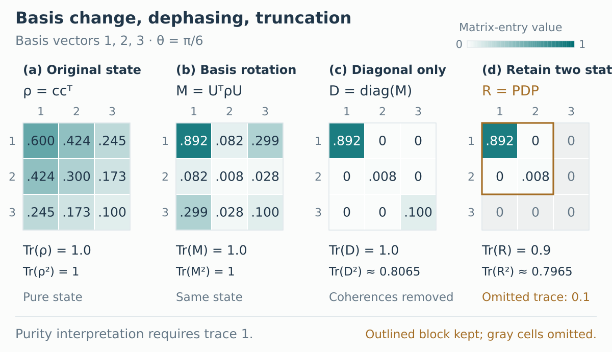
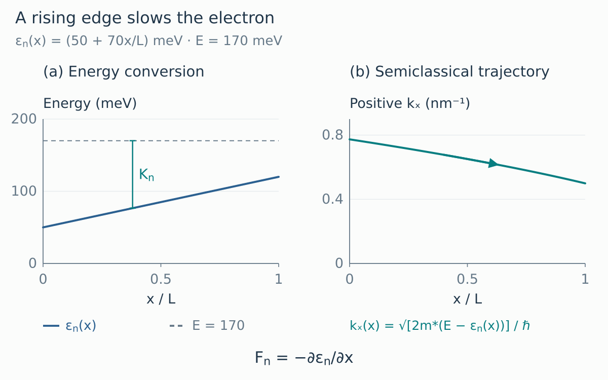
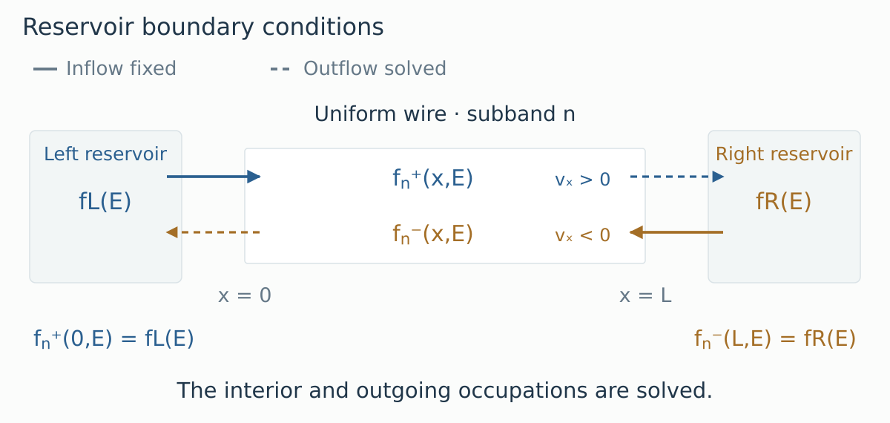
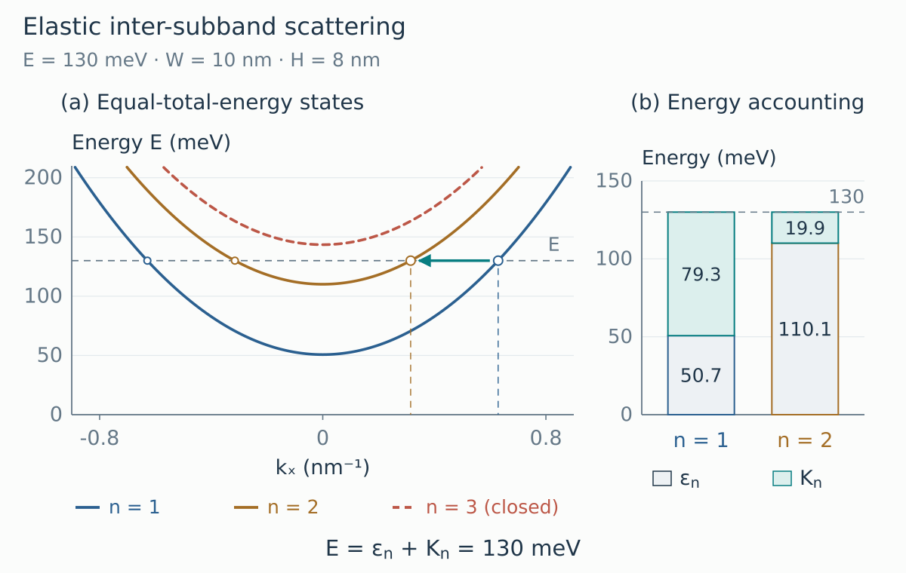
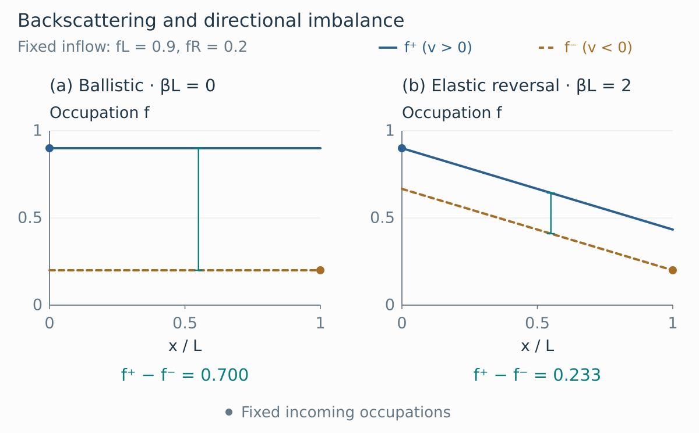

[Read in English]({{ site.baseurl }}/posts/Multi-Subband-Boltzmann-Transport-From-Scratch/) · [Python reference]({{ site.baseurl }}/assets/code/multi-subband-bte.py) · [Executable notebook]({{ site.baseurl }}/assets/notebooks/multi-subband-bte-ko.ipynb)

전자가 가질 수 있는 에너지만 알아서는 전류를 구할 수 없다. 각 state에 전자가 얼마나 있는지, 그 전자들이 어느 방향으로 얼마나 빠르게 움직이는지, collision을 겪으면 어떤 state로 바뀌는지도 알아야 한다. 전자의 이동과 collision으로 각 state의 occupation이 어떻게 달라지는지 나타내는 식이 **Boltzmann transport equation(BTE)**이다.

좁은 wire에서는 단면을 가로지르는 transverse 방향으로 전자의 운동이 제한된다. 그 결과 이 방향의 에너지는 discrete level로 나뉘며, 각 transverse state를 mode 번호로 구분한다. 반면 wire를 따라가는 longitudinal 방향의 운동은 많은 경우 위치와 wavevector로 나타낼 수 있다. 이렇게 구한 state에 Boltzmann kinetics를 적용한 식이 **multi-subband Boltzmann transport equation(MS-BTE)**이다. BTE와 별개의 이론이 아니라, confinement를 반영한 quantum state에 대해 쓴 Boltzmann 방정식이다. [Noei et al., Sec. 2][noei]

같은 state를 다른 basis로 표현하는 것, 영향이 작다고 판단한 물리적 효과를 무시하는 것, 계산에 포함할 mode 수를 제한하는 것은 서로 다르다. **Basis change, 물리적 근사, numerical truncation**을 구분해야 MS-BTE에서 무엇을 계산하고 무엇을 생략하는지, 어떤 조건에서 계산량을 줄일 수 있는지 알 수 있다.

## 1. 이동과 collision을 함께 계산하는 BTE

먼저 전자의 운동을 한 공간 좌표로 나타내고, 그 좌표를 $x$로 두자. 시간 $t$에 위치 $x$, wavevector $k$ 부근의 local state가 얼마나 채워져 있는지 **spin 하나에 대해** $f(x,k,t)$로 나타낸다. 이 값에는 단위가 없으며, fermion에서는 $0\le f\le1$이다. Occupation이 0.3이면 같은 조건으로 준비하고 측정하는 실험을 반복했을 때 그 state에 전자가 있을 확률이 30%라는 뜻이다. 소자 안의 전체 전자 중 30%가 그곳에 있다는 뜻은 아니다. 가능한 모든 state의 occupation을 더하면 평균 전자 수가 된다. 이 합을 1로 normalization하지는 않는다.

위치와 momentum을 함께 좌표로 쓰는 공간을 **phase space**라고 한다. 여기서 momentum 변수는 $\hbar k$다. 각 좌표는 특정 위치와 momentum 부근에 모인 wavepacket이나 state 집합을 나타낸다. 두 물리량의 정확한 eigenvalue를 동시에 정한다는 뜻은 아니다. **Semiclassical description**에서는 에너지와 scattering 확률은 양자역학으로 구하고, collision 사이의 이동은 wavepacket 중심의 근사적인 운동식으로 계산한다. Packet 안에서 potential이 거의 변하지 않을 만큼 packet의 공간적 크기가 작아야 한다. 동시에 위치와 momentum의 분포 폭은 uncertainty relation을 만족해야 한다. [Xiao, Chang, and Niu, Secs. IV–V][wavepacket]

Packet의 velocity가 $v$이고 force $F$가 작용하면 $\dot x=v$, $\hbar\dot k=F$다. 가장 간단한 1차원 BTE는 다음과 같다.

$$
\underbrace{\partial_t f}_{\text{local change}}
+\underbrace{v\partial_x f}_{\text{motion in position}}
+\underbrace{\frac{F}{\hbar}\partial_k f}_{\text{motion in momentum}}
=\underbrace{C[f]}_{\text{collisions}}.
\tag{1}
$$

각 항의 단위는 시간의 역수다. Collision 항은 force가 아니라, collision 때문에 occupation이 변하는 속도다. 한 state의 occupation이 줄었다고 해서 전자가 사라졌다는 뜻은 아니다. 다른 state로 옮겨 갔을 수도 있다. 예를 들어 state 수를 세는 가중치인 state-counting weight가 같은 두 state 사이에서 전자가 에너지를 보존하며 오가는 **elastic exchange**를 생각하자. 도착 state가 이미 채워져 이동이 제한되는 효과를 아직 반영하지 않은 계수를 unblocked rate coefficient라고 한다. 이 계수가 양방향에서 같은 $r$이면 **reciprocal exchange**다. 첫 번째 state의 occupation 변화율은 $r(f_2-f_1)$이 된다. Gain과 loss를 각각 계산할 때는 이미 채워진 state로 전자가 들어가지 못하는 Pauli blocking도 반영해야 한다. 이 두 항을 뺄 때 Pauli factor가 상쇄되는 과정과, state-counting weight가 다를 때의 계산은 뒤의 collision model에서 확인할 수 있다.

식의 왼쪽은 packet의 **trajectory를 따라 occupation이 변하는 속도**를 편미분으로 풀어 쓴 것이다. 위치와 wavevector $x,k$를 독립변수로 두고, 각 편미분에서는 미분하는 변수를 제외한 나머지를 고정한다. Collision이 없으면 trajectory를 따라 움직이며 본 occupation은 일정하다. 반면 한 위치에서 관찰하면 profile의 다른 부분이 차례로 지나가므로 occupation이 바뀔 수 있다. **Stationary** solution에서는 $\partial_t f=0$이다. 각 위치에서 분포가 시간에 따라 변하지 않는다는 뜻이지, 전자의 velocity나 전류까지 0이라는 뜻은 아니다.

<details markdown="1">
<summary>이동을 나타내는 미분 항이 두 개 생기는 이유</summary>

Collision이 없으면 전자의 trajectory를 따라 occupation이 일정하게 유지된다. 짧은 시간 $dt$ 동안의 변위를 1차까지 쓰면 $(\dot x\,dt,\dot k\,dt)$이므로

$$
f(x+\dot x\,dt,k+\dot k\,dt,t+dt)=f(x,k,t)+\mathcal O(dt^2).
\tag{2}
$$

왼쪽을 1차 Taylor expansion한 뒤 $f(x,k,t)$를 빼고 $dt$로 나눈다. 여기서 $dt\to0$으로 보내면 $\partial_t f+\dot x\,\partial_x f+\dot k\,\partial_k f=0$을 얻는다. Collision이 있을 때 오른쪽에 그로 인한 occupation 변화율을 넣으면 식 (1)이 된다. 왼쪽의 미분 항들은 chain rule에서 나온 것이며, 전자를 새로 생성하는 항이 아니다.

</details>

BTE는 정확한 quantum dynamics의 변수만 바꾼 식이 아니다. 선택한 state, semiclassical 운동식, collision 근사에 따라 적용 범위가 달라진다. 수치 오차를 줄여도 모델에서 생략한 quantum 정보가 복원되지는 않는다. 또한 BTE에서 bulk plane-wave state만 써야 하는 것도 아니다. Quantum confinement를 포함한 state에서 에너지와 transition rate를 구한 뒤 kinetic equation을 구성할 수 있다. [Milovanović, Sec. 4.2][kinetics]

## 2. 손으로 확인할 수 있는 두 가지 BTE 해

코드를 직접 수정해 실행하려면 Python 3.9+와 NumPy가 필요하다. Python 환경에서 `python3 -m pip install numpy`로 NumPy를 설치한 뒤 본문의 코드를 순서대로 실행하거나, executable notebook을 사용하면 된다. Browser 실습에는 Python 설치가 필요 없다.

### Free flight: 모양을 유지한 채 이동하는 profile

$F=0$, $C=0$으로 두고, 하나의 $k$를 고정해 그때의 occupation profile을 보자. 이때 velocity도 일정하다. 초기 profile이 $g(x)$라면

$$
f(x,k,t)=g(x-vt),\qquad
\partial_t f=-v g'(x-vt),\quad
v\partial_x f=v g'(x-vt).
\tag{3}
$$

두 미분 항은 상쇄된다. 여기서 이동하는 것은 **occupation profile**이다. 전자 하나의 wavefunction을 절댓값 제곱한 값이 아니다. $x$의 단위를 nanometre로 두고 $v=20\,\mathrm{nm/ps}$, $g(x)=0.1+0.8\exp[-(x+30)^2/(2\times12^2)]$를 사용하자. Picosecond는 $10^{-12}$초다. Peak의 위치는 $t=0,1,2\,\mathrm{ps}$일 때 각각 $-30$, $-10$, $10\,\mathrm{nm}$이고, 높이는 0.9로 일정하다. 이 free-flight 문제에는 contact나 wall이 없다.

### Directional relaxation: spatial gradient 없이 변하는 occupation

이번에는 에너지와 speed가 같고 진행 방향만 반대인 두 state를 생각하자. 각 state의 occupation은 위치에 따라 달라지지 않는다고 가정한다. Force는 없고 spatial derivative도 0이다. 전자가 elastic collision으로 방향을 바꾸며, 그 unblocked rate coefficient가 양방향에서 같은 $r$이면

$$
\begin{aligned}
\frac{df_+}{dt}&=r(f_--f_+),&
\frac{df_-}{dt}&=r(f_+-f_-),\\
\frac{d(f_++f_-)}{dt}&=0,&
\frac{d(f_+-f_-)}{dt}&=-2r(f_+-f_-).
\end{aligned}
\tag{4}
$$

이다. 두 occupation의 합은 보존되지만, 진행 방향에 따른 차이는 줄어든다. $f_+(0)=0.8$, $f_-(0)=0.2$이면

$$
f_\pm(t)=0.5\pm0.3e^{-2rt}.
\tag{5}
$$

$r=0.4\,\mathrm{ps}^{-1}$이면 occupation 차이는 $1/(2r)=1.25\,\mathrm{ps}$가 지날 때마다 $e^{-1}$배로 줄어든다. 합이 1인 것은 선택한 초기값 때문이지, 모든 distribution을 그렇게 normalization해야 해서가 아니다. 두 state의 weight가 같으므로 이 합이 보존되면 전자 수도 보존된다. 앞의 free flight와 이 relaxation은 서로 다른 초기 조건과 방정식을 갖는 두 문제다. **위치에 따라 변하는 scattering 문제 하나를 두 패널에 나눠 그린 것이 아니다.**

```python
import numpy as np

def packet_occupation(x_nm, t_ps):
    # Fixed-k slice: streaming shifts the centre, not the occupation amplitude.
    centre_nm = -30.0 + 20.0 * t_ps
    return 0.1 + 0.8 * np.exp(-(np.asarray(x_nm) - centre_nm)**2 / (2 * 12.0**2))

def relaxing_pair(t_ps, rate_per_ps=0.4):
    # Uniform equal-speed branches: no streaming term or contact boundary data.
    imbalance = 0.6 * np.exp(-2 * rate_per_ps * np.asarray(t_ps))
    return 0.5 + imbalance / 2, 0.5 - imbalance / 2

assert np.isclose(packet_occupation(10.0, 2.0), 0.9)
t = np.linspace(0, 4, 41)
fp, fm = relaxing_pair(t)
assert np.allclose(fp + fm, 1.0)
assert np.allclose(fp - fm, 0.6 * np.exp(-0.8 * t))
print("At 1.25 ps:", np.round(relaxing_pair(1.25), 4))
```

<figure class="msbte-figure">
<picture class="rsna-results-figure">
<source media="(max-width: 560px)" srcset="" width="600" height="1330">

</picture>
<figcaption markdown="span">그림 1. 왼쪽에서는 collision 없이 occupation profile이 이동한다. 오른쪽에서는 전자가 양방향으로 같은 rate coefficient에 따라 방향을 바꾸면서 두 occupation의 차이가 줄어든다. 왼쪽 문제에는 collision이 없고, 오른쪽 문제에는 spatial gradient가 없다. 두 exact solution으로 각각 streaming 항과 collision 항의 구현을 검증할 수 있다.</figcaption>
</figure>



Free-flight mode에서는 시간을 바꾸며 peak를 따라가 보자. Relaxation mode에서는 collision rate가 0일 때와 0이 아닐 때를 비교해 보자. 각 문제에서 변하지 않는 양은 무엇일까?

## 3. BTE를 직접 계산할 때 연산량이 커지는 이유

3차원 bulk model의 distribution은 $f_b(\mathbf r,\mathbf k,t)$다. 위치 좌표 세 개, wavevector 좌표 세 개, 시간, band 번호 $b$가 필요하다. **Band**는 wavevector에 따라 달라지는 에너지 곡선이나 곡면 하나를 뜻한다. 같은 wavevector에서도 서로 다른 band의 state는 에너지가 다를 수 있다. 이 **one-particle distribution**은 phase-space 변수 여섯 개와 시간에 의존한다. 전자 $N$개의 위치를 하나씩 나열한 $3N$개 좌표를 사용하는 것은 아니다. Band 하나에 대한 방정식은 다음과 같다.

$$
\partial_t f_b+
\mathbf v_b\cdot\nabla_{\mathbf r}f_b+
\frac{\mathbf F_b}{\hbar}\cdot\nabla_{\mathbf k}f_b
=C_b[\lbrace f_{b'}\rbrace].
\tag{6}
$$

중괄호는 collision이 일어나면 다른 band나 momentum의 occupation도 이 collision 항에 영향을 준다는 뜻이다. **BTE를 푸는 데 정해진 basis나 계산 방법이 하나만 있는 것은 아니다.** Deterministic solver에서는 distribution 값이나 basis에 대한 전개 계수를 직접 구한다. Monte Carlo solver에서는 trajectory와 scattering event를 sampling해 distribution을 추정한다. 둘 다 Boltzmann model을 푸는 방법이다. [Rupp, Grasser, and Jüngel][bulk]

Solver를 구성하기 전에도 저장 공간이 얼마나 필요한지 가늠할 수 있다. Cartesian grid를 직접 사용하면

$$
N_{\rm full}=N_xN_yN_zN_{k_x}N_{k_y}N_{k_z}
\quad\hbox{occupation values per band and time slice}.
\tag{7}
$$

각 축에 점을 100개씩 두면 값이 $10^{12}$개다. 저장 용량을 십진 단위로 나타내면 float64 array 하나에만 $8\,\mathrm{TB}$가 필요하다. Boundary data와 collision coefficient를 저장하고, linear system과 electrostatics를 계산하는 데는 메모리와 연산이 더 필요하다. 모든 BTE solver가 이 grid를 통째로 저장하는 것은 아니다. Sampling, symmetry, adaptive resolution, angular expansion을 활용하면 거대한 grid를 직접 구성하지 않아도 된다. Collision operator가 local하면 서로 다른 모든 공간 grid point를 연결할 필요도 없다. [Rupp et al.][bulk]

좁은 wire에서는 몇 개의 transverse quantum mode만으로도 transport에 중요한 state를 충분히 표현할 수 있는 경우가 있다. 이때는 transverse phase space를 촘촘한 grid로 나누는 대신 mode 번호로 구분해 저장량을 크게 줄일 수 있다. Population model에 필요한 occupation 값은 약 $N_xN_kN_s$개다. $N_x=N_k=100$, $N_s=10$이면 값이 $10^5$개이므로 $0.8\,\mathrm{MB}$다.

```python
full_values = 100**6
subband_values = 100 * 100 * 10
print(f"Direct tensor-grid storage: {8 * full_values / 1e12:.1f} TB")
print(f"Ten-mode occupation storage: {8 * subband_values / 1e6:.1f} MB")
```

위 계산은 **두 표현 방식에서 occupation array에 필요한 메모리**만 비교한 것이다. 같은 정확도로 계산한 두 simulation의 실행 시간을 비교한 결과는 아니다. 작은 occupation array로 충분하려면 longitudinal semiclassical 근사와 population 근사가 잘 맞아야 하고, 계산에 포함한 mode만으로 density와 전류가 충분히 수렴해야 한다. 모든 mode를 포함해 quantum state를 전개하면 원래 정보는 보존되지만, basis만 바꾼다고 계산량이 자동으로 줄어들지는 않는다.

## 4. Transverse energy level에서 subband가 생기는 과정
{: id="1-transverse-energy-level에서-subband가-생기는-과정" }

Transverse momentum을 연속 변수로 두고 wall에서의 반사를 classical하게 계산한다면, bulk BTE의 grid를 아무리 세분화해도 quantum confinement는 얻을 수 없다. Classical reflection은 velocity 성분의 부호를 바꾸지만, wavefunction에 경계조건을 적용해 standing wave를 구하는 과정은 아니다. Confinement를 반영하려면 **가능한 state와 그 에너지**부터 quantum 문제를 풀어 구해야 한다.

큰 electron reservoir 두 개에 연결된 직사각형 단면의 wire를 생각하자. Transport 방향은 $x$, 단면의 좌표는 $y,z$, 두 contact 사이의 거리는 $L$이다. 수치 예제에서는 단면과 potential energy를 미리 정하고, 둘 다 $x$에 따라 변하지 않는다고 가정한다. 전자 분포가 바뀌어도 potential은 다시 계산하지 않는다. 각 state의 occupation은 contact에서 들어오는 전자와 wire 내부의 scattering에 따라 달라질 수 있다.

세 방향 모두 **effective mass** $m^*=0.19m_0$를 사용하자. $m_0$는 진공에서의 전자 질량이다. 두 spin state는 **에너지와 occupation이 같고**, spin splitting, spin에 따른 주입 차이, spin flip은 없다고 가정한다. 따라서 spin factor 2를 곱할 수 있다. Silicon의 band 구조 전체가 아니라, conduction band의 최저점 하나 근처를 parabolic하게 근사한 모델이다.

**Effective-mass model**에서는 원자 단위의 potential을 직접 계산하는 대신, 그 효과를 energy–momentum 관계와 $m^{\ast}$에 반영한다. 아래 wavefunction이 나타내는 것은 원자 간격 규모의 빠른 진동이 아니라, 그 진동을 감싸는 완만한 **envelope**다. 세 방향에 같은 $m^{\ast}$를 사용하는 것이 isotropic approximation이다. $y=0,W$와 $z=0,H$에 hard wall이 있는 균일한 wire 안에서는 다음 effective Hamiltonian을 사용한다.

$$
\widehat H=-\frac{\hbar^2}{2m^*}
\left(\partial_x^2+\partial_y^2+\partial_z^2\right)+U_0.
\tag{8}
$$

$U_0$는 모든 state에 공통으로 더해지는 potential energy다. Hard wall에서는 경계의 wavefunction이 0이다. Wire 바깥의 물질을 무한히 높은 barrier로 근사한 셈이다. State를 transverse standing wave와 longitudinal plane wave의 곱으로 쓰면

$$
\begin{aligned}
\Psi_{n,k}(x,y,z)&=\phi_n(y,z)\frac{e^{ikx}}{\sqrt{\mathcal L}},\\
\phi_{n_y,n_z}(y,z)&=\frac{2}{\sqrt{WH}}
\sin\!\frac{n_y\pi y}{W}\sin\!\frac{n_z\pi z}{H},\\
n_y,n_z&=1,2,\ldots .
\end{aligned}
\tag{9}
$$

가 된다. $n=(n_y,n_z)$는 transverse mode를 구분하는 번호다. Normalization length $\mathcal L$은 길이 방향의 state 수를 세기 위해 도입한 값으로, 두 contact 사이의 거리 $L$과는 다르다. Transverse wavefunction은 $\int_0^W\int_0^H\lvert\phi_n\rvert^2\,dz\,dy=1$을 만족한다.

이를 Schrödinger equation에 대입하면 다음을 얻는다.

$$
\begin{aligned}
\epsilon_n&=U_0+\frac{\hbar^2\pi^2}{2m^*}
\left(\frac{n_y^2}{W^2}+\frac{n_z^2}{H^2}\right),\\
E_n(k)&=\epsilon_n+\frac{\hbar^2 k^2}{2m^*}.
\end{aligned}
\tag{10}
$$

**Subband edge** $\epsilon_n$은 해당 subband에서 가능한 가장 낮은 에너지이며, $k=0$일 때의 값이다. Transverse energy level이 하나 정해져도 길이 방향의 운동에는 여러 에너지가 가능하다. 둘을 더한 총에너지를 $k$에 대해 그리면 포물선 하나가 된다. 이것이 transverse level 하나에서 subband가 생기는 이유다. 총에너지가 $E>\epsilon_n$으로 주어지면 길이 방향의 state는 두 개이며, 하나는 $k>0$, 다른 하나는 $k<0$이다.

이 균일한 effective Hamiltonian에서는 separation of variables가 정확히 성립한다. Transverse kinetic-energy operator가 $\phi_n$에 작용할 때의 eigenvalue는 $\epsilon_n-U_0$이고, longitudinal operator가 $e^{ikx}$에 작용할 때는 $\hbar^2k^2/(2m^*)$다. 두 값에 $U_0$를 더하면 식 (10)을 얻는다. 여기까지는 가능한 state를 구했을 뿐, 각 state에 전자가 얼마나 들어 있는지는 아직 정하지 않았다.

<details markdown="1">
<summary>Effective mass에는 crystal의 어떤 정보가 들어 있을까?</summary>

Crystal에서 전자가 가질 수 있는 에너지 범위를 **band**라고 한다. 이 모델은 conduction band의 state를 사용해 전자의 이동을 계산한다. 에너지가 crystal wavevector에 따라 어떻게 달라지는지 나타낸 관계를 **dispersion relation**이라고 한다. 매끄러운 최저점 $k_0$ 근처에서 1차원 Taylor expansion을 하면

$$
\begin{aligned}
E_{\rm crystal}(k_0+\delta k)&\simeq E_c+
\frac12 E_{\rm crystal}''(k_0)(\delta k)^2,\\
\frac{1}{m^*}&=\frac{E_{\rm crystal}''(k_0)}{\hbar^2}.
\end{aligned}
$$

이다. $E_c$는 최저점의 에너지이고, $\delta k$는 최저점에서 wavevector가 얼마나 벗어났는지를 나타낸다. 최저점에서는 1차 미분이 0이다. 곡률에 맞춰 effective mass를 정하면 자유입자 식과 같은 형태의 kinetic energy를 얻는다. 이 parabolic approximation은 최저점 근처에서 유용하지만, band 전체에서도 잘 맞는다고 보장할 수는 없다. [Purdue NEMO: dispersion relations][dispersion]

식 (9), (10), (15)의 $k$는 선택한 longitudinal minimum을 기준으로 잰 값이다. 에너지의 기준점은 임의로 정할 수 있지만, subband edge와 reservoir 에너지는 같은 기준을 써야 한다. $x,y,z$ 방향의 effective mass를 같게 두고 band minimum 하나만 남기는 것은 별도의 모델 가정이지, hard-wall boundary condition에서 따라오는 결과가 아니다.

</details>

$W=10\,\mathrm{nm}$, $H=8\,\mathrm{nm}$, $U_0=0$일 때 낮은 세 edge는 약 $50.7$, $110.1$, $143.5\,\mathrm{meV}$이고, 각각 $(1,1)$, $(2,1)$, $(1,2)$ mode에 해당한다. $1\,\mathrm{nm}$는 $10^{-9}\,\mathrm m$, $1\,\mathrm{meV}$는 $10^{-3}\,\mathrm{eV}$다. SI 단위로는 $1\,\mathrm{eV}=1.602176634\times10^{-19}\,\mathrm J$다. 양의 elementary charge는 $e=1.602176634\times10^{-19}\,\mathrm C$이며, 전자의 전하는 $-e$다.

```python
import numpy as np

HPLANCK = 6.62607015e-34  # J s; exact SI value
HBAR = HPLANCK / (2 * np.pi)
E_CHARGE = 1.602176634e-19  # positive; the electron charge is -e
M0 = 9.1093837139e-31
KB_EV = 8.617333262e-5  # eV/K

def edge_eV(ny, nz, width_nm=10.0, height_nm=8.0, mass=0.19):
    # The two terms are the y and z confinement energies, not x kinetic energy.
    W, H = width_nm * 1e-9, height_nm * 1e-9
    energy_J = HBAR**2 * np.pi**2 / (2 * mass * M0) * (
        ny**2 / W**2 + nz**2 / H**2
    )
    return energy_J / E_CHARGE

edges = np.array([edge_eV(1, 1), edge_eV(2, 1), edge_eV(1, 2)])
print(np.round(1000 * edges, 2), "meV")
assert np.isclose(edge_eV(1, 1, 20, 16), edges[0] / 4)
```

단면의 두 길이를 **모두** 두 배로 늘리면 confinement energy는 각각 1/4이 된다. $W$만 두 배로 늘렸다면 $y$ 방향 항만 줄어들고, $z$ 방향 항은 그대로다.

<figure class="msbte-figure">
<picture class="rsna-results-figure">
<source media="(max-width: 560px)" srcset="" width="600" height="1280">

</picture>
<figcaption markdown="span">그림 2. 각 transverse eigenstate의 eigenenergy가 subband edge가 된다. 여기에 길이 방향의 kinetic energy를 더하면 총에너지가 된다. Transverse mode 번호와 longitudinal momentum의 부호는 서로 다른 정보를 나타낸다.</figcaption>
</figure>



Mode 1을 선택한 채 wire의 폭을 10 nm에서 6 nm로 줄여 보자. 모든 그래프의 축 범위가 고정되어 있어, edge가 올라가고 y 방향 분포는 좁아지면서 peak가 높아지는 모습을 비교할 수 있다. 여러 좌표 중 하나에 대한 분포만 구하려면 나머지 좌표에 대해 probability density를 적분하면 된다. 이렇게 얻은 값이 **marginal probability density**다. y 방향 그래프는 z에 대해 적분한 값이고, z 방향 그래프는 y에 대해 적분한 값이다. 각각의 곡선 아래 면적은 1이다. 높이는 바꾸지 않았으므로 transverse index가 같다면 z 방향 분포는 그대로다. 이번에는 폭을 8 nm로 두고 Mode 2와 3을 번갈아 선택해 보자. 두 energy는 같지만 y·z 방향 분포는 다르다. Mode 번호는 에너지가 낮은 순서로 붙였으므로, 폭을 바꾸면 같은 번호에 해당하는 transverse index 쌍이 달라질 수 있다.

## 5. Quantum mode에서 MS-BTE로: 서로 다른 세 단계

Confinement가 있는 wire에서는 먼저 quantum Hamiltonian으로 가능한 state를 구한다. 그다음 transport에 어떤 정보가 필요한지 판단한다. State의 상대 phase까지 계산할지, occupation만 계산할지, mode는 몇 개나 남길지에 따라 서로 다른 모델이 된다. Bulk classical distribution의 변수 이름만 바꿔서는 이 과정을 대신할 수 없다.

### 완전한 basis change는 quantum state를 그대로 보존한다

벡터를 orthonormal basis에 대한 계수로 나타내듯이, transverse wavefunction도 mode별 계수로 나타낼 수 있다. 각 $x$에서 $\phi_n(x;y,z)$가 transverse problem의 **완전한** orthonormal basis를 이룬다고 하자. 그러면 wavefunction은

$$
\Psi(x,y,z,t)=\sum_{n=1}^{\infty}\chi_n(x,t)\phi_n(x;y,z).
\tag{11}
$$

로 전개된다. $\chi_n$은 phase까지 포함한 길이 방향의 quantum amplitude다. 모든 mode와 그 사이의 coupling 항을 유지하면 원래 quantum 문제의 정보를 잃지 않는다. 표현만 달라졌으므로 아직 Boltzmann equation을 얻은 것은 아니다. 균일하고 separation of variables가 가능한 wire에서는 transverse basis가 $x$에 의존하지 않아 식 (10)처럼 Hamiltonian을 분리할 수 있다. Basis가 $x$에 따라 바뀐다면 식 (11)을 미분할 때 $\phi_n$도 함께 미분해야 한다. 그 결과 생기는 mode-coupling 항을 없애려면 별도의 근거가 필요하다.

Symmetry가 있으면 transverse eigenproblem을 더 쉽게 풀 수 있다. 그렇다고 symmetry가 있어야만 transverse mode를 쓸 수 있는 것은 아니다. 단면이 비대칭이거나 불규칙해도 transverse eigenstate는 구할 수 있다. 적은 수의 mode로 충분한지는 confinement의 세기와 계산할 에너지 범위에 달려 있다. Transverse motion은 quantum state로 유지하고 longitudinal motion에만 semiclassical limit을 적용하면 kinetic equation으로 이어진다. Collisionless case에서 이를 엄밀하게 유도한 예가 [Ben Abdallah and Méhats][limit]다. 다만 이 유도가 소자 모델의 모든 scattering approximation까지 정해 주지는 않는다.

### Population만 남기고 coherence를 버리는 것은 물리적 근사다

세 개의 basis state로 표현한 **전자 하나의** 예제를 보자. Normalization된 amplitude vector를 $c$로 쓰면 **density matrix**는 $\rho=cc^\dagger$다. Diagonal entry는 이 basis로 측정했을 때 각 state가 나올 확률이고, off-diagonal entry에는 서로 다른 state 사이의 relative-phase 정보가 들어 있다. Dagger는 complex-conjugate transpose를 뜻한다. $U^\dagger U=I$를 만족하는 unitary matrix $U$로 basis를 바꾸면

$$
M=U^\dagger\rho U,\qquad
\operatorname{Tr}M=\operatorname{Tr}\rho=1,\qquad
\operatorname{Tr}M^2=\operatorname{Tr}\rho^2=1.
\tag{12}
$$

**Trace**는 diagonal entry의 합이며, 여기서는 전체 확률이다. $\operatorname{Tr}\rho^2$를 **purity**라고 한다. Normalization된 amplitude vector 하나로 나타낼 수 있는 state에서는 이 값이 1이다. 올바른 unitary basis change라면 trace와 purity가 모두 보존되어야 한다. 두 값을 비교해 기본 조건을 확인할 수 있지만, 이것만으로 변환 전체가 맞다고 보장되지는 않는다.

반면 $M$을 diagonal 부분만 남긴 $D$로 바꾸면 off-diagonal 정보가 사라진다. 그 순간의 population은 그대로지만 state는 일반적으로 달라진다. 이후의 dynamics도 달라질 수 있다. 이는 단순한 “basis change”가 아니라 물리적 근사다.

Population kinetic model을 쓰려면 density나 전류처럼 계산하려는 물리량, 즉 **observable**에 coherence가 미치는 영향이 충분히 작아야 한다. Coherent coupling이 약해서 새로운 coherence가 거의 생기지 않더라도, initial state에 있거나 contact에서 주입된 coherence까지 저절로 사라지는 것은 아니다. 따라서 초기 조건과 contact에서의 주입도 population만으로 표현해도 되는지 확인해야 한다. Phase 관계가 사라지는 dephasing이 충분히 빠른지, 미세한 phase 변화를 평균내는 averaging을 적용해도 되는지 등의 조건을 따져야 한다.

Transition-rate model은 보통 scattering의 memory도 무시한다. **Markov approximation**에서는 현재의 distribution만 알면 변화율을 구할 수 있다고 가정하며, 과거의 전체 이력은 따로 추적하지 않는다. Confinement만으로 이 조건까지 보장되지는 않는다. [Milovanović, Sec. 4.2.1][kinetics]; [Fischetti et al., Sec. II][closure]

### 유한한 mode만 남기는 것은 별도의 truncation이다

첫 두 state만 남기고 세 번째는 제외한다고 하자. 이 toy model의 projection matrix는 $P=\operatorname{diag}(1,1,0)$이다. Population만 남긴 matrix에 적용하면 $R=PDP$를 얻는다. 이 matrix의 trace는 남겨 둔 두 state의 확률을 더한 값이다. **여기서 다시 normalization해 합을 1로 맞추면, 얼마만큼의 확률을 제외했는지 알 수 없게 된다.** Transport 계산에서는 mode 수를 늘려 보면서 density, 전류, 관련 transition이 얼마나 달라지는지 확인해야 한다.

```python
# A three-state algebra example; the rotation is not a physical subband model.
c = np.sqrt(np.array([0.6, 0.3, 0.1]))
rho = np.outer(c, c.conj())
theta = np.pi / 6
U = np.array([[np.cos(theta), -np.sin(theta), 0.0],
              [np.sin(theta),  np.cos(theta), 0.0],
              [0.0,            0.0,           1.0]])
M = U.conj().T @ rho @ U                # Same state in a different basis.
D = np.diag(np.diag(M))                # Discard coherence in that new basis.
P = np.diag([1.0, 1.0, 0.0])
R = P @ D @ P                          # Omit state 3 without renormalizing.
assert np.allclose(U.conj().T @ U, np.eye(3))
assert np.isclose(np.trace(M @ M), 1.0)
assert np.isclose(np.trace(D), 1.0) and np.trace(D @ D) < 1.0
assert np.isclose(np.trace(R), 0.9)
for name, matrix in (("rho", rho), ("M", M), ("D", D), ("R", R)):
    print(name, "trace =", round(float(np.trace(matrix)), 6),
          "Tr(matrix^2) =", round(float(np.trace(matrix @ matrix)), 6))
```

<figure class="msbte-figure">
<picture class="rsna-results-figure">
<source media="(max-width: 560px)" srcset="" width="600" height="1540">

</picture>
<figcaption markdown="span">그림 3. Unitary rotation으로 basis를 바꿔도 같은 quantum state를 나타낸다. 반면 off-diagonal entry를 지우거나 일부 state를 제외하면 원래 state와 달라진다. Matrix entry는 소수 셋째 자리까지 표시했고, trace와 purity는 반올림 전 값으로 계산했다. 여기서는 첫 두 state만 섞이므로 세 번째 state의 weight는 0.1로 유지된다. 이 예제는 전자 하나의 확률을 다룬다. 소자의 distribution까지 같은 방식으로 normalization해야 하는 것은 아니며, 확률의 10%를 제외했다고 전류 오차도 10%가 되는 것은 아니다.</figcaption>
</figure>

### 이렇게 얻은 transport equation도 BTE에 속한다

Mode별 kinetic model에서 $f_n(x,k,t)$는 subband $n$의 spin 하나당 local occupation이다. **Population closure**는 amplitude나 correlation의 별도 방정식 없이도 occupation의 변화율을 계산할 수 있게 하는 가정이다. 여기에 $x$ 방향의 quantum amplitude를 local phase-space distribution으로 바꾸는 **longitudinal semiclassical approximation**도 필요하다. Transverse mode 사이의 off-diagonal entry를 지우는 것과는 다른 단계다. Subband energy가 $E_n(x,k)$일 때 scalar MS-BTE는 다음과 같다.

$$
\partial_t f_n
+\frac{\partial_k E_n}{\hbar}\partial_x f_n
-\frac{\partial_x E_n}{\hbar}\partial_k f_n
=C_n[\lbrace f_m\rbrace].
\tag{13}
$$

왼쪽 항들은 각 subband에서 전자가 이동하고 force를 받으면서 occupation이 어떻게 변하는지 나타낸다. 오른쪽 collision 항에는 다른 subband로 옮겨 가거나 다른 subband에서 들어오는 전자의 영향도 포함된다. 따라서 계산 차원을 줄여도 각 subband의 occupation을 서로 독립적으로 구할 수 있는 것은 아니다. Parabolic model에서는 $\partial_xE_n=\partial_x\epsilon_n$이다. [Noei et al., Eq. (3)][noei]

Transverse quantum state에 mode 번호를 붙여 전개하는 것은 basis 선택이다. Longitudinal semiclassical kinetics와 population/rate description은 scalar $f_n$만으로 표현할 수 없는 quantum 정보를 생략하는 근사다. 유한한 $N_s$만 계산하는 것은 일부 mode를 제외하는 truncation이다. 근사의 타당성은 물리적으로 판단하고, mode 수가 충분한지는 numerical convergence test로 확인한다. Mode basis를 쓰더라도 coherence를 남겨 quantum transport를 계산할 수는 있다.

<details markdown="1">
<summary>길이 방향의 quantum 정보는 어느 단계에서 생략할까?</summary>

$x$에 의존하지 않는 transverse basis에서 quantum one-particle density matrix의 원소를 $\rho_{nm}(x,x',t)$로 쓰자. 소자에서 이 matrix의 trace는 spin 하나당 전자 수를 나타내므로, 앞의 전자 하나짜리 toy model처럼 1일 필요는 없다. 서로 다른 두 위치 $x,x'$를 사용하면 mode $n,m$ 사이의 coherence뿐 아니라 위치 사이의 coherence도 남길 수 있다. 상대 좌표 $\xi=x-x'$에 대해 Fourier transform을 취하면 다음과 같다.

$$
\begin{aligned}
F_{nm}(x,k,t)&=\int d\xi\,e^{-ik\xi}
\rho_{nm}\!\left(x+\frac{\xi}{2},x-\frac{\xi}{2},t\right),\\
\int\frac{dk}{2\pi}F_{nm}(x,k,t)&=\rho_{nm}(x,x,t).
\end{aligned}
\tag{14}
$$

이 **partial Wigner transform**은 정보를 버리지 않고 표현만 바꾼다. 그 결과를 곧바로 음이 아닌 classical distribution으로 해석할 수는 없다. $F_{nn}$도 음수가 될 수 있고, 정확한 evolution equation에는 nonlocal quantum term이 들어갈 수 있다. $n\ne m$인 원소를 제외해도 길이 방향의 이런 양자역학적 성질은 남는다. **Coarse-graining**은 공간이나 momentum의 미세한 변화를 일정한 범위에서 평균내는 과정이다. Local $f_n$을 식 (13)의 occupation으로 해석하려면 semiclassical gradient/coarse-graining approximation, 적절한 population closure, collision model이 필요하다. Transverse basis가 $x$에 의존하면 derivative coupling도 추가된다. “Wavefunction을 확률로 바꾼다”는 연산 하나로 이 모든 단계를 대신할 수는 없다.

</details>

<details markdown="1">
<summary>Brillouin-zone folding과 다른 이유</summary>

Transverse confinement에서는 경계조건을 만족하는 state만 허용되므로 운동이 양자화된다. 반면 **Brillouin-zone folding**은 periodic unit cell을 크게 잡아 reciprocal-space cell이 작아질 때 crystal wavevector의 표기를 바꾸는 방법이다. 두 경우 모두 band plot에 여러 곡선이 나타날 수 있지만, 곡선을 얻는 과정은 다르다. Hard-wall wire에는 zone folding을 사용하지 않아도 subband가 생긴다. 특정 재료의 band structure를 계산할 때 folding 기법을 별도로 사용할 수는 있다. [ABINIT: fold2bloch][folding]

</details>

## 6. Velocity와 force를 하나의 에너지 함수에서 구하기
{: id="2-velocity와-force를-하나의-에너지-함수에서-구하기" }

Plane wave 하나는 공간 전체에 퍼져 있으므로 전자가 어느 위치에 모여 있는지 정할 수 없다. 서로 가까운 $k$ 값의 state를 합치면 한곳에 모인 **wavepacket**을 만들 수 있다. Semiclassical description에서는 이 packet의 중심을 추적한다. 중심 wavevector $k$에서의 dispersion으로 packet의 운동을 근사하려면 momentum의 분포 폭이 충분히 좁아야 한다. 동시에 packet 안에서 potential이 거의 변하지 않을 만큼 공간적 크기도 작아야 한다. 이 두 조건을 함께 만족할 수 있어야 semiclassical 근사를 쓸 수 있다. Plane wave 자체를 위치와 momentum이 정확히 정해진 점입자로 취급하는 것은 아니다. [Xiao, Chang, and Niu, Secs. IV–V][wavepacket]

균일하지 않은 wire에서는 단면이나 potential의 변화 때문에 edge가 $\epsilon_n(x)$처럼 위치에 따라 달라질 수 있다. 균일한 예제는 edge가 일정한 특수한 경우다. Scalar parabolic model에서 packet 중심의 운동식은 다음과 같다.

$$
\begin{aligned}
E_n(x,k)&=\epsilon_n(x)+\frac{\hbar^2 k^2}{2m^*},\\
\dot x=v_n(k)&=\frac{1}{\hbar}\partial_k E_n
=\frac{\hbar k}{m^*},\\
\hbar\dot k=F_n(x)&=-\partial_x\epsilon_n(x).
\end{aligned}
\tag{15}
$$

$k$는 wavevector이며, 이 근사에서 longitudinal crystal momentum은 $\hbar k$다. Group velocity는 dispersion의 기울기를 $\hbar$로 나눈 값이다. Subband edge가 $x$가 커질수록 높아지면 force는 $x$가 작아지는 방향으로 작용한다.

Electrostatic potential이 $\varphi(x)$일 때 전자의 potential energy는 $-e\varphi$다. $\epsilon_n$에 이 항을 이미 포함했다면, $-\partial_x\epsilon_n$ 안에 electric force도 들어 있다. 여기에 $-e\mathcal E$를 따로 더하면 같은 force를 두 번 세게 된다. $\mathcal E=-\partial_x\varphi$를 사용하면 부호도 일치한다. 즉, $-\partial_x(-e\varphi)=-e\mathcal E$다.

Wire가 좁아지는 구간에서는 confinement가 강해져 $\epsilon_n(x)$이 올라간다. 따라서 길이 방향 electric field를 따로 가하지 않아도 전자의 진행을 방해하는 force가 생길 수 있다. 에너지 함수가 시간에 따라 변하지 않는다면, collision과 collision 사이에는 식 (15)에 의해 $E_n$이 보존된다.

$$
\frac{dE_n}{dt}
=\partial_xE_n\,\dot x+\partial_kE_n\,\dot k=0.
\tag{16}
$$

<details markdown="1">
<summary>그림으로 확인하기: subband edge가 올라갈 때 전자는 느려진다</summary>

<figure class="msbte-figure">
<picture class="rsna-results-figure">
<source media="(max-width: 560px)" srcset="" width="600" height="1200">

</picture>
<figcaption markdown="span">총에너지는 170 meV로 일정하고, subband edge는 50 meV에서 120 meV로 올라간다. 그만큼 longitudinal kinetic energy가 120 meV에서 50 meV로 줄어들어 오른쪽으로 움직이는 전자가 느려진다. Kinetic energy가 0이 되는 turning point에는 도달하지 않는다. Momentum 그래프는 position–momentum space에서 wavepacket 중심이 이동하는 경로를 나타낸다. Wavefunction의 진동을 그린 그래프는 아니다.</figcaption>
</figure>

</details>

<details markdown="1">
<summary>모양이 변하는 wire에서도 같은 transverse mode를 따라갈 수 있을까?</summary>

각 $x$에서 transverse eigenproblem $\widehat H_\perp(x)\phi_n(x;y,z)=\epsilon_n(x)\phi_n(x;y,z)$를 풀 수 있다. 전체 wavefunction을 이 local basis로 전개하면 $\partial_x\phi_n$, $\partial_x^2\phi_n$을 포함하는 항이 나타난다. 이 항들은 서로 다른 mode를 coherent하게 결합할 수 있다.

Mode별 occupation만 따로 추적하려면 이러한 coherent coupling을 무시할 수 있어야 한다. 단면이 완만하게 변하고 mode 사이의 에너지 차이가 충분히 클 때는 이 근사가 잘 맞을 수 있다. 하지만 wire의 모양이 매끄럽다는 것만으로 오차가 작다고 단정할 수는 없다. Mode 사이의 에너지 차이가 작거나 점점 줄어드는 구간에서는 근사가 유효한지 따로 확인해야 한다. 급격히 좁아지는 구간에서 생기는 quantum reflection과 coherent mode conversion도 단순한 population model만으로는 계산하지 못한다.

균일한 wire에서는 transverse basis가 $x$에 의존하지 않으므로 이 derivative coupling이 사라진다. 그렇더라도 occupation만 추적하는 BTE가 길이 방향의 phase interference까지 계산하는 것은 아니다.

</details>

## 7. Occupation으로 density와 전류 구하기
{: id="3-occupation과-wavefunction은-다르다" }

Subband energy로 가능한 state를 구했다면, $f_n(x,k,t)$로 각 state의 occupation을 정한다. Density와 전류를 계산하려면 occupation 하나가 몇 개의 state를 대표하는지도 알아야 한다. 서로 다른 state가 여러 개 있고 각각의 평균 occupation이 0.8이어도 된다. 합을 1로 맞추는 대신, 각 state의 기여를 더해 평균 전자 수를 구한다.

$0\le f_n\le1$은 spin을 하나로 고정한 state에 대한 **Pauli exclusion**이다. 그렇다고 $f_n$이 $\lvert\Psi\rvert^2$ 같은 position probability density가 되는 것은 아니다. Local 좌표는 coarse-graining한 packet 중심을 나타낸다. Packet의 분포 폭은 여전히 $\Delta x\,\Delta k\ge1/2$를 만족해야 한다. 이 uncertainty bound만으로 coherence를 무시할 수는 없다. 다음 예제에서도 population과 coherence의 차이가 드러난다.

<details markdown="1">
<summary>Population이 같아도 interference pattern은 다를 수 있다</summary>

Spin과 transverse mode가 정해진 전자 하나를 생각하자. 길이 방향의 state를 $\psi_\pm(x)=e^{\pm ikx}/\sqrt{\mathcal L}$로 두고, 허용되는 $k$ 값 중 0이 아닌 값을 고른다. 이 전자를 다음 두 가지 방식으로 준비해 보자.

- Coherent superposition $\psi=(\psi_++\psi_-)/\sqrt2$에서는 두 amplitude 사이의 relative phase가 일정하다.
- Statistical mixture에서는 $\psi_+$와 $\psi_-$ 중 하나를 확률 $1/2$로 고른다. 매번 두 amplitude를 더하는 것은 아니다.

두 경우 모두 각 momentum state의 population은 $1/2$이고 net current는 0이다. 하지만 길이 방향의 position probability는 다르다.

$$
\begin{aligned}
p_{\rm coherent}(x)&=\frac{1+\cos(2kx)}{\mathcal L},\\
p_{\rm mixture}(x)&=\frac{1}{\mathcal L}.
\end{aligned}
$$

Cosine 항은 두 amplitude를 더한 뒤 절댓값을 제곱할 때 생기는 cross term이다. Population만으로는 relative phase를 알 수 없으므로 이 항을 복원할 수 없다. 따라서 transverse mode로 separation of variables를 했다는 이유만으로 interference까지 무시해도 되는 것은 아니다. 무엇을 계산하려는지, 실제 coherence가 어느 길이·시간 척도까지 유지되는지를 함께 고려해야 한다. Collision이 없는 BTE도 여전히 population model이다. Scattering이 없다고 이미 버린 phase 정보를 되찾을 수는 없다.

</details>

State 수를 세기 위해 길이가 $\mathcal L$인 큰 normalization box를 두고, 여기에 잠시 periodic boundary condition을 적용하자. $e^{ik\mathcal L}=1$에서 $k_j=2\pi j/\mathcal L$를 얻으므로, 간격은 $\Delta k=2\pi/\mathcal L$다. Box가 충분히 크면 폭이 $dk$인 구간에는 spin 하나당 약 $\mathcal L\,dk/(2\pi)$개의 state가 있다.

이 periodic box는 **state 수를 세기 위한 장치**다. 실제 contact에도 periodic boundary condition을 적용한다는 뜻은 아니다. State 수를 길이로 나누면 $\mathcal L$은 사라진다. Contact에 연결된 실제 wire에는 식 (21)의 incoming distribution을 적용한다. Spin degeneracy $g_s=2$까지 포함하면

$$
\begin{aligned}
N_n(x,t)&=\frac{g_s}{2\pi}\int_{-\infty}^{\infty} f_n(x,k,t)\,dk,\\
N(x,t)&=\sum_n N_n(x,t),\\
\Phi(x,t)&=\frac{g_s}{2\pi}\sum_n\int_{-\infty}^{\infty}v_n(k)f_n(x,k,t)\,dk.
\end{aligned}
\tag{17}
$$

가 된다. $N_n$과 $N$은 길이 1 metre당 전자 수인 **line density**다. $\Phi$는 방향의 부호를 포함한 electron number flux이며, 단위는 초당 전자 수다. $\Phi>0$이면 전체적으로 왼쪽에서 오른쪽으로 더 많은 전자가 이동한다. 같은 좌표 방향으로 정의한 conventional charge current는 다음과 같다.

$$
I_{\rm charge}=-e\Phi,
\qquad I_e=e\Phi=-I_{\rm charge}.
\tag{18}
$$

전류 예제에서는 electron flow를 나타내는 $I_e$를 사용하고, injection 실습에서는 $I_{\rm charge}=-I_e$도 함께 표시한다. $I_e>0$은 전자가 전체적으로 왼쪽에서 오른쪽으로 흐른다는 뜻이며, conventional charge current가 양수라는 뜻은 아니다.

구체적으로 수를 세어 보자. 길이 $1\,\mu\mathrm m$인 normalization box의 어떤 $k$ 구간에 spin 하나당 state가 20개 있고, 각각의 occupation이 0.25라고 하자. 평균 전자 수는 0.25가 아니라 $2\times20\times0.25=10$이고, line density는 $10\,\mu\mathrm m^{-1}$이다. 오른쪽으로 움직이는 전자들의 line density에 speed를 곱하면 초당 단면을 통과하는 전자 수가 된다. 짧은 시간 $dt$ 동안 단면을 통과하는 전자들은 처음에 그 왼쪽의 길이 $v\,dt$ 구간 안에 있던 전자들이기 때문이다. 이것이 식 (17)의 flux에 velocity를 곱하는 이유다.

$f_n(k)=f_n(-k)$이면 density가 커도 전류는 0일 수 있다. 반대 방향으로 움직이는 전자들이 만드는 전류가 서로 상쇄되기 때문이다. 전류는 전자가 얼마나 많은지만이 아니라, **어느 방향으로 얼마나 더 움직이는지**에 달려 있다.

<details markdown="1">
<summary>Line density로부터 3차원 charge density는 어떻게 구할까?</summary>

각 subband의 전자가 단면의 어디에 분포하는지는 transverse mode가 정한다.

$$
n_{3D}(x,y,z,t)=\sum_n N_n(x,t)\lvert\phi_n(x;y,z)\rvert^2.
\tag{19}
$$

$\lvert\phi_n\rvert^2$의 단위는 $\mathrm{m}^{-2}$이므로 $N_n\lvert\phi_n\rvert^2$는 $\mathrm{m}^{-3}$ 단위의 density다. 식 (19)를 단면 전체에 적분하면 $N$을 얻는다. 여기서도 population model과 마찬가지로 서로 다른 transverse mode 사이의 off-diagonal coherence를 무시한다.

</details>

## 8. Contact에서는 들어오는 전자의 occupation만 정한다
{: id="4-contact에서는-들어오는-전자만-지정한다" }

**Reservoir**는 wire와 전자를 주고받아도 thermal equilibrium을 유지할 만큼 큰 contact다. Wire에서 빠져나간 전자는 reservoir에 흡수된 뒤 그 안에서 다시 equilibrium에 도달한다. 전자를 막는 hard wall과는 역할이 다르다. 온도 $T$에 따라 occupation이 에너지에 대해 얼마나 완만하게 변하는지가 달라진다. **Chemical potential** $\mu$는 state가 대부분 채워진 에너지 영역과 대부분 비어 있는 영역을 나누는 기준이다. Transport에서는 reservoir의 이 값을 **electrochemical potential** 또는 Fermi level이라고도 부른다. Electrostatic contribution까지 포함한 값이며, 총에너지 $E$와 같은 기준으로 잰다. 모든 전자가 $\mu$라는 에너지를 가진다는 뜻은 아니다.

서로 독립적인 fermionic state의 equilibrium occupation은 **Fermi–Dirac distribution**으로 주어진다.

$$
f_{\rm FD}(E;\mu,T)=\frac{1}{1+\exp[(E-\mu)/(k_BT)]}.
\tag{20}
$$

$k_B$는 온도를 에너지 척도 $k_BT$로 바꾸는 Boltzmann constant다. $T>0$일 때 $E=\mu$에서 occupation은 $1/2$다. $\mu$보다 훨씬 낮은 에너지에서는 1에, 훨씬 높은 에너지에서는 0에 가까워진다. $T\to0$이면 계단 모양이 된다. $300\,\mathrm K$에서 $k_BT\simeq25.85\,\mathrm{meV}$다. Fermi–Dirac statistics와 chemical potential의 자세한 설명은 [MIT statistical-mechanics 강의 노트][fermi]에서 볼 수 있다.

Single-particle Hamiltonian만으로는 전자가 thermal equilibrium에 있는지 알 수 없다. Reservoir가 thermal equilibrium을 유지한다고 별도로 가정해야 한다. Spin을 하나로 고정한 state가 비어 있을 때와 전자 하나로 채워져 있을 때의 equilibrium statistical weight를 각각 $w_0=1$, $w_1=\exp[-(E-\mu)/(k_BT)]$로 두자. 이를 normalization하면 $f=w_1/(w_0+w_1)$이 되어 식 (20)을 얻는다. 예를 들어 $E-\mu=k_BT\ln3$이면 $w_1=1/3$이고 occupation은 $1/4$다. 에너지 차이의 부호를 바꾸면 $w_1=3$이고 occupation은 $3/4$가 된다.

Occupation의 에너지 의존성은 차이 $E-\mu$로 정해진다. 따라서 양쪽 contact의 chemical potential을 포함해 모든 에너지에 같은 상수를 더해도 occupation은 바뀌지 않는다. 두 reservoir가 각각 equilibrium에 있더라도 wire 전체가 equilibrium인 것은 아니다. 양쪽 contact의 조건이 다르면 진행 방향에 따른 occupation 차이가 생기고, 계속 유지될 수 있다.

$x=0$에서는 왼쪽 reservoir의 전자가 오른쪽으로 들어온다. $x=L$에서는 오른쪽 reservoir의 전자가 왼쪽으로 들어온다. 따라서 boundary condition은

$$
\begin{aligned}
f_n(0,k>0)&=f_{\rm FD}(E_n(0,k);\mu_L,T_L),\\
f_n(L,k<0)&=f_{\rm FD}(E_n(L,k);\mu_R,T_R).
\end{aligned}
\tag{21}
$$

이다. 반대로 **나가는 방향의 occupation은 transport equation을 풀어 구해야 한다.** 양 끝에서 양방향 occupation을 모두 equilibrium 값으로 고정하면, 일반적으로 필요한 것보다 많은 boundary condition을 지정하게 된다. 소자 안의 backscattering에 따라 달라져야 할 값까지 미리 고정해 버리는 셈이다. 들어오는 방향에만 thermal-bath boundary condition을 적용하는 방법은 [Noei et al.][noei]에서도 사용한다.

균일하고 collision이 없으며 전자를 반사하는 barrier도 없는 wire에서는 들어온 occupation이 trajectory를 따라 그대로 유지된다.

$$
f_n(x,k)=
\begin{cases}
f_L(E_n(k)),&k>0,\\
f_R(E_n(k)),&k<0.
\end{cases}
\tag{22}
$$

$f_L$, $f_R$는 각각 왼쪽과 오른쪽 reservoir의 distribution을 줄여 쓴 것이다. 이 모델에서는 channel의 potential energy가 길이 방향으로 일정하므로 내부에 longitudinal field가 없다. 그래도 양쪽 reservoir의 occupation이 다르면 들어오는 flux에 차이가 생겨 전류가 흐를 수 있다. 실제 소자에서 전압이 어디에 걸리고 potential이 어떻게 형성되는지는 이 조건만으로 정해지지 않는다.

```python
def fermi(E_eV, mu_eV, temperature_K):
    if temperature_K <= 0:
        raise ValueError("Use positive temperature in this example")
    z = (np.asarray(E_eV) - mu_eV) / (KB_EV * temperature_K)
    # logaddexp prevents overflow in the exponential far above mu.
    return np.exp(-np.logaddexp(0.0, z))

energy = 0.130  # eV, the same TOTAL energy for every open subband
print(fermi(energy, 0.150, 300), fermi(energy, 0.100, 300))
assert np.isclose(fermi(0.150, 0.150, 300), 0.5)
```

<figure class="msbte-figure">
<picture class="rsna-results-figure">
<source media="(max-width: 560px)" srcset="" width="600" height="895">

</picture>
<figcaption markdown="span">그림 4. 실선 화살표는 미리 지정하는 inflow를, 점선 화살표는 계산으로 구하는 outgoing occupation을 나타낸다. 각 contact로 나가는 전자의 occupation은 wire 안의 scattering에 따라 달라지므로, 이 값까지 독립적으로 고정하면 안 된다.</figcaption>
</figure>



**높은 mode까지 채우기**를 누른 뒤 계산에 포함할 mode 수를 2 → 4 → 8로 바꿔 보자. 가운데 그래프는 occupation을 다시 그린 것이 아니라, 에너지별 electron-flow current인 $dI_e/dE$를 보여 준다. 각 subband는 자신의 edge보다 높은 에너지에서만 기여한다. Mode를 제외하면 spectrum의 계단과 부호를 반영한 면적이 달라진다. 점선은 contact 조건을 그대로 두고 비교용 mode 여덟 개를 모두 포함한 결과다. 마지막 그래프에서는 이에 대응하는 누적 전류를 고정된 μA 축으로 비교한다. 전류 표시값은 화면에 나온 구간만 수치 적분한 값이 아니라 식 (41)의 analytic integral로 구한 값이다. 여덟 개는 비교를 위한 cutoff이며, 전체 wire의 전류가 수렴했는지는 mode를 더 늘려 확인해야 한다.

**두 reservoir를 같게** 버튼을 누르면 전류 spectrum은 전체가 0이 되지만, 첫 그래프의 occupation은 사라지지 않는다. 높은 mode 설정으로 돌아간 뒤 **양쪽 contact 바꾸기**를 누르면 spectrum과 적분한 전류의 부호가 모두 반대가 된다. 초기화하면 높은 mode의 기여가 실제로 작은 원래의 낮은 에너지 설정으로 돌아간다. Chemical potential은 300 meV까지 바꿀 수 있어, mode를 제외했을 때 차이가 뚜렷한 조건에서도 truncation을 비교할 수 있다.

<span id="5-trajectory를-따라-occupation의-변화를-계산하는-boltzmann-equation"></span>

<details markdown="1">
<summary>위치에 따라 달라지는 static potential에서도 equilibrium을 만족할까?</summary>

공통된 $\mu,T$에 대해 $f_n^{\rm eq}(x,k)=f_{\rm FD}(E_n(x,k);\mu,T)$라고 하자. $f'_{\rm FD}$를 에너지에 대한 미분으로 쓰면 두 streaming 항이 상쇄된다.

$$
v_n f'_{\rm FD}\partial_x\epsilon_n
-\frac{\partial_x\epsilon_n}{\hbar}
f'_{\rm FD}\partial_kE_n=0.
\tag{23}
$$

따라서 equilibrium occupation이 위치에 따라 바뀐다는 이유만으로 전류가 생기는 것은 아니다. 수치 계산에서도 이 equilibrium을 보존하려면 acceleration과 spatial streaming을 함께 고려해 discretize해야 한다. 아래의 균일한 wire solver는 $\partial_x\epsilon_n=0$으로 두므로 이 추가적인 수치 문제를 다루지 않는다. 완전한 equilibrium이 되려면 $C[f^{\rm eq}]=0$도 만족해야 한다. 이 collision 조건은 뒤의 detailed balance에서 확인한다.

</details>

## 9. Collision은 전자를 다른 state로 옮긴다
{: id="6-scattering은-state-사이에서-전자를-옮긴다" }

Collision은 전자를 다른 state로 옮긴다. 이 과정에서 wire 안의 전체 전자 수가 줄어드는 것은 아니다. **Intra-subband** collision에서는 $n$이 그대로이고, **inter-subband** collision에서는 $n$이 바뀐다. 어느 경우든 진행 방향이 바뀔 수 있다.

전자 수를 정확히 세기 위해, 먼저 spin 하나에 대해 box normalization을 적용한 discrete state $a=(n,k_j)$를 사용하자. 한 위치에서 일어나는 collision을 계산하므로 position과 time 표기는 생략한다. $W_{a\to b}$는 특정 final state $b$로 옮겨갈 때의 **unblocked transition-rate coefficient**다. 충분히 짧은 $dt$ 동안 Pauli blocking을 적용하기 전의 transition probability는 약 $W_{a\to b}dt$다. Rate의 단위는 $\mathrm{s}^{-1}$다. 확률 자체가 아니라 시간당 발생 빈도를 나타내므로, 그 수치는 1보다 클 수도 있다. 그러면

$$
C_a[f]=\sum_b\left[
W_{b\to a}f_b(1-f_a)
-W_{a\to b}f_a(1-f_b)
\right].
\tag{24}
$$

이다. Gain 항에서는 출발 state $b$가 채워져 있고 도착 state $a$가 비어 있어야 한다. Loss 항은 그 반대다. $1-f$는 **Pauli blocking**을 나타낸다. 이미 채워진 single-particle state에는 같은 spin의 전자가 하나 더 들어갈 수 없다는 뜻이다. 이 모델은 미리 정한 scatterer나 bath가 일으키는 one-electron transition을 다루며, occupation들이 서로 독립적이라고 가정한다. 가장 일반적인 BTE collision integral은 아니다. Electron–electron scattering에는 two-particle transition kernel과 추가 occupation factor가 필요하다. Continuum limit에서는 state 수를 세는 가중치를 반영해 합을 적분으로 바꾼다.

예를 들어 $f_a=0.8$, $f_b=0.2$이고, 두 방향의 rate가 $W_{a\to b}=W_{b\to a}=1000\,\mathrm{s}^{-1}$로 같다고 하자. $a$로 들어오는 gain은 $1000(0.2)(0.2)=40\,\mathrm{s}^{-1}$, 빠져나가는 loss는 $1000(0.8)(0.8)=640\,\mathrm{s}^{-1}$다. 따라서 $C_a=-600\,\mathrm{s}^{-1}$, $C_b=+600\,\mathrm{s}^{-1}$이다. State 하나의 occupation이 줄어든 만큼 다른 state에서 늘어난다. 미분값이 음수라고 전자가 없어진 것은 아니다.

Transition rate는 어디서 구할까? Perturbation $V$가 약하고 시간에 따라 변하지 않으며 final state가 연속적으로 분포한다면, **Fermi's golden rule**로 다음 elastic transition-rate kernel을 얻는다.

$$
W_{a\to b}=\frac{2\pi}{\hbar}
\lvert\langle b\vert V\vert a\rangle\rvert^2\delta(E_b-E_a).
\tag{25}
$$

Final state에 대해 적분하면 delta function에 의해 energy conservation을 만족하는 state만 남는다. $\delta(0)$에 유한한 숫자를 넣어 계산하는 것이 아니다. Matrix element는 initial wavefunction에 perturbation을 작용시킨 뒤 final wavefunction과의 overlap을 구한 값이다. 따라서 inter-subband rate를 구하려면 subband energy뿐 아니라 transverse wavefunction도 알아야 한다. Time-dependent perturbation theory에서 긴 시간의 극한을 취해 transition rate를 얻는 과정은 [MIT quantum-theory 강의 노트][golden]에 정리되어 있다.

<details markdown="1">
<summary>Subband 사이의 scattering에는 에너지 조건만 맞으면 될까?</summary>

균일한 wire에서 perturbation matrix element의 transverse 부분은

$$
V_{mn}(x)=\int dy\,dz\,
\phi_m^*(y,z)V(x,y,z)\phi_n(y,z).
$$

이다. Perturbation이 단면 전체에서 일정해 $V(x,y,z)=V(x)$라면, orthonormality로부터 $V_{mn}(x)=V(x)\delta_{mn}$을 얻는다. 여기서 $\delta_{mn}$은 같은 mode이면 1, 다른 mode이면 0이다. 이처럼 separation of variables가 성립할 때는 단면 전체에 일정한 perturbation으로 서로 다른 transverse mode를 섞을 수 없다. 반면 perturbation이 단면 안의 위치에 따라 달라지면 off-diagonal matrix element가 0이 아닐 수 있다. Energy conservation을 만족하는 final state가 있더라도, 실제 transition rate가 0이 아닌지는 overlap과 perturbation을 확인해야 알 수 있다.

</details>

Lattice vibration에 의한 scattering에서는 전자가 **phonon**과 $\hbar\omega$의 에너지를 주고받는다. Phonon을 흡수하면 $E_b=E_a+\hbar\omega$, 방출하면 $E_b=E_a-\hbar\omega$다. 각 rate에는 phonon occupation에 따른 인자도 들어간다. Lattice는 전자와 에너지를 주고받으면서 일정한 온도를 유지하는 큰 환경, 즉 **thermal bath**로 작용할 수 있다. 전자만의 에너지는 보존되지 않을 수 있지만, 전자와 bath를 합친 전체 에너지는 보존된다. Contact reservoir는 들어오는 전자의 occupation을 정하고, phonon bath는 흡수·방출 rate를 정한다. 실제 재료 모델에서는 모든 event에 같은 rate를 넣지 않고 scattering mechanism별로 구분한다.

### 전류가 0인 것만으로 equilibrium을 확인할 수는 없다
{: id="전류가-0인-것만으로-equilibrium을-확인할-수는-없다" }

Fermi function은 $f_a/(1-f_a)=\exp[-(E_a-\mu)/(k_BT)]$를 만족한다. Transition이 가능하고 양방향 rate가 모두 0이 아닌 pair에 다음 조건을 적용하면 식 (24)의 gain과 loss가 상쇄된다.

$$
\frac{W_{a\to b}}{W_{b\to a}}
=\exp\!\left[-\frac{E_b-E_a}{k_BT}\right].
\tag{26}
$$

Equilibrium에서는 두 state 사이에서 단위 시간당 이동하는 평균 전자 수가 양방향에서 같다. 각 pair에서 성립하는 이 관계를 **detailed balance**라고 한다. 여기서는 온도 $T$인 thermal bath와 결합된 transition rate에 이 조건을 적용한다. 전류가 0이어도 에너지 분포는 계속 변할 수 있으므로, $I=0$이라고 $C[f]=0$인 것은 아니다.

같아야 하는 것은 rate 자체가 아니라 **occupation과 Pauli blocking을 반영해 단위 시간당 옮겨가는 평균 전자 수**다. 예를 들어 $E_a=\mu$, $E_b=\mu+k_BT$이면 $f_a=1/2$, $f_b=1/[1+\exp(1)]$이고 $W_{a\to b}=\exp(-1)W_{b\to a}$다. Equilibrium에서는 Pauli blocking까지 반영한 값이 두 방향 모두 $W_{b\to a}/[2(1+\exp(1))]$가 된다. 금지된 transition이라 두 rate가 모두 0이면 옮겨가는 전자 수도 이미 0이므로, rate의 비를 계산할 필요가 없다.

Elastic reciprocal scattering에서는 $E_a=E_b$이고 microscopic forward rate와 reverse rate가 같다. 이때

$$
f_b(1-f_a)-f_a(1-f_b)=f_b-f_a.
\tag{27}
$$

이므로 $f\ll1$을 가정하지 않아도 elastic collision operator가 $f$에 대해 linear할 수 있다. 다만 이 상쇄를 근거로 일반적인 inelastic 계산에서도 Pauli blocking을 생략해서는 안 된다.

## 10. Particle conservation으로 계산을 검증하기
{: id="7-particle-conservation으로-계산을-검증하기" }

식 (24)를 모든 state $a$에 대해 더하자. 전자 하나가 출발 state를 떠나면 도착 state의 전자 수는 하나 늘어난다. 합에서 index $a,b$를 서로 바꾸면 gain과 loss가 상쇄되어 $\sum_a C_a=0$을 얻는다. Continuum 표기로는 다음과 같다.

$$
\sum_n\frac{g_s}{2\pi}\int C_n[f]\,dk=0.
\tag{28}
$$

각 subband의 population이 따로 보존될 필요는 없다. Inter-subband exchange가 있으면 개별 population은 변할 수 있다. 결합된 모든 subband의 변화량을 더했을 때 교환 항이 상쇄되어야 한다.

이제 식 (13)을 $k$에 대해 적분하고 모든 $n$에 대해 더하면

$$
\partial_tN+\partial_x\Phi=0.
\tag{29}
$$

을 얻는다. 여기서는 질량이 일정하고 $\lvert k\rvert$가 충분히 커지면 distribution이 0으로 가므로, force 항의 적분은 0이다. 식 (29)는 **continuity equation**이다. 구간 안의 전자 수는 들어온 수에서 나간 수를 뺀 만큼 변한다는 뜻이다. Stationary state에서는 $\partial_x\Phi=0$이다. 전자를 생성하거나 없애는 항이 없는 wire에서 전류가 위치에 따라 계속 줄어든다면, 이를 단순히 scattering 때문이라고 설명할 수는 없다. 수치 계산이나 모델이 입자 수를 보존하는지 확인해야 한다.

각 항을 따로 적분해 확인할 수도 있다. $\int\partial_kf_n\,dk=f_n(+\infty)-f_n(-\infty)=0$이고, collision의 합은 식 (28)에 따라 0이다. 질량이 일정한 dispersion에서는 $v_n(k)$가 $x$에 의존하지 않으므로, spatial streaming 항을 적분하면 $\partial_x\Phi$가 된다. Stationary state에서 일정해야 하는 것은 **net flux**다. 각 방향의 flux 크기는 위치에 따라 달라질 수 있지만, 둘의 차이는 일정해야 한다. Backscattering은 전자를 없애는 대신 진행 방향을 바꾼다.

<details markdown="1">
<summary>단순한 relaxation-time 항이 particle conservation을 어길 수 있는 이유</summary>

가장 단순한 **relaxation-time approximation**, 줄여서 **RTA**에서는 모든 state에 같은 상수 relaxation time을 사용해 $C_n=-(f_n-f_n^{\rm target})/\tau$로 둔다. Distribution이 시간 척도 $\tau$에 걸쳐 정해진 target에 가까워지게 한다.

Target의 local density가 현재 density와 다르면, $C$를 적분한 값은 $(N^{\rm target}-N)/\tau$가 된다. 즉, 모델 안에서 전자가 생기거나 사라진다. 여기처럼 relaxation time이 모든 state에서 같으면 target의 density를 현재 density에 맞춰 이 문제를 피할 수 있다. Relaxation time이 state마다 다르면 그 역수를 weight로 넣은 적분이 상쇄되어야 하므로, density만 같게 맞추는 것으로는 충분하지 않다. 다른 conservation law도 만족하는지, scattering mechanism을 적절히 나타내는지도 따로 확인해야 한다. Equilibrium target을 고정하는 방식이 적절한 open-system relaxation model도 있다. 이를 channel 내부의 particle-conserving collision에 사용하려면 local density와 conservation law를 확인해야 한다.

순수하게 elastic한 scattering은 총에너지를 유지한 채 방향이나 subband를 바꾼다. 따라서 임의의 energy distribution을 하나의 Fermi function으로 thermalize할 수는 없다. 분포가 $f(k)=f(-k)$를 만족하더라도 local thermal distribution인 것은 아니다. Elastic BTE의 analytic solution을 해석할 때도 이 둘을 구분해야 한다. [Baccarani et al.][elastic]

</details>

## 11. Elastic scattering에서는 총에너지가 보존된다
{: id="8-elastic-inter-subband-scattering에서는-longitudinal-kinetic-energy가-달라진다" }

주어진 총에너지 $E$가 subband edge보다 높아 전자가 그 subband에서 길이 방향으로 진행할 수 있다면

$$
\begin{aligned}
K_n(E)&=E-\epsilon_n>0,\\
k_{n,\pm}(E)&=\pm\frac{\sqrt{2m^*(E-\epsilon_n)}}{\hbar},\\
v_n(E)&=\sqrt{\frac{2(E-\epsilon_n)}{m^*}}>0.
\end{aligned}
\tag{30}
$$

이다. 여기서 $v_n(E)$는 velocity의 크기인 **speed**다. 방향 $s=\pm1$인 state의 velocity는 $s v_n(E)$다. $E<\epsilon_n$이면 해당 subband에는 그 에너지에서 길이 방향으로 진행할 수 있는 state가 없다.

$10\times8\,\mathrm{nm}^2$ wire에서 $E=130\,\mathrm{meV}$인 전자를 생각하자. 이 에너지에서 전자가 진행할 수 있는 state는 낮은 두 subband에 있다. Mode 1에서 mode 2로 elastic transition을 하면 longitudinal kinetic energy는 약 $79.3\,\mathrm{meV}$에서 $19.9\,\mathrm{meV}$로 줄어든다. 그만큼 transverse energy가 늘었으므로 총에너지는 $130\,\mathrm{meV}$ 그대로다. 세 번째 mode는 edge가 이 에너지보다 높아 전자가 진행할 state가 없다. 질량이 같고 edge가 다른 두 mode 사이에서 $k$를 유지한 채 mode 번호만 바꾸면 energy conservation을 어기게 된다.

<figure class="msbte-figure">
<picture class="rsna-results-figure">
<source media="(max-width: 560px)" srcset="" width="600" height="1270">

</picture>
<figcaption markdown="span">그림 5. Elastic collision을 겪은 전자는 총에너지가 같은 state로 옮겨 간다. Longitudinal kinetic energy까지 같아야 하는 것은 아니다. Mode 2는 mode 1보다 subband edge가 높으므로, 같은 총에너지에서 longitudinal kinetic energy와 momentum의 크기가 더 작다. 청록색 화살표는 momentum이 양수인 두 state 사이의 transition을 나타낸다. 이 경우 전자는 오른쪽으로 계속 움직이면서 느려진다. 화살표는 real space에서 전자가 이동한 경로가 아니다. Energy stack에는 subband edge와 longitudinal kinetic energy를 따로 표시했다. 둘을 더하면 어느 mode에서나 130 meV다. 점선으로 표시한 세 번째 subband는 edge가 이 에너지보다 높아 진행할 state가 없다.</figcaption>
</figure>

### 1차원 density of states
{: id="1차원-density-of-states" }

위치 $x$를 고정하고 $f_{n,s}(x,E)=f_n(x,k_{n,s}(E))$로 쓰자. Occupation은 그대로 두고 state를 표시하는 변수만 바꾼 것이다. 에너지에 대해 normalization한 새 distribution을 도입한 것은 아니다. 어느 방향이든 $\lvert dE/dk\rvert=\hbar v_n$이므로 $\lvert dk/dE\rvert=1/(\hbar v_n)$이다. 따라서 좁은 에너지 구간에서 occupied state 수는

$$
dN_{n,s}=\frac{g_s}{2\pi}f_{n,s}\left\lvert\frac{dk}{dE}\right\rvert dE
=\frac{g_s}{h v_n}f_{n,s}\,dE.
$$

다. 여기서 **density of states**는 단위 에너지 구간에 가능한 state 수를 나타내며, 지금은 wire의 단위 길이당 값으로 정의한다. 그러면

$$
\begin{aligned}
w_{n,s}(E)&=\frac{g_s}{h v_n(E)},\\
N_n(x)&=\int_{\epsilon_n}^{\infty}
\frac{g_s}{h v_n(E)}[f_{n,+}(x,E)+f_{n,-}(x,E)]\,dE,\\
\Phi(x)&=\frac{g_s}{h}\sum_n\int_{\epsilon_n}^{\infty}
[f_{n,+}(x,E)-f_{n,-}(x,E)]\,dE.
\end{aligned}
\tag{31}
$$

이다. $h=2\pi\hbar$이며, $w_{n,s}$는 한 방향에 대해 단위 길이·단위 에너지당 가능한 state 수다. Spin도 포함한다. $h$와 velocity에 SI 단위를 사용했다면, 이 적분의 에너지는 joule 단위여야 한다.

Density에 곱해지는 weight는 edge 근처에서 $1/\sqrt{E-\epsilon_n}$로 발산한다. 적분값 자체는 유한하지만, threshold에 직접 값을 대입하는 수치 적분은 문제가 된다. **Quadrature**는 여러 지점의 함수값에 weight를 곱해 더하는 수치 적분 방법이다. 함수값이 발산하는 지점을 그대로 사용해서는 안 된다. 반면 flux에서는 speed가 상쇄되어 $v_n w_{n,s}=g_s/h$가 된다. 느린 branch에는 같은 에너지 구간에 더 많은 state가 있지만, 각 전자의 speed는 작기 때문이다. 이런 threshold singularity는 energy-space nanowire BTE의 discretization을 어렵게 하는 요인이다. [Noei et al.][noei]

예제 wire의 $130\,\mathrm{meV}$에서 두 mode의 speed는 약 $3.83\times10^5$, $1.92\times10^5\,\mathrm{m/s}$다. 이 에너지 주변의 좁은 $1\,\mathrm{meV}$ 구간에서 DOS가 일정하다고 근사하자. Spin을 포함해 **한 방향에서** 가능한 state 수는 길이 1 micrometre당 각각 약 1.26개와 2.52개다. 느린 mode의 density weight가 약 두 배 크지만, flux를 구할 때 각 weight에 speed를 곱하면 이 차이가 상쇄된다.

## 12. Particle conservation을 만족하는 collision model
{: id="9-particle-conservation을-만족하는-작은-coupled-collision-model" }

균일한 wire에서 scattering이 elastic하면 총에너지마다 문제를 따로 풀 수 있다. 여기서 **branch**는 subband와 진행 방향을 함께 지정한 것이다. $130\,\mathrm{meV}$에서 전자가 진행할 수 있는 네 branch를 $a=(1,+),(1,-),(2,+),(2,-)$ 순서로 놓자. $f_a(x)$는 각 branch의 occupation이다.

**Phenomenological model**에서는 특정 재료의 microscopic mechanism에서 rate를 유도하는 대신, 필요한 물리적 조건을 만족하도록 계수를 정한다. 여기서는 electron number를 보존하고 같은 에너지의 equilibrium occupation을 유지하는 collision model을 만들자. 계수 $\kappa_{ab}=\kappa_{ba}$는 음이 아니고 inverse length 단위를 가지며, $\kappa_{aa}=0$으로 둔다.

$$
\begin{aligned}
C_a[f]&=v_a\sum_b\kappa_{ab}(f_b-f_a),\\
s_a\frac{df_a}{dx}&=\sum_b\kappa_{ab}(f_b-f_a).
\end{aligned}
\tag{32}
$$

두 번째 줄은 stationary BTE $s_av_a\partial_xf_a=C_a$를 speed로 나눈 식이다. $\kappa_{ab}$ **자체는 초당 rate가 아니며, 단위는 inverse length다.** Loss-rate coefficient는 $v_a\kappa_{ab}$다. 즉, 이 예제에서는 loss rate가 speed에 비례하도록 정했다. 실제 microscopic scattering에서는 rate가 에너지와 subband에 따라 달라지는 방식이 일반적으로 더 복잡하다.

Branch 사이의 rate를 같게 두지 않고 $\kappa$를 대칭으로 둔 이유는 무엇일까? Speed가 다르면 같은 에너지 구간에서 가능한 state 수도 다르기 때문이다. $C_a$에 density weight를 곱해 더하면

$$
\sum_a w_a C_a
=\frac{g_s}{h}\sum_{a,b}\kappa_{ab}(f_b-f_a)=0.
\tag{33}
$$

으로 각 pair의 항이 상쇄된다. 모든 branch의 occupation이 $f_a=f_0(E)$로 같을 때도 collision에 의한 변화는 없다. 따라서 이 모델에서는 에너지별 전자 수가 보존되며, 모든 branch에 같은 Fermi occupation을 넣으면 그 값이 유지된다. 전자는 다른 branch로 옮겨 갈 수 있지만, 총에너지가 변하는 energy relaxation은 일어나지 않는다.

같은 subband에서 방향이 바뀌는 $+\leftrightarrow-$ transition에는 계수 $\beta_n$을 사용하자. 다른 subband로 옮겨 가는 transition에는 네 가지 방향 조합마다 $\gamma/2$를 사용한다. 출발 branch 하나에서 다른 subband의 두 방향으로 갈 수 있으므로, 이 두 inverse-length 계수를 더하면 $\gamma$가 된다. 2로 나눈 것은 두 final direction에 계수를 똑같이 나눠 주기 위해서다. Phonon selection rule에서 유도한 값은 아니다. 앞에서 정한 네 branch의 순서로 쓰면

$$
\kappa=\begin{pmatrix}
0&\beta_1&\gamma/2&\gamma/2\\
\beta_1&0&\gamma/2&\gamma/2\\
\gamma/2&\gamma/2&0&\beta_2\\
\gamma/2&\gamma/2&\beta_2&0
\end{pmatrix}.
$$

이다. 같은 방향을 유지한 mode conversion도, 방향이 뒤집히는 transition도 가능하다. 코드에서는 이 matrix를 `K`라고 부른다. 식 (30)의 longitudinal kinetic energy $K_n$과는 다르다.

서로 다른 subband의 branch 한 쌍으로 DOS weight가 왜 필요한지 확인해 보자. 길이와 시간의 단위를 맞춰 $v_a=2$, $v_b=1$, $\kappa_{ab}=0.1$, $f_a=0.8$, $f_b=0.2$라고 하자. 이 pair에서는 $C_a=-0.12$, $C_b=+0.06$이다. 두 occupation 변화율의 합은 0이 아니지만 $C_a/v_a+C_b/v_b=-0.06+0.06=0$이다. 느린 branch에는 단위 에너지당 state가 두 배 많기 때문이다. 각 branch의 occupation 변화율과 전자 수의 변화율을 혼동하면 안 된다.

```python
def coupling_matrix(n_modes, beta=0.02, gamma=0.01):
    # Order: (mode 1,+), (mode 1,-), (mode 2,+), (mode 2,-), ...
    # beta and gamma are in nm^-1 because the solver uses x in nm.
    K = np.zeros((2 * n_modes, 2 * n_modes))
    for n in range(n_modes):
        K[2*n, 2*n+1] = K[2*n+1, 2*n] = beta
    for n in range(n_modes):
        for m in range(n + 1, n_modes):
            K[2*n:2*n+2, 2*m:2*m+2] = gamma / 2
            K[2*m:2*m+2, 2*n:2*n+2] = gamma / 2
    return K

def collision_rhs(f, speeds, K):
    # Occupations, not particle counts, are the inputs.
    # Multiplication by speed converts inverse length into inverse time.
    return speeds * (K @ f - K.sum(axis=1) * f)

speed_units = np.array([2., 2., 1., 1.])
K_demo = coupling_matrix(2)
C_demo = collision_rhs(np.array([.9, .1, .3, .3]), speed_units, K_demo)
assert abs(np.sum(C_demo / speed_units)) < 1e-14
assert np.allclose(collision_rhs(np.full(4, .4), speed_units, K_demo), 0)
```

이 예제에서는 길이와 시간의 단위를 맞춰 임의의 speed를 넣고, weight를 곱한 collision 항의 합이 상쇄되는지 확인한다. 실제 rate를 계산할 때도 metre와 $\mathrm{m}^{-1}$ 또는 nanometre와 $\mathrm{nm}^{-1}$처럼 단위를 맞춰야 한다.

<details markdown="1">
<summary>Branch마다 speed가 달라도 Pauli factor가 상쇄되는 이유</summary>

Branch $a$에서 $b$로 갈 때 Pauli blocking을 적용하기 전의 transition-rate coefficient는 $r_{a\to b}=v_a\kappa_{ab}$다. Branch $a$의 단위 에너지당 occupied state 수는 $w_af_a$다. 따라서 $a\to b$와 $b\to a$ 두 방향으로 옮겨가는 전자 수의 차이는 다음 식에 비례한다.

$$
w_ar_{a\to b}f_a(1-f_b)
-w_br_{b\to a}f_b(1-f_a).
\tag{34}
$$

대칭성에 의해 $w_ar_{a\to b}=w_br_{b\to a}=g_s\kappa_{ab}/h$다. Branch $a$의 gain에서 loss를 뺀 뒤 $w_a$로 나누면, 식 (27)처럼 Pauli factor가 상쇄되어 식 (32)를 얻는다. Equilibrium에서는 occupation이 같아야 한다. $v_a\ne v_b$일 때 branch별 particle density까지 같아야 하는 것은 아니다.

</details>

## 13. Subband 하나의 analytic solution으로 solver 검증하기
{: id="10-한-subband의-해석해로-solver-검증하기" }

주어진 에너지에서 전자가 진행할 수 있는 subband가 하나뿐이라고 하자. $\kappa_{+-}=\beta$로 두고, 그 에너지에서 $f_+(0)=f_L$, $f_-(L)=f_R$를 지정하면 식 (32)는 다음과 같이 간단해진다.

$$
\begin{aligned}
\frac{df_+}{dx}&=-\beta(f_+-f_-),\\
\frac{df_-}{dx}&=-\beta(f_+-f_-).
\end{aligned}
\tag{35}
$$

좌표 $x$는 왼쪽 contact를 원점으로 잡고 오른쪽으로 갈수록 증가하도록 정의한다. 두 식 모두 이 좌표로 미분한다. 왼쪽으로 움직인다는 정보는 velocity의 음의 부호에 이미 들어 있으므로, 그래프의 축을 따로 뒤집지 않는다. 진행 방향이 반대여도 두 profile의 기울기는 같을 수 있다.

두 식을 빼면 $\Delta=f_+-f_-$가 일정함을 알 수 있다. 첫 번째 식은 왼쪽에서, 두 번째 식은 오른쪽에서 적분하면

$$
\begin{aligned}
\Delta&=\frac{f_L-f_R}{1+\beta L},\\
f_+(x)&=f_L-\beta x\Delta,\\
f_-(x)&=f_R+\beta(L-x)\Delta.
\end{aligned}
\tag{36}
$$

이다. 분모는 boundary condition에서 정해진다. 이를 적용하면 $f_L-f_R=\Delta+\beta L\Delta$가 된다. 양쪽 contact에서 지정한 값의 차이와, wire 내부의 같은 위치에서 비교한 두 진행 방향의 occupation 차이는 서로 다를 수 있다. Scattering이 있으면 각 방향의 occupation이 위치에 따라서도 달라지기 때문이다.

$\beta=0$이면 모든 위치에서 $f_+=f_L$, $f_-=f_R$다. $\beta L\gg1$이면 두 occupation의 차이는 작아진다. 그래도 양쪽 inflow가 다르면 두 값이 완전히 같아지지는 않으므로 전류는 여전히 흐른다. Ballistic occupation 차이 $f_L-f_R$에 곱해지는 계수를 transmission factor로 정의하면

$$
\mathcal T(E)=\frac{1}{1+\beta(E)L}.
\tag{37}
$$

이다. $f_L=f_R$이면 식 (36)에서 $f_+=f_-=f_L$이고, $\beta$에 관계없이 전류는 0이다. 식 (37)의 계수는 이때도 정의되므로, 값이 모두 0인 두 전류를 나눌 필요는 없다. $f_L=0.9$, $f_R=0.2$, $\beta L=2$이면 일정한 occupation 차이는 $0.7/3$이다. 이때 $f_-(0)\simeq0.667$, $f_+(L)\simeq0.433$이다. 양쪽 contact에서 나가는 전자의 occupation은 그쪽 reservoir의 occupation과 다르다. Scattering으로 wire를 빠져나오는 전자의 distribution이 바뀌어도, wire 안의 net flux는 위치에 따라 변하지 않는다.

<figure class="msbte-figure">
<picture class="rsna-results-figure">
<source media="(max-width: 560px)" srcset="" width="600" height="1310">

</picture>
<figcaption markdown="span">그림 6. 두 경우 모두 들어오는 occupation은 0.9와 0.2다. Scattering이 있으면 각 방향의 occupation은 위치에 따라 변하지만 둘의 차이는 일정하다. Net current는 ballistic일 때보다 작지만 wire의 어느 위치에서나 같다. 전자가 이동할수록 전류가 계속 줄어드는 것은 아니다.</figcaption>
</figure>

<details markdown="1">
<summary>1/β를 mean free path라고 불러도 될까? 2배 차이를 확인하자</summary>

균일한 one-subband system에서 Pauli blocking을 적용하기 전의 reversal-rate coefficient는 $r=v\beta$다. Final state가 거의 비어 있는 dilute limit에서는 reversal을 **Poisson process**, 즉 일정한 rate로 event가 서로 독립적으로 일어나는 과정으로 다룰 수 있다. 이때 event 사이의 평균 이동 거리는 $v/r=1/\beta$다. Occupation이 커지면 Pauli blocking에 따라 실제로 허용되는 event의 rate가 달라진다. 이때는 $1/\beta$를 곧바로 event 사이의 평균 거리라고 해석할 수 없다.

반면 streaming이 없을 때 두 방향의 occupation 차이는 Pauli factor의 elastic cancellation에 의해 여전히 $d(f_+-f_-)/dt=-2r(f_+-f_-)$를 따른다. 따라서 momentum-relaxation time은 $1/r$이 아니라 $\tau_m=1/(2r)$다.

즉, $v\tau_m=1/(2\beta)$인 반면 식 (37)에 나타나는 길이는 $1/\beta$다. 정의가 다른 scattering length를 같은 값처럼 사용하면 안 된다. 아래 실습에서 조절하는 $\beta$와 $\gamma$도 그 자체로 일반적인 mean free path를 뜻하지는 않는다.

</details>

## 14. Finite-volume method로 particle-conserving solver 만들기
{: id="11-finite-volume-method로-particle-conserving-solver-만들기" }

주어진 에너지에서 두 subband에 모두 진행할 state가 있다면, 양방향을 포함해 구해야 할 occupation 함수가 네 개다. Collision으로 전자가 다른 branch로 옮겨 갈 수 있으므로 네 함수를 함께 풀어야 한다. **Finite-volume method**에서는 wire를 길이가 $\Delta x=L/N_x$인 cell $N_x$개로 나누고, 각 cell에 branch별 occupation을 저장한다. 두 cell 사이의 경계면을 face라고 한다.

오른쪽으로 가는 전자의 upstream 값은 왼쪽 cell에서 가져온다. 왼쪽으로 가는 전자라면 오른쪽 cell에서 가져온다. 이러한 **upwind** 방식은 정보가 전달되는 방향에 맞춰 값을 선택한다. Cell $i$의 branch $a$에 대해

$$
\frac{f_{i,a}-f_{\mathrm{up},a}}{\Delta x}
=\sum_b\kappa_{ab}(f_{i,b}-f_{i,a}).
\tag{38}
$$

이다. $s_a=-1$에서는 velocity가 음수인 동시에, upstream에 맞춰 spatial difference의 방향도 바뀌므로 두 부호가 상쇄된다. 그래서 식의 왼쪽은 두 진행 방향에서 같은 형태가 된다. 양 끝의 inflow face에서는 $f_{\rm up}$에 reservoir occupation을 넣는다. Outgoing boundary value는 지정하지 않는다.

아래 구현은 모든 미지수를 하나의 dense linear system으로 묶는다. Matrix의 0인 원소까지 저장하는 대신 식의 구조를 이용하면 더 효율적으로 풀 수 있다. 다운로드할 수 있는 reference implementation은 cell별 matrix 묶음을 순서대로 제거하는 block elimination을 사용한다. Branch 수가 일정하면 공간 방향의 linear system을 푸는 계산량은 cell 수에 비례한다.

식 (38)에서 미지수를 포함한 항을 모두 왼쪽으로 옮기면 diagonal coefficient는 $1/\Delta x+\sum_b\kappa_{ab}$가 된다. 같은 cell에서 다른 branch와 연결되는 collision off-diagonal coefficient는 $-\kappa_{ab}$이고, upstream coefficient는 $-1/\Delta x$다. 이미 값이 정해진 reservoir inflow는 오른쪽으로 옮긴다. 코드의 `laplacian`은 `diag(K.sum(axis=1)) - K`이며, collision의 loss에서 gain을 뺀 matrix다.

```python
def solve_shell_demo(length_nm, K, f_left, f_right, cells=24):
    branches = K.shape[0]
    assert branches % 2 == 0 and np.allclose(K, K.T)
    assert np.all(K >= 0) and np.allclose(np.diag(K), 0)
    dx = length_nm / cells
    laplacian = np.diag(K.sum(axis=1)) - K
    A = np.zeros((cells * branches, cells * branches))
    rhs = np.zeros(cells * branches)
    plus = np.arange(branches) % 2 == 0
    for i in range(cells):
        block = slice(i * branches, (i + 1) * branches)
        A[block, block] = np.eye(branches) / dx + laplacian
        for a in range(branches):
            row = i * branches + a
            upstream = i - 1 if plus[a] else i + 1
            if 0 <= upstream < cells:
                A[row, upstream * branches + a] -= 1 / dx
            else:
                rhs[row] += (f_left if plus[a] else f_right) / dx
    f = np.linalg.solve(A, rhs).reshape(cells, branches)
    # Each face uses upwind values from DIFFERENT neighboring cells.
    fp = np.vstack([np.full((1, branches // 2), f_left), f[:, plus]])
    fm = np.vstack([f[:, ~plus], np.full((1, branches // 2), f_right)])
    face_flux = np.sum(fp - fm, axis=1)  # dimensionless spectral flux
    return (np.arange(cells) + .5) * dx, f, face_flux

x_nm, f, q_faces = solve_shell_demo(100, coupling_matrix(2), .9, .2)
print("occupation range:", f.min(), f.max())
print("face-flux variation:", np.ptp(q_faces))
assert f.min() >= .2 - 1e-12 and f.max() <= .9 + 1e-12
assert np.ptp(q_faces) < 1e-11
```

`face_flux`는 $q=\sum_n(f_{n,+}^{\rm face}-f_{n,-}^{\rm face})$다. 여기에 $g_s/h$를 곱하면 SI 단위의 단위 에너지당 electron flux가 된다. 내부 face에서 $+$ occupation은 왼쪽 cell, $-$ occupation은 오른쪽 cell의 값을 사용한다.

식 (38)을 모든 branch에 대해 더하면 collision 항이 상쇄되어 각 cell의 왼쪽 face와 오른쪽 face에서 net flux가 같아진다. 이 conservation law는 discrete equation에서도 정확히 성립한다. 반면 같은 cell 안의 값으로 계산한 $\sum_{n,s}s f_{i,n,s}$는 face flux의 근사일 뿐이다. Grid 간격이 유한하면 위치에 따라 달라질 수 있다.

### Flux가 보존되어도 grid 오차는 남는다
{: id="conservation이-정확해도-continuum-solution과는-오차가-남는다" }

First-order upwind에는 discretization error가 있다. Profile이 실제 해보다 퍼지게 만드는 오차를 **numerical diffusion**이라고 부른다. Subband가 하나일 때 위 scheme의 discrete contact transmission을 정확히 구하면

$$
\mathcal T_{N_x}=
\frac{1+\beta\Delta x}{1+\beta L+\beta\Delta x}
\longrightarrow\frac{1}{1+\beta L}.
\tag{39}
$$

이다. 어떤 grid에서도 face flux는 보존하지만, grid를 세분화해 $\Delta x\to0$으로 보낼 때 continuum solution에 수렴한다. Conservation을 확인했다고 convergence까지 확인한 것은 아니다.

<details markdown="1">
<summary>Cell 하나를 손으로 풀고 finite-grid transmission 유도하기</summary>

Subband 하나, 길이 $100\,\mathrm{nm}$인 cell 하나에 $\beta=0.02\,\mathrm{nm}^{-1}$, incoming occupation 0.9와 0.2를 넣으면 식 (38)은

$$
\begin{pmatrix}0.03&-0.02\\-0.02&0.03\end{pmatrix}
\begin{pmatrix}f_+\\f_-\end{pmatrix}
=\begin{pmatrix}0.009\\0.002\end{pmatrix}.
$$

가 된다. Matrix의 계수와 오른쪽 vector의 단위는 $\mathrm{nm}^{-1}$이다. 해는 $f_+=0.62$, $f_-=0.48$이다. 왼쪽 face에서는 $q_L=0.9-0.48=0.42$, 오른쪽에서는 $q_R=0.62-0.2=0.42$다. 하지만 **cell 내부**의 두 값을 빼면 0.14밖에 되지 않는다. 하나의 face를 지나는 두 방향의 population은 서로 반대쪽에서 온다. 따라서 같은 cell의 값만 빼면 discrete current를 잘못 계산하게 된다.

같은 크기의 cell $N_x$개에 1부터 번호를 붙이자. 이웃한 cell의 두 branch 식을 빼면 $d=f_{i,+}-f_{i,-}$가 일정함을 알 수 있다. Discrete boundary equation과 face reconstruction을 사용하면

$$
\begin{aligned}
f_L-f_R&=(1+\beta L+\beta\Delta x)d,\\
q&=(1+\beta\Delta x)d.
\end{aligned}
$$

다. $q/(f_L-f_R)$를 계산하면 식 (39)를 얻는다. Finite-grid 식은 주어진 grid에서 solver가 내야 하는 값을 알려준다. Continuum 식은 grid 간격을 0으로 보낼 때 수렴해야 하는 값을 알려준다. 두 식은 검증하는 대상이 다르다.

</details>

```python
beta, length_nm = 0.02, 100.0
exact = 1 / (1 + beta * length_nm)
errors = []
for nx in (12, 24, 48):
    _, _, q = solve_shell_demo(length_nm, coupling_matrix(1, beta), .9, .2, nx)
    transmission = q[0] / (.9 - .2)
    dx = length_nm / nx
    discrete = (1 + beta * dx) / (1 + beta * length_nm + beta * dx)
    assert np.isclose(transmission, discrete)
    errors.append(abs(transmission - exact))
    print(nx, round(transmission, 6), round(abs(transmission - exact), 6))
assert errors[2] < errors[1] < errors[0]
```



총에너지를 두 번째 edge보다 낮게 두었다가 그 위로 올려 보자. 에너지가 edge를 넘으면 두 번째 subband에서도 양방향으로 진행할 수 있다. Energy-shell 그래프에서 수평선과 subband 포물선이 만나는 점은 그 에너지에서 가능한 state를 나타낸다. 진행 가능한 branch가 그대로인 구간에서는 에너지를 바꿔도 occupation profile이 달라지지 않는다. 이 예제에서는 계수를 에너지와 무관하게 정했고, 식 (32)의 양변에서 speed가 약분되기 때문이다. 그렇더라도 longitudinal kinetic energy와 speed는 달라지므로 포물선 위의 교점은 움직인다. Energy를 바꿨을 때 occupation은 같아도 전자의 운동까지 같아지는 것은 아니다.

Coupling이 없는 경우, intra-subband reversal만 있는 경우, inter-subband coupling도 있는 경우를 비교해 보자. Flux 축의 범위는 고정되어 있다. 전자가 다른 subband로 옮겨 가더라도 전체 flux는 어느 위치에서나 같아야 한다. Occupation 곡선의 점은 전자 하나하나가 아니라 cell 중심에 저장한 계산값이다. Cell 수를 늘려 점 사이가 촘촘해질 때 결과가 어떻게 달라지는지 비교하면 spatial convergence를 확인할 수 있다. 두 번째 subband에서 진행할 수 있을 때만 의미가 있는 조작 항목은 그 threshold 아래에서 비활성화한다. 설정값은 저장해 두므로 에너지를 다시 올리면 그대로 사용할 수 있다. 양방향 occupation에 같은 값을 더하면 둘의 차이는 그대로이므로 net flux도 바뀌지 않는다.

이 모델에서 두 mode의 계수가 같고 양쪽 contact가 각각 equilibrium reservoir라면, 같은 에너지에서 각 contact가 두 mode에 주는 incoming occupation도 같다. 따라서 같은 진행 방향끼리 비교하면 두 mode의 occupation profile이 겹친다. 전자들이 subband 사이를 오가면서 mode별 occupation이 어떻게 달라지는지 보려면 **nonthermal mode-selective injector**를 켜 보자. 두 번째 mode의 inflow를 독립적으로 지정하는 옵션이다. 기본 설정에서는 0.9 대신 0.3을 넣지만, 첫 번째 mode의 occupation보다 크게 정할 수도 있다. 이 주입 조건은 equilibrium reservoir와 다르며, 실제 passive filter의 성능을 계산하는 옵션도 아니다. 여기서 inter-subband coupling을 켜면 mode별 flux는 위치에 따라 달라져도 합은 일정하게 유지된다.

두 가지 preset으로 비교 조건을 바로 설정할 수 있다.

- **Mode 사이의 재분배**는 왼쪽에서 occupation 0.9와 0.1을 각각 주입하고, 오른쪽에서는 두 mode에 모두 0.5를 주입한다. 두 mode의 flux 방향은 반대이고 합은 0이다. Inter-subband 계수를 바꾸면서 각 mode를 회색 기준선과 비교해 보자. 회색 선은 주입 조건과 intraband 계수는 그대로 두고 inter-subband coupling만 0으로 계산한 결과다. 전체 전류가 0이어도 mode 사이에서는 재분배가 일어날 수 있다.
- **Grid 수렴 비교하기**는 scattering이 강한 조건에서 cell 12개로 시작한다. N을 24, 36으로 늘려 보자. 회색 continuum occupation과 전체 flux는 그대로인데 finite-volume 계산값은 그 기준에 가까워진다. 각 face에서 flux가 보존되는지 확인하는 것과 continuum 해로 수렴하는지 확인하는 것은 별개의 검증이다.

Analytic benchmark와 비교할 수 있는 조건에서는 lab에 **transmission grid error**도 표시된다. 두 mode에 같은 inflow를 주고 계수도 같게 두면, 각 mode의 effective reversal coefficient는 $\alpha=\beta+\gamma/2$다. Inter-mode coupling의 절반은 반대 방향으로 연결되고, 같은 방향으로 연결되는 항은 occupation이 같아서 상쇄되기 때문이다. 식 (39)의 $\beta$를 $\alpha$로 바꾸면 finite-grid transmission과 continuum 값을 비교할 수 있다. $\beta=\gamma=0.04\,\mathrm{nm}^{-1}$, $L=100\,\mathrm{nm}$에서 12개 cell을 쓰면 grid의 transmission은 0.20으로, continuum 값 $1/7$보다 40% 크다. Face flux가 보존되어도 이런 오차는 남는다. Cell 수를 늘려 오차가 줄어드는지 확인해야 한다. Mode별 inflow가 다른 경우에는 이 benchmark를 적용할 수 없으므로, lab에서도 오차 대신 별도 안내를 표시한다.

## 15. Ballistic 전류를 에너지 적분으로 구하기
{: id="12-에너지를-적분해-전류-구하기-ballistic-benchmark" }

균일한 ballistic wire에 대해 식 (22)를 식 (31)에 대입하면

$$
I_e=\frac{g_se}{h}\sum_n\int_{\epsilon_n}^{\infty}
[f_L(E)-f_R(E)]\,dE.
\tag{40}
$$

이다. 같은 ideal channel과 reservoir를 사용하는 **Landauer expression**에서 transmission을 1로 둔 결과와 같다. 두 결과를 비교하면 state counting, spin factor, 단위, boundary condition을 올바르게 적용했는지 확인할 수 있다. 다만 이 일치만으로 population BTE가 임의의 barrier를 통과하는 coherent transmission까지 계산할 수 있는 것은 아니다.

양쪽 온도가 같고 $T>0$이면 적분을 해석적으로 계산할 수 있다.

$$
\begin{aligned}
I_e&=\frac{g_se k_BT}{h}\sum_n\left[
\ell\!\left(\frac{\mu_L-\epsilon_n}{k_BT}\right)
-\ell\!\left(\frac{\mu_R-\epsilon_n}{k_BT}\right)\right],\\
\ell(z)&=\ln(1+e^z).
\end{aligned}
\tag{41}
$$

적분을 확인하려면 $A_\mu(a)=\int_a^\infty f_{\rm FD}(E;\mu,T)\,dE$로 두자. $u=(E-\mu)/(k_BT)$로 치환하면 $A_\mu(a)=k_BT\ln[1+\exp((\mu-a)/(k_BT))]$를 얻는다. 이를 $a$로 미분하면 $-f_{\rm FD}(a)$이고, $a\to\infty$에서 0으로 간다. $A_{\mu_L}(\epsilon_n)$에서 $A_{\mu_R}(\epsilon_n)$를 빼면 식 (41)이다.

식 (41)의 에너지는 모두 같은 단위로 맞춰야 한다. 아래 코드는 logarithm 안에서는 eV를 쓰고, 앞에 곱하는 에너지는 joule로 바꾼다.

```python
def ballistic_current_A(edge_values_eV, mu_left_eV, mu_right_eV, T=300.0):
    thermal_eV = KB_EV * T
    a = (np.asarray(edge_values_eV) - mu_left_eV) / thermal_eV
    b = (np.asarray(edge_values_eV) - mu_right_eV) / thermal_eV
    integral_eV = thermal_eV * np.sum(
        np.logaddexp(0.0, -a) - np.logaddexp(0.0, -b)
    )
    return 2 * E_CHARGE / HPLANCK * (E_CHARGE * integral_eV)

print("three-mode I_e:", 1e6 * ballistic_current_A(edges, .150, .100), "uA")
assert ballistic_current_A(edges, .150, .150) == 0
assert np.isclose(ballistic_current_A(edges, .150, .100),
                  -ballistic_current_A(edges, .100, .150))
```

두 $e$는 역할이 다르다. 하나는 electron flux를 ampere로 바꾸고, 다른 하나는 eV로 계산한 에너지 적분을 joule로 바꾼다. 어느 하나라도 빠뜨리면 단위 변환이 맞지 않아 전류 값이 크게 달라진다.

$T\to0$에서 두 chemical potential이 모두 edge보다 높으면, 이 ballistic model에서 spin degeneracy가 있는 channel 하나의 전류는 $I_e=(2e/h)(\mu_L-\mu_R)$다. $\mu_L-\mu_R=eV$로 energy-equivalent bias를 정의하면 small-signal conductance는 $2e^2/h\simeq77.48\,\mu\mathrm S$다. [NIST conductance quantum][nist]

Scattering이 있으면 energy shell마다 transport equation을 풀어, 위치에 따라 일정한 $q(E)$를 구한 뒤 에너지에 대해 적분한다. 모든 shell에 같은 fitted transmission을 넣는 방식과는 다르다. Shell을 독립적으로 풀 수 있는 것은 scattering이 elastic하기 때문이다. Phonon의 방출·흡수가 있으면 서로 다른 에너지의 occupation이 연결되므로, 이 independent-shell solver를 그대로 사용할 수 없다.

**Energy shell**은 같은 총에너지에서 전자가 진행할 수 있는 모든 branch를 묶어 부르는 말이다. 폭이 $\Delta E$인 좁은 energy bin의 전류 기여는 약 $\Delta I_e=(g_se/h)q(E)\Delta E$다. Spin factor가 2일 때 $1\,\mathrm{meV}$ 폭의 bin에서 $q=0.2$라면 약 $15.50\,\mathrm{nA}$가 된다. 이 변환을 적용하면 solver가 반환하는 dimensionless face flux에서 ampere 단위의 전류를 얻는다.

<details markdown="1">
<summary>실행 예제: scattering이 있는 경우의 전류 적분</summary>

이 예제의 계수는 에너지에 의존하지 않는다. 따라서 인접한 subband edge 사이에서는 전자가 진행할 수 있는 mode의 집합과 collision matrix가 바뀌지 않는다. 방정식도 incoming occupation에 대해 linear하다. 왼쪽 inflow가 1이고 오른쪽 inflow가 0인 solution을 $u$라고 하자. 그러면 $f_R\mathbf1+(f_L-f_R)u$가 원하는 reservoir 값을 만족한다. $\mathbf1$은 모든 branch와 cell의 occupation이 1인 상수 vector다. 양방향에 똑같이 더한 상수는 net current를 만들지 않으므로 $q(E)=(f_L(E)-f_R(E))q_{\rm unit}$이다.

이 linearity는 small-voltage approximation에서 나온 것이 아니다. $\mu_L-\mu_R$가 작다고 가정하지 않았기 때문이다. 아래 코드는 전자가 진행할 수 있는 mode의 집합이 같은 에너지 구간마다 solver를 한 번 실행한다. 그다음 각 bin의 midpoint에서 Fermi occupation을 계산해 적분한다. 앞의 `edges`에 지정한 transverse mode 세 개를 사용한다.

```python
def current_from_shells_A(edge_values_eV, mu_left_eV, mu_right_eV,
                          T=300.0, beta=.02, gamma=.01,
                          length_nm=100.0, cells=24, bins=128):
    thermal_eV = KB_EV * T
    upper = max(max(edge_values_eV), mu_left_eV, mu_right_eV) + 24 * thermal_eV
    boundaries = np.unique(np.r_[edge_values_eV, upper])
    integral_eV = 0.0
    for lo, hi in zip(boundaries[:-1], boundaries[1:]):
        n_open = np.count_nonzero(np.asarray(edge_values_eV) < (lo + hi) / 2)
        K = coupling_matrix(n_open, beta, gamma)
        _, _, unit_flux = solve_shell_demo(length_nm, K, 1.0, 0.0, cells)
        dE = (hi - lo) / bins
        energy = lo + (np.arange(bins) + .5) * dE
        injection = (fermi(energy, mu_left_eV, T)
                     - fermi(energy, mu_right_eV, T))
        integral_eV += unit_flux[0] * np.sum(injection) * dE
    return 2 * E_CHARGE**2 / HPLANCK * integral_eV

ballistic_exact = ballistic_current_A(edges, .150, .100)
ballistic_grid = current_from_shells_A(edges, .150, .100, beta=0, gamma=0)
scattered_grid = current_from_shells_A(edges, .150, .100)
print("I_e, ballistic / elastic model (uA):",
      1e6 * ballistic_grid, 1e6 * scattered_grid)
assert np.isclose(ballistic_grid, ballistic_exact, rtol=3e-4)
assert 0 < scattered_grid < ballistic_grid
```

`bins`를 늘려 전류 값이 어떻게 달라지는지 보면 energy bin 폭에 따른 오차를 확인할 수 있다. 공간 방향의 오차는 `cells`를 늘려 따로 확인한다. 낮은 온도에서는 Fermi step이 $k_BT$ 정도의 좁은 에너지 범위에서 변하므로, subband threshold뿐 아니라 이 범위도 충분히 촘촘한 energy grid로 계산해야 한다. 실온에서 충분했던 coarse grid가 1 K에서도 충분한 것은 아니다.

위의 three-mode elastic 예제를 기본 설정으로 계산하면 midpoint integral에서 $I_e\approx2.18745\,\mu\mathrm A$를 얻는다. *같은 24-cell 해*의 에너지 적분을 해석적으로 계산하면 $2.18773\,\mu\mathrm A$이므로, midpoint 적분 오차는 약 $-0.013\%$다. 하지만 이 대칭적인 모델의 spatial continuum 해는 $2.02991\,\mu\mathrm A$다. 공간을 24개 cell로 나누어 근사한 오차 때문에 전류가 약 7.8% 크게 나온다. Flux 보존 오차나 energy 적분 오차가 작아도 spatial convergence는 따로 확인해야 한다.

Reference module은 계수가 일정하다는 점을 이용해 기본 설정에서 각 구간을 수치 적분 없이 계산한다. 즉, $\int_a^b(f_L-f_R)\,dE=A_{\mu_L}(a)-A_{\mu_L}(b)-A_{\mu_R}(a)+A_{\mu_R}(b)$라는 analytic integral을 사용한다. `integration="gauss"`를 선택하면 각 chemical potential 주변의 구간을 thermal energy에 맞춰 더 잘게 나누고 수치 적분한다. Scattering 계수가 에너지에 따라 달라지는 물리 모델이라면 $q_{\rm unit}$도 에너지마다 다시 구해야 한다. 그때는 한 구간에서 solver를 한 번만 실행하는 방법을 사용할 수 없다. Reference의 `current_a`는 부호를 포함한 conventional charge current이므로, electron-flow current는 `-result["current_a"]`다.

</details>

<details markdown="1">
<summary>Energy grid, threshold weight, mode truncation 확인하기</summary>

전류를 적분할 때는 모든 subband edge를 경계로 에너지 구간을 나눈다. Quadrature node는 각 구간 안쪽에 두고 threshold 자체에는 두지 않는다. 수치 적분을 할 때는 $\mu_L,\mu_R$ 부근도 구간을 잘게 나누어, contact occupation이 $k_BT$ 정도의 에너지 범위에서 변하는 모습을 구분할 수 있어야 한다. Reference의 Gauss–Legendre 옵션은 구간을 먼저 나눈 뒤 quadrature node를 배치한다. Node 수를 늘리면서 적분값이 수렴하는지 확인한다. 기본 설정인 analytic integral에는 quadrature error가 없지만, 유한한 upper cutoff와 spatial grid, 계산에 포함한 mode 수에 따른 오차는 여전히 남는다.

Density를 구할 때는 $1/v$ weight도 처리해야 한다. Edge $\epsilon_n$ 근처에서 $E=\epsilon_n+u^2$로 치환하면 $dE=2u\,du$가 $1/u$ singularity를 상쇄한다. State-counting weight가 발산하지 않도록 $k$를 변수로 적분하는 방법도 있다.

유한한 upper cutoff 때문에 빠지는 기여도 확인해야 한다. 양의 온도에서 reservoir의 high-energy occupation은 지수적으로 감소한다. Cutoff를 높여 결과가 얼마나 달라지는지 확인하자. 가장 큰 chemical potential보다 thermal energy의 20배만큼 높은 값을 시작점으로 삼아 볼 수는 있다. 다만 inelastic scattering이 있는 임의의 nonequilibrium distribution에서도 이 기준으로 오차가 작다고 보장할 수는 없다.

마지막으로 edge가 $\mu$보다 높다는 이유만으로 그 mode를 무시할 수는 없다. 유한한 온도에서는 그 위에도 occupation의 tail이 남는다. 계산에 포함하는 transverse mode를 늘리면서 density와 전류가 모두 수렴하는지 확인해야 한다. 위의 three-mode 코드는 지정한 mode 세 개만 계산한다. 전체 wire의 전류를 구하기에 mode 수가 충분한지까지 자동으로 확인하는 코드는 아니다.

</details>

## 16. 계산 결과를 믿기 전에 확인할 항목
{: id="13-계산-결과를-믿기-전에-확인할-항목" }

물리 모델이 맞는지와 수치 계산이 정확한지는 따로 확인해야 한다. 각 검증에서 확인할 항목은 다음과 같다.

| 검증 항목 | 만족해야 할 결과 | 확인할 수 있는 오류 |
| :--- | :--- | :--- |
| Confinement scaling | 단면의 두 길이를 모두 2배로 늘리면 confinement energy는 1/4 | Geometry·단위 오류 |
| 같은 contact 조건 | 같은 총에너지에서 공통 Fermi occupation, net current 0 | 잘못된 inflow나 collision balance |
| Elastic exchange | DOS weight를 곱한 collision 변화의 합이 0 | Occupation과 particle count의 혼동 |
| Subband 하나 | Grid를 세분화하면 식 (36), (37)로 수렴 | Conservation은 만족하지만 값은 부정확한 경우 |
| 모든 cell face | Stationary state에서 전체 electron flux가 일정 | 인위적인 particle source·sink |
| Occupation 범위 | 지정한 모든 inflow occupation의 최솟값과 최댓값 사이 유지 | 부호·matrix 구성 오류 |
| Ballistic energy integral | 식 (41)과 일치 | Spin, eV/J 변환, energy quadrature 오류 |
| Cell 수, energy grid, mode 수 | 더 세밀하게 계산해도 observable의 차이가 허용오차 이내 | 공간·에너지·mode 중 하나만 수렴을 확인한 경우 |
{: .msbte-table }

[Reference Python file]({{ site.baseurl }}/assets/code/multi-subband-bte.py)은 최종 전류 값뿐 아니라 검증에 필요한 array도 반환한다. Discrete one-subband 식과 continuum limit을 각각 확인할 수 있다. **Residual**은 계산한 값을 discretized equation에 대입했을 때 좌변과 우변 사이에 남는 차이다. Residual, flux continuity, analytic solution과의 비교는 각각 확인하는 대상이 다르다. Linear-system residual이 작다고 물리 모델까지 맞는 것은 아니다.

Notebook에서는 본문의 코드를 Python 3.9+와 NumPy로 순서대로 실행한다. Browser 실습은 입력 범위가 정해진 작은 모델을 실행한다. 코드를 직접 수정하려면 notebook이나 다운로드한 module을 사용하면 된다.

## 17. 전자의 분포와 electrostatic potential을 함께 구하려면
{: id="14-전자의-분포와-electrostatic-potential을-함께-구하려면" }

지금까지는 wire의 geometry와 subband edge를 미리 지정했다. Transistor에서는 전자의 charge가 electrostatic potential을 바꾸고, 바뀐 potential이 다시 subband와 occupation에 영향을 준다. 전자 분포로부터 potential을 구한 뒤, 그 potential로 다시 계산한 전자 분포가 처음 분포와 일치해야 한다. 이것이 **self-consistency**다.

격자에 고정된 양전하를 생각하자. 전자를 하나 내놓고 양전하로 남은 ionized donor가 한 예다. Ionized donor의 number density를 $N_D^+$로 쓰고, donor 하나의 전하를 $+e$로 두자. 이동하는 전하는 전자뿐이라고 가정하면 Poisson equation은

$$
\nabla\cdot(\varepsilon\nabla\varphi)
=-\rho=e(n_{3D}-N_D^+).
\tag{42}
$$

$\varepsilon$은 이동하는 전자를 제외한 배경 물질의 polarization을 나타내는 permittivity다. $\rho=e(N_D^+-n_{3D})$는 charge density, $\varphi$는 electric potential이다. 이동하는 전자의 전하는 이미 density 항에 직접 넣었으므로, 그 응답을 배경 permittivity에 또 포함하지 않는다. Poisson equation은 전하 분포와 potential의 공간 변화를 연결한다. 오른쪽의 전자 항이 양수인 것은 식에 $-\rho$가 들어가기 때문이지, 전자의 전하가 양수여서가 아니다.

Potential $\varphi$를 임시로 정하면 transverse Hamiltonian에 conduction-band confinement profile과 $-e\varphi$가 들어간다. 이 Hamiltonian을 길이 방향의 각 단면에서 풀어 $\epsilon_n(x)$와 $\phi_n(x;y,z)$를 얻는다. 이어서 MS-BTE로 $N_n(x)$를 계산하고, 식 (19)로 복원한 charge density를 Poisson equation에 넣어 potential을 다시 구한다. Potential, density, terminal current가 각각 허용오차 안으로 수렴할 때까지 반복한다. 이때 새 potential과 이전 potential을 섞는 mixing으로 반복 계산을 안정시킬 수 있다.

간단한 mixing에서는 이전 potential과 방금 구한 potential을 weighted average로 섞어 다음 계산에 사용한다. Gate와 contact의 electrostatic boundary condition도 지정해야 한다. Poisson equation만 있고 boundary condition이 없으면 소자의 potential을 하나로 정할 수 없다. 또 line density를 volume charge로 바꾸려면 각 단면의 transverse wavefunction이 normalization되어 있어야 한다.

Schrödinger equation, Poisson equation, subband transport equation을 이렇게 결합한 소자 모델은 [Ben Abdallah et al.][abdallah]에서 다룬다. 실제 재료를 다루는 multi-valley 구현에서는 material model과 transverse state를 바탕으로 scattering도 계산한다. [Caruso et al.][caruso]

위의 solver는 subband edge를 고정한다. 따라서 gate에 따른 channel charge의 변화, source/drain depletion, self-consistent transistor $I$–$V$ curve는 계산하지 않는다. 이런 결과를 구하려면 Poisson equation뿐 아니라 서로 맞는 geometry, contact condition, material parameter도 갖춰야 한다.

<details markdown="1">
<summary>Scalar effective mass에서 valley와 nonparabolic band로 확장하기</summary>

**Valley**는 crystal의 conduction-band dispersion에서 서로 떨어져 있는 최저점을 말한다. Valley마다 방향별 effective mass와 confinement energy가 다를 수 있다. Multi-valley model에서는 subband index에 valley 번호를 추가하고, 허용되는 inter-valley transition도 포함한다.

**Nonparabolicity**는 dispersion이 더 이상 $k$에 대한 정확한 이차함수가 아니라는 뜻이다. 이때도 group velocity는 $v=\partial_kE/\hbar$에서 구해야 한다. 습관적으로 $\hbar k/m^*$를 그대로 쓰면 안 된다. State-counting weight, transition threshold, 에너지와 momentum의 변환도 함께 바뀌어야 한다. 복잡한 band model을 사용하려면 그에 맞는 parameter와 scattering model도 필요하다.

</details>

## 18. 계산량을 줄이는 조건과 transport model의 선택
{: id="15-ms-bte로-계산할-수-있는-것과-다른-모델이-필요한-것" }

### Mode reduction은 언제 실제로 계산량을 줄일까?

Occupation을 $N_xN_kN_s$개 저장하는 방식이 유리하려면, 작은 $N_s$로도 관심 있는 observable을 충분히 정확하게 구할 수 있어야 한다. 온도, injection energy, bias가 높아져 필요한 mode 수가 늘면 이점이 줄어든다. 급격한 geometry 변화나 occupation이 작은 mode를 거치는 coupling을 표현하기 위해서도 mode를 더 남겨야 할 수 있다. Edge가 높다는 이유 하나만으로 mode를 제외해서는 안 된다.

Occupation array의 크기만으로 전체 계산량을 알 수는 없다. 길이 방향의 각 단면에서 transverse eigenproblem을 풀고, scattering overlap과 electrostatics를 계산하고, transport equation도 풀어야 한다. 출발 mode와 도착 mode를 구분해서 세면 가능한 조합은 최대 $N_s^2$개다. 하지만 이는 **pair의 개수**일 뿐, 일반적인 time complexity를 뜻하지는 않는다. 실제 collision 계산량은 elasticity, 허용되는 momentum transfer, 재료의 selection rule, sparsity, quadrature, numerical algorithm에 따라 달라진다. Scalar population은 mode index 하나로 나타내지만, full mode-coherence matrix를 유지하려면 두 mode index가 필요하다.

Mode 수를 늘릴 때는 마지막으로 포함한 mode의 occupation만 보지 말고 density, 전류, transition 경로를 확인해야 한다. Quantum 계산에서는 occupation이 작은 mode뿐 아니라 주어진 에너지에서 진행할 state가 없는 mode도 virtual coupling을 통해 propagation에 영향을 줄 수 있다. Kinetic model에서는 mode를 추가하면서 가능한 scattering 경로가 늘어날 수 있다. Mode나 grid 수를 늘려 결과가 수렴해도, coherence를 무시한 물리적 근사까지 타당하다고 확인되는 것은 아니다. Real-space NEGF와 유한한 mode를 사용하는 NEGF를 비교할 때도 전류의 수렴으로 mode truncation을 평가한다. [Martinez et al.][modespace]

### 다른 표현 방식과 계산 방법

**Physical model**, **state representation**, **numerical solver**는 서로 다른 선택이다.

| 선택 | 달라지는 부분 | 별도로 확인해야 하는 부분 |
| :--- | :--- | :--- |
| Grid / basis BTE | Distribution을 discretize하거나 basis function으로 전개 | State와 에너지에 quantum confinement가 반영되어야 함 |
| Monte Carlo BTE 또는 MS-BTE | 모든 distribution 값을 저장하는 대신 trajectory와 collision event를 sampling | Sampling으로 생략한 coherence가 복원되지는 않으며, noise의 수렴도 확인해야 함 |
| Moment 또는 drift–diffusion model | Closure assumption을 적용해 density, mean energy 같은 양만 유지 | 강한 nonthermal distribution을 몇 개의 moment만으로 구분하지 못할 수 있음 |
| Real-space quantum transport | NEGF 등으로 공간상의 quantum amplitude와 correlation을 유지 | 더 자세한 계산에서도 적절한 Hamiltonian과 scattering model이 필요함 |
| Coupled mode-space quantum transport | Quantum equation을 transverse mode로 전개하고 coherent coupling을 유지 | Mode를 사용한다고 Boltzmann이나 diagonal-population approximation이 필요한 것은 아님 |
{: .msbte-table }

Bulk BTE의 **spherical-harmonics expansion**은 momentum space의 각도 의존성을 알려진 angular function의 전개 계수로 나타낸다. Expansion order를 높이면서 각도 의존성에 대한 근사가 수렴하는지 확인할 수 있다. Monte Carlo, 이러한 함수 전개, adaptive grid를 사용하면 거대한 tensor grid를 직접 구성하지 않아도 된다. 이런 방법이 필요하다고 해서 BTE 자체를 풀 수 없다는 뜻은 아니다. [Rupp et al.][bulk]

Confinement와 함께 longitudinal interference나 tunneling이 중요하다면 quantum transport가 필요할 수 있다. **NEGF**는 open quantum system의 propagation과 occupation을 담은 Green function과 correlation function을 사용한다. Real space나 coupled mode space로 구현할 수 있고 scattering approximation도 포함할 수 있다. Mode-space NEGF는 “subband를 사용하는 것”과 “quantum coherence를 버리는 것”이 서로 다른 선택임을 보여 준다. [Martinez et al.][modespace] [NEGF tutorial]({{ site.baseurl }}/posts/From-Closed-to-Open-Quantum-Transport-with-NEGF/)에서는 Hamiltonian과 contact를 기술하는 식을 유도한다.

**Ballistic** channel에서는 전자가 channel을 통과하는 동안 scattering을 무시할 수 있다. Ballistic이라는 말 자체가 coherent나 incoherent를 뜻하지는 않는다. Collisionless scalar BTE와 coherent ballistic NEGF가 남기는 정보는 서로 다르다. 여기서 사용하는 local longitudinal semiclassical model은 일반적인 under-barrier tunneling, interference fringe, mode 사이의 coherent conversion을 계산하지 않는다. 그렇다고 어떤 basis를 쓰든 population equation에서는 tunneling 효과가 전부 사라진다는 뜻은 아니다. Quantum eigenstate 자체에 이미 barrier penetration과 spatial hybridization이 들어 있을 수 있기 때문이다. Population model에서 생략하는 것은 선택한 state들 사이의 coherence다. [Milovanović, Sec. 4.2][kinetics]

**Elastic**은 전자의 총에너지가 보존된다는 뜻이지 phase가 사라진다는 뜻이 아니다. Static disorder에서도 coherent scattering이 일어날 수 있다. Amplitude 대신 transition rate를 사용하면서 interference를 생략한 것은 모델의 근사다. $\beta$를 크게 한다는 이유만으로 이 근사가 정당해지지는 않는다. Phase coherence가 유지되는 긴 disordered wire에서는 interference에 의한 **localization**으로 transport가 크게 억제될 수 있다. 이 rate model에는 그 효과가 없다. [Beenakker][localization]

Confinement를 quantum state로 반영하면서 많은 collision을 rate로 계산하려는 문제에 MS-BTE를 쓸 수 있다. 이때 구하려는 observable에 longitudinal phase coherence가 얼마나 중요한지 확인해야 한다. MS-BTE는 full quantum transport의 모든 정보를 유지하면서 계산량만 줄이는 방법도, confinement가 있는 계를 계산하는 유일한 방법도 아니다. 근사가 유효하고 mode·grid 수렴이 확인되는 범위에서 계산량을 줄일 수 있다.

## 19. 연습문제: 근사와 전류, collision 계산 확인하기
{: id="16-연습문제-state-conservation-간단한-coding-test" }



<details markdown="1">
<summary>준비 문제: 이동, 근사, truncation 구분하기</summary>

1. Free-flight 예제에서는 고정된 $x$의 occupation이 바뀐다. 이것만으로 collision이 일어났다고 할 수 있을까? 이동하는 peak를 따라가면 어떤 양이 변하지 않을까?
2. 그림 3의 $\rho\to U^\dagger\rho U$, $M\to D$, $D\to PDP$를 비교해 보자. 표현만 바꾸는 연산, coherence를 버리는 연산, state를 제외하는 연산은 각각 무엇일까? $PDP$를 다시 normalization하면 왜 제외한 state의 weight를 알기 어려워질까?
3. 모든 transverse mode를 남기되 scalar population만 계산하는 프로그램은 full quantum transport를 복원한 것일까? 반대로 mode basis를 사용하면 NEGF 대신 반드시 BTE를 풀어야 할까?

**정답.** **1.** 아니다. Streaming만으로도 profile이 이동한다. Peak의 occupation은 0.9로 유지된다. **2.** 완전한 unitary rotation은 state를 보존한다. Diagonal만 남기면 해당 basis의 coherence를 버리고, projection은 state 하나를 제외한다. Trace가 0.9라는 데서 버린 확률을 알 수 있다. **3.** 둘 다 아니다. Mode를 늘려도 버린 coherence가 되살아나지는 않으며, mode-space quantum equation에서는 coherent coupling을 유지할 수 있다.

</details>

### 1. Phonon을 흡수하면 다른 subband로 갈 수 있을까?
{: id="1-phonon을-흡수하면-다른-subband로-갈-수-있을까" }

그림 5의 wire에서 subband 1에 있는 전자의 총에너지가 $100\,\mathrm{meV}$라고 하자. 시간에 따라 변하지 않는 elastic perturbation만으로 edge가 약 $110\,\mathrm{meV}$인 subband 2로 옮겨갈 수 있을까? 먼저 $20\,\mathrm{meV}$ phonon을 흡수했다면 무엇이 달라질까?

<details markdown="1">
<summary>정답</summary>

$100\,\mathrm{meV}$에서는 subband 2의 longitudinal kinetic energy가 음수가 되어야 하므로 진행할 수 있는 final state가 없다. $20\,\mathrm{meV}$ phonon을 흡수하면 총에너지가 $120\,\mathrm{meV}$가 된다. 그러면 longitudinal kinetic energy가 약 $10\,\mathrm{meV}$인 subband 2의 final state로 옮겨갈 에너지 조건은 충족한다. 다만 에너지가 맞는다고 transition이 반드시 일어나는 것은 아니다. Rate는 transition matrix element와 phonon population에 따라 정해진다.

</details>

### 2. Speed가 다를 때 density 비교하기
{: id="2-속력이-다를-때-density-비교하기" }

같은 총에너지에서 $v_1=2v_2$이고 네 branch의 occupation이 모두 0.4라고 하자. 폭이 같은 작은 에너지 구간을 잡고, 각 subband에 있는 단위 길이당 평균 전자 수를 비교해 보자. Net current는 얼마일까?

<details markdown="1">
<summary>정답</summary>

각 subband의 단위 길이당 평균 전자 수는 $(f_++f_-)/v_n$에 비례하므로, 이 구간에서 subband 2의 전자 수가 subband 1의 두 배다. 각 mode에서 두 진행 방향의 occupation이 같으므로 전류는 0이다. Occupation이 같다고 density도 같은 것은 아니고, 전자가 많다고 전류가 큰 것도 아니다.

</details>

### 3. Coarse grid에서도 전류가 일정하면 정확한 해일까?
{: id="3-coarse-grid에서도-전류가-일정하면-정확한-해일까" }

$\beta L=2$, $N_x=10$일 때 식 (39)를 계산하고 식 (37)과 비교해 보자. Face flux가 정확히 보존되어도 왜 두 값의 차이가 남는지 설명해 보자.

<details markdown="1">
<summary>정답</summary>

$\beta\Delta x=0.2$이므로 $\mathcal T_{10}=1.2/3.2=0.375$다. Continuum 값은 $1/3\simeq0.3333$이다. 전류가 정확히 보존되는데도 finite grid의 transmission은 continuum 값보다 12.5% 크다. 이 오차를 줄이려면 spatial grid를 세분화해야 한다. Linear system을 더 작은 허용오차로 푸는 것만으로는 해결되지 않는다.

</details>

### 4. Coding test: particle-conserving collision update 구현하기
{: id="4-coding-test-particle-conserving-collision-update-구현하기" }

**입력.** 1차원 NumPy array `f`에는 occupation이, array `v`에는 양의 speed가 들어 있다. Matrix `K`는 대칭이며, 모든 원소가 음이 아니고 diagonal 원소는 0이다. 각 state는 같은 에너지의 branch를 나타낸다. `K`의 단위는 inverse length이며, `v`는 이에 맞는 길이/시간 단위를 사용한다.

**출력.** 식 (32)에 따라 occupation의 시간 변화율을 계산한 array `C`를 반환한다. `f`의 합이 1이 되도록 normalization하면 안 된다. `K`의 각 행도 normalization하지 않는다. 그런 연산은 주어진 물리 모델을 바꿔 버린다.

`f=[0.8,0.2]`, `v=[2,2]`, `K=[[0,0.1],[0.1,0]]`이면 정답은 `[-0.12,0.12]`다. Speed가 다를 때 0이어야 하는 값은 `sum(C)`가 아니라 **weight를 포함한** `sum(C/v)`다.

```python
def elastic_collision(f, v, K):
    # Return a new array. Do not mutate any input.
    raise NotImplementedError("Implement the gain-minus-loss occupation change")

def check_collision(candidate):
    K = coupling_matrix(2, beta=.03, gamma=.02)
    v = np.array([2., 2., 1., 1.])
    for f0 in (np.array([.9, .1, .3, .3]),
               np.array([0., 1., .2, .8]), np.full(4, .37)):
        original_f, original_v, original_K = f0.copy(), v.copy(), K.copy()
        expected = original_v * np.sum(
            original_K * (original_f[None, :] - original_f[:, None]), axis=1)
        C = np.asarray(candidate(f0, v, K))
        assert np.array_equal(f0, original_f), "f was mutated"
        assert np.array_equal(v, original_v), "v was mutated"
        assert np.array_equal(K, original_K), "K was mutated"
        assert not any(np.shares_memory(C, a) for a in (f0, v, K)), "Return a new array"
        assert C.shape == original_f.shape and np.allclose(C, expected)
        assert abs(np.sum(C / original_v)) < 1e-12
        # A sufficiently small explicit step remains an occupation in [0,1].
        rate = np.max(original_v * original_K.sum(axis=1))
        updated = original_f + (0.5 / rate) * C
        assert np.all(updated >= -1e-12) and np.all(updated <= 1 + 1e-12)
    return "3 cases passed"

# After implementing your function, uncomment:
# print(check_collision(elastic_collision))
```

<details markdown="1">
<summary>Reference solution: time step을 작게 잡아야 하는 이유</summary>

```python
def elastic_collision_reference(f, v, K):
    gain = K @ f
    loss = K.sum(axis=1) * f
    return v * (gain - loss)

print(check_collision(elastic_collision_reference))
```

Continuous collision equation에서는 $0\le f\le1$이 유지된다. $f_a=0$일 때 미분값은 음수가 아니고, $f_a=1$일 때는 양수가 아니므로 이 범위 밖으로 벗어나지 않는다. **Explicit Euler update**로 $f^{\rm new}=f+\Delta t\,C[f]$를 계산할 때는 $\Delta t$를 충분히 작게 잡아야 한다. 모든 branch에서 $\Delta t\,v_a\sum_b\kappa_{ab}\le1$이면 새 occupation은 이전 occupation들의 **convex combination**이 된다. 즉, 이전 값에 음이 아닌 계수를 곱해 더하고 그 계수의 합이 1이므로, 새 값은 이전 값들의 범위 안에 있다. Collision 식이 맞아도 time step을 너무 크게 잡으면 occupation이 0–1 범위를 벗어날 수 있다.

이 test는 collision operator를 검증한다. 소자 solver 전체를 검증하는 것은 아니다. Contact, streaming, energy integration, 재료 모델의 타당성은 각각 따로 확인해야 한다.

</details>

BTE는 전자의 이동과 collision에 따른 occupation 변화를 나타낸다. Confinement가 있는 wire에서는 transverse quantum mode를 구하고, longitudinal kinetic approximation과 population closure를 적용해 MS-BTE를 얻는다. 계산에 포함할 mode 수는 density와 전류가 수렴하는지 확인하며 정한다. Contact에서 들어오는 occupation을 지정한 뒤 wire 내부의 분포를 풀고, state 수와 velocity를 반영해 더하면 density와 전류를 구할 수 있다. Mode를 충분히 많이 계산하는 것과 물리적 근사가 타당한지 확인하는 것은 별개의 문제다.

## References

- K. Rupp, T. Grasser, and A. Jüngel, [“Deterministic Numerical Solution of the Boltzmann Transport Equation”][bulk]. 6차원 phase space, Monte Carlo와 deterministic angular expansion의 비교, 메모리 사용량 감소. 본문의 저장량은 예시로 계산한 값이며, 이 논문에서 측정한 benchmark가 아니다.
- N. Ben Abdallah and F. Méhats, [“Semiclassical analysis of the Schrödinger equation with a partially confining potential”][limit], *Journal de Mathématiques Pures et Appliquées* **84**, 580–614 (2005). DOI: 10.1016/j.matpur.2004.10.004. 구속되지 않은 방향의 partial semiclassical limit. Collisionless transport를 다루며, 모든 소자 scattering model을 유도한 것은 아니다.
- G. Milovanović, [*Numerical Modeling of Quantum Cascade Lasers*, Sec. 4.2][kinetics], TU Wien doctoral thesis (2011). Subband kinetics와 Markov·diagonal approximation을 다룬다. Eigenstate 자체에 포함된 quantum structure와 state 사이의 coherence를 구분한다.
- M. V. Fischetti, S. E. Laux, and A. Kumar, [“Simulation of Quantum Transport in Small Semiconductor Devices”][closure], *SISPAD 2005*, pp. 19–22, Sec. II. Initial/injected state와 diagonal closure의 관계. Markov·mean-field assumption은 별도 단계로 다룬다.
- A. Martinez, A. R. Brown, A. Asenov, and N. Seoane, [“A comparison between a fully-3D real-space versus coupled mode-space NEGF in the study of variability in gate-all-around Si nanowire MOSFET”][modespace], *SISPAD 2009*, pp. 194–197. Mode-space quantum transport, 유한한 mode 수에 따른 정확도, 전류를 기준으로 한 convergence 비교.
- ABINIT documentation, [“fold2bloch”][folding]. Supercell 표현에 따른 Brillouin-zone folding. Hard-wall transverse quantization과는 다른 과정이다.
- N. Ben Abdallah, M. J. Cáceres, J. A. Carrillo, and F. Vecil, [“A deterministic solver for a hybrid quantum-classical transport model in nanoMOSFETs”][abdallah], *Journal of Computational Physics* **228**, 6553–6571 (2009). DOI: 10.1016/j.jcp.2009.06.001. Transverse Schrödinger–Poisson과 longitudinal subband transport를 결합한 모델 및 deterministic numerical method.
- M. Noei, T. Linn, and C. Jungemann, [“A numerical approach to quasi-ballistic transport and plasma oscillations in junctionless nanowire transistors”][noei], *Journal of Computational Electronics* **19**, 975–986 (2020). DOI: 10.1007/s10825-020-01488-4. Wire MS-BTE, contact treatment, phase-space discretization을 다루는 open-access 논문. 논문에서 선택한 statistics·scattering approximation이 위의 모든 모델과 같지는 않다.
- E. Caruso et al., [“Modeling Nanoscale III–V Channel MOSFETs with the Self-Consistent Multi-Valley/Multi-Subband Monte Carlo Approach”][caruso], *Electronics* **10**, 2472 (2021). DOI: 10.3390/electronics10202472. 실제 재료 모델로의 확장, material scattering, 별도로 추가하는 longitudinal quantum correction.
- G. Baccarani, E. Gnani, A. Gnudi, and S. Reggiani, [“Quasi-Ballistic Transport in Nanowire Field-Effect Transistors”][elastic], *SISPAD 2008*, pp. 5–8. Elastic 1D BTE의 analytic solution. 전자의 진행 방향이 바뀌는 것과 energy relaxation의 차이.
- MIT, [8.321 Quantum Theory I, Lecture 26][golden] (2017). Time-dependent perturbation theory에서 transition rate를 얻는 과정.
- MIT, [8.333 Statistical Mechanics I, Fermi–Dirac statistics notes][fermi] (2025). Equilibrium occupation과 chemical potential.
- NIST, [CODATA conductance quantum][nist]. $2e^2/h$의 값.
- Purdue University, [NEMO: Realistic Dispersion Relationships][dispersion]. Parabolic effective-mass approximation과 적용 범위.
- D. Xiao, M.-C. Chang, and Q. Niu, [“Berry phase effects on electronic properties”][wavepacket], *Reviews of Modern Physics* **82**, 1959–2007 (2010), Secs. IV–V. Wavepacket의 구성과 semiclassical 근사에 필요한 길이·시간 척도 조건. 여기서는 scalar parabolic limit만 사용한다.
- C. W. J. Beenakker, [“Random-matrix theory of quantum transport”][localization], *Reviews of Modern Physics* **69**, 731–808 (1997). Phase-coherent disordered wire, phase breaking, localization.

[abdallah]: https://doi.org/10.1016/j.jcp.2009.06.001
[noei]: https://link.springer.com/article/10.1007/s10825-020-01488-4
[caruso]: https://doi.org/10.3390/electronics10202472
[elastic]: https://in4.iue.tuwien.ac.at/pdfs/sispad2008/pdfs/4648223.pdf
[golden]: https://ocw.mit.edu/courses/8-321-quantum-theory-i-fall-2017/81f6e90a6cdd311ca5f3afb32e9da1f2_MIT8_321F17_lec26.pdf
[fermi]: https://www.mit.edu/~jgt/Content-Web/Teaching/8333/8333%202025%20Lecture%2028.pdf
[nist]: https://physics.nist.gov/cuu/Constants/Table/allascii.txt
[closure]: https://in4.iue.tuwien.ac.at/pdfs/sispad2005/1562014.pdf
[dispersion]: https://engineering.purdue.edu/gekcogrp/software-projects/nemo/dispersion.php
[wavepacket]: https://doi.org/10.1103/RevModPhys.82.1959
[localization]: https://doi.org/10.1103/RevModPhys.69.731
[bulk]: https://iue.tuwien.ac.at/pdf/ib_2011/BC2012_Rupp_2.pdf
[limit]: https://doi.org/10.1016/j.matpur.2004.10.004
[kinetics]: https://www.iue.tuwien.ac.at/phd/milovanovic/diss_htmlse9.html
[modespace]: https://eprints.gla.ac.uk/41426/
[folding]: https://docs.abinit.org/tutorial/fold2bloch/
