[Read in English]({{ site.baseurl }}/posts/Drude-Model-From-Scratch/) · [Python 코드]({{ site.baseurl }}/assets/code/drude-model.py) · [실행 가능한 notebook]({{ site.baseurl }}/assets/notebooks/drude-model-ko.ipynb)

도선 양끝에 일정한 전압을 걸면 전류가 흐른다. 온도가 크게 변하지 않는 보통의 도선에서는 잠시 뒤 전류도 거의 일정해진다. 익숙한 현상이지만, 전류의 크기는 무엇이 정할까? 또 전류가 계속 커지지 않고 일정해지는 이유는 무엇일까?

전압을 걸면 도선 안에 전기장이 생기고, 전자는 그 전기장에서 힘을 받는다. 힘은 속도를 바꾼다. 그런데 전자 밀도가 일정할 때 전류가 일정하려면 전자들의 평균 속도도 일정해야 한다. 이 둘이 어떻게 이어지는지 알려면, 처음부터 Ohm's law를 가정할 것이 아니라 전자의 운동을 계산해야 한다.

## 1. 전하·전류 밀도, 전기장과 전하 보존
{: id="drude-01" }

길이 $L$, 단면적 $A$인 균일한 도선을 생각하자. $x$는 왼쪽 contact에서 오른쪽으로 증가한다. 양의 기본 전하를 $e$라 쓰면 전자의 전하는 $-e$다. $n(\mathbf r,t)$는 이동할 수 있는 conduction electron의 단위 부피당 수다. 원자에 묶여 있는 전자까지 모두 세는 것은 아니다. 움직이지 않는 전하들은 순전하가 양수인 배경으로 나타낸다. 배경 입자 하나의 전하가 $+e$이고 단위 부피당 입자 수가 $N_D$라면, 두 밀도가 같을 때 전자와 배경의 전하가 상쇄된다. 이처럼 net charge가 0인 조건을 **charge neutrality**라고 한다.

$\mathbf u$는 **mean drift velocity**다. 도선이 정지한 좌표계에서, 같은 시각에 작은 영역 안에 있는 전자들의 속도 벡터를 평균한 값이다. 전자 하나하나의 속력이 커도 서로 반대 방향으로 움직이면 평균 속도는 작거나 0일 수 있다. 예를 들어 같은 수의 전자가 같은 속력으로 왼쪽과 오른쪽으로 움직이면, 어느 전자도 멈춰 있지 않지만 평균 속도는 0이다.

전류는 단면을 통과하는 순전하량을 단위 시간으로 나눈 값이다. 단면 전체에서 전자 밀도와 drift가 균일하면 짧은 시간 $\Delta t$ 동안 단면적 $A$를 통과하는 전자 수의 차이는 $nAu_x\Delta t$다. 양의 방향으로 통과한 수에서 음의 방향으로 통과한 수를 뺀 값이므로 부호가 있다. 여기에 전자의 전하를 곱하면 $\Delta Q=-enAu_x\Delta t$이고, 이를 $\Delta t$로 나누면 전류가 된다. 전류 방향은 양전하가 움직이는 방향으로 정의한다. 이 **conventional current** 방향은 전자의 이동 방향과 반대다. 따라서 charge density $\rho$와 current density $\mathbf J$는 다음과 같다.

$$
\begin{aligned}
&\rho=e(N_D-n),\\
&\mathbf J=-en\mathbf u,\\
&I=\int_A\mathbf J\cdot d\mathbf A.
\end{aligned}
\tag{1}
$$

$n$의 단위는 $\mathrm{m}^{-3}$, $\rho$는 $\mathrm{C/m^3}$, $\mathbf u$는 $\mathrm{m/s}$, $\mathbf J$는 $\mathrm{A/m^2}$이며 $I$는 ampere로 측정한다. 전자가 음의 $x$ 방향으로 drift하면 전류는 양수다. 단면 전체에서 current density가 균일하면 $I=AJ_x$다.

**Electrostatic potential** $\varphi$의 단위는 volt이며, 전기장은 $\mathbf E=-\nabla\varphi$로 주어진다. 전자가 이 전기장에서 받는 힘은 $-e\mathbf E$다. 배경을 linear dielectric으로 다루고 **permittivity**를 $\varepsilon=\varepsilon_0\varepsilon_b$라 쓰면 다음 관계가 성립한다.

$$
\begin{aligned}
&\nabla\cdot(\varepsilon\mathbf E)=\rho,\\
&-\nabla\cdot(\varepsilon\nabla\varphi)=\rho.
\end{aligned}
\tag{2}
$$

두 번째 식이 **Poisson equation**이다. $\varepsilon_0$는 진공의 permittivity이고, 무차원수 $\varepsilon_b$는 배경이 전기장에 얼마나 반응하는지를 나타낸다. 움직이는 conduction electron은 이미 $\rho$에 포함했으므로 배경의 permittivity에 다시 포함하지 않는다. 관심 있는 주파수 범위에서 배경의 permittivity는 일정한 양의 실수로 가정한다. 결정에 이 식을 적용할 때는 여러 원자 간격에 걸쳐 평균한 전기장을 다룬다. 원자핵 가까이에서의 microscopic potential을 뜻하는 것은 아니다.

1차원에서 potential의 gradient는 $\partial_x\varphi$이고, 전기장의 divergence는 $\partial_xE_x$다. 작은 영역으로 들어오는 전기장보다 나가는 전기장이 많으면 divergence가 양수다. $\mathbf E$의 단위는 $\mathrm{V/m}$, $\varepsilon$의 단위는 $\mathrm{F/m}$이므로 식 (2)의 양변은 모두 단위 부피당 전하량이다.

Poisson equation은 전하가 있을 때 전기장이 공간에 따라 어떻게 달라지는지를 나타낸다. 전자가 얼마나 빨리 움직이는지를 정하는 식은 아니다. Potential을 구하려면 **boundary condition**, 즉 경계에서 주어진 조건도 필요하다. Charge density만으로는 potential을 하나로 정할 수 없다. [Haus and Melcher, Chs. 4 and 7][electrostatics]

**Continuity equation**은 이 이동 가능한 전자 집단의 수가 보존된다는 조건이다. Generation, recombination, trapping처럼 전자가 이 집단에 들어오거나 빠지는 과정은 없다고 가정한다. 이런 과정이 있다면 이동 가능한 전자 수가 바뀌는 것이지 전하 자체가 생기거나 없어지는 것은 아니다. 이 가정 아래에서는 한 구간 안의 전자 수가 들어온 수만큼 늘고 나간 수만큼 줄어든다. **Particle flux**는 단위 면적을 단위 시간 동안 통과하는 입자 수다. 단면적이 일정할 때

$$
\frac{d}{dt}\big[nA\,\Delta x\big]
=A(nu_x)_{x}-A(nu_x)_{x+\Delta x}
$$

를 $A\Delta x$로 나누고 $\Delta x\to0$의 극한을 취한다. 3차원에서는 다음 식이 된다.

$$
\begin{aligned}
&\partial_t n+\nabla\cdot(n\mathbf u)=0,\\
&\partial_t\rho+\nabla\cdot\mathbf J=0.
\end{aligned}
\tag{3}
$$

$N_D$가 고정되어 있고 $\mathbf J=-en\mathbf u$이므로 첫 번째 식에서 두 번째 식을 얻는다. 전자의 속력이나 방향이 바뀌는 것만으로 영역 안의 전자 수가 달라지지는 않는다. 전자가 경계를 통과해 들어오거나 나가야 그 수가 바뀐다.

전하 보존을 숫자로 확인해 보자. 한 구간의 왼쪽으로 들어오는 전류가 $2\,\mu\mathrm A$, 오른쪽으로 나가는 전류가 $1\,\mu\mathrm A$인 상태가 $1\,\mathrm{ns}$ 동안 이어지면, 그동안 구간 안에 쌓인 순전하량은

$$
\begin{aligned}
&\Delta Q=(I_{\rm left}-I_{\rm right})\Delta t\\
&=(2-1)\,\mu\mathrm A\times1\,\mathrm{ns}\\
&=+10^{-15}\,\mathrm C.
\end{aligned}
$$

순전하가 양의 방향으로 증가했다는 것은 전자 수가 $\Delta Q/e\simeq6.24\times10^3$만큼 줄었다는 뜻이다. 전자는 전류와 반대로 움직이므로 오른쪽에서 들어오는 전자보다 왼쪽으로 나가는 전자가 더 많다. 이처럼 들어오는 전류와 나가는 전류가 다르면 전하량이 계속 바뀌므로 **steady state**가 아니다.

<figure class="drude-figure">
<picture class="rsna-results-figure">
<source media="(max-width: 560px)" srcset="" width="600" height="1110">
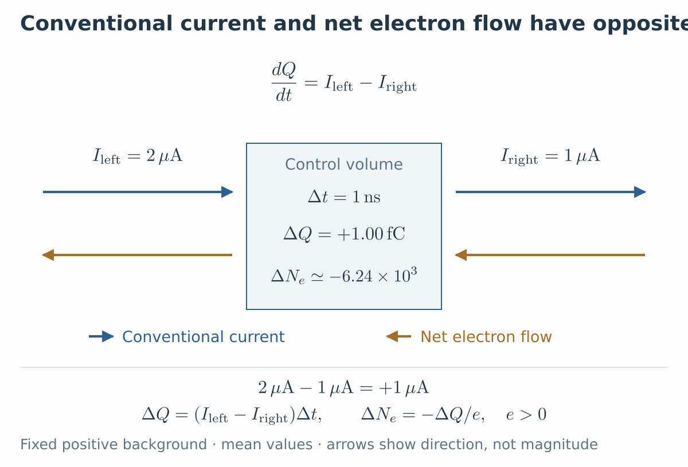
</picture>
<figcaption markdown="span">그림 1. 두 줄의 화살표는 conventional current와 net electron flow를 구분한다. 두 경계의 전류 모두 $+x$ 방향을 양수로 정의했다. $I_{\rm left}=2\,\mu\mathrm A$와 $I_{\rm right}=1\,\mu\mathrm A$를 $1\,\mathrm{ns}$ 동안 유지하면 $\Delta Q=+10^{-15}\,\mathrm C$가 된다. 전자 수의 변화는 $\Delta N_e=-\Delta Q/e\simeq-6.24\times10^3$다. 오른쪽에서 들어오는 전자보다 왼쪽으로 나가는 전자가 더 많다.</figcaption>
</figure>



| 관계식 | 정하는 것 | 이 식만으로 정하지 못하는 것 |
|---|---|---|
| Poisson equation | 전하와 boundary condition에 따른 전기장 | 전자의 drift |
| Continuity equation | 들어오고 나간 flux의 차이에 따른 입자 수 변화 | 주어진 전기장에서의 전류 |
| Transport 관계식 | 전기장에 따른 carrier의 운동과 전류 | Electrostatic boundary condition |
{: .drude-table }

아직 빠져 있는 transport 관계식을 Drude model로 정할 수 있다.

## 2. Charge-neutral 도선의 전기장과 boundary condition
{: id="drude-02" }

먼저 전자를 움직이게 할 전기장을 구하자. 도선 내부에서 $n=N_D$이고 permittivity는 일정하다고 하자. Poisson equation에서 얻는 조건은 $\partial_xE_x=0$이지, **$E_x=0$이라는 뜻이 아니다**. 경계에서 $\varphi(0)=V$, $\varphi(L)=0$라면

$$
\begin{aligned}
&\varphi(x)=V\left(1-\frac{x}{L}\right),\\
&E_x=\frac{V}{L},\\
&\rho=0.
\end{aligned}
\tag{4}
$$

$V>0$이면 전기장은 오른쪽을 향한다. 전극과 표면전하가 이 boundary condition을 만들어도, 도선 내부의 bulk charge density는 0일 수 있다. 전기장이 공간에 따라 일정하면 divergence는 0이지만, 그 전기장이 전자에 가하는 힘까지 0인 것은 아니다.

Steady state에서는 continuity equation에 따라 $\partial_xJ_x=0$도 성립해야 한다. 즉, 도선의 어느 단면에서나 전류가 같아야 한다. 하지만 이 조건만으로 전류의 크기는 알 수 없다. 완전한 절연체와 좋은 도체가 같은 정적 Poisson equation을 만족해도 전류는 크게 다를 수 있다. 두 물질에서 전기장과 전류를 연결하는 transport 관계식이 다르기 때문이다.

도체 내부의 전기장이 0이라는 익숙한 설명은 **electrostatic equilibrium**에 관한 것이다. 전하가 재배치된 뒤, 에너지를 소모하는 전류가 지속적으로 흐르지 않는 상태를 말한다. 여기서는 외부 전원이 전압을 유지하는 동안 전하가 도선을 통과한다. **Steady state**는 관심 있는 양이 시간에 따라 더 이상 변하지 않는다는 뜻이지, 전류가 0이라는 뜻이 아니다. 전기장과 전류가 일정하더라도 equilibrium은 아닐 수 있다.

그림 2는 같은 위치 구간에서 potential과 전기장을 비교한다. Potential의 기울기가 일정한 음수이므로 전기장은 일정한 양수다. Bulk의 net charge가 0이어도 이런 전기장이 있을 수 있다. Boundary condition으로 전기장은 구했지만, 전류의 크기는 아직 정해지지 않았다. 그 값을 알려면 전자의 운동방정식이 더 필요하다.

<figure class="drude-figure">
<picture class="rsna-results-figure">
<source media="(max-width: 560px)" srcset="" width="600" height="1490">
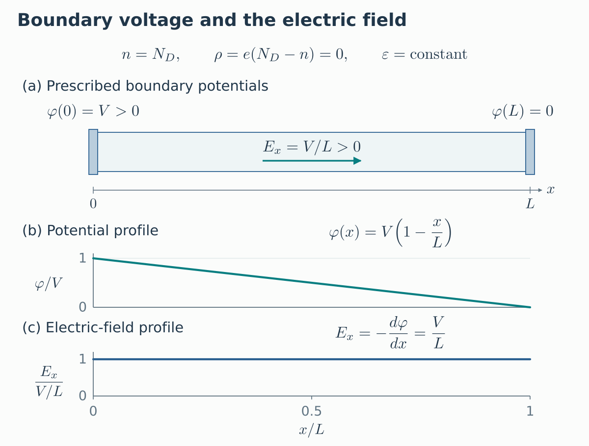
</picture>
<figcaption markdown="span">그림 2. (a) 사각형은 균일한 bulk 영역이고, 양끝의 세로 막대는 potential을 지정한 경계다. 내부 화살표는 전기장이다. (b) Potential은 왼쪽 경계에서 오른쪽 경계까지 선형으로 감소한다. (c) 이 기울기에 음의 부호를 붙이면 같은 구간에서 일정한 양의 전기장을 얻는다. 두 그래프는 같은 위치 좌표를 쓴다. Charge neutrality, 즉 $\rho=0$은 전기장의 divergence가 0이라는 조건이지 전기장 자체가 0이라는 조건이 아니다. 이 electrostatic 계산만으로 전류의 크기까지 정할 수는 없다.</figcaption>
</figure>

<details markdown="1">
<summary>밀도가 균일하지 않으면 무엇이 달라질까?</summary>

그때는 Poisson equation에 따라 전기장도 일반적으로 위치마다 달라진다. 밀도 차이가 있으면 diffusion도 일어날 수 있으므로, drift만 포함한 $\mathbf J=\sigma\mathbf E$로는 equilibrium이나 transport를 설명하지 못할 수 있다. 열적 운동에 기여하는 각 single-particle state의 occupation이 충분히 작아 Maxwell–Boltzmann statistics를 적용할 수 있는 전자 기체를 **nondegenerate**라고 한다. 온도가 일정한 단순한 모델에서는 이 전자들이 만드는 전류에 $en\mu\mathbf E$뿐 아니라 $+eD\nabla n$도 들어간다. $\mu$는 4절에서 정의할 mobility이고, $D$는 단위가 $\mathrm{m^2/s}$인 diffusion coefficient다. 전자는 밀도가 낮은 쪽으로 퍼지지만 음전하를 운반하므로 diffusion 전류의 부호는 양수다.

균일한 도선 예제에는 이 추가 항이 없다. 19절의 작은 전하 진동 예제는 long-wavelength limit에서 pressure를 무시하고 linearization한 모델을 사용한다. 따라서 두 예제 모두 일반적인 drift–diffusion 소자 모델과는 구분해야 한다.

</details>

## 3. 평균 전자 속도의 Drude equation
{: id="drude-03" }

전기장은 구했고, 평균 속도와 전류의 관계도 알고 있다. 이제 평균 속도가 시간에 따라 어떻게 변하는지 구하면 된다. 공간적으로 균일하고 밀도가 일정한 전자 기체에 $t=0$부터 일정한 외부 전기장 $\mathbf E_0$를 걸자. 처음 평균 속도는 $\mathbf u(0)=0$으로 둔다. 여기서는 도선 내부의 균일한 영역을 모델링한다. Contact에서 전자가 들어오는 과정이나 전기장이 회로 전체로 퍼지는 과정은 아직 계산하지 않는다.

### Scattering이 없을 때의 평균 속도와 전류

운동방정식에 들어가는 일정한 양의 질량을 $m^{\ast}$라 쓰자. 먼저 다룰 자유전자는 $m^{\ast}=m_0$이며, $m_0$는 전자의 bare mass다. 모든 전자에 같은 전기력이 작용하므로 Newton equation을 평균해도 평균 속도의 가속도는 같다. 이 일정한 가속도를 시간에 대해 적분하고 식 (1)에 대입하면

$$
\begin{aligned}
&\frac{d\mathbf u}{dt}=-\frac{e}{m^{\ast}}\mathbf E_0,\\
&\mathbf u(t)=-\frac{e}{m^{\ast}}\mathbf E_0t,\\
&\mathbf J(t)=\frac{ne^2}{m^{\ast}}\mathbf E_0t.
\end{aligned}
$$

이 모델에서도 전기장을 걸면 전류가 생긴다. 다만 전류가 *일정해지지는 않는다*. 전기장을 두 배 오래 걸면 전류도 두 배가 된다. 따라서 설명해야 할 것은 단순히 전압을 걸었을 때 전류가 생기는 이유가 아니다. 이 모델에서 끝없이 커지는 평균 속도와 전류를 무엇이 일정하게 만드는지가 문제다.

### Scattering에 의한 평균 속도의 relaxation

물질 안의 전자는 impurity나 격자 진동과도 상호작용한다. 이때 전자의 방향이나 에너지가 바뀌는 과정을 **scattering**이라 한다. 평균 속도를 줄이기 위해 전자를 모두 멈출 필요는 없다. 한쪽 방향으로 치우쳐 있던 전자들을 여러 방향으로 흩어 놓으면, 개별 전자의 속력은 커도 평균 속도는 작아질 수 있다.

이 과정을 단순하게 모델링하자. 짧은 시간 $dt\ll\tau$ 동안 각 전자가 scattering을 겪을 확률은 1차 항까지 $dt/\tau$로 두고, 이전에 어떤 일을 겪었는지에는 무관하다고 가정한다. 여기서 $\tau>0$는 시간이다. Scattering 직후 속도의 평균은 0으로 가정한다.

Scattering을 겪지 않은 전자들의 평균 속도는 기존 값에 전기장이 주는 속도 변화 $-e\mathbf E\,dt/m^{\ast}$를 더한 값이다. 이들이 전체에서 차지하는 비율은 $1-dt/\tau$다. Scattering을 겪은 쪽의 평균 속도는 가장 낮은 차수에서 0이다. Scattering 직후 남은 시간에도 전기장에 의한 가속은 일어나지만, 사건이 일어날 확률과 남은 시간이 각각 $dt$에 비례하므로 전체 평균에는 $dt^2$ 차수로만 기여한다.

Event probability가 두 집단의 통계적 weight를 정한다. 즉, 가능한 scattering 이력에 대해 평균하는 모델이다. 두 집단의 비율을 곱해 평균하고 $dt$의 1차 항까지 남기면

$$
\begin{aligned}
&\mathbf u(t+dt)=\left(1-\frac{dt}{\tau}\right)\mathbf u(t)\\
&\qquad-\frac{e\mathbf E}{m^{\ast}}dt+\mathcal O(dt^2).
\end{aligned}
\tag{5}
$$

양변에서 $\mathbf u(t)$를 빼고 $dt$로 나눈 뒤 $dt\to0$의 극한을 취하자. 질량을 곱하면 **Drude equation of motion**을 얻는다.

$$
m^{\ast}\frac{d\mathbf u}{dt}
=-e\mathbf E-\frac{m^{\ast}}{\tau}\mathbf u.
\tag{6}
$$

오른쪽 첫 항은 전기력이다. 두 번째 항은 기존 진행 방향이 무작위로 바뀌면서 평균 속도가 줄어드는 효과다. 평균 속도가 왼쪽을 향하면 이 항은 오른쪽을 향해 그 크기를 줄인다. 이는 평균 운동에 관한 식이지, 전자 하나하나를 멈추게 하는 마찰력을 가정한 식이 아니다. [TU Delft, Drude equation of motion][drude-notes]

전기장을 제거하면 식 (6)은 $d\mathbf u/dt=-\mathbf u/\tau$가 되고, 해는 $\mathbf u(t)=\mathbf u(0)e^{-t/\tau}$다. 따라서 $\tau$는 평균 속도가 줄어드는 시간 척도다. 시간 $\tau$가 지나면 평균 속도는 처음의 $e^{-1}$배가 된다. 이를 **momentum relaxation time**이라 하며, $\tau_{\rm tr}$라고도 쓴다.

위처럼 scattering 한 번으로 방향이 완전히 무작위가 되는 모델에서는 relaxation time과 사건 사이의 평균 시간이 같다. 실제 scattering에서는 이전 진행 방향이 일부 남아서 평균 속도가 줄어들기까지 여러 번의 scattering이 필요할 수 있다. 같은 형태의 식을 근사적으로 쓰더라도, 이때 $\tau$를 사건 사이의 평균 시간으로 바로 정해서는 안 된다. 평균 drift가 줄어드는 속도에서 구해야 한다. 두 시간의 차이는 14절에서 계산한다.

지금은 평균 속도와 전기장이 공간적으로 균일하고, 양의 질량은 방향에 따라 달라지지 않으며, damping은 평균 속도에 비례한다고 가정했다. Pressure gradient가 만드는 힘이나 momentum이 공간을 따라 이동하는 효과는 제외했다. 결정에서도 $m_0$와 다른 일정한 양의 $m^{\ast}$를 쓸 수 있는 조건은 7–9절의 band 설명에서 구한다.

<figure class="drude-figure">
<picture class="rsna-results-figure">
<source media="(max-width: 560px)" srcset="" width="600" height="1090">

</picture>
<figcaption markdown="span">그림 3. 같은 전기장에서 평균 drift가 0인 상태로 시작하며, $m^{\ast}=m_0$다. 축에는 $s=t/\tau_{\rm ref}$와 $J_{\rm ref}=ne^2E_0\tau_{\rm ref}/m^{\ast}$를 사용하고, $\tau_{\rm ref}>0$는 유한한 reference time이다. 점선에는 scattering이 없고, 실선에는 $\tau=\tau_{\rm ref}$를 적용했다. Scattering이 없는 곡선에서 reference time은 축의 단위를 정할 뿐, scattering time을 뜻하지 않는다.</figcaption>
</figure>

## 4. DC mobility, conductivity와 channel resistance
{: id="drude-04" }

이제 일정한 전류를 가정하는 대신, 어떤 값으로 일정해질 수 있는지 구하자. 일정해진 평균 속도를 $\mathbf u_{\rm dc}$라 쓰자. 아래첨자 DC는 direct current, 즉 직류를 뜻한다. 이 steady state에서는 $d\mathbf u/dt=0$이어야 하므로 식 (6)은

$$
0=-e\mathbf E-\frac{m^{\ast}}{\tau}\mathbf u_{\rm dc}.
$$

가 된다. 이를 정리하면 $\mathbf u_{\rm dc}=-e\tau\mathbf E/m^{\ast}$다. 이 값을 $\mathbf J=-en\mathbf u$에 넣으면 $\mathbf J=(ne^2\tau/m^{\ast})\mathbf E$를 얻는다. 전자 전하에서 나온 두 음의 부호가 상쇄된 것이다. Steady state에서 평균 drift velocity의 크기를 전기장 크기로 나눈 값을 DC **mobility** $\mu$, current density를 전기장으로 나눈 비례계수를 DC **conductivity** $\sigma_0$라 정의하면, $n$이 고정되어 있을 때 다음과 같이 정리할 수 있다.

$$
\begin{aligned}
&\mathbf u_{\rm dc}=-\mu\mathbf E,\\
&\mu=\frac{e\tau}{m^{\ast}},\\
&\mathbf J=\sigma_0\mathbf E,\\
&\sigma_0=en\mu=\frac{ne^2\tau}{m^{\ast}}.
\end{aligned}
\tag{7}
$$

지금처럼 질량이 양수인 모델에서 mobility $\mu$는 양수이며, 전자가 전기장과 반대로 움직인다는 사실은 $\mathbf u=-\mu\mathbf E$의 음의 부호에 들어 있다. Conductivity $\sigma_0$에는 carrier의 밀도도 들어간다. 따라서 mobility가 높아도 carrier가 적으면 conductivity는 낮을 수 있다.

위의 이상적인 방정식에서는 전류가 $\mathbf E$에 비례한다. 이를 실제 물질에 적용하려면 **low field**, 즉 **linear response**로 계산할 수 있는 조건이 필요하다. 전기장에 따른 carrier 속도 분포의 변화가 작아서, 전기장의 1차 항까지만 계산해도 충분해야 한다. 이때는 전기장을 걸기 전의 carrier 밀도, 운동을 기술하는 질량, relaxation time을 그대로 쓸 수 있다. 가열이나 전기장에 따른 scattering 변화로 $\tau$가 크게 달라져서는 안 된다. 결정에서는 전자들이 일정한 질량을 쓸 수 있는 에너지 범위에 머물러야 한다는 조건도 필요하며, 그 이유는 7–9절에서 유도한다. 어느 정도의 전기장을 low field로 볼 수 있는지는 물질과 조건에 따라 다르다.

Mobility의 SI 단위는 $\mathrm{m^2/(V\,s)}$다. $\mathrm{cm^2/(V\,s)}$로 바꾸려면 $10^4$를 곱한다. 밀도 단위는 반대 방향으로 환산되어 자주 헷갈린다. $1\,\mathrm{cm}^{-3}=10^6\,\mathrm{m}^{-3}$다.

이것이 Drude conductivity다. Carrier 밀도가 커지면 전하를 운반하는 전자가 많아진다. Relaxation time이 길면 방향이 무작위로 바뀌기 전까지 전기장이 평균 drift를 더 크게 만든다. 질량이 크면 같은 힘에서 가속도가 작다. 세 변수가 conductivity에 들어가는 방식은 각각 이 차이를 반영한다.

도선의 전류를 구하려면 식 (4)의 균일한 전기장 $E_x=V/L$과 식 (1)의 단면 관계 $I=AJ_x$를 쓰면 된다. 따라서 $I=A\sigma_0E_x=A\sigma_0V/L$이다. 저항을 $R=V/I$로 정의하면

$$
\begin{aligned}
&I=\frac{\sigma_0A}{L}V,\\
&R=\frac{L}{\sigma_0A},\\
&\varrho_{\rm el}=\frac{1}{\sigma_0}.
\end{aligned}
\tag{8}
$$

Resistivity $\varrho_{\rm el}$의 단위는 $\Omega\,\mathrm m$이며 charge density $\rho$와 다른 양이다. 물질의 conductivity에 도선의 길이와 단면적을 함께 넣으면 channel resistance를 구할 수 있다. $n,m^{\ast},\tau$가 일정하면 $I$–$V$ 그래프는 직선이다. 하지만 가열, carrier density 변화, velocity saturation, ballistic contact, 전기장에 따라 달라지는 scattering이 중요해지면 이 직선을 그대로 연장해서는 안 된다.

<figure class="drude-figure">
<picture class="rsna-results-figure">
<source media="(max-width: 560px)" srcset="" width="600" height="1510">
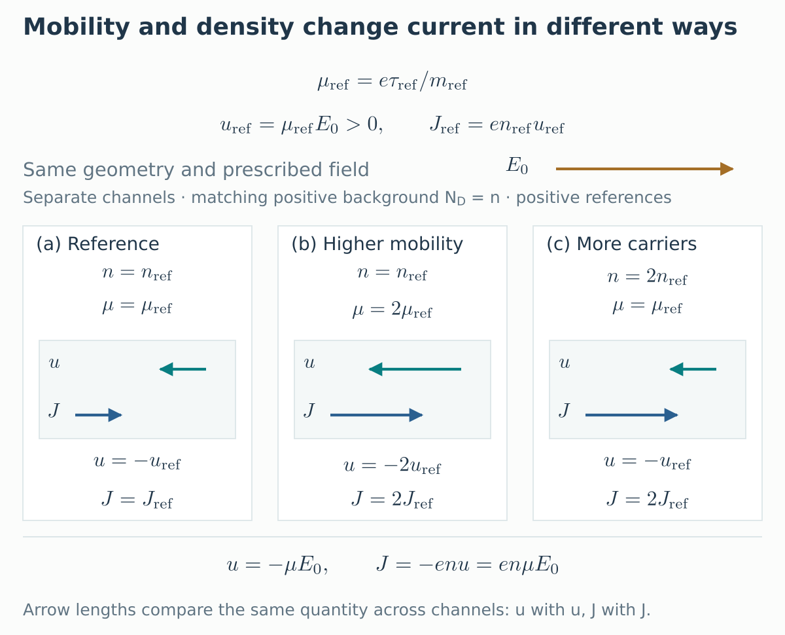
</picture>
<figcaption markdown="span">그림 4. 세 channel의 크기와 가한 전기장 $E_0>0$는 같다. 각 channel의 고정된 positive background density도 $N_D=n$로 맞췄으므로 모두 charge-neutral하다. Reference 값은 $\mu_{\rm ref}=e\tau_{\rm ref}/m_{\rm ref}$, $u_{\rm ref}=\mu_{\rm ref}E_0$, $J_{\rm ref}=en_{\rm ref}u_{\rm ref}$로 정의한다. 밀도가 같을 때 mobility를 두 배로 하면 drift의 크기와 current density가 모두 두 배가 된다. Mobility가 같을 때 밀도만 두 배로 하면 current density는 두 배가 되지만 평균 drift는 그대로다. Electron drift는 전기장과 반대 방향이고 conventional current는 같은 방향이다. 화살표 길이는 channel 사이에서 같은 물리량끼리만 비교해야 한다. 속도 화살표와 전류 화살표의 길이를 서로 비교하는 표시는 아니다.</figcaption>
</figure>

**Transport mean free path**는 carrier의 대표 속력에 momentum relaxation time을 곱한 길이다. 이때 속력은 작은 평균 drift 속력이 아니라 개별 carrier가 움직이는 속력이다. **Diffusive** channel은 transport mean free path보다 충분히 길다. 따라서 carrier는 도선을 통과하기 전에 처음 진행하던 방향과의 상관관계를 잃는다. 반면 **ballistic** transport에서는 carrier가 scattering을 거의 겪지 않고 channel을 통과한다. 이때는 bulk 저항 식만으로 전류를 정할 수 없고 contact에서 주입되는 전자와 boundary condition을 함께 고려해야 한다.

구체적으로 $n=10^{23}\,\mathrm{m}^{-3}$, $m^{\ast}=0.2m_0$, $\tau=100\,\mathrm{fs}$, $E_x=1000\,\mathrm{V/m}$으로 두자. Femtosecond는 $10^{-15}$초다. 도선의 크기는 $L=1\,\mu\mathrm m$, $A=(100\,\mathrm{nm})^2$으로 정한다. 이 입력값으로 계산하면 대략 다음 값을 얻는다.

$$
\begin{aligned}
&\mu=0.087941\,\mathrm{m^2/(V\,s)}\\
&=879.41\,\mathrm{cm^2/(V\,s)},\\
&u_x=-87.941\,\mathrm{m/s},\\
&\sigma_0=1408.97\,\mathrm{S/m},\\
&V=1\,\mathrm{mV},\\
&I=14.0897\,\mathrm{nA},\\
&R=70.9738\,\mathrm{k\Omega}.
\end{aligned}
$$

코드는 Python 3.9 이상과 NumPy가 필요하며 위에서부터 순서대로 실행한다. Notebook에도 같은 코드와 그림이 들어 있다. 물리 상수는 [NIST CODATA 값][constants]을 사용한다.

```python
import numpy as np
from math import gamma

E_CHARGE = 1.602176634e-19   # Positive e, in C; electron charge is -e.
HBAR = 6.62607015e-34 / (2 * np.pi)
M0 = 9.1093837139e-31
KB = 1.380649e-23
EPS0 = 8.8541878188e-12

n, mass, tau = 1e23, 0.2 * M0, 100e-15
field, length, area = 1000.0, 1e-6, (100e-9)**2
mobility = E_CHARGE * tau / mass
sigma0 = n * E_CHARGE * mobility
drift = -mobility * field
voltage, current = field * length, sigma0 * field * area
print("mobility (cm^2/Vs):", mobility * 1e4)
print("drift (m/s), current (nA):", drift, current * 1e9)
print("channel resistance (kohm):", voltage / current / 1e3)
assert np.isclose(current * 1e9, 14.0897016)
assert np.isclose(current, -E_CHARGE * n * drift * area)
```

<details markdown="1">
<summary>이 예제의 전기장은 충분히 약하고 도선은 충분히 길까?</summary>

Carrier의 대표 운동에너지를 $K_{\rm char}=50\,\mathrm{meV}$로 정하고, 앞 예제의 $m^{\ast}=0.2m_0$, $\tau=100\,\mathrm{fs}$, $E_x=1000\,\mathrm{V/m}$을 유지하자. 대표 속력과 transport mean free path는

$$
\begin{aligned}
&v_{\rm char}=\sqrt{\frac{2K_{\rm char}}{m^{\ast}}}\\
&\simeq2.9655\times10^5\,\mathrm{m/s},\\
&\ell_{\rm char}=v_{\rm char}\tau\simeq29.65\,\mathrm{nm}.
\end{aligned}
$$

Low-field 근사가 타당한지 확인하려면 이 거리를 이동하는 동안 전기장이 하는 일을 carrier의 에너지와 비교해 볼 수 있다.

$$
e\lvert E_x\rvert\ell_{\rm char}\simeq0.02965\,\mathrm{meV}
\ll K_{\rm char}.
$$

도선 길이 $L=1\,\mu\mathrm m$는 transport mean free path의 약 34배다. Mean free path보다 짧은 ballistic channel과는 다른 조건이다. 이 비교는 선택한 carrier energy를 기준으로 한 확인이다. 전자들이 넓은 에너지 범위에 분포한다면, 전류에 기여하는 carrier들의 에너지와 mean free path를 함께 살펴야 한다. 온도를 일정하게 유지하려면 에너지가 빠져나가는 과정도 별도로 필요하다.

</details>

## 5. 전기장을 켜고 끌 때의 전류 변화
{: id="drude-05" }

Steady state의 힘의 균형으로 최종 전류는 구했지만, 실제로 그 값에 가까워지는지는 아직 확인하지 않았다. 다시 $\mathbf u(0)=0$에서 시작해 $t=0$에 $\mathbf E_0$를 걸자. 식 (6)을 $d\mathbf u/dt=-(\mathbf u-\mathbf u_{\rm dc})/\tau$로 쓰면, 최종 평균 속도와의 차이가 지수함수로 줄어든다는 것을 알 수 있다. 따라서 속도와 전류는

$$
\begin{aligned}
&\mathbf u(t)=-\frac{e\tau}{m^{\ast}}\mathbf E_0(1-e^{-t/\tau}),\\
&\mathbf J(t)=\sigma_0\mathbf E_0(1-e^{-t/\tau}).
\end{aligned}
\tag{9}
$$

$t=\tau$에서 전류는 최종값의 $1-e^{-1}\simeq0.6321$에 도달한다. 이후 전기장을 끄면 끄는 순간의 전류에서 지수적으로 감소한다. 이 감소의 시간 원점은 처음 켠 순간이 아니라 전기장을 끈 순간이다.

아주 이른 시간에는 $1-e^{-t/\tau}\simeq t/\tau$다. 따라서 $J(t)\simeq ne^2E_0t/m^{\ast}$로, 3절에서 구한 scattering 없는 경우의 전류 증가와 같다. 아직 scattering이 평균 운동에 큰 영향을 줄 만큼 시간이 지나지 않았기 때문이다. 초기 기울기는 $\tau$와 무관하다. Relaxation time이 길어지면 최종 전류도 커지고 그 값에 가까워지는 데 걸리는 시간도 길어진다. 같은 전기장이 주는 순간적인 가속도 자체가 달라지는 것은 아니다.

```python
s = np.linspace(0, 6, 121)  # Dimensionless time s=t/tau.
j_on = -np.expm1(-s)       # J/(sigma0*E0); accurate near s=0.
j_off = np.exp(-s)         # J/J_at_switch_off, with a new time origin.
assert np.isclose(-np.expm1(-1.0), 0.6321205588)
assert np.allclose(j_on + j_off, 1.0)
print("Turn-on fraction at 1 tau:", -np.expm1(-1.0))
```

<figure class="drude-figure">
<picture class="rsna-results-figure">
<source media="(max-width: 560px)" srcset="" width="600" height="1450">
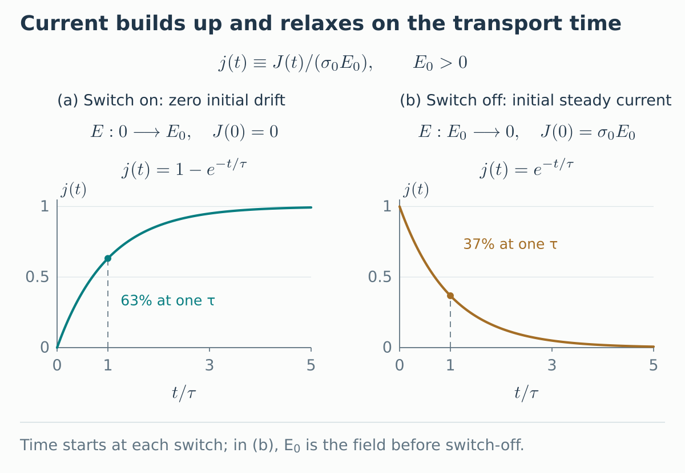
</picture>
<figcaption markdown="span">그림 5. (a) 평균 drift가 0인 상태에서 전기장 $E_0>0$을 켜면 전류는 $\sigma_0E_0$에 접근한다. (b) 그 steady current에 도달한 뒤 전기장을 끈다. 여기서 $E_0$는 끄기 전의 전기장이며, 끈 뒤의 전기장은 0이다. 두 panel 모두 각자의 switching 순간부터 시간을 잰다. Momentum relaxation time은 두 경우에 같다.</figcaption>
</figure>



$\tau$와 $m^{\ast}$를 각각 바꾸어 mobility와 최종 전류를 비교해 보자. 가로축은 $s=t/\tau$이므로 그래프의 기울기는 $dJ/dt$가 아니라 $dJ/ds$다. $\tau$를 바꾸면 같은 가로축 위치가 가리키는 실제 시간도 달라진다. 식 (9)에서 실제 시간에 대한 초기 기울기를 구하면 $dJ/dt=(1/\tau)dJ/ds=ne^2E_0/m^{\ast}$이며 $\tau$와 무관하다. 전기장 방향을 뒤집으면 전류와 electron drift의 부호가 어떻게 바뀌는지도 확인할 수 있다. Channel의 길이와 단면적은 고정되어 있다.

<details markdown="1">
<summary>전기장이 한 일은 어디로 갈까?</summary>

$n$이 일정할 때 식 (6)에 $n\mathbf u$를 내적하면

$$
\begin{aligned}
&\frac{d}{dt}\left(\frac{nm^{\ast}u^2}{2}\right)\\
&=\mathbf J\cdot\mathbf E-\frac{nm^{\ast}u^2}{\tau}.
\end{aligned}
\tag{10}
$$

첫 항은 전기장이 단위 부피에 공급하는 전력이다. 마지막 항은 평균 drift 운동에 해당하는 에너지를 줄인다. Steady state에서 공급 전력은 $\sigma_0E^2\ge0$다.

여기서 $u^2$는 평균 속도를 제곱한 값이지, 개별 전자들의 속력 제곱을 평균한 값이 아니다. 따라서 식 (10)은 전자 기체의 전체 운동에너지 밀도가 아니라 **drift-energy density**에 대한 식이다. Elastic impurity scattering은 전자 하나하나의 에너지를 보존하면서도 전류를 줄일 수 있다. 따라서 전기장이 계속 일을 하면 전자의 평균 에너지는 계속 높아질 수 있다. 일정한 온도를 유지하려면 phonon, contact 또는 다른 bath로 에너지가 전달되어야 한다. 에너지가 빠져나가는 시간은 $\tau_{\rm tr}$와 같을 필요가 없다. Elastic relaxation-time model만으로는 전자 온도를 정할 수 없다.

</details>

관측 시간을 고정한 채 $\tau\to\infty$로 보내면 식 (9)는 전자가 계속 가속하는 운동에 가까워진다. 공간적으로 균일하고 collision이 없는 parabolic model에서는 유한한 DC steady-state current에 도달하지 않는다. Ballistic two-terminal conductance를 구하는 문제는 다르다. 그 경우에는 contact에서 전자를 주입하는 조건까지 포함하므로, 유한한 conductance가 나와도 위 결론과 모순되지 않는다.

## 6. AC conductivity: 전류의 진폭과 phase lag
{: id="drude-06" }

지금까지는 전기장을 켠 뒤 그 값을 일정하게 유지했다. 전기장이 진동하면 전자들의 평균 drift 방향도 계속 바뀌어야 한다. 따라서 전기장이 바뀌는 시간과 $\tau$의 상대적인 크기가 중요해진다. 전기장을 켠 직후의 transient가 사라지면 전류는 전기장과 같은 주파수로 반복된다. 이 **periodic steady state**는 순간 전류가 일정하다는 뜻이 아니라, 같은 파형이 매 주기 반복된다는 뜻이다.

실제 전기장을 $\mathbf E(t)=\operatorname{Re}[\mathbf E_\omega e^{-i\omega t}]$로 쓰자. Complex amplitude $\mathbf E_\omega$는 전기장의 크기와 phase를 정한다. $\omega$는 단위가 radian/s인 angular frequency다. 여기서 $i$는 전류가 아니라 허수 단위다. 식 (6)에 $\mathbf u_\omega e^{-i\omega t}$를 대입하면 시간 미분이 $-i\omega\mathbf u_\omega$가 되므로

$$
\begin{aligned}
&\mathbf J_\omega=\sigma(\omega)\mathbf E_\omega,\\
&\sigma(\omega)=\frac{\sigma_0}{1-i\omega\tau}.
\end{aligned}
\tag{11}
$$

분자와 분모에 $1+i\omega\tau$를 곱하면 conductivity의 실수부와 허수부를 구할 수 있다.

$$
\begin{aligned}
&\operatorname{Re}\sigma=\frac{\sigma_0}{1+(\omega\tau)^2},\\
&\operatorname{Im}\sigma=\frac{\sigma_0\omega\tau}{1+(\omega\tau)^2}.
\end{aligned}
\tag{12}
$$

한 방향의 실제 전기장 $E_0\cos\omega t$에 대해서는

$$
\begin{aligned}
&J(t)=\frac{\sigma_0E_0}{\sqrt{1+(\omega\tau)^2}}
\cos(\omega t-\theta),\\
&\theta=\tan^{-1}(\omega\tau).
\end{aligned}
\tag{13}
$$

전류는 전기장보다 **늦게** 변한다. $\omega\tau=1$에서 전류의 진폭은 $\sigma_0E_0$의 $1/\sqrt2$이고 **phase lag**는 $45^\circ$다. 식 (12)의 허수부가 양수인데도 전류가 늦는 이유는 $e^{-i\omega t}$ 규약을 사용하기 때문이다. 시간 의존성의 부호를 바꾸면 허수부의 부호도 바뀐다.

실제 파형으로 바꾸면 부호를 직접 확인할 수 있다. $\omega\tau=1$에서

$$
\begin{aligned}
&\frac{J(t)}{\sigma_0E_0}
=\operatorname{Re}\!\left[\frac{1+i}{2}e^{-i\omega t}\right]\\
&=\frac{\cos\omega t+\sin\omega t}{2}\\
&=\frac{1}{\sqrt2}\cos(\omega t-\pi/4).
\end{aligned}
$$

전기장이 최대가 되는 순간은 $\omega t=0$이고, 전류가 최대가 되는 순간은 그보다 늦은 $\omega t=\pi/4$다. 한 주기의 1/8만큼 늦다.

순간적인 단위 부피당 전력은 $J(t)E(t)$다. 이 곱을 한 주기 동안 평균하면 $\tfrac12\operatorname{Re}\sigma\,E_0^2\ge0$를 얻는다. Cosine과 sine의 곱은 한 주기 평균이 0이기 때문이다. 허수부는 추가로 소모하는 전력을 뜻하지 않는다. 전기장과 위상이 다른 **reactive response**, 즉 에너지를 저장했다가 돌려주는 성분을 나타낸다. [Tong, Electromagnetism, Drude response][tong-em]

```python
omega_tau = np.array([0.0, 1.0, 10.0])
response = 1 / (1 - 1j * omega_tau)  # sigma(omega)/sigma0; exp(-i*omega*t).
assert np.all(response.real >= 0)
assert np.allclose(response[1], 0.5 + 0.5j)
phase = np.linspace(0, 2 * np.pi, 101)
waveform = np.real(response[1] * np.exp(-1j * phase))
assert np.allclose(waveform, np.cos(phase - np.pi / 4) / np.sqrt(2))
print("Normalized AC response:", response)
```

<figure class="drude-figure">
<picture class="rsna-results-figure">
<source media="(max-width: 560px)" srcset="" width="600" height="1800">
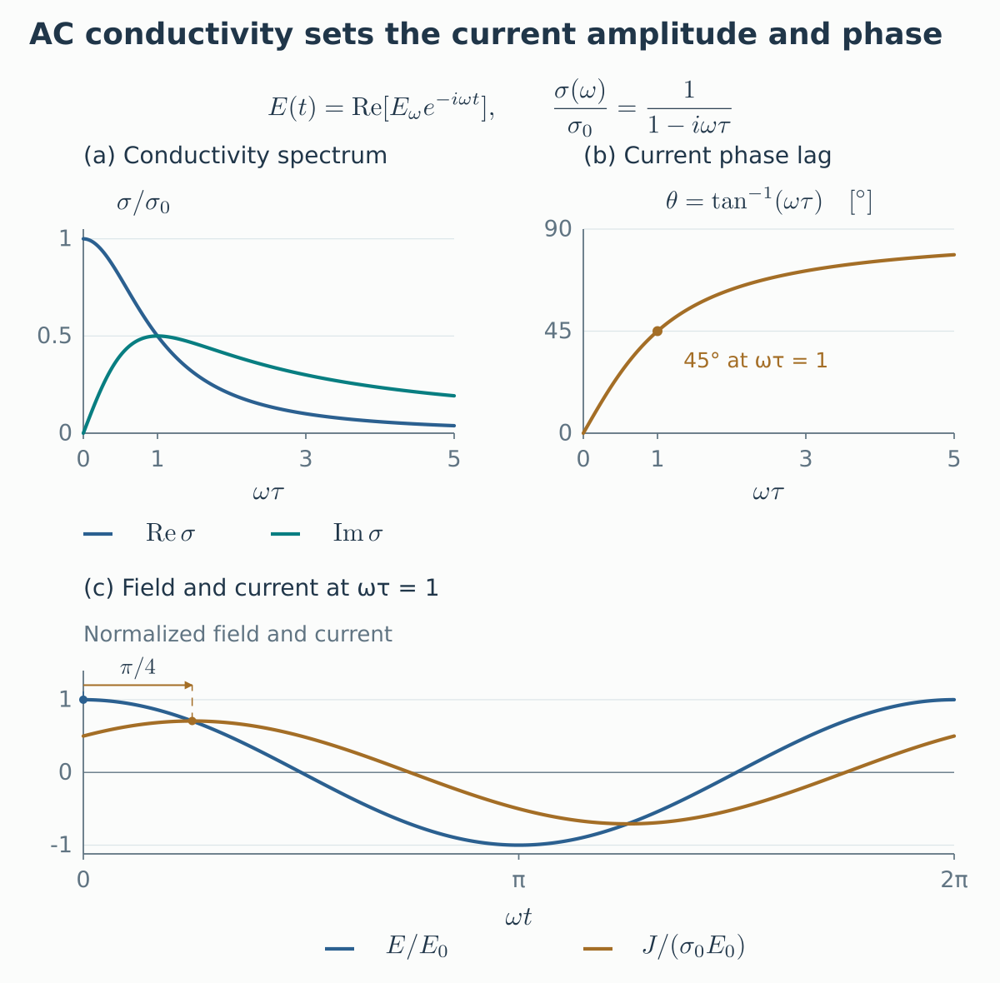
</picture>
<figcaption markdown="span">그림 6. Conductivity의 실수부와 허수부는 $e^{-i\omega t}$ 규약을 따른다. $\omega\tau=1$에서 normalized current의 진폭은 $1/\sqrt2$이고, 전기장보다 위상이 $\pi/4$ 늦다. (c)의 가로 표시는 전기장이 최대가 되는 순간부터 전류가 최대가 되는 순간까지의 차이를 나타낸다. 이 conductivity는 같은 위치의 전기장과 conduction current를 연결한다.</figcaption>
</figure>



$\omega\tau\ll1$에서 $\omega\tau\gg1$까지 바꾸어 보자. 천천히 변하는 전기장에서는 전류가 거의 같은 위상으로 따라간다. 주파수를 높이면 전류의 진폭은 줄고 phase lag는 1/4주기에 가까워진다. 주파수를 0으로 설정하면 시간에 따라 일정한 전기장을 표시하며, 진동 파형은 그리지 않는다.

<details markdown="1">
<summary>AC steady state와 전기장을 켠 직후의 transient는 어떻게 다를까?</summary>

식 (13)의 주기적인 해를 $J_{\rm ss}(t)$라 하자. 같은 정현파 전기장을 $t=0$부터 가하면 임의의 초기 전류에 대해

$$
J(t)=J_{\rm ss}(t)
+[J(0)-J_{\rm ss}(0)]e^{-t/\tau}.
$$

추가된 항은 외부 전기장 항을 0으로 둔 **homogeneous equation**의 해다. 이 항은 시간 척도 $\tau$로 사라진다. Cosine 전기장에서 초기조건을 $J(0)=0$으로 정하면, transient가 주기적인 해의 초기값을 정확히 상쇄한다. 주파수가 0인 극한에서는 $J_{\rm ss}=\sigma_0E_0$이므로 전체 식은 $\sigma_0E_0(1-e^{-t/\tau})$가 되어 식 (9)의 step response와 일치한다. Complex conductivity가 나타내는 것은 AC steady state이지, 전기장을 켠 순간부터의 전 과정이 아니다.

</details>

<details markdown="1">
<summary>Conduction current와 displacement current에서 dielectric function까지</summary>

Conduction current density는 여전히 $\mathbf J=\sigma\mathbf E$다. Maxwell equation에는 배경의 **displacement current** $\varepsilon_0\varepsilon_b\partial_t\mathbf E$도 들어간다. 단자에서 측정하는 AC 전류에는 두 성분이 모두 기여할 수 있고, 소자의 모양과 크기도 영향을 준다.

주파수가 0이 아닐 때 conduction current와 배경의 displacement current를 합쳐 effective relative dielectric function을 정의하자.

$$
\begin{aligned}
&\mathbf J_{\mathrm{total},\omega}\\
&=[\sigma(\omega)-i\omega\varepsilon_0\varepsilon_b]\mathbf E_\omega\\
&=-i\omega\varepsilon_0\varepsilon_r(\omega)\mathbf E_\omega.
\end{aligned}
$$

이 등식을 $\varepsilon_r$에 대해 풀면

$$
\begin{aligned}
&\varepsilon_r(\omega)=\varepsilon_b+\frac{i\sigma(\omega)}{\varepsilon_0\omega}\\
&=\varepsilon_b-\frac{\omega_{p0}^2}{\omega(\omega+i/\tau)},\\
&\omega_{p0}^2=\frac{ne^2}{\varepsilon_0m^{\ast}}.
\end{aligned}
\tag{14}
$$

진공의 permittivity로 정의한 주파수가 $\omega_{p0}$이며, 배경 screening을 포함한 undamped **plasma frequency**는 $\omega_p=\omega_{p0}/\sqrt{\varepsilon_b}$다. 전자 밀도가 조금 달라졌을 때 그 전하가 만든 복원 전기장으로 밀도가 집단적으로 진동하는 angular frequency를 뜻하며, damping이 없는 경우의 값이다. 이 운동은 19절에서 유도한다. 분모와 부호는 식 (11)과 같은 시간 규약을 따른다. 이 Drude dielectric function은 같은 위치의 전기장과 전류를 연결하는 local model이다. Interband transition과 spatial dispersion은 생략했으므로, 결정의 optical spectrum 전체를 설명하지는 않는다.

</details>

## 7. 결정의 전자 상태와 energy band
{: id="drude-07" }

Drude 전류를 계산하려면 mass와 relaxation time을 알아야 한다. 자유전자 계산에는 bare mass를 쓰지만, 결정 속 전자는 주기적인 원자 potential의 영향도 받는다. Impurity가 없어도 이 potential 때문에 힘과 속도의 관계가 달라진다. 따라서 mass나 상태 사이의 transition을 계산하려면, 결정에서 가능한 상태와 그 에너지부터 알아야 한다.

결정 속 전자의 에너지는 모든 wavevector에서 자유공간의 $\hbar^2k^2/(2m_0)$를 따르지는 않는다. 여기서 $\hbar=h/(2\pi)$는 reduced Planck constant다. 주기적인 원자 potential이 **eigenstate**와 그 에너지를 바꾸기 때문이다. Wavevector에 따라 에너지를 그리면 연속적으로 이어지는 곡선이나 곡면을 얻는다. 그중 하나가 **energy band** $\epsilon_b(\mathbf k)$이며, 서로 다른 band는 index $b$로 구분한다.

**Wavevector**는 공간에 따른 위상 변화를 나타낸다. Wavevector가 0이 아닌 1차원 plane wave $e^{ikx}$는 파장 $2\pi/\lvert k\rvert$만큼 이동하면 위상이 반복되므로, $k$의 단위는 길이의 역수다. 결정에서는 한 cell에서 다음 cell로 갈 때 위상이 어떻게 바뀌는지 구분하는 데 쓰며 전자의 위치를 뜻하지 않는다. 완벽하게 주기적인 격자는 band state를 정한다. 격자 자체를 무작위로 놓인 장애물로 생각하면 안 된다. Impurity나 완벽한 주기성에서 벗어난 부분이 있으면 전자들이 그 state 사이에서 이동할 수 있다.

1차원에서 주기적인 potential을 격자 간격 $a$만큼 평행이동해도 Hamiltonian은 변하지 않는다. 따라서 eigenstate도 같은 거리만큼 옮겼을 때 위상만 바뀌도록 선택할 수 있다.

$$
\begin{aligned}
&\psi_k(x+a)=e^{ika}\psi_k(x),\\
&\psi_k(x)=e^{ikx}u_k(x),\\
&u_k(x+a)=u_k(x).
\end{aligned}
\tag{15}
$$

이것이 **Bloch form**이다. 주기적인 함수 $u_k$는 격자 안의 공간 구조를 나타내는 wavefunction의 일부이며, 평균 drift velocity $\mathbf u$와는 다른 양이다. Wavevector가 $2\pi/a$만큼 달라도 격자 간격만큼 평행이동할 때 생기는 위상은 같다. 따라서 $k$의 범위를 $[-\pi/a,\pi/a)$ 같은 하나의 **Brillouin zone**으로 제한할 수 있다. 같은 평행이동 위상을 갖더라도 서로 다른 상태일 수 있으며, 이들은 band index로 구분한다. [Tong, Band Structure][bands]

구체적인 **tight-binding** 모델에서는 각 site 주변에 모인 orbital $\lvert j\rangle$ 하나를 둔다. Basis orbital들은 각각 normalized되어 있고 서로 orthogonal하다고 가정한다. 따라서 각 site 계수의 절댓값을 제곱하면 그 basis state의 확률 weight가 된다. Index $j$는 site를 구분하며, $\epsilon_0$는 이 모델에서 고립된 orbital에 부여한 에너지다. 1절의 vacuum permittivity와는 다른 양이다. 이웃한 orbital 사이에서 probability amplitude를 전달하는 결합을 에너지 단위의 **hopping parameter** $t_h>0$로 나타내자. Hamiltonian의 diagonal 항은 orbital의 에너지를 정하고, off-diagonal 항은 이웃한 orbital을 섞는다.

$$
\begin{aligned}
&H=\epsilon_0\sum_j\lvert j\rangle\langle j\rvert\\
&\quad-t_h\sum_j\left(
\begin{aligned}[t]
&\lvert j+1\rangle\langle j\rvert\\
&+\lvert j\rangle\langle j+1\rvert
\end{aligned}
\right).
\end{aligned}
\tag{16}
$$

Site가 $N$개인 periodic chain에서 각 site의 계수가 $c_j=e^{ikja}/\sqrt{N}$인 상태는 이 Hamiltonian의 eigenstate다. 허용되는 wavevector는 정수 $l$에 대해 $k=2\pi l/(Na)$다. 이웃한 두 site의 계수에서는 $e^{ika}$, $e^{-ika}$라는 위상 인자가 나오고, 그 합은 $2\cos ka$다. 따라서

$$
\begin{aligned}
&\epsilon(k)=\epsilon_0-2t_h\cos ka.\\
&\text{With }\epsilon_0=2t_h:\\
&\epsilon(k)=2t_h(1-\cos ka).
\end{aligned}
\tag{17}
$$

에너지의 기준점을 이렇게 정하면 band minimum이 0이 된다. 기준점의 변화는 힘이나 속도에는 영향을 주지 않는다. $ka=0$에서는 이웃한 계수의 위상이 같고 에너지는 0이다. $ka=\pi$에서는 이웃한 계수의 부호가 반대이고 에너지는 $4t_h$다. 이 에너지 차이는 Hamiltonian에서 이웃한 amplitude가 결합하는 방식 때문에 생긴다. Collision 횟수가 달라져서 생기는 차이가 아니다.

Hopping은 완전한 결정의 Hamiltonian에서 probability amplitude를 섞는 coherent 항이다. Schrödinger equation은 amplitude와 상대 위상의 시간 변화를 함께 정한다. 단위 시간당 transition probability를 뜻하는 것은 아니다. 상대 위상도 시간에 따라 변할 수 있지만 계산에서는 그 관계를 유지한다. $t_h$가 커지면 band의 폭은 넓어지지만, 그것만으로 relaxation time이 짧아지는 것은 아니다.

<figure class="drude-figure">
<picture class="rsna-results-figure">
<source media="(max-width: 560px)" srcset="" width="600" height="1410">
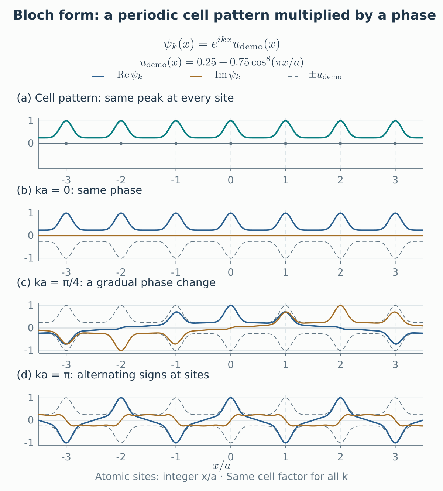
</picture>
<figcaption markdown="span">그림 7. 각 화살표는 Re–Im 평면의 복소수 $2c_j$를 나타내며, $c_j=e^{ikja}/2$다. $ka=0$에서는 이웃한 coefficient의 phase가 같고, $ka=\pi/2$에서는 site 하나를 지날 때마다 phase가 4분의 1회전씩 증가한다. 두 상태 모두 각 site에서 $\lvert c_j\rvert^2=1/4$다. Site별 확률이 같더라도 상대 phase와 에너지는 다를 수 있다.</figcaption>
</figure>



<details markdown="1">
<summary>네 site로 이루어진 ring의 Hamiltonian을 직접 풀어 보자</summary>

네 site를 주기적으로 연결한 ring에서 $\epsilon_0=2t_h$로 정하고 basis를 $\lvert0\rangle,\lvert1\rangle,\lvert2\rangle,\lvert3\rangle$ 순서로 나열하자. Hamiltonian은

$$
H_4=t_h
\begin{pmatrix}
2&-1&0&-1\\
-1&2&-1&0\\
0&-1&2&-1\\
-1&0&-1&2
\end{pmatrix}.
$$

행렬의 모서리에 있는 항은 마지막 site와 첫 site를 연결한다. 모든 성분이 같은 normalized vector $(1,1,1,1)^T/2$의 에너지는 0이다. 각 행에서 $2t_h-t_h-t_h=0$이 되기 때문이다. 부호가 번갈아 나타나는 벡터 $(1,-1,1,-1)^T/2$의 에너지는 $4t_h$다. 허용되는 $ka=-\pi,-\pi/2,0,\pi/2$를 식 (17)에 넣으면 에너지는 $4t_h,2t_h,0,2t_h$다. 행렬을 직접 풀어 얻은 네 eigenvalue와 모두 일치한다.

```python
ring_size, hopping_four_eV = 4, 1.0
H_four = 2 * hopping_four_eV * np.eye(ring_size)
for site in range(ring_size):
    neighbor = (site + 1) % ring_size
    H_four[site, neighbor] = -hopping_four_eV
    H_four[neighbor, site] = -hopping_four_eV

ring_ka = np.array([-np.pi, -np.pi / 2, 0.0, np.pi / 2])
band_four_eV = 2 * hopping_four_eV * (1 - np.cos(ring_ka))
matrix_four_eV = np.linalg.eigvalsh(H_four)
uniform_four = np.ones(ring_size) / np.sqrt(ring_size)
alternating_four = (-1.0)**np.arange(ring_size) / np.sqrt(ring_size)
assert np.allclose(matrix_four_eV, np.sort(band_four_eV))
assert np.allclose(H_four @ uniform_four, 0.0)
assert np.allclose(H_four @ alternating_four, 4 * hopping_four_eV * alternating_four)
print("Four-site energies (eV):", matrix_four_eV)
```

이 diagonalization에는 collision rate가 들어가지 않는다. 행렬로 구한 것은 energy eigenstate와 그 에너지다. 전류가 줄어드는 과정까지 설명하려면 scattering을 추가로 고려해야 한다.

</details>

Bloch eigenstate 하나는 결정 전체에 퍼져 있으므로, 도선의 특정 위치 근처에 있는 carrier를 그 상태 하나로 표현할 수는 없다. 같은 band에서 서로 가까운 wavevector의 상태들을 겹치면 한 영역에서는 amplitude가 더해지고 다른 영역에서는 대부분 상쇄되어, 한곳에 모인 **wave packet**을 만들 수 있다. 격자 크기의 빠른 진동을 감싸는 전체적인 모양이 **envelope**이며, 이 envelope는 band의 **group velocity**로 움직인다. Packet이 차지하는 영역에서 외부 potential의 변화가 작으면 semiclassical equation으로 중심의 운동을 추적할 수 있다. 공간 전체에 퍼진 Bloch eigenstate 하나에 정확한 궤적을 부여하는 것은 아니다.

<details markdown="1">
<summary>공간에 퍼진 eigenstate로 움직이는 wave packet을 어떻게 만들까?</summary>

Bloch eigenstate 하나는 공간에 퍼진 stationary state다. 움직이는 electron packet을 만들려면 서로 가까운 여러 wavevector의 상태를 겹친다. 중심 $k_0$ 근처에서 $\epsilon(k)\simeq\epsilon(k_0)+\epsilon^{\prime}(k_0)(k-k_0)$로 전개하자. 각 상태의 위상이 $kx-\epsilon(k)t/\hbar$이므로, 이들을 겹쳐 만든 envelope는 $x-\epsilon^{\prime}(k_0)t/\hbar$에 따라 달라진다. 따라서 packet의 중심은 식 (18)의 group velocity로 움직인다.

이 전개를 쓰려면 packet의 $k$ 분포가 충분히 좁아야 한다. 동시에 packet의 공간적 크기는 외부 potential이 변하는 거리보다 충분히 작아야 한다. 위치와 momentum의 퍼짐에는 여전히 uncertainty relation이 적용된다. Packet 중심의 운동을 추적하는 semiclassical 근사와 plane wave 하나에 정확한 위치를 정해 주는 것은 다른 이야기다.

</details>

## 8. Wave packet의 운동과 effective mass
{: id="drude-08" }

### Wave packet 중심의 위치·속도·가속도

한곳에 모여 있고 normalized된 electron wave packet $\lvert\psi(t)\rangle$의 중심 위치, 중심 속도, 중심의 가속도를 다음과 같이 정의하자.

$$
\begin{aligned}
&\mathbf r_c(t)=\langle\psi(t)\lvert\widehat{\mathbf r}\rvert\psi(t)\rangle,\\
&\mathbf v_c(t)=\frac{d\mathbf r_c}{dt},\\
&\mathbf a_c(t)=\frac{d\mathbf v_c}{dt}.
\end{aligned}
$$

Hat은 position operator를 나타낸다. Expectation value는 이 packet의 위치 확률분포에 대한 평균이다. **여기서 가속도는 이 중심 속도의 시간 미분을 뜻한다.** 전자 하나가 지나는 정확한 microscopic 궤적을 지정하는 것은 아니다. 앞에서 쓴 drift velocity $\mathbf u$는 여러 carrier를 다시 평균한 값이므로, packet 하나의 위치 확률분포에 대한 평균과는 구분해야 한다.

외력이 없는 결정에서 wavevector가 고정된 Bloch eigenstate는 확률밀도가 시간에 따라 변하지 않는다. Velocity의 expectation value도 일정하며, 0이 아닐 수 있다. 하지만 공간 전체에 퍼져 있으므로 transport 궤적으로 추적할 localized center를 갖는 상태는 아니다. 서로 가까운 Bloch state들을 겹쳐 packet을 만들면, 외력에 따라 중심 wavevector와 중심 속도가 어떻게 변하는지 계산할 수 있다.

### 하나의 band에서 wave packet의 운동을 근사하기

다른 band와 분리된 한 band 안에서 wavevector 분포가 좁은 packet을 생각하자. 외부 potential은 packet의 공간적 크기에 걸쳐 매끄럽게 변해야 한다. 외력의 세기와 시간 변화도 다른 band로의 transition을 무시할 수 있는 범위여야 한다. 이 운동을 구하는 동안에는 scattering을 제외한다. 아래 식의 $\mathbf r$과 $\mathbf k$는 packet의 중심 위치와 중심 wavevector이며, $\mathbf v$는 $\mathbf v_c$의 근삿값이다. Packet Hamiltonian은

$$
\begin{aligned}
&\mathcal H_{\rm packet}=\epsilon(\mathbf k)+U_{\rm ext}(\mathbf r),\\
&\mathbf p_{\rm crys}=\hbar\mathbf k.
\end{aligned}
$$

여기서 $U_{\rm ext}$는 외부 potential energy이며, 주기적인 격자의 효과는 이미 $\epsilon(\mathbf k)$에 들어 있다. Packet Hamiltonian에서는 $\mathbf p_{\rm crys}$를 momentum 변수로 사용한다. 이 중심 변수들에 Hamilton's equations를 적용하면 에너지를 momentum으로 미분해 속도를 얻고, 위치로 미분한 뒤 음의 부호를 붙여 외력을 얻는다. $\partial/\partial p_{\mathrm{crys},i}=(1/\hbar)\partial/\partial k_i$를 이용하면

$$
\begin{aligned}
&v_i(\mathbf k)=\frac{1}{\hbar}\frac{\partial\epsilon}{\partial k_i},\\
&\hbar\dot k_j=F_j.
\end{aligned}
\tag{18}
$$

이 등식들은 위에서 정한 semiclassical 근사 안에서 쓴다. Wavevector 분포가 넓은 임의의 state에 대해 정확하게 성립하는 식은 아니다. Index $i,j$는 Cartesian 좌표의 방향을 구분한다. 첫 번째 식은 packet의 group velocity이고, 두 번째 식은 외력이 crystal momentum을 바꾸는 관계다. 주기적인 potential에서 $\hbar\mathbf k$는 평행이동에 따른 위상을 나타내는 양이다. 일반적으로 전자의 bare mechanical momentum과는 다르므로, group velocity를 언제나 $\hbar\mathbf k/m_0$로 쓸 수는 없다. 전기장의 경우 $U_{\rm ext}=-e\varphi$이고 $\mathbf F=-e\mathbf E$다. Berry-curvature correction과 자기장도 제외했다. [Tong, Secs. 3.2.1–3.2.3][dynamics]

외력이 $\mathbf k(t)$를 바꾸면 group velocity도 바뀐다. 이 속도의 시간 미분이 여기서 근사적으로 계산하는 packet 중심의 가속도다. Chain rule을 적용하면

$$
\begin{aligned}
&\dot v_i=\sum_j\frac{\partial v_i}{\partial k_j}\dot k_j\\
&=\sum_j\frac{1}{\hbar^2}\frac{\partial^2\epsilon}{\partial k_i\partial k_j}F_j.
\end{aligned}
\tag{19}
$$

식 (19)는 외력에 따라 packet의 중심 속도가 얼마나 빠르게 변하는지 나타낸다. 자유입자 식의 inverse mass에 해당하는 이 계수를 **band inverse-effective-mass tensor**로 정의한다.

$$
\begin{aligned}
&\left(m_{\rm curv}^{-1}\right)_{ij}=\frac{1}{\hbar^2}\frac{\partial^2\epsilon}{\partial k_i\partial k_j}.\\
&\text{In 1D:}\\
&\frac{1}{m_{\rm curv}(k)}=\frac{\epsilon''(k)}{\hbar^2}.
\end{aligned}
\tag{20}
$$

여기서 tensor는 외력 벡터에 곱해 packet 중심의 가속도를 구하는 행렬이다. 1차원에서는 수 하나가 된다. Curvature로 바로 얻는 값은 **단위 외력당 중심 속도의 시간 변화율**, 즉 inverse mass다. Mass 자체가 curvature에 비례하는 것이 아니다.

Band의 기울기가 가파르면 group velocity의 크기가 크다. 반면 양의 curvature가 크면 외력에 의해 $k$가 바뀔 때 이 속도도 빠르게 바뀐다. 같은 외력에서 packet 중심의 가속도가 크고 양의 effective mass는 작은 것이다. Packet이 빠르게 움직인다고 해서 그 순간 속도가 변하는 비율까지 커야 하는 것은 아니다.

매끄러운 band minimum $k_0$에서는 Taylor expansion의 1차 항이 0이다. 양의 2차 항까지 남기면

$$
\begin{aligned}
&\epsilon(k)\simeq E_c+\frac{\hbar^2(k-k_0)^2}{2m^{\ast}},\\
&v=\frac{\hbar(k-k_0)}{m^{\ast}},\\
&\dot v=\frac{F}{m^{\ast}}.
\end{aligned}
\tag{21}
$$

여기서 $E_c$는 band minimum의 에너지다. 마지막 줄은 scattering 사이의 packet 중심 운동에 대한 식이다. Isotropic quadratic 근사가 유효한 범위에서는 wavevector가 달라도 같은 양의 mass로 packet 중심의 가속도를 계산한다. 따라서 여러 carrier를 평균해도 Drude에서 쓴 일정한 mass의 전기력 항을 얻는다. 전류가 줄어드는 scattering 효과는 여기에 별도로 더해야 한다.

<figure class="drude-figure">
<picture class="rsna-results-figure">
<source media="(max-width: 560px)" srcset="" width="600" height="1220">

</picture>
<figcaption markdown="span">그림 8. Parabolic-envelope 모델에서 실수 Gaussian $\psi_{\rm env}(x,0)\propto\exp[-x^2/(4(\Delta x_0)^2)]$으로 시작한다. $\Delta x_0$는 초기 위치 분포의 standard deviation이다. Packet에 일정한 외력 $F>0$을 가한다. $t_0=2m^{\ast}(\Delta x_0)^2/\hbar$로 두고 $Ft_0^2/(2m^{\ast}\Delta x_0)=1$인 경우를 골랐다. 세 곡선은 $t/t_0=0,1,2$에 해당한다. 중심이 이동하는 동안 분포의 폭도 넓어지지만, 전체 위치에서 적분한 확률은 계속 1이다. 점선은 위치의 expectation value이며, 전자 하나의 microscopic 경로가 아니다.</figcaption>
</figure>



전자의 bare mass가 달라진 것은 아니다. 원자 수준의 scalar potential을 직접 쓰는 경우, Ehrenfest theorem에 따르면 위치 expectation value의 가속도는 **격자의 힘과 외력 각각의 expectation value를 더한 값**을 bare mass로 나눈 값이다. Band 계산에서는 주기적인 격자의 효과를 상태와 dispersion에 이미 포함했다. 따라서 여기서 구한 effective mass는 이 single-band 근사에서 packet 중심의 운동과 **외력** 사이의 관계를 나타낸다. Microscopic 방정식에서 격자의 힘을 지우고 얻은 결과가 아니다. [Fitzpatrick, Ehrenfest theorem][ehrenfest]

## 9. Nonparabolic band와 anisotropic effective mass
{: id="drude-09" }

Mass를 일정한 scalar로 쓰려면 두 조건이 필요하다. 관심 있는 band 영역을 parabola로 잘 근사할 수 있어야 하고, curvature가 방향에 따라 달라지지 않아야 한다. **Nonparabolic** band에서는 첫 번째 조건이 맞지 않아 wavevector에 따라 local mass가 달라질 수 있다. **Anisotropic** band에서는 두 번째 조건이 맞지 않으므로 힘을 가하는 방향까지 구분해야 한다.

### Cosine band의 group velocity와 curvature

8절에서 정한 single-band packet-center 근사를 유지하고, 먼저 scattering 사이의 운동을 계산하자. 식 (17)의 cosine band 전체에 속도와 curvature 관계식을 적용하면

$$
\begin{aligned}
&v(k)=\frac{2t_ha}{\hbar}\sin ka,\\
&\frac{1}{m_{\rm curv}(k)}=\frac{2t_ha^2}{\hbar^2}\cos ka,\\
&m_{\rm edge}=\frac{\hbar^2}{2t_ha^2}.
\end{aligned}
\tag{22}
$$

$ka=0$ 근처의 band는 양의 mass $m_{\rm edge}$를 갖는 parabola로 근사할 수 있다. $ka=\pi/3$에서의 curvature mass는 그 두 배다. $ka=\pi/2$에서는 group velocity가 최대지만 wavevector에 대한 그 미분은 0이므로 inverse curvature mass가 0이다. 이때 mass가 무한대라는 표현은 inverse mass가 0이라는 뜻이지, 전자가 움직이지 못한다는 뜻이 아니다. 이 **inflection point**를 지나면 curvature가 음수가 되어 packet 중심의 가속도가 외력과 반대 방향일 수 있다.

이 설명은 특정 wavevector의 packet 하나에 대한 것이다. 도선의 전류는 전자가 차지한 모든 상태의 기여를 더해야 하며, 그 상태들이 모두 같은 wavevector에 있는 것은 아니다. 따라서 한 지점의 curvature가 음수라는 사실만으로 conductivity의 부호를 정할 수는 없다.

$t_h=1\,\mathrm{eV}$, $a=0.5\,\mathrm{nm}$이면 $m_{\rm edge}\simeq0.1524m_0$이고 최대 속도는 약 $1.5193\times10^6\,\mathrm{m/s}$다. 계산할 때는 hopping energy를 joule로 바꾼 뒤 SI 단위의 $\hbar$와 함께 써야 한다.

```python
def cosine_band(ka, hopping_eV=1.0, lattice_nm=0.5):
    # ka is dimensionless. Convert the Hamiltonian energy and lattice spacing to SI.
    z = np.asarray(ka)
    th, a = hopping_eV * E_CHARGE, lattice_nm * 1e-9
    energy_J = 4 * th * np.sin(z / 2)**2  # Same band; avoids cancellation near ka=0.
    velocity = 2 * th * a / HBAR * np.sin(z)
    inverse_mass = 2 * th * a**2 / HBAR**2 * np.cos(z)
    return energy_J / E_CHARGE, velocity, inverse_mass

probe = np.array([0, np.pi / 3, np.pi / 2, np.pi])
energies, velocities, inv_mass = cosine_band(probe)
print("energy (eV):", energies)
print("m0/m_curv:", M0 * inv_mass)
assert np.isclose(inv_mass[1], inv_mass[0] / 2)
assert abs(inv_mass[2] / inv_mass[0]) < 1e-14
assert inv_mass[-1] < 0
```

<figure class="drude-figure">
<picture class="rsna-results-figure">
<source media="(max-width: 560px)" srcset="" width="600" height="1930">
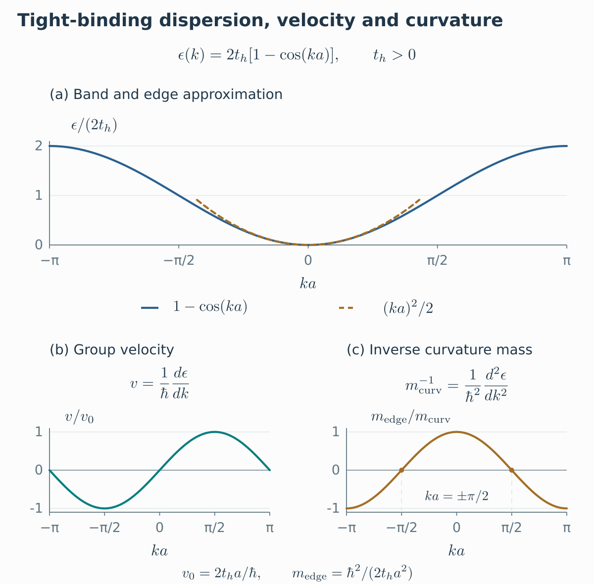
</picture>
<figcaption markdown="span">그림 9. 같은 tight-binding band에서 1차 미분은 wavevector 분포가 좁은 packet의 group velocity를 주고, 2차 미분은 외력에 따른 중심 속도의 변화율을 정한다. 그래프에 그린 inverse mass는 점으로 표시한 inflection point에서 0을 지난다. Band-edge mass를 상수로 쓸 수 있는 범위는 band minimum 근처다.</figcaption>
</figure>



속도는 0이지만 curvature는 0이 아닌 점을 찾고, 이어서 속도는 최대지만 curvature는 0인 점을 찾아보자. Hopping을 키우면 속도의 크기와 curvature가 함께 바뀐다. 다만 dimensionless sine/cosine 곡선의 모양은 그대로다.

<details markdown="1">
<summary>Curvature가 음수면 conductivity도 음수일까?</summary>

아니다. Packet 하나가 어떻게 가속하는지와 모든 전자가 합쳐서 어떤 전류를 만드는지는 다른 문제다. 거의 채워진 band의 maximum 근처에서는 전자가 빠진 상태를 양전하를 띠는 **hole**로 설명할 수 있으며, 이 excitation의 mass는 양수다. 완전히 채워진 band에는 보통의 intraband DC 전류가 흐르지 않는다. 서로 다른 wavevector의 기여가 상쇄되고, 온도가 0이면 같은 band 안에서 occupation을 바꿀 수 있는 가까운 빈 상태도 없기 때문이다.

10절처럼 전체 occupation을 고려해 conductivity를 계산해야 한다. 거기서 사용하는 relaxation 가정에서는 band 일부의 curvature가 음수여도 dissipative conductivity는 음수가 되지 않는다. 거의 채워진 band의 전자 밀도와 음의 curvature mass 하나를 $ne^2\tau/m$에 넣는 계산으로는 이 결과를 얻을 수 없다.

</details>

<details markdown="1">
<summary>하나의 cosine band에서 나타나는 Bloch oscillation</summary>

일정한 전기장 아래에서 packet이 하나의 cosine band에 계속 남는다고 하자. 그러면

$$
\begin{aligned}
&k(t)=k(0)-\frac{eE}{\hbar}t,\\
&v(t)=\frac{2t_ha}{\hbar}\sin[k(t)a],\\
&\omega_B=\frac{e\lvert E\rvert a}{\hbar}.
\end{aligned}
\tag{23}
$$

속도는 $k$에 대해 주기적이므로 끝없이 증가하지 않고 진동한다. 이 **Bloch oscillation**을 계산할 때는 진동 한 주기 동안 scattering과 interband transition을 무시할 수 있다고 가정한다. Band minimum 근처의 parabola를 Brillouin zone 전체에 적용하면 이 운동을 놓치게 된다. 실제로 진동을 관측할 수 있는지는 전기장, scattering, interband transition에 달려 있다. Cosine dispersion이라는 사실만으로 특정 시료에서 진동이 관측된다고 단정할 수는 없다.

</details>

### Anisotropic quadratic band의 mass tensor와 좌표축 회전

두 **principal axis**, 즉 mass matrix가 diagonal이 되는 방향의 mass $m_1,m_2$가 모두 양수인 2차원 quadratic band를 생각하자. Mass가 작은 축 방향으로는 같은 힘에도 packet 중심의 가속도가 크다. Mass matrix와 그 역행렬은 eigenvalue가 모두 양수인 **positive-definite** 행렬이다. 좌표축을 회전시켜도 eigenvalue는 바뀌지 않지만, 실험실 좌표에서 어떤 성분들이 섞이는지는 달라진다. Orthogonal matrix $R$는 길이를 바꾸지 않고 좌표축을 회전시키는 행렬이다. 실험실 좌표에서는

$$
\begin{aligned}
&\epsilon(\mathbf k)=E_c+\frac{\hbar^2}{2}\mathbf k^{T}M^{-1}\mathbf k,\\
&M^{-1}=R\begin{pmatrix}1/m_1&0\\0&1/m_2\end{pmatrix}R^{T},\\
&\dot{\mathbf v}=M^{-1}\mathbf F.
\end{aligned}
\tag{24}
$$

$m_1=0.2m_0$, $m_2=m_0$이고 $30^\circ$ 회전했을 때

$$
m_0M^{-1}=\begin{pmatrix}4&\sqrt3\\\sqrt3&2\end{pmatrix}.
$$

실험실 $x$ 방향으로만 힘을 가해도 packet 중심 속도의 *x*, *y* 성분이 모두 바뀐다. 행렬의 첫 번째 열에서 가속도 성분의 비를 구하면 $a_y/a_x=\sqrt3/4\simeq0.433$이다. 외력과 packet 중심의 가속도가 반드시 평행한 것은 아니다.

```python
angle = np.pi / 6
Raxes = np.array([[np.cos(angle), -np.sin(angle)],
                  [np.sin(angle),  np.cos(angle)]])
inverse_M = Raxes @ np.diag([1 / (0.2 * M0), 1 / M0]) @ Raxes.T
force = np.array([1e-18, 0.0])  # N; this example specifies a force, not an E field.
acceleration = inverse_M @ force
assert np.allclose(M0 * inverse_M, [[4, np.sqrt(3)], [np.sqrt(3), 2]])
print("acceleration direction ay/ax:", acceleration[1] / acceleration[0])
```

이 quadratic band에서 scalar relaxation time이 일정하면 mobility tensor는 $e\tau M^{-1}$가 된다. 전자 drift와 전기장을 연결할 때는 4절에서 쓴 음의 부호를 그대로 적용한다. 회전한 좌표에서 이 tensor에 생기는 off-diagonal 성분은 대칭이며, Hall effect를 뜻하지 않는다. Hall effect는 별도로 고려해야 한다. *y* 방향의 전류를 막는 boundary condition을 적용하면, 그 조건을 만족시키는 전기장이 같은 방향으로 추가로 생긴다. 위의 tensor는 이런 boundary condition을 적용하기 전, 물질 자체의 전기장–전류 관계를 나타낸다.

## 10. Occupation과 Boltzmann equation으로 conductivity 계산하기
{: id="drude-10" }

앞의 속도 관계식은 packet 하나에 대한 식이다. 반면 drift velocity $\mathbf u$는 작은 영역 안에 있는 carrier들의 평균 속도다. 빠르게 움직이는 전자가 많아도 반대 방향으로 움직이는 전자끼리 평균에서 상쇄될 수 있다. 전류를 구하려면 각 상태의 속도에 그 상태의 전자 수를 곱해 더하고 전자의 전하까지 곱해야 한다.

자기장이 없고 두 spin 집단이 같은 분포를 갖는 하나의 band를 생각하자. Dispersion은 wavevector의 방향을 뒤집어도 같아 $\epsilon(-\mathbf k)=\epsilon(\mathbf k)$라고 가정한다. 그러면 group velocity는 $\mathbf v(-\mathbf k)=-\mathbf v(\mathbf k)$를 만족한다. 반대 wavevector의 상태를 짝지으면 equilibrium에서 전류가 상쇄되는 이유를 확인할 수 있다.

Spin 하나당 **occupation**을 $f(\mathbf k)$라 쓰자. 값은 0과 1 사이이지만, 모든 상태에 대해 더한 값이 1일 필요는 없다. 전체 확률을 1로 맞추는 probability distribution과는 다르다. $f=1/2$라면 같은 조건으로 준비한 여러 시스템 중 절반에서 그 상태가 차 있다는 뜻이지, 전자 하나의 전하가 절반이라는 뜻은 아니다. 두 spin 집단을 모두 셀 때의 계수는 $g_s=2$다.

상태 수를 세는 계수는 7절의 유한한 chain과 마찬가지로 periodic boundary condition에서 나온다. 길이가 $L_{\rm box}$인 1차원 box에서는 $e^{ikL_{\rm box}}=1$이어야 하므로 허용되는 wavevector 사이의 간격은 $2\pi/L_{\rm box}$다. 정육면체 box에서 spin 하나당 허용 상태 하나는 wavevector 공간의 부피 $(2\pi/L_{\rm box})^3$에 해당한다. 따라서 작은 부피 $d^3k$ 안의 상태 수를 실제 공간의 box 부피로 나누면

$$
\frac{d^3k}{(2\pi/L_{\rm box})^3}
\frac{1}{L_{\rm box}^3}
=\frac{d^3k}{(2\pi)^3}.
$$

Box를 크게 하는 극한에서 이 상태들의 합을 적분으로 바꿀 수 있다. 두 spin을 포함하면 단위 부피당 상태 수는 $g_s\,d^3k/(2\pi)^3$이며 밀도는 $n=g_s\int f\,d^3k/(2\pi)^3$다. 결정의 band에서는 하나의 Brillouin zone에 대해 적분한다. 아래에서 쓸 이상적인 parabolic-band 모델에서는 모든 wavevector로 적분 범위를 늘린다. 전자들이 차지한 상태가 parabola 근사가 잘 맞는 에너지 범위 안에 있을 때 유용한 근사다.

$T$를 kelvin으로 나타낸 양의 절대온도라 하자. Boltzmann constant $k_B$는 온도에 대응하는 에너지 $k_BT$를 정한다. Thermal equilibrium에서 occupation은 $f_0(\epsilon)=1/[1+\exp((\epsilon-\mu_F)/(k_BT))]$다. **Chemical potential** $\mu_F$는 에너지 단위의 양이며, 아래첨자로 mobility $\mu$와 구분한다. 온도가 주어지면 occupation을 합쳐 정해진 전자 밀도를 얻도록 이 값을 정한다. 저온의 **degenerate** 전자 기체에서는 $\mu_F$ 근처의 좁은 에너지 구간을 사이에 두고 대부분 차 있는 상태와 대부분 빈 상태가 나뉜다. 약한 전기장에 따른 occupation 변화도 주로 이 구간에서 일어난다. 반면 nondegenerate 기체에서는 작은 occupation이 열에너지 범위에 걸쳐 분포한다. Equilibrium에서는 반대 방향으로 움직이는 전자들의 전류가 상쇄되고, 작은 변화 $\delta f=f-f_0$가 생기면 전류가 흐를 수 있다.

$\epsilon=\mu_F$에서 occupation은 $1/2$다. 이보다 에너지가 충분히 낮은 state는 대부분 차 있고, 충분히 높은 state는 대부분 비어 있다. 온도가 높아지면 occupation이 1에서 0으로 바뀌는 구간이 넓어진다. 이 **Fermi–Dirac distribution**에는 spin까지 같은 single-particle state에 전자 둘이 들어갈 수 없다는 조건이 반영되어 있다.

Occupation이 조금 달라지는 예를 보자. 같은 에너지에서 속도가 $+v$와 $-v$이고 상태 수를 셀 때 같은 weight를 갖는 두 상태를 생각하자. 처음에 $f_+=f_-=0.500$이면 두 occupation의 합은 $1.000$이고, 각각에 속도를 곱해 더하면 0이다. Occupation을 $f_+=0.499$, $f_-=0.501$로 바꾸어도 합은 $1.000$으로 같지만

$$
vf_+-vf_-=v(0.499-0.501)=-0.002v.
$$

여기에 전자의 음전하와 두 상태에 공통인 양의 weight를 곱하면 전류는 양수가 된다. 즉, 전자 밀도가 그대로여도 어느 방향의 상태에 전자가 더 많은지에 따라 전류가 흐를 수 있다.

<figure class="drude-figure">
<picture class="rsna-results-figure">
<source media="(max-width: 560px)" srcset="" width="600" height="1160">
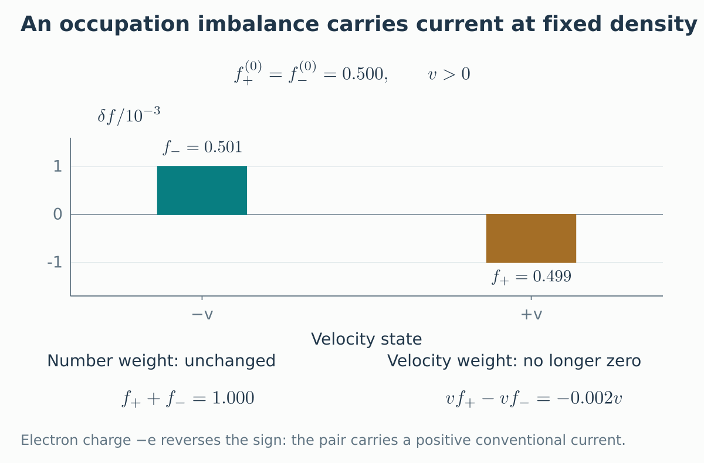
</picture>
<figcaption markdown="span">그림 10. 막대는 occupation 자체가 아니라 변화량 $\delta f$다. 음의 막대는 occupation이 줄었다는 뜻이지 확률이 음수라는 뜻이 아니다. 같은 weight를 갖는 두 상태의 equilibrium occupation은 각각 $0.500$이며, 변화한 값은 $f_+=0.499$와 $f_-=0.501$이다. 두 occupation의 합은 그대로지만 속도를 곱해 더한 값은 음수가 된다. 여기에 전자의 음전하를 곱하면 conventional current에는 양의 값으로 기여한다.</figcaption>
</figure>



Wave packet의 group velocity를 구한 뒤, **kinetic model**에서는 여러 carrier의 occupation이 어떻게 바뀌는지 추적한다. Coherent wavefunction의 상대 위상을 하나하나 계산하는 방법은 아니다. 이런 semiclassical rate 근사는 여러 carrier에 걸쳐 오래 유지되는 phase correlation을 보존하지 않는다. 따라서 정확한 quantum time evolution 전체를 재현하는 것은 아니다.

공간적으로 균일한 시스템에서 **Boltzmann transport equation**은 occupation이 $\mathbf k$ 공간에서 이동하는 과정과 scattering에 의해 바뀌는 과정을 함께 나타낸다. Scattering이 없으면 wavevector가 변하는 동안 그 상태의 occupation은 유지된다. 짧은 시간에 $f(\mathbf k+\dot{\mathbf k}\,dt,t+dt)=f(\mathbf k,t)$이 성립하는 것이다. Taylor expansion으로 occupation이 이동하는 **advection** 항을 구하고, scattering에 의한 단위 시간당 변화 $C[f]$를 더하면

$$
\partial_t f+\dot{\mathbf k}\cdot\nabla_{\mathbf k}f=C[f].
$$

분포가 공간적으로 균일한 steady state에서는 $\partial_t f=0$이고 $\dot{\mathbf k}=-e\mathbf E/\hbar$다. $f=f_0+\delta f$로 쓰고 $\delta f$를 전기장의 1차 항으로 계산하자. 그러면 $\mathbf E\cdot\nabla_{\mathbf k}\delta f$는 2차 항이므로 생략한다. Equilibrium에서는 $C[f_0]=0$이다. 남은 linearized collision term을 $C[\delta f]$라 쓰자.

이제 에너지에만 의존하는 양의 scalar transport time으로 relaxation을 나타내자. Isotropic band의 한 energy shell에서 속력이 일정하고, elastic scattering의 각도 분포가 방향 변화의 각도에만 의존하면 이 형태를 유도할 수 있다. 더 일반적인 band나 scattering에서는 추가로 채택한 근사이며, Taylor expansion만으로 따라오는 결과는 아니다. Linearized balance와 이 relaxation 근사를 함께 쓰면

$$
\begin{aligned}
&-\frac{e\mathbf E}{\hbar}\cdot\nabla_{\mathbf k}f_0
=C[\delta f],\\
&C[\delta f]=-\frac{\delta f}{\tau_{\rm tr}(\epsilon)}.
\end{aligned}
\tag{25}
$$

두 번째 등식은 전류를 만드는 **angular mode**의 relaxation을 나타낸다. 앞의 두 상태 예처럼, 같은 에너지에서도 움직이는 방향에 따라 occupation이 달라지는 성분이다. 모든 분포에 쓸 수 있는 collision 법칙은 아니다. 14절에서는 isotropic elastic scattering kernel에서 이 형태가 나오는 이유를 유도한다.

분포가 steady state라는 말은 전자가 움직이거나 scattering하는 과정이 멈췄다는 뜻이 아니다. 고정된 wavevector에서 보면 전기장 때문에 population이 계속 들어오거나 나가고, scattering도 population을 재분배한다. 식 (25)는 두 변화가 서로 균형을 이루는 조건이다. 방향에 따라 다른 occupation이 일정하게 유지되므로 전류도 일정하다. 전기장을 제거하면 이를 유지하는 작용이 사라지고, scattering이 방향에 따른 occupation 차이를 줄인다.

$\nabla_{\mathbf k}f_0=\hbar\mathbf v\,\partial_\epsilon f_0$를 쓰면 식 (25)에서

$$
\delta f=-e\tau_{\rm tr}(\epsilon)(\mathbf E\cdot\mathbf v)
\left(-\frac{\partial f_0}{\partial\epsilon}\right).
\tag{26}
$$

앞서 가정한 even dispersion과 에너지에만 의존하는 transport time 때문에 전기장이 만든 perturbation은 wavevector를 뒤집으면 부호가 바뀌는 **odd** 성분이다. 짝지은 두 상태의 속도와 occupation 변화는 각각 부호가 반대이므로, 밀도 변화는 적분에서 상쇄된다. 따라서 전기장의 1차 항까지는 전류가 흘러도 equilibrium의 전자 밀도가 유지된다.

오른쪽을 향하는 전기장은 오른쪽으로 움직이는 전자 상태의 occupation을 줄인다. 전자에 작용하는 힘은 왼쪽을 향하지만, packet 중심의 가속도는 band curvature에도 달려 있다. Conductivity matrix는 $J_i=\sum_j\sigma_{ij}E_j$로 정의한다. 각 성분은 $j$ 방향 전기장이 $i$ 방향 전류에 얼마나 기여하는지 나타낸다. 전류를 구할 때는 occupation 변화에 $v_i$를 곱하고, 그 전기장이 만드는 occupation 변화에는 $v_j$가 들어간다. 여기에 전하를 곱해 모든 상태에 대해 더하면 $v_iv_j$의 곱을 포함한 다음 식을 얻는다.

$$
\sigma_{ij}=g_se^2\int\frac{d^3k}{(2\pi)^3}\,
\tau_{\rm tr}(\epsilon)v_iv_j
\left(-\frac{\partial f_0}{\partial\epsilon}\right).
\tag{27}
$$

이 적분에는 특정 $k$의 전자 수만 들어가는 것이 아니다. Occupation이 얼마나 바뀌는지, 속도가 얼마인지, transport time이 얼마인지를 함께 계산한다. 임의의 실수 방향 벡터 $\mathbf a$에 대해 $\mathbf a^T\sigma\mathbf a$는 $\tau_{\rm tr}(\mathbf a\cdot\mathbf v)^2(-\partial_\epsilon f_0)$의 적분이므로 음수가 아니다. Band의 일부에서 curvature가 음수라고 해서 conductivity도 음수가 되는 것은 아니다.

Isotropic parabolic band에서 양의 mass와 $\tau$가 일정하면 integration by parts로 scalar Drude 식을 얻는다. 여기서 $\delta_{ij}$는 **Kronecker delta**로, $i=j$이면 1이고 $i\ne j$이면 0이다. 이 isotropic 모델에서는 각 방향의 전류가 같은 방향의 전기장에만 비례한다는 뜻이다.

$$
\begin{aligned}
&g_s\int\frac{d^3k}{(2\pi)^3}v_iv_j
\left(-\frac{\partial f_0}{\partial\epsilon}\right)
=\frac{n}{m^{\ast}}\delta_{ij},\\
&\sigma_{ij}=\frac{ne^2\tau}{m^{\ast}}\delta_{ij}.
\end{aligned}
\tag{28}
$$

Fermi–Dirac occupation에서도 transport time이 거의 일정하고 dispersion이 quadratic이면 같은 간단한 Drude 식을 얻는다. Statistics는 전자 분포를 정하고, 어떤 scattering이 중요한지에도 영향을 준다. [Tong, Sec. 3.2.5][dynamics]; [Giustino, transport discussion and erratum][giustino]

<details markdown="1">
<summary>Integration by parts로 Drude 식을 얻는 과정과 particle conservation</summary>

Quadratic band에서는 $\partial_{k_i}v_j=\hbar\delta_{ij}/m^{\ast}$다. $\partial_{k_i}(v_jf_0)$를 모든 $\mathbf k$에 대해 적분하자. 높은 에너지에서 $f_0$가 감소하므로 boundary term은 사라진다. 남는 두 항은 $\hbar\delta_{ij}\int f_0/m^{\ast}$와 $\hbar\int v_iv_j\partial_\epsilon f_0$이며, 정리하면 식 (28)이 된다. 일정한 positive-definite mass matrix에도 같은 계산을 적용하면 $\sigma=ne^2\tau M^{-1}$를 얻는다.

반면 임의의 밀도 변화에 $C[f]=-(f-f_0^{\rm fixed})/\tau$를 적용하면 $\int C\propto-(n-n_0)/\tau$가 되어 실제로는 없는 particle source나 sink를 만들게 된다. 식 (25)에서는 밀도를 고정한 채 전류를 만드는 odd perturbation에만 이 근사를 적용했다. 분포가 시간에 따라 변하고 공간적으로도 균일하지 않은 kinetic model에서는 입자 수를 보존하는 collision operator를 쓰거나, 각 위치의 밀도에 맞게 local equilibrium을 정해야 한다. [MS-BTE 유도]({{ site.baseurl }}/posts/Multi-Subband-Boltzmann-Transport-From-Scratch/)에서도 이 보존 조건을 검사한다.

일반적인 anisotropic band나 scattering kernel에서는 scalar $\tau(\epsilon)$ 하나로 linearized Boltzmann equation을 풀 수 없을 수 있다. 이때는 추정한 lifetime을 식 (27)에 넣는 대신, 전기장에 따라 각 방향의 occupation이 얼마나 바뀌는지를 직접 구해야 한다.

</details>

## 11. Transition amplitude와 Fermi's golden rule
{: id="drude-11" }

Band를 계산하면 속도와 mass를 알 수 있지만, conductivity에 필요한 relaxation time $\tau$까지 정해지는 것은 아니다. 이 시간을 계산하려면 한 상태에서 다른 상태로 옮겨 갈 확률을 알아야 한다. Eigenstate $\lvert a\rangle$와 에너지 $E_a$를 알고 있는 Hamiltonian $H_0$에서 시작하자. 결정 속 전자라면 완벽하게 주기적인 격자의 효과는 이미 $H_0$에 들어 있다. 여기에 impurity potential 같은 약한 정적 perturbation $U$를 더하고, 계산에서는 $t=0$에 켠다고 하자. **Matrix element** $M_{ba}=\langle b\lvert U\rvert a\rangle$는 이 perturbation이 두 상태를 얼마나 결합하는지 나타내며 에너지 단위를 갖는다.

처음에 $H_0$의 eigenstate 하나를 준비해도, $U$를 더한 전체 Hamiltonian의 eigenstate는 아닐 수 있다. 따라서 시간이 지나면 다른 $H_0$ 상태의 amplitude가 생긴다. Impurity potential 자체가 시간에 따라 진동하지 않아도 들어오는 전자를 scattering할 수 있는 이유다. 정확한 시간 변화는 여전히 coherent한 Schrödinger evolution이다. Transition rate를 얻으려면 추가로 평균하는 과정이 필요하며, 전자가 impurity를 만날 때마다 wavefunction을 즉시 초기화한다는 별도 규칙을 가정하는 것은 아니다.

시간에 따라 변하는 상태를 이 basis로 전개하자.

$$
\lvert\psi(t)\rangle=\sum_b c_b(t)e^{-iE_bt/\hbar}\lvert b\rangle.
$$

$H_0$에 따른 시간 변화는 exponential phase factor로 따로 적었다. 남은 계수 $c_b(t)$는 $U$ 때문에 바뀐다. 이것을 **interaction-picture coefficient**라 부른다. 처음에는 $c_a(0)=1$이고 나머지 계수는 0이다. 이 전개를 Schrödinger equation에 넣고 우변의 계수를 초기값으로 놓으면 아래의 1차 적분식을 얻는다. Perturbation이 Hermitian이어도 matrix element는 복소수일 수 있다. 따라서 확률을 구할 때는 켤레복소수 없이 제곱하면 안 되고 절댓값의 제곱을 써야 한다.

서로 다른 final state $b\ne a$에 대해 1차 time-dependent perturbation theory로 구한 interaction-picture coefficient는

$$
c_b^{(1)}(t)=-\frac{i}{\hbar}\int_0^t
M_{ba}e^{i(E_b-E_a)t'/\hbar}\,dt'.
\tag{29}
$$

Probability amplitude는 무차원 복소수다. Amplitude가 간섭할 때는 위상이 중요하다. Transition probability는 amplitude 자체가 아니라 그 절댓값의 제곱이다. $\Delta E=E_b-E_a$라 쓰면

$$
\begin{aligned}
&P_{a\to b}^{(1)}(t)\\
&=\frac{4\lvert M_{ba}\rvert^2}{(\Delta E)^2}\sin^2\!\left(\frac{\Delta E\,t}{2\hbar}\right)\\
&=\frac{\lvert M_{ba}\rvert^2t^2}{\hbar^2}\operatorname{sinc}^2\!\left(\frac{\Delta E\,t}{2\hbar}\right),
\end{aligned}
\tag{30}
$$

여기서 $\operatorname{sinc}z=\sin z/z$이고 $\operatorname{sinc}0=1$이다. 확률에 붙인 위첨자는 first-order amplitude로 계산했다는 표시다. 표시한 확률은 perturbation $U$의 제곱에 비례하는 항이며, 1차 항이라는 뜻은 아니다. 코드의 `first_order_probability`도 같은 의미로 이름을 붙였다.

두 에너지가 같아도 $P\simeq\lvert M_{ba}\rvert^2t^2/\hbar^2$로 유한하다. 따라서 에너지가 같은 두 상태만 있는 고립된 시스템에서는 단위 시간당 transition probability가 곧바로 일정해지는 것이 **아니다**. 1차 perturbation theory는 계산된 transition probability들이 작을 때만 신뢰할 수 있다. [MIT, time-dependent perturbation theory, Sec. 4.3.1][golden]

코드에서 **detuning**이라고 부르는 값은 에너지 차이 $\Delta E$다. Detuning이 0이면 initial state와 final state의 에너지가 같다는 뜻이며, coupling이나 transition probability가 0이라는 뜻은 아니다.

```python
def first_order_probability(detuning_eV, coupling_eV, time_s):
    # np.sinc(y)=sin(pi*y)/(pi*y), unlike the sinc convention in Eq. (30).
    delta = np.asarray(detuning_eV) * E_CHARGE
    coupling = coupling_eV * E_CHARGE
    z = delta * time_s / (2 * HBAR)
    return (np.abs(coupling) * time_s / HBAR)**2 * np.sinc(z / np.pi)**2

detunings = np.linspace(-0.1, 0.1, 501)
probability = first_order_probability(detunings, 0.001, 50e-15)
p_resonant = first_order_probability(0.0, 0.001, 50e-15)
assert np.isclose(probability.max(), p_resonant)
assert 0 < p_resonant < 0.01  # A weak-transition example, not an exact Rabi solution.
assert np.isclose(first_order_probability(0.0, 0.001j, 50e-15), p_resonant)
print("First-order resonant probability:", p_resonant)
```

**Continuum**은 final state의 에너지 준위들이 충분히 촘촘해서 상태에 대한 합을 에너지 적분으로 근사할 수 있는 경우다. **Density of states**는 각 에너지 구간에 상태가 몇 개 있는지 센다. 각 상태의 occupation은 별개의 정보다. 먼저 유한한 시간 동안의 transition probability를 이 상태들에 대해 합하자. 여기서 **coarse-graining**은 빠르게 진동하는 위상 변화를 평균한 뒤 population이 천천히 바뀌는 부분을 남기는 것이다. Coupling이 약하고 final state가 충분히 촘촘해야 한다. 시간이 길어지면 에너지 peak의 폭은 $1/t$에 비례해 좁아지고 적분 면적은 $t$에 비례해 커진다. 이 관계에서 **Fermi's golden rule**을 얻는다.

$$
\begin{aligned}
&W_{a\to b}=\frac{2\pi}{\hbar}\lvert M_{ba}\rvert^2\delta(E_b-E_a),\\
&\Gamma_a=\sum_{b\ne a} W_{a\to b}.
\end{aligned}
\tag{31}
$$

Dirac delta는 final state에 대한 합이나 적분 안에서 에너지 보존을 적용하며, 단위는 에너지의 역수다. $\delta(0)$을 유한한 수처럼 직접 계산해서는 안 된다. Continuum에서는 $W_{a\to b}$를 rate kernel로 해석한다. 이를 적분한 $\Gamma_a$는 유한한 rate이며 단위는 시간의 역수다.

공명에 가까운 상태 하나의 transition probability는 시간의 제곱에 비례하지만, 기여하는 에너지 구간의 폭은 시간에 반비례해 줄어든다. 매끄러운 continuum에서 이를 합하면 전체 확률은 시간에 비례하며 그 계수가 rate가 된다. 정적인 perturbation에서는 에너지 delta에 따라 scattering이 **elastic**하다. Impurity 때문에 전자의 momentum이나 방향은 바뀌어도 전자가 impurity에 에너지를 잃지는 않는 것이다. 여러 전자가 있는 분포에서 어떤 transition이 실제로 기여하는지는 occupation도 함께 고려해야 한다.

유한한 시간에 계산한 peak의 에너지 폭은 대략 $\hbar/t$다. Matrix element와 density of states가 뚜렷하게 변하는 에너지 척도를 $W_{\rm smooth}$, 실제 준위 사이의 간격을 $\delta E_{\rm level}$이라 하자. 필요한 시간 구간은 $\hbar/W_{\rm smooth}\ll t\ll\hbar/\delta E_{\rm level}$이다. Peak의 폭은 앞의 에너지 척도보다 좁아야 하지만, 그 안에는 여전히 많은 준위가 들어 있어야 한다. 1차 perturbation theory를 쓰려면 **전체** transition probability도 $\Gamma_a t\ll1$이어야 한다. 더 긴 시간의 지수적 감쇠를 기술하는 kinetic model에는 과거 이력에 대한 기억이 사라진다는 추가 근사가 필요하다. 닫힌 two-level system의 정확한 시간 변화와는 다르다. [MIT, Lecture 26][golden-lecture]

<figure class="drude-figure">
<picture class="rsna-results-figure">
<source media="(max-width: 560px)" srcset="" width="600" height="1410">

</picture>
<figcaption markdown="span">그림 11. Coupling은 $1\,\mathrm{meV}$로 고정하고 reference time은 $t_0=25\,\mathrm{fs}$로 정했다. (a) 시간이 달라지면 peak의 높이와 폭이 달라진다. 정확한 resonance에서는 확률이 시간의 제곱에 비례한다. (b) $\mathrm{Area}=\int_{-\infty}^{\infty}(P/P_{\rm ref})\,d\delta$에는 (a)에 보인 구간 바깥의 tail도 포함된다. 이는 dimensionless kernel의 면적이지 전체 transition probability 자체가 아니다. 그래프에 표시한 비율 $\mathrm{Area}/(2\pi)=t/t_0$는 시간에 비례한다. Final state가 충분히 촘촘하고 그 density가 매끄러우면, 에너지 적분을 통해 전체 transition probability를 구할 수 있다. 여기서 계산한 single-state probability는 first-order amplitude를 쓸 수 있을 만큼 작다.</figcaption>
</figure>



<details markdown="1">
<summary>각 상태의 transition probability는 시간의 제곱인데, 합은 왜 시간에 비례할까?</summary>

Coupling $M$과 전체 final-state DOS $D_f$가 $E_a$ 근처에서 거의 일정하다고 하자. $D_f\,dE$는 선택한 initial state에서 에너지 구간 $dE$ 안에 있는 final state의 수다. $D_f$의 단위는 에너지의 역수이며, **단위 부피당** 값이 아니다. 15절의 단위 부피당 DOS와 구분해야 한다. $\Delta E=E_b-E_a$를 쓰면

$$
\begin{aligned}
P_{\rm sum}(t)&\simeq\int_{-\infty}^{\infty}
D_f\,P_{a\to b}^{(1)}(t)\,d\Delta E\\
&=\frac{2\lvert M\rvert^2D_f t}{\hbar}
\int_{-\infty}^{\infty}\operatorname{sinc}^2y\,dy\\
&=\frac{2\pi}{\hbar}\lvert M\rvert^2D_f t.
\end{aligned}
$$

변수 치환은 $y=\Delta E\,t/(2\hbar)$이고, $\int_{-\infty}^{\infty}\operatorname{sinc}^2y\,dy=\pi$다. 공명하는 각 상태의 transition probability는 $t^2$에 비례하지만, 기여하는 상태들의 에너지 폭은 $1/t$에 비례해 줄어든다. 따라서 합은 $t$에 비례하며 rate는 $\Gamma=2\pi\lvert M\rvert^2D_f/\hbar$다. 적분 범위를 무한대로 늘린 것은 넓은 continuum의 경계에서 충분히 멀리 떨어진 peak를 근사한 것이다. 실제 band가 모든 에너지에 걸쳐 있다는 가정은 아니다.

Transition probability가 작은 계산 예제로, detuning이 $-1$부터 $1\,\mathrm{eV}$인 구간에서 $M=10^{-7}\,\mathrm{eV}$, $D_f=10^6\,\mathrm{eV}^{-1}$로 두자. 아래 grid는 continuum 적분을 계산하기 위한 것이며 실제 개별 에너지 준위의 위치가 아니다.

```python
continuum_detunings = np.linspace(-1.0, 1.0, 40001)  # eV.
continuum_coupling_eV, continuum_dos_per_eV = 1e-7, 1e6
continuum_gamma = (2 * np.pi * abs(continuum_coupling_eV)**2
                   * continuum_dos_per_eV / (HBAR / E_CHARGE))
for continuum_time in (50e-15, 100e-15, 200e-15):
    continuum_p = first_order_probability(
        continuum_detunings, continuum_coupling_eV, continuum_time)
    continuum_total = continuum_dos_per_eV * np.sum(
        (continuum_p[:-1] + continuum_p[1:]) / 2
        * np.diff(continuum_detunings))
    assert 0 < continuum_total < 1e-3
    assert np.isclose(continuum_total / continuum_time,
                      continuum_gamma, rtol=0.01)
    print("time (fs), total P, rate / golden rate:",
          continuum_time * 1e15, continuum_total,
          continuum_total / continuum_time / continuum_gamma)
```

Golden-rule rate는 약 $9.54584\times10^7\,\mathrm{s}^{-1}$다. 유한한 에너지 구간에서 구한 rate를 이 값으로 나누면 $0.99156$, $0.99578$, $0.99790$이며, 각 시간에서 전체 transition probability는 $2\times10^{-5}$보다 작다.

</details>

## 12. Matrix element 계산: wavefunction의 overlap과 momentum transfer
{: id="drude-12" }

Golden rule은 matrix element의 절댓값 제곱으로 rate를 구한다. Matrix element를 계산하려면 impurity potential과 initial/final state가 모두 필요하다. 위치 공간에서는 initial wavefunction에 perturbing potential을 곱한 뒤, final wavefunction의 complex conjugate와 곱해 위치에 대해 적분한다. 따라서 impurity의 공간적 형태와 wavefunction이 모두 rate에 영향을 준다.

Scalar **effective-mass envelope approximation**은 각 Bloch wave에서 원자 주기로 변하는 부분을 직접 풀지 않고 envelope로 band edge 근처의 운동을 나타낸다. 아래의 plane wave는 이 envelope에 대한 것이며, periodic cell 안의 overlap은 따로 계산하지 않는다. 공간에 퍼진 이 wave들은 계산의 basis다. 7절에서 Bloch state를 겹쳐 packet을 만들었듯이, 이들을 겹쳐 localized incoming packet을 만들 수 있다. Basis로 쓴다고 해서 localized electron 하나를 extended plane wave 하나로 표현하는 것은 아니다.

일정한 양의 effective mass를 갖는 isotropic parabolic band에서, 큰 normalization volume $\mathcal V$에 box-normalized envelope plane wave $\psi_{\mathbf k}=e^{i\mathbf k\cdot\mathbf r}/\sqrt{\mathcal V}$를 쓰자. $1/\sqrt{\mathcal V}$는 각 상태의 확률을 공간 전체에서 적분했을 때 1이 되게 하는 계수다. 이것은 상태 수를 세기 위한 box다. 실제 소자의 크기를 뜻하지 않으며 contact resistance를 계산하는 모델도 아니다. 공간의 한 영역에 집중된 localized potential $U(\mathbf r)$에 대해

$$
\begin{aligned}
&M_{\mathbf k'\mathbf k}=\frac{1}{\mathcal V}\int d^3r\,U(\mathbf r)e^{-i(\mathbf k'-\mathbf k)\cdot\mathbf r}\\
&=\frac{\widetilde U(\mathbf q)}{\mathcal V},\\
&\mathbf q=\mathbf k'-\mathbf k,\\
&\widetilde U(\mathbf q)=\int d^3r\,U(\mathbf r)e^{-i\mathbf q\cdot\mathbf r}.
\end{aligned}
\tag{32}
$$

Initial wave에 final wave의 complex conjugate를 곱하면 두 wavevector의 차이가 생겨 exponential 안에 $\mathbf q$가 들어간다. **Fourier transform**은 공간에 따른 potential을 여러 wavevector 성분으로 나누는 연산이며, 이 overlap은 그중 두 wavevector의 차이에 해당하는 성분을 고른다. 벡터 $\hbar\mathbf q$가 crystal-momentum transfer다. 이 convention에서 $U$의 단위는 에너지, $\widetilde U$는 에너지와 부피의 곱, $M$은 에너지다.

Potential이 공간에 따라 천천히 바뀌면, 빠르게 진동하는 overlap을 적분할 때 대부분 상쇄되므로 큰 $q$의 기여가 작다. Momentum transfer가 작다는 것은 initial wavevector와 final wavevector가 가깝다는 뜻이다. 여기서 쓰는 parabolic band의 elastic scattering에서는 두 wavevector의 크기가 같으므로, 작은 transfer는 방향도 조금만 바뀐다는 뜻이다. 반면 short-range perturbation은 큰 momentum transfer에서도 상당한 Fourier 성분을 가질 수 있다.

1차원에서 직접 계산하기 위해 적분한 세기 $g=\int U(x)\,dx$를 고정하고 폭 $\ell$을 바꾸자.

$$
\begin{aligned}
&U_\ell(x)=\frac{g}{\sqrt{2\pi}\ell}e^{-x^2/(2\ell^2)},\\
&\widetilde U_\ell(q)=g\,e^{-q^2\ell^2/2},\\
&M_{k'k}=\frac{\widetilde U_\ell(k'-k)}{\mathcal L}.
\end{aligned}
\tag{33}
$$

여기서 $g$와 $\widetilde U$의 단위는 에너지와 **길이**의 곱이며 $\mathcal L$은 normalization length다. $g$를 고정한 채 $\ell$을 두 배로 늘리면 potential의 peak는 절반이 되고, $\widetilde U(0)=g$는 그대로이며, 큰 momentum transfer는 더 강하게 억제된다.

$q\ell_0=1$에서 normalized Fourier amplitude $\widetilde U/g$는 폭이 좁은 perturbation에서 약 0.6065, 넓은 perturbation에서는 약 0.1353이다. 절댓값을 제곱하면 각각 약 0.3679와 0.0183이 된다. Golden rule에는 이 제곱이 들어가므로, 적분한 세기가 같아도 특정 momentum transfer에서의 scattering은 같지 않다.

```python
ell0, box_length = 1e-9, 100e-9
g_1d = 0.1 * E_CHARGE * 1e-9  # 0.1 eV nm; energy times length.
x_grid = np.linspace(-12 * ell0, 12 * ell0, 12001)
dx = x_grid[1] - x_grid[0]
q_probe = 1.0 / ell0
for ell in (ell0, 2 * ell0):
    potential = g_1d / (np.sqrt(2 * np.pi) * ell) * np.exp(-x_grid**2 / (2 * ell**2))
    fourier_numeric = np.sum(potential * np.exp(-1j * q_probe * x_grid)) * dx
    fourier_exact = g_1d * np.exp(-0.5 * (q_probe * ell)**2)
    assert np.isclose(fourier_numeric / g_1d, fourier_exact / g_1d, atol=1e-8)
    print("width (nm), M (eV):", ell * 1e9, fourier_exact / box_length / E_CHARGE)
```

<figure class="drude-figure">
<picture class="rsna-results-figure">
<source media="(max-width: 560px)" srcset="" width="600" height="1510">
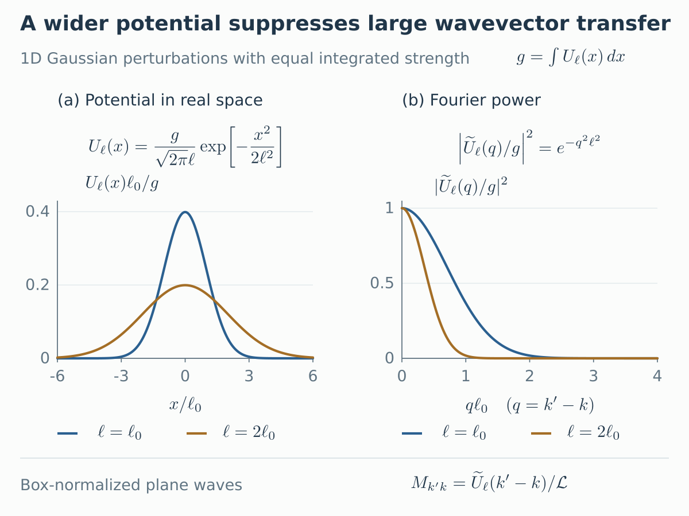
</picture>
<figcaption markdown="span">그림 12. 기준 폭은 $\ell_0$이며 두 곡선은 $\ell=\ell_0$와 $2\ell_0$를 사용한다. 두 1차원 Gaussian perturbation에서 같은 것은 peak 높이가 아니라 적분한 세기 $g$다. 여기서 $q$는 wavevector transfer이며, momentum transfer는 $\hbar q$다. Transfer가 0일 때 Fourier power는 같지만, 넓은 perturbation은 큰 $q$를 더 강하게 억제한다. Matrix element의 제곱에도 같은 의존성이 나타난다.</figcaption>
</figure>



물질 안에는 impurity가 여러 개 있다. 공간적으로 균일한 평균 potential은 band energy에 포함한다. 남은 scattering 기여를 서로 상관없는 impurity 위치에 대해 평균하면, 위치에 따라 달라지는 간섭항이 사라져 평균 rate가 impurity density $n_i$에 비례한다. 임의로 정한 normalization volume은 final-state 수와 결합하면 결과에서 사라진다. 물질의 lifetime은 계산용 box의 크기가 아니라 실제 impurity density로 정해져야 한다.

<details markdown="1">
<summary>불순물이 여러 개일 때 normalization box의 크기는 왜 결과에서 사라질까?</summary>

서로 상관없는 위치 $\mathbf R_\alpha$에 같은 불순물 $N_i$개가 있으면 matrix element에 $\sum_\alpha e^{-i\mathbf q\cdot\mathbf R_\alpha}$가 들어간다. 위치에 대해 평균하면 절댓값의 제곱 중 incoherent 성분은 $N_i$가 된다. 공간적으로 균일한 평균 potential은 scattering event로 세지 않고 band energy에 포함한다. Incoherent scattering 성분에 대해서는

$$
\begin{aligned}
&\left\langle\lvert M_{\mathbf k'\mathbf k}^{\rm total}\rvert^2\right\rangle
=\frac{N_i}{\mathcal V^2}\lvert\widetilde U(\mathbf q)\rvert^2,\\
&n_i=\frac{N_i}{\mathcal V}.
\end{aligned}
\tag{34}
$$

Final state에 대한 합에서 $\mathcal V\int d^3k^{\prime}/(2\pi)^3$가 나온다. 이를 $N_i/\mathcal V^2$와 결합하면 임의의 box 크기와 무관한 실제 불순물 밀도 $n_i$만 남는다. 불순물 위치 사이에 상관관계가 있으면 structure factor가 추가된다. 위치가 서로 무관하다는 것은 모든 disordered crystal의 성질이 아니라 이 모델의 가정이다.

실제 Bloch-state matrix element에는 periodic cell 안의 overlap, orbital character, spin, band index도 들어갈 수 있다. 식 (32)는 이를 scalar envelope로 근사한 경우다.

</details>

## 13. Matrix element, scattering amplitude, cross section
{: id="drude-13" }

12절의 3차원 isotropic parabolic envelope 모델과 약하고 독립적인 정적 impurity 가정을 유지하자. Golden rule을 적용하면 가능한 final wavevector들의 기여를 더하게 된다. 각 항에는 coupling의 절댓값 제곱이 들어가고, 에너지 delta는 elastic final state만 남긴다. Impurity density $n_i$는 단위 부피당 impurity 수다. Initial state의 spin을 하나 정하고 impurity가 spin을 뒤집지 않는다고 가정하면, 같은 spin의 final state만 세므로 이 rate에 spin 계수 $g_s$를 추가하지 않는다. 전체 rate는

$$
\begin{aligned}
&\Gamma_q(\mathbf k)=\frac{1}{\tau_q}\\
&=\frac{2\pi n_i}{\hbar}\int\frac{d^3k'}{(2\pi)^3}\lvert\widetilde U(\mathbf k'-\mathbf k)\rvert^2\delta(\epsilon_{\mathbf k'}-\epsilon_{\mathbf k}).
\end{aligned}
\tag{35}
$$

$\tau_q$의 아래첨자 $q$는 **quantum**을 줄인 표기이며 momentum-transfer wavevector $\mathbf q$가 아니다. 이 weak-disorder 근사에서의 **single-particle 또는 quantum elastic lifetime**을 나타낸다. 과거 이력에 대한 기억이 없는 rate 모델에서는 전체 rate의 역수가 선택한 initial state를 떠날 때까지의 평균 대기시간이다. 각 scattering이 전류를 얼마나 바꾸는지는 따지지 않고 모든 각도의 scattering을 센다. 일반적인 many-body lifetime이나 electron–hole recombination time, 전자가 에너지를 잃고 냉각되는 시간을 뜻하지 않는다.

같은 impurity를 outgoing wave의 방향과 flux로 나타낼 수도 있다. 이때 쓰는 **scattering amplitude**는 앞의 시간에 따라 변하는 계수와는 다른 양이다. 3차원의 localized scatterer에 $z$ 방향으로 wave가 입사할 때, 멀리 떨어진 stationary scattering state는 아래 형태다. 첫 항은 들어오는 plane wave이고, 두 번째 항은 바깥으로 퍼지는 spherical wave다. 거리가 늘수록 이 wave가 퍼지는 면적은 거리의 제곱에 비례해 커진다. 여기서 $r$은 scatterer에서 떨어진 거리이며, 입사 wavevector의 양의 크기를 $k>0$로 썼다. Polar angle $\theta$는 입사 방향에서 잰 각도이며, $\phi$는 그 축 주위의 azimuthal angle이다.

Outgoing flux를 incoming flux와 비교하기 위해 입사 amplitude를 1로 정했다. 식 (32)의 box-normalized state와 달리, 이 stationary scattering state는 공간 전체의 확률 적분을 1로 맞춘 상태가 아니다. **First Born approximation**은 perturbation이 없을 때의 incident wave로 potential에 대한 1차 scattering을 계산하며, 아래 두 번째 식을 준다.

$$
\begin{aligned}
&\psi(\mathbf r)\simeq e^{ikz}+f_{\rm sc}(\theta,\phi)\frac{e^{ikr}}{r},\\
&f_{\rm sc}^{\rm Born}(\theta,\phi)
=-\frac{m^{\ast}}{2\pi\hbar^2}\widetilde U(\mathbf q).
\end{aligned}
\tag{36}
$$

바깥으로 퍼지는 outgoing wave의 계수 $f_{\rm sc}$는 $1/r$에 곱해지므로 길이 단위다. 에너지 단위인 $M_{ba}$나 시간에 따라 변하는 무차원 계수 $c_b(t)$와는 다르다. 단위가 다르므로 서로 바꾸어 쓸 수 없다. [Zwiebach, Scattering, Sec. 7.3][born]; [Tong, Scattering Theory, Sec. 6.3][tong-scattering]

**Solid angle**은 구면에서 원뿔 모양으로 벌어진 방향의 범위를 잰다. 작은 범위는 $d\Omega=\sin\theta\,d\theta\,d\phi$로 나타낸다. **단위 시간·단위 입체각당** 흩어지는 입자 수를 입사 flux density, 즉 단위 면적·단위 시간당 들어오는 입자 수로 나누면 **differential cross section**을 얻는다. 단위는 면적/steradian이다.

$$
\begin{aligned}
&\frac{d\sigma_{\rm sc}}{d\Omega}=\lvert f_{\rm sc}(\theta,\phi)\rvert^2,\\
&\sigma_{\rm sc}^{\rm total}=\int d\Omega\,\lvert f_{\rm sc}\rvert^2.
\end{aligned}
\tag{37}
$$

면적 $\sigma_{\rm sc}$는 전기 conductivity $\sigma$와 다른 양이며, impurity의 기하학적 면적과 같을 필요도 없다. 입사 particle flux에 곱해 흩어지는 rate를 구하는 effective area다. Particle flux는 전하량을 곱하지 않고 입자 수를 센다. 전류를 구할 때는 입자의 운동에 전하량까지 곱한다. 이 관계는 3차원 cross section에 대한 식이다. 12절의 1차원 Fourier 예제는 상태 수를 세는 방식이 다르므로 3차원 cross-section 공식으로 쓸 수 없다. 입사 속도가 $v=\hbar k/m^{\ast}$이고 impurity density가 $n_i$이면

$$
\Gamma_q=n_iv\int d\Omega\,\frac{d\sigma_{\rm sc}}{d\Omega}.
\tag{38}
$$

단위는 $(\mathrm{m}^{-3})(\mathrm{m/s})(\mathrm{m}^2)=\mathrm{s}^{-1}$다. 식 (38)은 식 (35)와 일치한다. $k^{\prime}$에 대한 radial integral에서 에너지 delta가 $m^{\ast}k/\hbar^2$를 주기 때문이다. 같은 rate를 momentum 공간의 상태 수로 계산하거나 입사 flux로 계산한 것이다.

예를 들어 $n_i=10^{22}\,\mathrm{m}^{-3}$, $v=10^5\,\mathrm{m/s}$, $\sigma_{\rm sc}^{\rm total}=10^{-18}\,\mathrm{m}^2$으로 정하면 전체 rate는 $10^9\,\mathrm{s}^{-1}$이고 평균 대기시간은 1 ns다. 이 값은 scattering이 얼마나 자주 일어나는지를 셀 뿐, 전류가 얼마나 크게 바뀌는지는 나타내지 않는다. 방향이 조금 바뀌는 경우와 완전히 반대로 바뀌는 경우를 모두 한 번으로 세지만, 두 경우가 drift에 미치는 영향은 다르다.

<figure class="drude-figure">
<picture class="rsna-results-figure">
<source media="(max-width: 560px)" srcset="" width="600" height="1480">

</picture>
<figcaption markdown="span">그림 13. 왼쪽은 3D wave를 한 단면에서 본 그림이다. 선들은 phase가 같은 위치를 표시하며, 한 wavelength씩 떨어져 있다. 점선의 radial 화살표는 좌표를 나타내고 입자의 경로는 아니다. 예제에서는 일정한 Born amplitude $f_{\rm sc}=-a_B$를 골랐으며, $a_B>0$는 길이 단위의 parameter다. Amplitude의 절댓값을 제곱하면 differential cross section이 되고, 모든 방향에서 적분하면 total cross section이 된다. 오른쪽의 입력값으로 본문에서 계산한 total event rate와 lifetime을 다시 구할 수 있다.</figcaption>
</figure>

Born approximation을 쓰려면 관심 있는 조건에서 scattering potential이 충분히 약해야 한다. 불순물의 농도가 낮으면 각각을 독립적으로 평균한다는 가정은 타당해지기 쉽다. 하지만 농도를 낮춘다고 강한 개별 scatterer가 약해지는 것은 아니다. 실제 물질에서는 potential, screening, wavefunction을 정하고 perturbation 근사가 유효한지도 확인해야 한다.

## 14. Angular scattering의 quantum·transport relaxation time
{: id="drude-14" }

Total rate는 조금 꺾이는 scattering도 방향이 완전히 뒤집히는 scattering도 각각 하나의 사건으로 센다. 하지만 두 사건이 전류를 줄이는 정도는 다르다. 조금 꺾이면 원래 방향의 속도 성분이 거의 남지만, 완전히 뒤집히면 그 성분의 부호가 바뀐다. 따라서 전류가 줄어드는 속도를 구하려면 사건 수뿐 아니라 scattering 이후 방향도 알아야 한다.

Dispersion이 isotropic이고, 한 에너지에서 elastic scattering이 입사 방향과 scattering 이후 방향 사이의 각도 $\theta$에만 의존한다고 하자. 여기서 사용하는 energy shell에서는 elastic scattering으로 방향만 바뀌고 속력은 바뀌지 않는다. Isotropic model에서는 어느 입사 방향에서도 같은 각도 규칙을 적용할 수 있다. 그러면 남은 변화는 방향만으로 기술할 수 있다. 여기서 hat은 단위 방향 벡터 $\widehat{\mathbf k}=\mathbf k/\lvert\mathbf k\rvert$를 나타낸다. 단위 입체각당 rate를 $w(\theta)=n_iv\,d\sigma_{\rm sc}/d\Omega$로 정의하자. Scattering은 선택한 방향에서 전자를 내보내기도 하고 다른 방향의 전자를 데려오기도 한다. 모든 방향에서 같은 equilibrium occupation은 이 gain과 loss에서 상쇄되므로 linearized angular collision operator에는 분포의 변화만 남는다.

$$
C[\delta f](\widehat{\mathbf k})
=\int d\Omega'\,w(\theta)
\left[\delta f(\widehat{\mathbf k}')-\delta f(\widehat{\mathbf k})\right].
\tag{39}
$$

이번에는 $\mathbf k$와 $\mathbf E$ 사이의 각도를 $\alpha$라 하자. Scattering 전후의 각도 $\theta$와는 다르다. 한 에너지에서 식 (26)의 분포 변화는 $\delta f=A\cos\alpha$ 꼴이다. $A$는 occupation 변화의 부호가 있는 작은 실수 계수이며, 도선 단면적과는 별개다. 서로 반대쪽 반구에서 occupation이 반대 부호로 바뀌는 이 패턴을 dipole이라 부른다. 전자의 경우 전기장과 반대로 움직이는 쪽의 occupation은 늘고 전기장 방향으로 움직이는 쪽은 줄어든다. 전하가 음수이므로 이렇게 생긴 conventional current는 전기장 방향이다. 바로 이 분포 변화가 전류를 만든다. 모든 방향의 occupation이 같다면 서로 반대인 속도의 기여가 상쇄될 것이다.

방위각에 대해 평균하면 $\widehat{\mathbf k}^{\prime}$ 중 입사 방향에 수직인 성분은 상쇄된다. 따라서 scattering 이후의 perturbation을 평균하면 $A\cos\alpha\cos\theta$가 되고, gain에서 loss를 뺀 항은 각도 적분 전에 $A\cos\alpha(\cos\theta-1)$이다. 이 때문에 식 (39)는 $C=-\delta f/\tau_{\rm tr}$가 되며

$$
\begin{aligned}
&\frac{1}{\tau_q}=\int d\Omega\,w(\theta),\\
&\frac{1}{\tau_{\rm tr}}=\int d\Omega\,w(\theta)(1-\cos\theta).
\end{aligned}
\tag{40}
$$

인자 $1-\cos\theta$는 원래 방향의 속도 성분이 얼마나 줄었는지를 원래 크기로 나눈 값이다. 방향이 조금만 바뀌면 거의 줄지 않고, scattering 이후 방향이 등방적이면 평균 손실 비율은 1이며, 정확히 반대로 뒤집히면 2다. 이 cosine 모양의 occupation 변화에 collision operator를 적용하면 각도에 따른 모양은 유지되고 크기만 바뀐다. 이것을 angular relaxation eigenmode라 하며, 그 크기가 줄어드는 시간이 scalar conductivity의 transport time이다. 다만 이 인자로 일반적인 anisotropic 또는 inelastic collision 계산 전체를 대체할 수 있는 것은 아니다. [Kim, Woo and Min, Eq. (1) and Sec. II][transport-time]

예를 들어 모든 사건에서 방향이 $10^\circ$만큼 바뀌고 방위각은 무작위라면 transport rate는 event rate의 $1-\cos10^\circ\simeq0.01519$배에 불과하다. Transport relaxation time은 사건 사이 평균 대기시간의 약 65.8배다. 여러 번 조금씩 꺾여도 전자들이 한쪽으로 더 많이 움직이는 경향은 오래 남는다.

<figure class="drude-figure">
<picture class="rsna-results-figure">
<source media="(max-width: 560px)" srcset="" width="600" height="1430">
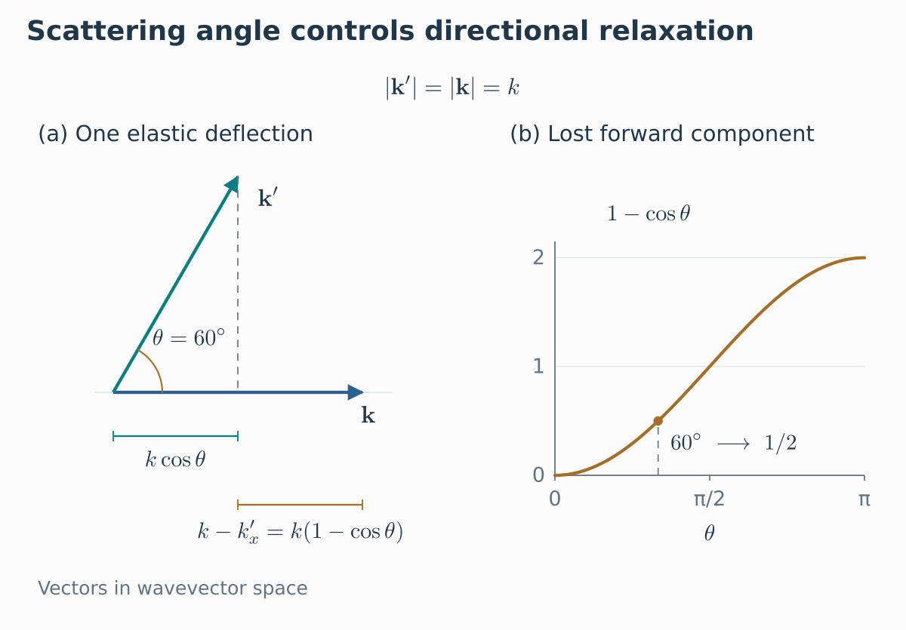
</picture>
<figcaption markdown="span">그림 14. 두 wavevector의 크기는 모두 $k$다. Scattering 이후 원래 방향에 남는 성분은 $k\cos\theta$이므로, 줄어든 성분은 $k-k_x^{\prime}=k(1-\cos\theta)$다. 표시한 예제는 $\theta=60^\circ$다. 이 wavevector 성분 변화에 $\hbar$를 곱하면 momentum 성분의 변화를 얻는다.</figcaption>
</figure>



<details markdown="1">
<summary>Elastic gain–loss operator에서 Pauli 인자가 상쇄되는 이유</summary>

같은 가중치를 갖는 angular state 사이에서 reciprocal elastic transition이 일어나면 gain에서 loss를 뺀 항에

$$
f'(1-f)-f(1-f')=f'-f.
$$

가 들어간다. 이처럼 gain과 loss를 합친 elastic occupation operator에서는 Pauli 인자가 상쇄되며, 같은 Fermi occupation을 가진 분포는 변하지 않는다. 식 (39)는 특정 전자 하나가 Pauli blocking을 피하여 상태를 벗어날 확률이 아니라 분포의 relaxation을 기술한다. 식 (35)의 single-particle broadening lifetime $\tau_q$를 해석할 때도 이 구분이 중요하다. Inelastic transition과 electron–electron collision에서는 일반적으로 에너지와 occupation의 의존성까지 더 고려해야 한다.

</details>

같은 차이를 시간에 따라 볼 수도 있다. Collision이 만드는 변화만 분리하기 위해, 한쪽 방향으로 움직이는 전자가 조금 더 많은 상태를 만든 뒤 전기장을 끈다고 하자. 이후 scattering이 없다면 이 고정된 에너지 shell의 전자는 방향을 유지한다. 반면 독립적인 scattering이 반복되면 처음 방향과의 평균 상관관계는 줄어들 수 있다.

Memoryless kinetic model에서 각도 weight 없이 합한 elastic rate를 총 rate $\Gamma_q$인 사건 과정으로 나타내자. 순간적인 사건 rate는 이전 사건 이후 얼마나 시간이 지났는지에 의존하지 않는다. 사건마다 원래 방향에 투영한 성분이 평균 $\langle\cos\theta\rangle$만큼 남는다고 하자. 이 각도 평균에서는 각 방향의 rate를 total rate로 나눈 값을 weight로 쓴다. 같은 방향에서 출발해 서로 다른 scattering 이력을 거치는 경우들을 평균하면

$$
\begin{aligned}
&\langle\widehat{\mathbf k}(t)\cdot\widehat{\mathbf k}(0)\rangle\\
&=\exp\!\left[-\Gamma_q\big(1-\langle\cos\theta\rangle\big)t\right].
\end{aligned}
\tag{41}
$$

따라서 forward scattering이 우세하면 $\tau_{\rm tr}\gg\tau_q$다. 하지만 ‘transport time이 언제나 더 길다’는 것은 틀리다. 이전 이력과 무관하게 두 방향 사이에서 각각 rate $r$로 방향이 뒤집히는 모델에서는

$$
\begin{aligned}
&\frac{d(f_+-f_-)}{dt}=-2r(f_+-f_-),\\
&\tau_{\rm tr}=\frac{1}{2r},\\
&\tau_q=\frac{1}{r}.
\end{aligned}
\tag{42}
$$

방향 반전 한 번은 속도 성분을 원래 크기의 두 배만큼 바꾼다. 사건 사이의 대기시간, 한쪽으로 치우친 속도 분포가 사라지는 시간, energy relaxation time은 서로 다른 양이다.

## 15. Short-range impurity: 에너지를 고정한 scattering 계산
{: id="drude-15" }

Short-range 근사를 쓰면 matrix element의 각도 의존성을 없앨 수 있다. 충분히 좁은 결함은 전자에게 가능한 momentum transfer 범위에서 거의 같은 Fourier 성분을 갖는다. Potential이 약하다는 것은 Born approximation에 필요한 별도의 조건이다. 두 조건을 함께 만족하면 Born amplitude가 scattering 방향에 무관해져, 사건 수와 전류 감소를 같은 계산으로 구할 수 있다.

운동에너지가 $K=\epsilon-E_c>0$인 isotropic 3차원 parabolic band를 생각하자. 결함의 범위가 관련 파장보다 작으면 Fourier transform을 상수 $U_0$로 근사할 수 있다. 길이 단위의 Born amplitude $a_B$를 입력값으로 정하고 다음과 같이 정의하자.

$$
\begin{aligned}
&U_0=\frac{2\pi\hbar^2}{m^{\ast}}a_B,\\
&f_{\rm sc}^{\rm Born}=-a_B,\\
&\sigma_{\rm sc}^{\rm total}=4\pi a_B^2.
\end{aligned}
\tag{43}
$$

Scattering이 각도에 무관하므로 scattering 이후 방향은 등방적이고 $\tau_{\rm tr}=\tau_q$다. 변수 $a_B$는 Born amplitude다. 길이 단위라고 해서 $a_B$를 결함의 기하학적 반지름으로 해석할 수는 없다. 상수 Fourier transform은 3차원에서 범위가 유한하고 약한 perturbation을 낮은 momentum에서 근사한 것이다. 모든 momentum에서의 potential을 완전히 지정한 것은 아니다.

특정 final state로 가는 amplitude만 알아서는 total rate를 구할 수 없다. 에너지를 보존하면서 갈 수 있는 모든 final state를 세어야 한다. Isotropic parabolic band에서는 이 상태들이 wavevector 공간의 구면 위에 놓인다. Conductivity integral에서 사용한 box-state measure로 그 구면 주변의 얇은 shell을 세면 된다. Wavevector 공간에서 구면 shell의 부피는 $4\pi k^2dk$다. 이를 $(2\pi)^3$로 나누고 $dK/dk=\hbar^2k/m^{\ast}$를 이용해 에너지 변수로 바꾸면, 단위 부피·단위 에너지·**spin 하나당** density of states는

$$
\begin{aligned}
&D_1(K)=\frac{m^{\ast}k}{2\pi^2\hbar^2},\\
&k=\frac{\sqrt{2m^{\ast}K}}{\hbar}.
\end{aligned}
\tag{44}
$$

단위는 $\mathrm{J}^{-1}\mathrm{m}^{-3}$다. 이 DOS는 spectrum에 존재하는 상태 수를 세며, occupation이 있는 상태만 또는 비어 있는 상태만 세는 양이 아니다. Occupation은 따로 적용해야 한다. 따라서 golden rule을 적분하면

$$
\begin{aligned}
&\frac{1}{\tau_{\rm tr}}=\frac{1}{\tau_q}\\
&=\frac{2\pi n_i}{\hbar}\lvert U_0\rvert^2D_1(K)\\
&=n_iv\,4\pi a_B^2.
\end{aligned}
\tag{45}
$$

고정된 spin 하나에서 출발하는 spin-conserving transition의 final-state DOS에는 2를 추가로 곱하지 않는다. 이 모델에서 반대 spin은 전이할 수 있는 final spin channel이 아니기 때문이다. 전체 전류에는 여전히 $n$ 또는 $g_s$를 통해 같은 분포를 가진 두 spin 집단이 모두 포함된다.

$m^{\ast}=0.2m_0$, $K=50\,\mathrm{meV}$, $n_i=10^{25}\,\mathrm{m}^{-3}$, $a_B=0.2\,\mathrm{nm}$으로 두자. 그러면 $k\simeq0.51232\,\mathrm{nm}^{-1}$, $v\simeq2.9655\times10^5\,\mathrm{m/s}$, $\tau_{\rm tr}\simeq0.67086\,\mathrm{ps}$를 얻는다. 이 한 에너지에서는 $e\tau_{\rm tr}/m^{\ast}\simeq0.58996\,\mathrm{m^2/(V\,s)}$다. 특정 energy shell에서 추정한 mobility이며, 넓게 퍼진 열분포에는 18절의 평균이 필요하다.

```python
impurity_mass, kinetic = 0.2 * M0, 0.050 * E_CHARGE
impurity_density, a_born = 1e25, 0.2e-9
k_shell = np.sqrt(2 * impurity_mass * kinetic) / HBAR
v_shell = HBAR * k_shell / impurity_mass
u0 = 2 * np.pi * HBAR**2 * a_born / impurity_mass  # J m^3.
dos_one_spin = impurity_mass * k_shell / (2 * np.pi**2 * HBAR**2)
rate_dos = 2 * np.pi / HBAR * impurity_density * u0**2 * dos_one_spin
rate_flux = impurity_density * v_shell * 4 * np.pi * a_born**2
tau_impurity = 1 / rate_flux
assert np.isclose(rate_dos / rate_flux, 1.0)
print("tau (ps), shell mobility (m^2/Vs):", tau_impurity * 1e12,
      E_CHARGE * tau_impurity / impurity_mass)
print("mean free path (nm):", v_shell * tau_impurity * 1e9)
```

<figure class="drude-figure">
<picture class="rsna-results-figure">
<source media="(max-width: 560px)" srcset="" width="600" height="1340">
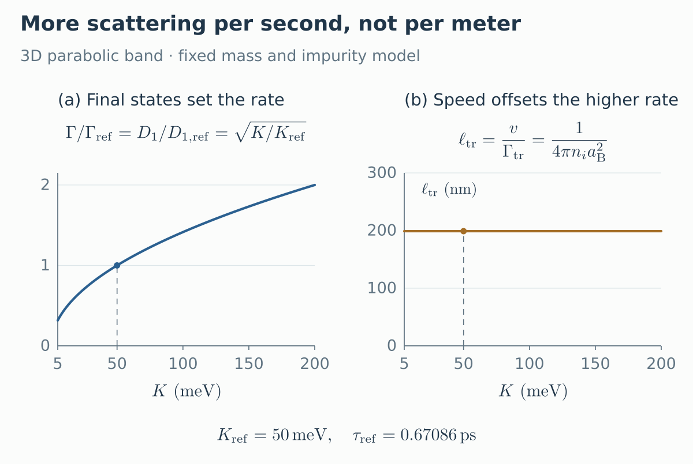
</picture>
<figcaption markdown="span">그림 15. Mass, impurity density와 Born amplitude를 고정했다. Matrix element는 방향에 무관하지만, 에너지가 높아지면 그 에너지를 갖는 final state의 density도 커진다. 따라서 rate $\Gamma=1/\tau$는 증가하고 그 역수인 시간은 줄어든다. 두 점은 같은 reference energy를 표시하며, 그래프는 양의 에너지에서만 계산했다.</figcaption>
</figure>



전자들이 서로 반대 방향으로 빠르게 움직이면 평균 drift는 작을 수 있다. 이 작은 drift 속도를 사용하면 전자의 microscopic motion에 해당하는 길이 척도를 과소평가하게 된다. **Transport mean free path**는 선택한 에너지에서의 속력에 transport time을 곱한 값이다. 이 속력은 평균 drift 속도가 아니다.

$$
\ell_{\rm tr}=v\tau_{\rm tr}.
\tag{46}
$$

이 예제에서는 $\ell_{\rm tr}\simeq198.94\,\mathrm{nm}$, $k\ell_{\rm tr}\simeq101.92$다. 국소적인 diffusive 저항으로 기술하려면 시료의 크기가 관련 mean free path보다 충분히 커야 한다. 또 전자가 그 거리를 가는 동안 전기장이 분포를 크게 바꾸지 않아야 한다. Wavevector의 역수는 microscopic 길이 척도다. Transport path가 이보다 훨씬 길면, momentum으로 구분되는 carrier는 방향이 흐트러지기 전에 wave의 위상이 여러 번 변할 만큼 이동할 수 있다. 큰 $k\ell$은 weak-disorder 가정의 일관성을 확인하는 지표이지, 개별 potential이 Born 조건을 만족한다는 증거는 아니다. 입력값으로 $a_B$만 정한 이 예제에서는 Born 근사를 따로 검증하는 데 필요한 결함의 범위와 세기를 정하지 않았다.

## 16. Screened Coulomb scattering의 quantum·transport rate
{: id="drude-16" }

Short-range 예제에서 두 lifetime이 같았던 이유는 Fourier transform이 상수였기 때문이다. Elastic scattering이라는 조건만으로 두 시간이 같아지는 것은 아니다. 공간에 넓게 퍼진 매끄러운 potential은 작은 momentum transfer를 더 강하게 만들 수 있다. 전하를 띤 결함이 이런 예다. 결함의 potential은 멀리까지 이어지고, 이동하는 전하와 배경의 polarization 때문에 전기장이 약해지는 현상을 **screening**이라고 한다. 단순한 isotropic screened potential energy는

$$
\begin{aligned}
&U(r)=\frac{Ze^2}{4\pi\varepsilon}\frac{e^{-q_sr}}{r},\\
&\widetilde U(q)=\frac{Ze^2}{\varepsilon(q^2+q_s^2)}.
\end{aligned}
\tag{47}
$$

$Z$는 부호가 있는 coupling parameter다. 부호를 뒤집으면 Born amplitude의 부호는 바뀌지만 절댓값의 제곱은 바뀌지 않는다. 양의 $q_s$는 screening length의 역수다. 전자–결함 potential은 인력일 수도 척력일 수도 있지만 아래 rate에는 크기만 필요하다. 결함과 주변 환경을 self-consistent하게 계산한 것이 아니라 **Yukawa** potential을 입력으로 정한 모델이다. [Tong, Sec. 6.3.2][tong-scattering]

Elastic scattering에서는 $k=\lvert\mathbf k\rvert=\lvert\mathbf k^{\prime}\rvert$가 보존된다. Initial/final wavevector 사이의 기하 관계로부터

$$
\begin{aligned}
&q=\lvert\mathbf k'-\mathbf k\rvert=2k\sin\frac{\theta}{2},\\
&x_s=\frac{4k^2}{q_s^2}.
\end{aligned}
\tag{48}
$$

이 무차원 비는 가능한 최대 elastic momentum transfer와 screening wavevector를 비교한다. Screening wavevector가 가능한 transfer 범위 전체보다 크면 Fourier 식의 분모는 거의 일정하고, 그렇지 않으면 각도 의존성을 고려해야 한다. $q_s\ll k$이면 matrix element가 $\theta=0$ 근처에 강하게 몰린다. Scattering이 자주 일어나 single-particle broadening이 커져도 전류는 거의 줄지 않을 수 있다. 두 rate를 계산하기 위해 $z=1-\cos\theta$, $C_U=Ze^2/\varepsilon$로 두자. 방위각 적분을 하면

$$
\begin{pmatrix}\Gamma_q\\\Gamma_{\rm tr}\end{pmatrix}
=\frac{n_im^{\ast}kC_U^2}{2\pi\hbar^3}
\int_0^2\frac{1}{(q_s^2+2k^2z)^2}
\begin{pmatrix}1\\z\end{pmatrix}dz.
\tag{49}
$$

두 적분을 계산하면

$$
\begin{aligned}
B(x_s)&=\ln(1+x_s)-\frac{x_s}{1+x_s},\\
\Gamma_q&=\frac{n_im^{\ast}kC_U^2}{\pi\hbar^3q_s^4(1+x_s)},\\
\Gamma_{\rm tr}&=\frac{n_im^{\ast}C_U^2}{8\pi\hbar^3k^3}B(x_s).
\end{aligned}
\tag{50}
$$

두 시간의 비를 구하면 coupling의 공통 인자가 소거된다.

$$
\begin{aligned}
&\frac{\tau_{\rm tr}}{\tau_q}=\frac{\Gamma_q}{\Gamma_{\rm tr}}\\
&=\frac{x_s^2}{2(1+x_s)B(x_s)}.
\end{aligned}
\tag{51}
$$

$x_s\to0$이면 각도 의존성이 거의 일정해지고 비는 1에 접근한다. $x_s\gg1$에서는 대략 $x_s/[2(\ln x_s-1)]$처럼 커진다. Screening이 없는 극한에 $q_s=0$을 그대로 대입하여 유한한 total rate로 사용할 수는 없다. Forward 방향의 특이점을 물리적으로 처리해야 한다.

다음 수치적분은 입체각에 맞는 가중치를 사용한다. $\sin\theta$ 없이 $\theta$에 대해 균일하게 적분하면 각 방향의 기여를 잘못 세게 된다. 고정된 256개 node의 grid는 $0<x_s\le400$에서 검증했다. 이는 물리 모델의 한계가 아니라 수치 분해능의 제한이다. 더 큰 $x_s$에서는 forward peak가 좁아지므로 각도 분해능을 높이거나 adaptive integration 또는 변수 변환을 사용해야 한다.

```python
nodes, gauss_weights = np.polynomial.legendre.leggauss(256)
z_angle = nodes + 1.0  # z=1-cos(theta) lies in [0,2]; dz=dx here.

def screened_time_ratio(shape):
    if not np.isfinite(shape) or not 0 < shape <= 400:
        raise ValueError("This fixed-order quadrature is verified for 0 < x_s <= 400")
    kernel = 1 / (1 + shape * z_angle / 2)**2
    total = gauss_weights @ kernel
    transport = gauss_weights @ (kernel * z_angle)
    return total / transport

for shape in (0.01, 4.0, 100.0):
    bshape = np.log1p(shape) - shape / (1 + shape)
    analytic = shape**2 / (2 * (1 + shape) * bshape)
    assert np.isclose(screened_time_ratio(shape), analytic, rtol=1e-9)
    print("x_s, tau_tr/tau_q:", shape, analytic)
```

<figure class="drude-figure">
<picture class="rsna-results-figure">
<source media="(max-width: 560px)" srcset="" width="600" height="1600">

</picture>
<figcaption markdown="span">그림 16. 각도 분포는 solid-angle element의 인자 $\sin\theta$를 포함하며 적분값은 1이다. 같은 total event rate에서 $x_s=0,4,100$을 비교하고, $x_s=0$은 등방적인 극한 분포다. Isotropic은 단위 입체각당 확률이 같다는 뜻이지 polar angle당 확률이 같다는 뜻은 아니다. 그래서 이 경우에도 그래프는 수평선이 아니라 $p(\theta)=\sin\theta/2$다. $1-\cos\theta$를 곱하면 강한 forward scattering이 momentum을 얼마나 적게 바꾸는지 드러난다. 이 normalization은 microscopic Coulomb coupling의 세기를 고정한 것이 아니라 각도 분포의 모양만 비교하기 위한 것이다.</figcaption>
</figure>



등방적인 scattering, 점점 forward 방향에 몰리는 scattering, 별도의 두 방향 반전 모델을 비교하자. Lab은 total event rate를 고정한 채 각도 분포를 바꾼다. 실제로 $n_i,Z,k$를 고정하고 screening을 바꾸면 식 (50)에 따라 total rate와 각도 분포가 함께 달라진다.

<details markdown="1">
<summary>Screening wavevector는 어디에서 나올까?</summary>

선형 정적 screening에서 작은 electrostatic potential은 국소적인 전자 에너지를 $-e\varphi$만큼 바꾼다. Reservoir의 chemical potential을 고정하면 밀도 변화는 $\delta n=e\varphi\,\partial n/\partial\mu_F$다. 이에 따라 생긴 전하를 Poisson 방정식에 넣으면 screened field 방정식에서

$$
q_s^2=\frac{e^2}{\varepsilon}\frac{\partial n}{\partial\mu_F}.
$$

고전적인 nondegenerate 기체에서는 $\partial n/\partial\mu_F=n/(k_BT)$이므로 Debye 식을 얻는다. 낮은 에너지부터 state가 채워진 단순한 band에서 온도가 0이면 screening에 기여하는 spin 집단을 모두 포함한 Fermi energy의 **전체** DOS가 들어간다. 이는 식 (44)의 spin 하나당 final-state DOS와 다르다.

이것은 선형 screening 모델이다. 강한 결함 potential, nonlocal screening, 상관관계, 여러 band, 낮은 차원에서는 달라질 수 있다. Charged-defect mobility를 예측하려면 유효한 Born approximation뿐 아니라 타당한 screening 모델도 필요하다. 식 (51)만으로는 이를 정할 수 없다.

</details>

## 17. Longitudinal acoustic phonon의 deformation-potential scattering
{: id="drude-17" }

앞의 정적 불순물 예제에서는 전자의 방향은 바뀌지만 에너지는 보존된다. 이것만으로는 전자와 격자 사이의 에너지 교환을 기술할 수 없다. 반면 원자가 움직이면 potential도 더 이상 정적이지 않다. **Phonon**은 격자 진동의 양자이므로 perturbation이 전자와 에너지를 주고받을 수 있다. 원자가 움직이면 전자의 Hamiltonian이 변한다. Electron–phonon matrix element는 Hamiltonian의 이 변화에 대해 initial/final 전자 상태 사이에서 계산한 matrix element다.

격자 전체를 같은 거리만큼 옮겨도 bulk band edge는 변하지 않는다. 하지만 압축하거나 팽창시키면 원자 사이의 간격이 바뀐다. 그래서 이 모델에서는 절대적인 displacement가 아니라 strain에 coupling한다고 본다. 단순한 longitudinal acoustic **deformation-potential** 모델은 국소적인 부피의 상대 변화가 conduction-band edge를 다음과 같이 바꾼다고 가정한다.

$$
U_{\rm ac}(\mathbf r)=D\,\nabla\cdot\mathbf u_{\rm lat}(\mathbf r).
\tag{52}
$$

$\mathbf u_{\rm lat}$는 lattice displacement이며 전자의 drift $\mathbf u$와 다르다. Displacement의 divergence는 무차원인 strain이고, 에너지 단위의 $D$는 그 strain에 따라 band edge가 얼마나 바뀌는지를 나타낸다. 면적/시간 단위인 2절의 diffusion coefficient $D$와도 다른 양이다. 여러 coupling mechanism 중 하나이지 모든 물질의 electron–phonon interaction을 뜻하지는 않는다. [Bardeen and Shockley][deformation]

Normal mode는 원자들이 함께 진동하는 하나의 패턴이다. Wavevector를 바꿀 때 이 mode들이 이어지는 계열을 phonon branch라 한다. Longitudinal acoustic branch 하나에서 $q=\lvert\mathbf q\rvert$, $\omega_q=v_sq$로 두자. $v_s$는 음속이다. Longitudinal은 displacement가 wavevector와 평행하다는 뜻이고, acoustic은 $q$가 0으로 갈 때 주파수도 0으로 간다는 뜻이다. Displacement를 양자화하고 phonon mode의 임의 위상을 operator에 흡수하면 전자와 phonon의 coupling 계수는 다음과 같다.

$$
\begin{aligned}
&M_q=Dq\sqrt{\frac{\hbar}{2\rho_m\mathcal V\omega_q}},\\
&\lvert M_q\rvert^2=
\frac{D^2\hbar q}{2\rho_m\mathcal Vv_s}.
\end{aligned}
\tag{53}
$$

질량 밀도 $\rho_m$의 단위는 $\mathrm{kg/m^3}$이며 charge density $\rho$와 다르다. 제곱근은 metre 단위의 displacement amplitude다. 여기에 $q$를 곱하면 strain이 되고, 다시 $D$를 곱하면 에너지가 된다. 인자 $q$는 식 (52)의 공간 미분에서 나온다. 이 계수는 전자와 normalization된 진동 mode 하나의 coupling을 나타낸다. Transition rate를 구할 때는 mode의 population과 에너지 보존 조건이 더 들어간다.

<details markdown="1">
<summary>Harmonic oscillator로 phonon displacement와 absorption/emission 인자 구하기</summary>

질량 $M$, 주파수 $\omega$인 quantum harmonic oscillator의 displacement scale은 $\sqrt{\hbar/(2M\omega)}$다. Lattice mode에 volume normalization을 적용하면 질량에 해당하는 인자는 $\rho_m\mathcal V$가 된다. 이를 longitudinal displacement field로 쓰면

$$
\begin{aligned}
\widehat{\mathbf u_{\rm lat}}(\mathbf r)
&=\sum_{\mathbf q}\sqrt{\frac{\hbar}{2\rho_m\mathcal V\omega_q}}\,
\mathbf e_{\mathbf q}\\
&\quad\left(\widehat a_{\mathbf q}e^{i\mathbf q\cdot\mathbf r}
+\widehat a_{\mathbf q}^{\dagger}e^{-i\mathbf q\cdot\mathbf r}\right),
\end{aligned}
$$

여기서 $\mathbf e_{\mathbf q}$는 $\mathbf q$와 평행하며 displacement 방향을 나타내는 실수 단위벡터다. $D\nabla\cdot\widehat{\mathbf u_{\rm lat}}$의 공간 미분에서 $i\mathbf q\cdot\mathbf e_{\mathbf q}$가 나온다. 인자 $i$는 phonon operator의 phase convention에 흡수할 수 있으므로, 식 (53)의 계수 $M_q$를 쓰면서도 $\lvert M_q\rvert^2$는 그대로다.

Phonon 수가 정수 $N$일 때 oscillator의 ladder operator를 적용하면

$$
\begin{aligned}
\widehat a\lvert N\rangle&=\sqrt N\,\lvert N-1\rangle,\\
\widehat a^{\dagger}\lvert N\rangle&=\sqrt{N+1}\,\lvert N+1\rangle.
\end{aligned}
$$

따라서 absorption matrix element의 제곱에는 $N$이, emission에는 $N+1$이 곱해진다. 열평균하면 $N$을 평균 phonon occupation $N_q$로 바꾼다. Mode가 처음에 비어 있어도 emission의 추가 인자 1은 남는다. 여기서 $\widehat a$와 $\widehat{\mathbf u_{\rm lat}}$의 hat은 quantum operator를 뜻한다. 14절에서 단위 방향을 나타낸 $\widehat{\mathbf k}$의 hat과는 용도가 다르다.

</details>

평형 phonon occupation이 $N_q=1/[\exp(\hbar\omega_q/(k_BT))-1]$이라고 하자. 여기서 occupation은 mode의 평균 phonon 개수다. 전자의 single-state occupation 확률과 달리 한 mode에 여러 phonon이 있을 수 있다. Absorption에는 없앨 phonon이 필요하지만, emission은 처음에 비어 있는 mode에도 phonon을 만들 수 있다. 따라서 두 과정에는 서로 다른 occupation factor가 붙는다. Golden rule의 absorption/emission 항은

$$
\begin{aligned}
&W^{\rm abs}_{\mathbf k\to\mathbf k+\mathbf q}=\frac{2\pi}{\hbar}\lvert M_q\rvert^2N_q\\
&\qquad\delta(\epsilon_{\mathbf k+\mathbf q}-\epsilon_{\mathbf k}-\hbar\omega_q),\\
&W^{\rm em}_{\mathbf k\to\mathbf k-\mathbf q}=\frac{2\pi}{\hbar}\lvert M_q\rvert^2(N_q+1)\\
&\qquad\delta(\epsilon_{\mathbf k-\mathbf q}-\epsilon_{\mathbf k}+\hbar\omega_q).
\end{aligned}
\tag{54}
$$

Absorption에서는 phonon 하나가 없어지면서 전자의 에너지가 증가한다. Emission에서는 phonon 하나가 생기면서 전자의 에너지가 감소하며, 추가된 1 때문에 spontaneous emission도 가능하다. 이들은 Pauli blocking을 아직 적용하지 않은 transition-rate 계수다. 전자의 occupation과 Pauli 인자는 gain–loss collision 방정식에 들어간다. 더 일반적인 과정에서는 crystal momentum transfer에 reciprocal-lattice vector가 필요할 수 있다. 이 작은 wavevector의 intraband 예제는 표시한 normal process만 포함한다.

정적인 elastic scattering과 달리 transition 전후의 전자 에너지가 다르다. 따라서 일반적인 inelastic collision 문제를 독립적인 energy shell로 나누거나, 조건 없이 $1-\cos\theta$ 인자로 대체할 수는 없다.

### Equipartition과 quasielastic 근사의 조건

Elastic shell에서의 계산을 다시 사용하려면 서로 다른 두 근사가 필요하다. Phonon population에는 occupation이 큰 equipartition 극한을 적용한다. 이때 mode 하나의 평균 열에너지는 $k_BT$에 가까워진다. 이와 별개로 전자의 transition에서는 에너지 변화가 작다고 본다. Phonon occupation이 크다는 사실만으로 전자의 scattering이 elastic해지지는 않는다.

관련 phonon이 $k_BT\gg\hbar\omega_q$를 만족하면 $N_q\simeq k_BT/(\hbar\omega_q)$다. Phonon의 에너지가 관련 전자 에너지 척도에서도 작다면 전자의 transition을 거의 elastic한 과정으로 취급하는 quasielastic 근사를 쓸 수 있다. 그러면 absorption과 emission에 같은 elastic energy delta를 근사적으로 사용할 수 있으므로 두 과정의 weight를 더하면

$$
\lvert M_q\rvert^2(2N_q+1)
\simeq\frac{D^2k_BT}{\rho_m\mathcal Vv_s^2}.
\tag{55}
$$

이 isotropic 근사에서는 $q$ 의존성이 소거된다. Final state를 합하면 부피도 소거되어

$$
\begin{aligned}
&\frac{1}{\tau_{\rm ac}(K,T)}=\frac{2\pi}{\hbar}\frac{D^2k_BT}{\rho_mv_s^2}D_1(K)\\
&\ \propto\ T\sqrt K.
\end{aligned}
\tag{56}
$$

이렇게 얻은 angular kernel은 상수이므로 이 근사 안에서는 transport time과 single-particle time이 같다. 근사하기 전의 inelastic 문제에서도 같아야 하는 것은 아니다. [MIT 6.730, electron–phonon scattering lectures][mit-solid]; [Giustino, Sec. III and erratum][giustino]

<figure class="drude-figure">
<picture class="rsna-results-figure">
<source media="(max-width: 560px)" srcset="" width="600" height="1620">

</picture>
<figcaption markdown="span">그림 17. (a) Classical displacement를 미분한 것이 strain이므로, displacement와 band-edge 변화가 최대가 되는 위치는 서로 다르다. 왼쪽은 mode의 공간 모양이며, phonon 개수가 정해진 quantum state의 평균 displacement를 뜻하지 않는다. (b) Absorption과 emission에는 서로 다른 Bose occupation factor가 붙는다. 점선의 high-occupation 근사는 $\hbar\omega_q/(k_BT)$가 작을 때 잘 맞는다. 이 조건만으로 전자의 transition을 quasielastic하게 취급할 수 있는 것은 아니다.</figcaption>
</figure>



```python
deformation_J, lattice_density, sound_speed = 5 * E_CHARGE, 5000.0, 5000.0
temperature = 300.0
ac_strength = deformation_J**2 * KB * temperature / (lattice_density * sound_speed**2)
rate_acoustic = 2 * np.pi / HBAR * ac_strength * dos_one_spin
assert ac_strength > 0 and rate_acoustic > 0
print("Illustrative acoustic tau at 50 meV (ps):", 1e12 / rate_acoustic)
print("Doubling T multiplies this fixed-energy rate by:", 2.0)
q_max_elastic = 2 * k_shell  # Elastic geometry, used to check the approximation.
phonon_energy_max = HBAR * sound_speed * q_max_elastic
print("Phonon energy estimate, kBT, electron K (meV):",
      phonon_energy_max / E_CHARGE * 1e3,
      KB * temperature / E_CHARGE * 1e3, kinetic / E_CHARGE * 1e3)
assert np.isclose(phonon_energy_max / E_CHARGE * 1e3, 3.372, rtol=1e-3)
assert np.isclose(KB * temperature / E_CHARGE * 1e3, 25.852, rtol=1e-5)
assert phonon_energy_max < 0.14 * KB * temperature
assert phonon_energy_max < 0.07 * kinetic
```

코드의 수치는 $D=5\,\mathrm{eV}$, $\rho_m=5000\,\mathrm{kg/m^3}$, $v_s=5000\,\mathrm{m/s}$인 등방적 물질 모델을 예제로 정한 값이다. Elastic scattering의 기하 관계에서는 $q\le2k$이므로, 이 상한으로 근사를 점검하면 phonon의 에너지는 약 $3.372\,\mathrm{meV}$다. 이를 $k_BT=25.852\,\mathrm{meV}$ 및 $K=50\,\mathrm{meV}$와 비교한 비율은 약 $0.130$과 $0.0674$다. 에너지 변화가 작다는 근사이지 0이라는 뜻은 아니다. 더 낮은 온도, transition threshold 근처, optical·polar·intervalley phonon에서는 식 (56)의 근사를 다시 확인해야 한다.

<details markdown="1">
<summary>실제 물질의 electron–phonon matrix element는 어떻게 구할까?</summary>

먼저 전자의 Bloch state, phonon mode, 각 normal-mode displacement가 만드는 screened electronic potential의 변화를 구한다. 그 potential 변화와 initial/final Bloch state의 overlap에 phonon displacement의 normalization factor를 곱한 것이 matrix element다. Initial band, final band, 전자 wavevector, phonon wavevector, phonon branch를 구분하는 index가 붙는다.

Deformation-potential 상수는 특정 long-wavelength model에서 이 의존성을 strain에 대한 band-edge 미분 하나로 근사한다. First-principles 방법에서는 mode에 따른 potential 미분과 전자 상태의 overlap을 그대로 계산한다. Matrix element를 구한 뒤에도 mobility를 계산하려면 occupation, 에너지 보존, transport equation이 필요하다. 모든 transition probability를 합해 $\tau$ 하나를 추정하는 것으로 끝나지 않는다.

계산 구현으로는 [EPW][epw]가 electron–phonon interpolation과 transport 계산을 제공한다. [Giustino의 review][giustino]는 그 바탕이 되는 matrix-element formalism을 유도한다. [2019 erratum][giustino-erratum]에서는 여러 식 중 current-density normalization과 선형화한 transport equation도 정정했다.

</details>

## 18. Mobility를 정하는 transport time의 에너지 평균
{: id="drude-18" }

앞의 impurity와 acoustic 계산은 전자의 에너지를 하나 정해 놓고 수행했다. 하지만 기체에는 여러 에너지의 carrier가 있고 속도와 transport time도 서로 다를 수 있다. $\tau_{\rm tr}$가 에너지에 따라 달라지면 $\mu=e\tau/m^{\ast}$에는 어느 값을 넣어야 할까?

전류가 바뀌는 과정에는 속도가 두 번 들어간다. 전기장에 의한 occupation 변화가 속도에 비례하고, 그 occupation 변화가 전류에 기여할 때 다시 속도를 곱하기 때문이다. DOS는 이 weight를 받는 상태가 몇 개 있는지 센다.

Isotropic 3차원 parabolic band에서 전체 DOS를 $D(K)=g_sD_1(K)$, band minimum으로부터의 에너지를 $K$라 하자. 에너지 함수인 이 DOS는 앞의 deformation-potential 상수나 diffusion coefficient와 다르다. 각도 평균은 $\langle v_x^2\rangle=v^2/3$이므로

$$
\begin{aligned}
n&=\int_0^\infty D(K)f_0(K)\,dK,\\
\sigma_0&=\frac{e^2}{3}\int_0^\infty D(K)v^2(K)\tau_{\rm tr}(K)
\left(-\frac{\partial f_0}{\partial K}\right)dK,\\
\mu&=\frac{\sigma_0}{en}=\frac{e\tau_{\rm eff}}{m^{\ast}}.
\end{aligned}
\tag{57}
$$

마지막 줄은 transport weight로 평균한 $\tau_{\rm eff}$를 정의한다. 일반적으로 전자별 대기시간을 단순 평균한 값과는 다르다. 속도가 빠른 carrier에 더 큰 weight가 붙으며, occupation이 전기장에 따라 얼마나 바뀔 수 있는지도 기여를 정한다. 채워진 영역의 안쪽은 조금 이동해도 그대로 채워져 있고, 그 가장자리에서 occupation이 바뀐다. 낮은 에너지 state가 대부분 채워진 degenerate 기체에서는 저온에 $-\partial_Kf_0$가 Fermi energy 근처에 몰린다. Nondegenerate 기체에서는 열에너지 범위에 걸쳐 퍼진다.

Nondegenerate 기체에서는 $-\partial_Kf_0=f_0/(k_BT)$이고 $D(K)v^2(K)\propto K^{3/2}$다. 양의 에너지 범위에서 integration by parts를 적용하면

$$
\begin{aligned}
&\int_0^\infty K^{3/2}e^{-K/(k_BT)}\,dK\\
&=\frac32 k_BT\int_0^\infty K^{1/2}e^{-K/(k_BT)}\,dK.
\end{aligned}
$$

양 끝의 boundary term은 0이다. 이 관계를 식 (57)에 대입하고 밀도로 나누면 다음과 같이 normalized average를 얻는다.

$$
\tau_{\rm eff}=
\frac{\displaystyle\int_0^\infty K^{3/2}\tau_{\rm tr}(K)e^{-K/(k_BT)}\,dK}
{\displaystyle\int_0^\infty K^{3/2}e^{-K/(k_BT)}\,dK}.
$$

분자와 분모에 같은 weight를 사용하므로 일정한 $\tau$를 넣으면 그 값이 그대로 나온다. 입자 수로만 평균한다면 속도의 제곱에 해당하는 인자가 빠져 weight가 $K^{1/2}e^{-K/(k_BT)}$가 된다. $\tau_{\rm tr}(K)=\tau_{\rm ref}(K/K_{\rm ref})^r$에서 reference 값들은 선택한 양의 에너지에서의 시간을 정하고, 지수는 에너지에 따른 시간의 의존성을 정한다. 두 적분에 $y=K/(k_BT)$를 대입하면

$$
\begin{aligned}
&\tau_{\rm eff}=\tau_{\rm ref}
\left(\frac{k_BT}{K_{\rm ref}}\right)^r
\frac{\Gamma(r+5/2)}{\Gamma(5/2)},\\
&r>-5/2.
\end{aligned}
\tag{58}
$$

지수의 범위 조건은 band minimum 근처에서도 conductivity integral이 유한하게 남도록 한다. 여기서 $\Gamma(z)$는 gamma function이며 scattering rate $\Gamma_q$와 다르다. 양의 $z$에 대해 $\Gamma(z)=\int_0^\infty y^{z-1}e^{-y}dy$로 정의하며, factorial을 확장한 함수로 $\Gamma(n+1)=n!$를 만족한다. Gamma function의 인자 $r+5/2$는 $\sqrt K$에 비례하는 3차원 DOS, $K$에 비례하는 속도의 제곱, 에너지 적분에서 나온다.

$\tau$가 일정하면 식 (58)은 그 $\tau$를 그대로 준다. 고온 acoustic 모델에서는 $\tau(K,T)\propto T^{-1}K^{-1/2}$다. 열평균에서 $T^{-1/2}$가 추가되므로 질량과 coupling parameter가 고정되고 carrier가 nondegenerate 상태를 유지하면 $\mu\propto T^{-3/2}$다. 이 조건에서 성립하는 scaling law이지 보편적인 mobility–temperature 곡선은 아니다.

15절의 short-range impurity 모델도 rate가 속력에 비례하므로 $r=-1/2$다. 그 예제의 $K_{\rm ref}=50\,\mathrm{meV}$에서 $\tau_{\rm ref}=0.670864\,\mathrm{ps}$를 그대로 사용하고, $300\,\mathrm K$의 nondegenerate 기체를 생각하자. 그러면 $\tau_{\rm eff}=0.701837\,\mathrm{ps}$, $\mu=0.617202\,\mathrm{m^2/(V\,s)}$를 얻는다. 같은 시간들을 입자 수로 평균하면 $1.052755\,\mathrm{ps}$다. 이 값을 mobility 식에 대신 넣으면 conductivity를 $1.5$배 크게 예측한다.

<figure class="drude-figure">
<picture class="rsna-results-figure">
<source media="(max-width: 560px)" srcset="" width="600" height="1570">
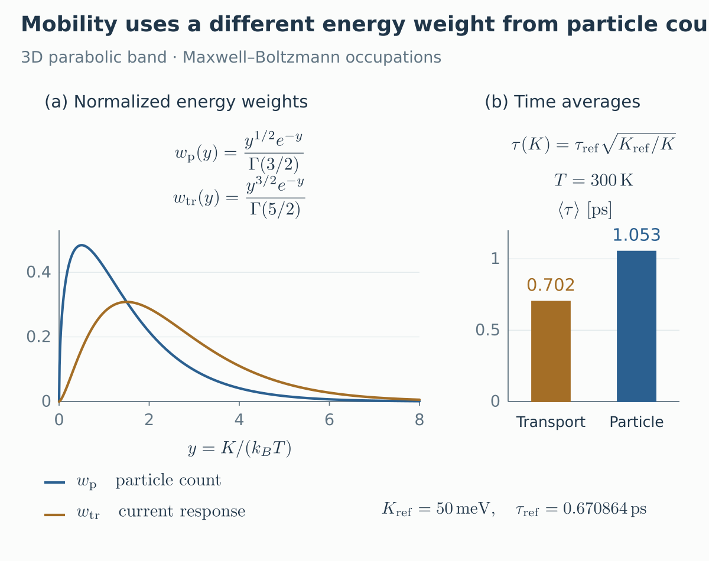
</picture>
<figcaption markdown="span">그림 18. (a) 입자 수와 current response에 쓰는 normalized weight를 비교했다. 두 weight는 양의 에너지 전체에서 적분하면 각각 1이지만, transport weight는 높은 에너지에 더 큰 비중을 준다. (b) 같은 energy-dependent relaxation time도 어떤 weight로 평균하는지에 따라 값이 달라진다. Mobility 식에는 transport weight로 평균한 값을 넣어야 한다.</figcaption>
</figure>



```python
def mb_transport_time(tau_ref, energy_ref_J, temperature_K, exponent):
    if tau_ref <= 0 or energy_ref_J <= 0 or temperature_K <= 0 or exponent <= -2.5:
        raise ValueError("Positive scales and exponent > -5/2 are required")
    return tau_ref * (KB * temperature_K / energy_ref_J)**exponent * gamma(exponent + 2.5) / gamma(2.5)

assert np.isclose(mb_transport_time(100e-15, 0.05 * E_CHARGE, 300, 0) / 100e-15, 1)
tau_ac_300 = 1 / rate_acoustic  # Reference energy is the same 50 meV as above.
eff_300 = mb_transport_time(tau_ac_300, kinetic, 300, -0.5)
eff_600 = mb_transport_time(tau_ac_300 / 2, kinetic, 600, -0.5)
assert np.isclose(eff_600 / eff_300, 2**(-1.5))
print("Acoustic-model mobility ratio mu(600K)/mu(300K):", eff_600 / eff_300)
impurity_eff_300 = mb_transport_time(tau_impurity, kinetic, 300, -0.5)
impurity_mobility_300 = E_CHARGE * impurity_eff_300 / impurity_mass
impurity_particle_tau_300 = (tau_impurity * (KB * 300 / kinetic)**(-0.5)
                             * gamma(1.0) / gamma(1.5))
assert np.isclose(impurity_eff_300 * 1e12, 0.701836862, rtol=1e-8)
assert np.isclose(impurity_mobility_300, 0.617202357, rtol=1e-8)
assert np.isclose(impurity_particle_tau_300 * 1e12, 1.052755292, rtol=1e-8)
assert np.isclose(impurity_particle_tau_300 / impurity_eff_300, 1.5)
print("Impurity transport tau (ps), mobility (m^2/Vs), particle tau (ps):",
      impurity_eff_300 * 1e12, impurity_mobility_300,
      impurity_particle_tau_300 * 1e12)
```

서로 독립적인 약한 mechanism이 같은 angular mode를 줄인다면, 각 에너지에서 rate를 먼저 합한 뒤 열평균해야 한다. Mechanism마다 시간을 먼저 평균하면 mobility가 달라질 수 있다. 역수를 취한 뒤 평균하는 것과 평균한 뒤 역수를 취하는 것은 일반적으로 다르기 때문이다.

<details markdown="1">
<summary>독립적인 scattering mechanism과 Matthiessen's rule</summary>

서로 독립적인 약한 scattering mechanism의 collision operator는 더할 수 있다. 여기서 다루는 isotropic model에서 주어진 에너지의 동일한 angular mode를 줄이는 mechanism끼리는 rate를 더할 수 있다.

$$
\frac{1}{\tau_{\rm tr}^{\rm total}(K)}
=\sum_\alpha\frac{1}{\tau_{\mathrm{tr},\alpha}(K)}.
\tag{59}
$$

이것이 rate를 더하는 **Matthiessen's rule**이다. 같은 질량을 쓰고 각 시간이 에너지에 무관하면 $1/\mu_{\rm total}=\sum_\alpha1/\mu_\alpha$도 성립한다. 하지만 에너지 평균과 역수를 취하는 연산은 일반적으로 순서를 바꿀 수 없다. 에너지 의존성이 서로 다르면 각 에너지에서 rate를 먼저 합하고 식 (57)을 적분해야 한다. Disorder의 상관관계나 서로 다른 angular eigenmode 때문에 단순히 rate를 더하는 것 자체가 성립하지 않을 수도 있다.

Band mass와 transport time도 실제 물질에서는 서로 독립적으로 바꿀 수 있는 변수가 아니다. Band mass가 바뀌면 속도, DOS, screening이 달라지고 matrix element도 흔히 달라진다. ‘질량이 작을수록 mobility가 높다’는 말은 관련 transport time과 나머지 모델 입력을 실제로 고정했을 때만 믿을 수 있다.

</details>

## 19. Periodic bulk density mode의 감쇠와 진동
{: id="drude-19" }

균일한 도선 예제에서는 양 끝의 전압을 정하고 전하가 쌓이지 않는다고 가정했다. 이제 전자가 조금 더 모인 곳과 조금 부족한 곳이 나란히 있고, 처음에는 drift가 없다고 하자. 이 분포가 만든 전기장 때문에 전자가 움직이기 시작하면 밀도 분포가 바뀌고 전기장도 바뀐다. 전기장을 입력값으로 정해 놓는 것만으로는 부족하다. Continuity equation, Poisson equation, 운동 방정식을 함께 풀어야 한다.

Contact 없이 bulk 안의 재분배만 보기 위해 같은 패턴을 주기적으로 반복하자. 3차원 bulk electron fluid에서 밀도, 전기장, drift가 $x$ 방향으로만 변하고 그 방향에는 periodic cell을 둔다고 하자. 이하의 drift velocity, 전기장, 전류는 이 방향의 성분이다. Number density $n_0=N_D$의 단위는 여전히 단위 부피당 입자 수다. 전자의 운동 자체가 1차원으로 제한된 wire와는 다르다. 그런 wire의 Coulomb field와 plasma dispersion을 구하려면 도선의 실제 단면 구조를 고려해야 한다. $m^{\ast},\tau,\varepsilon$은 일정하고 외부 전압은 없으며 작은 밀도 perturbation $\delta n$이 있다. Perturbation과 drift velocity에 대해 선형화하면

$$
\begin{aligned}
&\partial_t\delta n+n_0\partial_xu=0,\\
&\partial_xE=-\frac{e\delta n}{\varepsilon},\\
&\partial_tu+\frac{u}{\tau}=-\frac{eE}{m^{\ast}}.
\end{aligned}
\tag{60}
$$

Linearization에서는 $\delta n$, $u$, $E$를 작은 perturbation의 1차 항으로 센다. Particle flux $(n_0+\delta n)u$에서 $n_0u$는 남기지만, 두 작은 양을 곱한 $\delta n\,u$는 2차이므로 생략한다. 전자가 유체 속도가 다른 곳으로 이동하는 효과까지 따라가면 convective acceleration $u\partial_xu$가 생기지만, 이것도 2차다. 반면 밀도 gradient가 만드는 pressure force는 선형항으로도 남으므로 같은 이유로 생략할 수 없다. Pressure와 diffusion을 무시하는 것은 Coulomb force가 주된 복원력이 되도록 택한 별도의 long-wavelength approximation이다. 그렇지 않으면 thermal pressure나 Fermi pressure가 유한한 wavevector에서 dispersion을 바꾼다. 배경 permittivity는 1절에서 정의한 양의 실수 $\varepsilon$을 그대로 사용한다.

전기장에는 **quasistatic** 근사를 쓴다. 매 순간의 전하 분포를 Poisson equation에 넣어 전기장을 구하고, 이 시스템의 크기에서 전자기장 전파 지연과 유도 전기장은 무시한다는 뜻이다. $\omega\tau\ll1$을 가정하는 것은 아니다. 식 (60)에는 전자의 관성이 그대로 남아 있다.

Cosine 모양의 밀도 분포는 전자가 더 많은 부분과 부족한 부분이 번갈아 나타나며 전체 전자 수는 바꾸지 않는다. 이 패턴의 파장은 periodic cell 안에 맞게 들어가야 한다. 밀도 패턴의 0이 아닌 wavenumber를 $q>0$로 두고 $qL_{\rm cell}=2\pi$로 정하자. 길이 $L_{\rm cell}$인 cell 안에 파장 하나가 들어간다. Continuity는 전자들이 모여드는 운동을 밀도 증가로 연결하고, Drude는 속도가 변하는 양을 주며, Poisson은 전기장의 gradient를 다시 그 밀도와 연결한다. 이 관계를 닫기 위해 continuity를 시간에 대해 미분하고, Drude로 $\partial_tu$를 대체한 뒤 Poisson으로 $\partial_xE$를 대체하면 density mode $\delta n=\mathcal A(t)\cos qx$에 대해

$$
\begin{aligned}
&\ddot{\mathcal A}+\frac{\dot{\mathcal A}}{\tau}+\omega_p^2\mathcal A=0,\\
&\omega_p^2=\frac{n_0e^2}{\varepsilon m^{\ast}}.
\end{aligned}
\tag{61}
$$

$\omega_p$는 momentum damping이 없을 때 이 밀도 진동의 angular frequency다. Pressure 항의 영향이 작으려면 $qv_{\rm char}\ll\omega_p$인 영역을 택할 수 있다. 여기서 $v_{\rm char}$는 대표적인 thermal 또는 Fermi speed다.

$\mathcal A$는 부호가 있는 number-density amplitude이며 도선 단면적 $A$와 다르다. 부호가 바뀌면 전자가 더 많은 부분과 부족한 부분의 역할이 뒤바뀐다. 전체 밀도는 배경 밀도에 작은 modulation이 더해진 값으로 유지된다. 전자가 더 모인 곳에는 밀도를 다시 균일하게 만들려는 전기장이 생긴다. Carrier의 관성 때문에 밀도가 균일해진 뒤에도 이동이 이어질 수 있고, momentum relaxation 때문에 진동이나 밀도 변화가 점차 줄어든다. Cell 안에서 전기장과 전류의 공간 평균을 0으로 두면 각각의 공간 분포는

$$
\begin{aligned}
\delta n(x,t)&=\mathcal A(t)\cos qx,\\
E(x,t)&=-\frac{e\mathcal A(t)}{\varepsilon q}\sin qx,\\
J(x,t)&=\frac{e\dot{\mathcal A}(t)}{q}\sin qx.
\end{aligned}
\tag{62}
$$

마지막 줄을 $x$로 미분하면 $\partial_t\rho=-e\dot{\mathcal A}\cos qx$와 정확히 상쇄된다. 밀도가 재분배되는 것이지 전하가 사라지는 것이 아니다. 주기적인 cosine의 공간 평균은 0이므로 amplitude가 줄어드는 동안에도 전체 전자 수는 일정하다.

초기조건을 $\mathcal A(0)\ne0$, $\dot{\mathcal A}(0)=0$으로 잡자. 전기장은 이미 있지만 $J(0)=0$이다. Drude에 관성이 있으므로 가능하다. 이 순간에는 즉시 steady state에 도달했다고 가정한 $J=\sigma_0E$를 적용할 수 없다.

밀도가 균일한 상태를 지나치기 전에 momentum을 잃는지에 따라 운동이 달라진다. Momentum relaxation time과 복원 운동의 시간 척도를 비교하면 이 경쟁을 볼 수 있다. 무차원 시간 $s=t/\tau$, 무차원 frequency ratio $\Omega=\omega_p\tau$, normalization한 density amplitude $a(s)=\mathcal A(t)/\mathcal A(0)$를 정의하면

$$
\begin{aligned}
&a''+a'+\Omega^2a=0,\\
&a(0)=1,\quad a'(0)=0.
\end{aligned}
\tag{63}
$$

여기서 prime은 $s$에 대한 미분이다. 해가 진동하는지는 characteristic root로 구분할 수 있다. 식 (63)에 $a\propto e^{\lambda s}$를 대입하면

$$
\begin{aligned}
&\lambda^2+\lambda+\Omega^2=0,\\
&\lambda_\pm=\frac{-1\pm\sqrt{1-4\Omega^2}}{2}.
\end{aligned}
$$

$0<\Omega<1/2$이면 두 근은 모두 음의 실수다. $\Omega=1/2$에서 두 근이 같아지며 critical damping이 된다. 따라서 정해 놓은 초기조건에서 진동 없이 줄어드는 경우와 진동하며 줄어드는 경우의 경계는 $\Omega=1/2$다. 그보다 크면 두 근에 허수부가 생겨 진동하면서 감쇠하며, $\Omega=1$도 이 진동 영역의 한 경우다. 경계와 그 위에서는

$$
\begin{aligned}
&\Omega=\tfrac12:\quad a(s)=e^{-s/2}(1+s/2),\\
&\Omega>\tfrac12:\\
&a(s)=e^{-s/2}\left[\cos(\nu s)+\frac{\sin(\nu s)}{2\nu}\right],\\
&\nu=\sqrt{\Omega^2-\tfrac14}.
\end{aligned}
\tag{64}
$$

경계 아래에서는 무차원 시간에 대한 두 decay rate $-1/2\pm\sqrt{1/4-\Omega^2}$가 모두 음의 실수다. Damping이 있을 때 진동 영역의 실제 angular frequency는 $\sqrt{\omega_p^2-1/(4\tau^2)}$다.

```python
def density_mode(s, omega_tau):
    s = np.asarray(s, dtype=float)
    if omega_tau <= 0 or np.any(s < 0):
        raise ValueError("Positive omega_p*tau and nonnegative time are required")
    discriminant = omega_tau**2 - 0.25
    if discriminant > 0:
        nu = np.sqrt(discriminant)
        sine_over_nu = s * np.sinc(nu * s / np.pi)
        a = np.exp(-s / 2) * (np.cos(nu * s) + 0.5 * sine_over_nu)
        derivative = -omega_tau**2 * np.exp(-s / 2) * sine_over_nu
    elif discriminant == 0:
        a = np.exp(-s / 2) * (1 + s / 2)
        derivative = -0.25 * s * np.exp(-s / 2)
    else:
        kappa = np.sqrt(-discriminant)
        slow = -omega_tau**2 / (0.5 + kappa)  # Avoid subtracting nearly equal numbers.
        divided = -np.expm1(-2 * kappa * s) / (2 * kappa)
        a = np.exp(slow * s) * (1 - slow * divided)  # Stable near critical damping.
        derivative = -omega_tau**2 * np.exp(slow * s) * divided
    return a, derivative

for omega_tau in (0.2, 0.5, 1.2):
    a0, da0 = density_mode(0.0, omega_tau)
    assert np.isclose(a0, 1.0) and np.isclose(da0, 0.0)
print("Charge snapshot a,a' at Omega=1.2,s=1:", density_mode(1.0, 1.2))
```

<figure class="drude-figure">
<picture class="rsna-results-figure">
<source media="(max-width: 560px)" srcset="" width="600" height="1820">
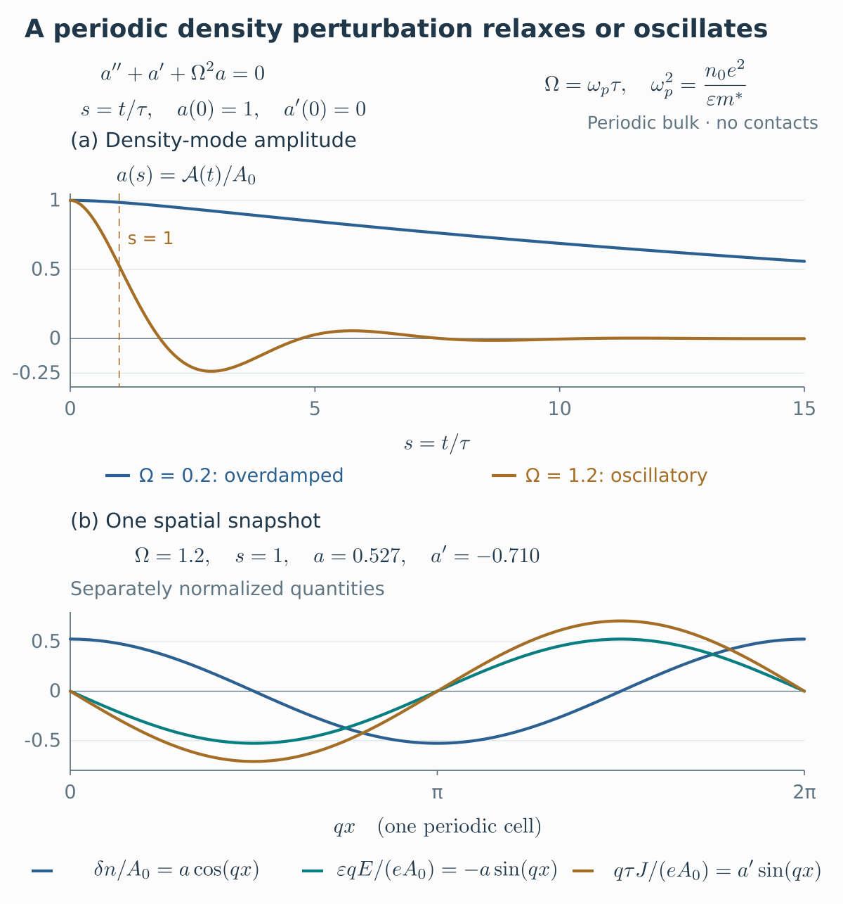
</picture>
<figcaption markdown="span">그림 19. $\Omega=0.2$와 $1.2$의 density-mode amplitude는 $a=1,a^{\prime}=0$에서 출발한다. (a)에 표시한 시각의 공간 분포를 (b)에 그렸다. 조건은 $\Omega=1.2,s=1$이며, 그때 $a\simeq0.52664$, $a^{\prime}\simeq-0.71020$이다. 그림의 $A_0=\mathcal A(0)$는 초기 density amplitude다. 밀도, 전기장, 전류를 각각 $A_0$, $eA_0/(\varepsilon q)$, $eA_0/(q\tau)$로 나눴으므로 곡선 높이로 세 물리량의 실제 크기를 직접 비교할 수는 없다. 이 전기장과 전류는 같은 밀도 변화에서 계산했으며 Poisson equation과 continuity equation을 만족한다. 이 collective mode에는 periodic boundary condition을 적용했고 pressure는 무시했다. Contact나 외부 단자 전압은 없다.</figcaption>
</figure>



$\Omega=0.5$를 지나가며 진동 없이 줄어드는 경우와 overshoot가 생기는 경우를 비교하자. 초기 순간에 유한한 전기장과 0인 전류를 확인할 수 있다. Lab은 5% 밀도 modulation에서 시작하며 전기장과 전류를 각각의 기준값으로 나누어 표시한다. 이를 SI 단위의 전기장과 전류로 바꾸려면 대상 시스템의 평균 밀도, permittivity, wavevector, relaxation time이 필요하다.

Momentum이 밀도 변화보다 훨씬 빠르게 조정될 때만, 느린 밀도 변화 동안 전기장과 전류가 국소적인 DC 관계를 따른다고 볼 수 있다. 파장이 길다는 사실만으로 관성에 의한 transient가 사라지는 것은 아니다.

<details markdown="1">
<summary>더 간단한 charge-relaxation time epsilon/sigma는 언제 유효할까?</summary>

밀도가 변하는 시간 척도에서 관성을 무시할 수 있으면 charge continuity에 $\mathbf J=\sigma_0\mathbf E$를 바로 대입한다. $\sigma_0$와 $\varepsilon$이 균일할 때

$$
\begin{aligned}
&\partial_t\rho=-\frac{\sigma_0}{\varepsilon}\rho,\\
&\tau_M=\frac{\varepsilon}{\sigma_0}
=\frac{1}{\omega_p^2\tau}.
\end{aligned}
\tag{65}
$$

이 **Maxwell charge-relaxation time**은 momentum relaxation time과 다르다. $\omega_p\tau\ll1$일 때 관성에 의한 빠른 transient가 사라진 뒤 남는 식 (61)의 느린 decay time이다. 이 극한에서 물리적 시간에 대한 두 rate는 대략 $-\omega_p^2\tau$와 $-1/\tau$다. Underdamped mode에 순간적인 Ohm 법칙을 적용하면 실제로 일어나는 진동을 설명할 수 없게 된다. [Haus and Melcher, Sec. 7.7][charge-relaxation]

</details>

## 20. 연습문제: 전기장·band curvature·scattering rate
{: id="drude-20" }



각 quiz 그림에는 문제에 필요한 전기장, curvature, scattering 방향 또는 phase convention이 주어져 있다. 먼저 무엇을 고정하는지 구분해야 한다. 전압을 고정한 채 도선을 길게 하는 것과 전기장을 고정한 채 길게 하는 것은 다르다. Elastic scattering의 각도를 바꾸는 것도 에너지를 잃는 channel을 추가하는 것과 다르다. 아래 수치 coding 문제는 notebook에서 코드를 고치고 테스트할 수 있다.

### 1. 같은 전압에서 도선이 길어지면

$V,A,n,m^{\ast},\tau$를 고정하고 $L$을 두 배로 늘리자. 밀도가 균일하고 charge neutrality를 만족하는 모델에서 전기장, 도선을 흐르는 전류, mobility, bulk charge density는 어떻게 되는가? Continuity 때문에 전류가 원래 도선과 같아야 하는가?

<details markdown="1">
<summary>정답</summary>

전기장과 전류는 절반이 되고 저항은 두 배가 된다. 물질의 transport parameter가 바뀌지 않으므로 mobility는 그대로다. 두 경우 모두 일정한 전기장의 divergence가 0이므로 bulk charge density는 0이다. Continuity는 **각 도선의 steady state에서** 전류가 공간적으로 일정해야 한다는 조건이지, boundary condition이 다른 두 도선의 전류가 같아야 한다는 조건이 아니다.

</details>

### 2. Packet은 움직이지만 그 순간 속도는 변하지 않는 경우

Cosine band에서 중심 wavevector가 $ka=\pi/2$이고 wavevector 분포가 좁은 packet을 생각하자. 중심 속도는 0이 아니지만, 작은 일정한 외력에 의한 그 속도의 시간 미분은 순간적으로 0일 수 있다. 이유를 설명하라. 이 점에 band-edge mass를 적용해도 되는가?

<details markdown="1">
<summary>정답</summary>

에너지의 1차 미분은 최대지만 2차 미분은 0이다. 식 (18)은 packet 중심의 속도를, 식 (19)는 그 속도의 시간 미분을 준다. Band minimum에서 이만큼 멀리 떨어진 곳에는 band edge의 quadratic 근사가 유효하지 않다. 외력이 $k$를 바꾸면 packet은 curvature가 다른 영역으로 이동한다. 따라서 중심의 가속도가 0이라는 결과는 이 semiclassical 근사에서 그 순간에만 해당한다.

</details>

### 3. Event rate는 같아도 전류 relaxation은 다르다

고정된 에너지의 isotropic angular model에서, 서로 독립적인 elastic scattering이 이전 이력과 무관하게 rate $5\times10^{12}\,\mathrm{s}^{-1}$로 발생한다. 각 사건에서 방향이 $60^\circ$ 바뀌며 방위각은 무작위다. $\tau_q$와 $\tau_{\rm tr}$를 구하라. 둘 중 어느 값으로 전자 기체의 냉각 속도를 알 수 있는가?

<details markdown="1">
<summary>정답</summary>

$\tau_q=0.2\,\mathrm{ps}$다. $1-\cos60^\circ=1/2$이므로 transport rate는 event rate의 절반이고 $\tau_{\rm tr}=0.4\,\mathrm{ps}$다. 사건들이 전자 에너지를 보존하므로 둘 다 기체의 에너지 냉각 시간이 아니다.

</details>

### 4. 전류가 생기기 전에도 전기장은 있다

앞의 periodic bulk mode에서 전기장에 공간적으로 균일한 성분이 없다고 하자. 초기 밀도를 $\delta n(x,0)=\mathcal A_0\cos qx$, $\mathcal A_0>0$로 정하고 초기 drift는 0이라 하자. $\sin qx>0$인 점에서 $E$, 초기 $J$, 초기 $\partial_tJ$의 부호는 무엇인가? 전자의 전하 부호와 continuity를 모두 확인하라.

<details markdown="1">
<summary>정답</summary>

전기장은 음수다. 처음에는 $J=0$이지만 $\partial_tJ=(n_0e^2/m^{\ast})E<0$이다. 전자는 양의 $x$ 방향으로 움직이기 시작하므로 전류는 음의 $x$ 방향으로 생긴다. 전체적으로 $\partial_t\rho+\partial_xJ=0$을 만족하며 전하는 사라지지 않는다. 밀도의 초기 시간 미분은 0이지만 2차 시간 미분은 밀도를 균일한 상태로 되돌리는 방향이다.

</details>

### 5. Coding test: event rate와 transport rate

**입력.** 길이가 같은 1차원 NumPy array 두 개다. `rate_weights[i]`는 angular bin `i`에 배정한 rate이며 입체각 적분의 weight가 이미 포함되어 있다. `cos_theta[i]`는 그 bin의 scattering angle에 대한 cosine이다. 입력은 모두 유한하고, rate는 음수가 아니며 cosine은 $[-1,1]$ 범위다.

**출력.** 초의 역수 단위인 새 2원소 array `[Gamma_q, Gamma_tr]`를 반환한다. Rate를 normalize하면 전체 사건 빈도를 잃으므로 normalization하지 않는다. 두 입력 중 어느 것도 변경하지 않는다. Lifetime 대신 rate를 반환하면 scattering이 없거나 완전한 forward scattering일 때도 0으로 나눌 필요가 없다.

`rate_weights=[4,6]`, `cos_theta=[1,0]`이면 답은 `[10,6]`다. 정확히 forward인 입력은 방향을 바꾸지 않는 test channel이다. 입력된 rate의 합에는 포함되지만 방향을 바꾸는 데에는 기여하지 않는다. 11절의 quantum transition에서는 처음과 똑같은 상태를 final state에서 제외했다. 따라서 이 인위적인 입력의 단순 rate 합을 물리적인 quantum out-scattering rate로 해석하면 안 된다. `[8]`, `[-1]`이면 방향 반전을 두 배로 세므로 답은 `[8,16]`다.

<figure class="drude-figure">
<picture class="rsna-results-figure">
<source media="(max-width: 560px)" srcset="" width="600" height="1300">
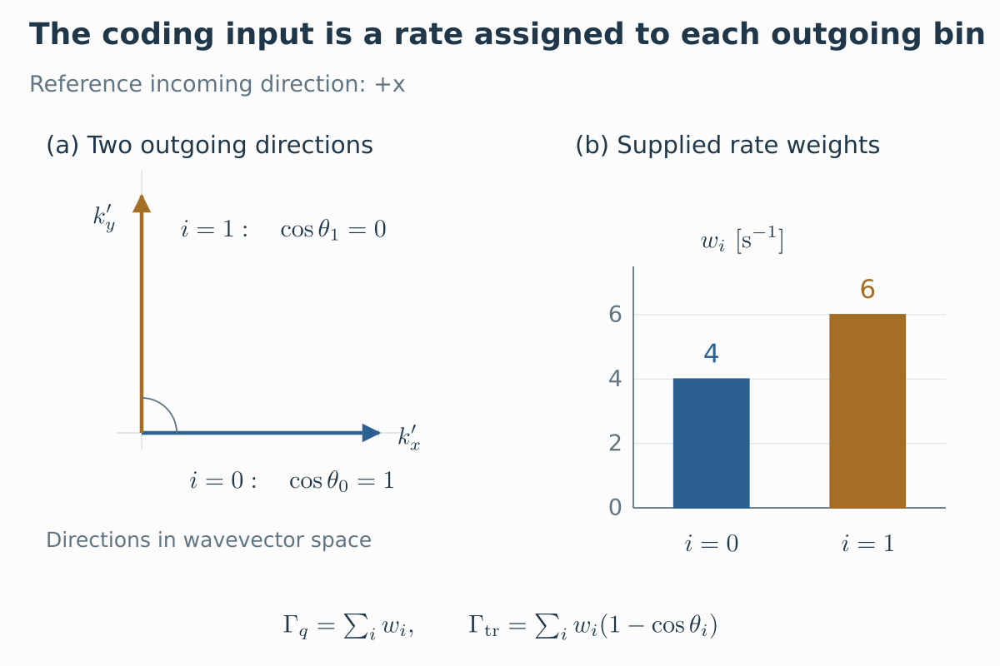
</picture>
<figcaption markdown="span">그림 20. 입사 방향을 가로축의 양의 방향으로 잡았다. 두 outgoing bin은 각각 forward 방향과 그에 수직인 방향이며, 입력된 rate weight를 막대로 표시했다. 각 weight에는 angular integration measure가 이미 포함되어 있으므로, 다시 normalize하지 않고 합해야 한다. 정확히 forward인 입력은 방향을 바꾸지 않는 이상적인 test channel이며, 다른 quantum state로의 transition을 뜻하지 않는다.</figcaption>
</figure>

```python
def angular_relaxation_rates(rate_weights, cos_theta):
    # Return [event rate, transport rate] without changing either input.
    raise NotImplementedError("Implement the angular sums in Eq. (40)")

def check_angular_rates(candidate):
    cases = [([4., 6.], [1., 0.]), ([8.], [-1.]),
             ([0., 0.], [-1., 1.]), ([2., 3., 5.], [0.8, -0.4, 0.0])]
    for rates, cosines in cases:
        rates, cosines = np.array(rates), np.array(cosines)
        before_r, before_c = rates.copy(), cosines.copy()
        expected = np.array([before_r.sum(), np.dot(before_r, 1 - before_c)])
        actual = np.asarray(candidate(rates, cosines))
        assert np.array_equal(rates, before_r), "Rate input was mutated"
        assert np.array_equal(cosines, before_c), "Angle input was mutated"
        assert actual.shape == (2,) and np.allclose(actual, expected)
        assert not any(np.shares_memory(actual, a) for a in (rates, cosines)), "Return a new array"
        assert 0 <= actual[1] <= 2 * actual[0] + 1e-12
    return "4 cases passed"

# After implementing your answer, uncomment:
# print(check_angular_rates(angular_relaxation_rates))
```

<details markdown="1">
<summary>Reference solution과 lifetime 비의 범위</summary>

```python
def angular_relaxation_rates_reference(rate_weights, cos_theta):
    rates = np.asarray(rate_weights, dtype=float)
    cosines = np.asarray(cos_theta, dtype=float)
    return np.array([np.sum(rates), np.sum(rates * (1 - cosines))])

print(check_angular_rates(angular_relaxation_rates_reference))
```

모든 인자 $1-\cos\theta$는 0과 2 사이이므로 $0\le\Gamma_{\rm tr}\le2\Gamma_q$다. 양의 유한한 rate에서는 $\tau_{\rm tr}/\tau_q\ge1/2$가 된다. 분포가 완전히 forward 방향으로 몰리는 극한에는 유한한 상한이 없다. Isotropic scattering에서는 이 비가 양 끝값이 아니라 1이다.

처음 제공한 함수와 reference solution은 이름이 다르다. Notebook을 실행해도 작성한 답을 reference solution으로 자동 대체하지 않는다. Checker는 계산값, 입력이 그대로 보존되는지, 각도에 따른 weight가 물리적으로 가능한 범위인지를 검사한다. Browser quiz는 임의의 사용자 코드를 실행하지 않는다.

</details>

저항 법칙은 서로 다른 물리 계산을 결합한 결과다. Poisson과 boundary condition은 전기장을 정하고, continuity는 전하가 쌓이는 양과 flux 사이의 관계를 정한다. Carrier dispersion은 semiclassical 속도와 외력이 그 속도를 바꾸는 방식을 정한다. Microscopic transition matrix element와 final-state counting으로 scattering rate를 구하고, 각도에 따른 weight를 적용해 transport time을 계산한다. Bulk charge density가 0이어도 전류를 만드는 전기장은 있을 수 있고, total scattering rate만으로 전류가 얼마나 빨리 줄어드는지 알 수는 없다. Mobility와 conductivity는 명시한 약한 전기장 조건에서 이 요소들을 결합한 결과다. 어느 한 요소가 바뀌면 $ne^2\tau/m^{\ast}$의 숫자 하나만 바꾸는 것으로는 충분하지 않을 수 있다.

## 참고문헌과 추가 구현
{: id="drude-references" }

- H. A. Haus and J. R. Melcher, [*Electromagnetic Fields and Energy*, Chapter 7][electrostatics] 및 [Section 7.7][charge-relaxation]. 전하 보존, 전도, electroquasistatic charge relaxation.
- TU Delft, [*Open Solid State Notes*: Drude model][drude-notes]. 평균 속도 방정식과 conductivity–mobility 관계. 위의 angular 모델에서는 event time과 transport time을 구분했다.
- D. Tong, [*Electromagnetism*, Sections 7.6.1–7.6.3][tong-em]. Drude AC response, dielectric response, plasma oscillation.
- D. Tong, [*Solid State Physics*, Chapter 2][bands] 및 [Chapter 3, Section 3.2][dynamics]. Bloch state, tight binding, group velocity, inverse-effective-mass tensor, Bloch oscillation.
- R. Fitzpatrick, [Ehrenfest's Theorem][ehrenfest]. 위치와 momentum의 expectation value, 전체 힘, packet 중심의 운동을 고전적인 식으로 근사할 수 있는 조건.
- B. Zwiebach, MIT 8.06, [Chapter 4: Time-Dependent Perturbation Theory, Section 4.3.1][golden] (2018). 유한 시간의 transition amplitude와 continuum의 golden-rule 극한. MIT 8.321의 [Lecture 26][golden-lecture] (2017)도 참고할 수 있다.
- B. Zwiebach, MIT 8.06, [Chapter 7: Scattering, Section 7.3][born] (2018); D. Tong, [*Topics in Quantum Mechanics*, Chapter 6, Sections 6.2–6.3][tong-scattering]. Cross section, Born approximation, screened Coulomb scattering.
- S. Kim, S. Woo and H. Min, [“Vertex corrections to the dc conductivity in anisotropic multiband systems”][transport-time], *Physical Review B* **99**, 165107 (2019), DOI: 10.1103/PhysRevB.99.165107. Angular transport weight가 성립하는 조건과 scalar relaxation time을 넘어서는 확장.
- J. Bardeen and W. Shockley, [“Deformation Potentials and Mobilities in Non-Polar Crystals”][deformation], *Physical Review* **80**, 72–80 (1950), DOI: 10.1103/PhysRev.80.72.
- MIT 6.730, [*Physics for Solid-State Applications*, lecture notes][mit-solid] (2003). Effective mass와 electron–phonon scattering의 유도.
- F. Giustino, [“Electron-phonon interactions from first principles”][giustino], *Reviews of Modern Physics* **89**, 015003 (2017), DOI: 10.1103/RevModPhys.89.015003; [Erratum][giustino-erratum], **91**, 019901 (2019). Matrix element, quasiparticle lifetime, transport. 전류와 kinetic equation은 정정된 식을 사용해야 한다.
- [EPW documentation][epw]과 [source repository][epw-source]. 예제의 scalar 모델을 넘어서는 first-principles electron–phonon 및 transport 구현.
- [NIST CODATA constants][constants]. 실행 코드에 사용한 SI 상수와 전자 질량.

[electrostatics]: https://web.mit.edu/6.013_book/www/chapter7/7.html
[charge-relaxation]: https://web.mit.edu/6.013_book/www/chapter7/7.7.html
[drude-notes]: https://solidstate.quantumtinkerer.tudelft.nl/3_drude_model/
[tong-em]: https://www.damtp.cam.ac.uk/user/tong/em/el6.pdf
[bands]: https://davidtong.org/pdfs/teaching/solid-state-physics/solidstate2.pdf
[dynamics]: https://davidtong.org/pdfs/teaching/solid-state-physics/solidstate3.pdf
[ehrenfest]: https://farside.ph.utexas.edu/teaching/qmech/lectures/node36.html
[golden]: https://ocw.mit.edu/courses/8-06-quantum-physics-iii-spring-2018/89ef6d5958ee59bae9a91345c3d8c8e4_MIT8_06S18ch4.pdf
[golden-lecture]: https://ocw.mit.edu/courses/8-321-quantum-theory-i-fall-2017/81f6e90a6cdd311ca5f3afb32e9da1f2_MIT8_321F17_lec26.pdf
[born]: https://ocw.mit.edu/courses/8-06-quantum-physics-iii-spring-2018/45dbd7038c3e969491eceeae86c44d42_MIT8_06S18ch7.pdf
[tong-scattering]: https://davidtong.org/pdfs/teaching/topics-in-quantum-mechanics/topicsinqm6.pdf
[transport-time]: https://arxiv.org/html/1901.04135v2
[deformation]: https://doi.org/10.1103/PhysRev.80.72
[mit-solid]: https://ocw.mit.edu/courses/6-730-physics-for-solid-state-applications-spring-2003/pages/lecture-notes/
[giustino]: https://doi.org/10.1103/RevModPhys.89.015003
[giustino-erratum]: https://doi.org/10.1103/RevModPhys.91.019901
[epw]: https://docs.epw-code.org/
[epw-source]: https://gitlab.com/epw/q-e/-/tree/develop/EPW
[constants]: https://physics.nist.gov/cuu/Constants/Table/allascii.txt
