[Read in Korean]({{ site.baseurl }}/posts/Drude-Model-From-Scratch-KR/) · [Python reference]({{ site.baseurl }}/assets/code/drude-model.py) · [Executable notebook]({{ site.baseurl }}/assets/notebooks/drude-model-en.ipynb)

Apply a fixed voltage across an ordinary wire, and its current usually settles to an approximately constant value, provided its temperature stays nearly fixed. That is a familiar observation. But what sets the value of the current, and why does it stop increasing?

A voltage establishes an electric field, which exerts a force on the electrons. A force changes velocity, whereas a constant current requires a constant average velocity when the carrier density is fixed. To connect these statements, we need to work out the electron motion—not assume Ohm's law at the outset.

## 1. Charge and current densities, electric field and charge conservation
{: id="drude-01" }

Take a uniform wire with length $L$ and cross-sectional area $A$. Set the origin of $x$ at the left contact, with positive direction to the right. An electron has charge $-e$, where $e$ is the elementary charge magnitude. Write $n(\mathbf r,t)$ for the number of mobile conduction electrons per unit volume; this excludes core electrons bound near the nuclei.

Count the negative charge of the conduction electrons separately from the charge that remains. In a metal, the nuclei and the electrons not included in the conduction population together supply a net positive lattice charge. An ionized donor that has given up one electron in an n-type semiconductor also contributes $+e$. The model writes the remaining fixed positive charge density as $+eN_D$: $N_D$ is that charge density divided by the elementary charge, not a literal count of all stationary particles. Charge neutrality means that this positive charge balances the conduction electrons' negative charge. In a p-type semiconductor, by contrast, an acceptor gains an electron and becomes negatively charged, while a mobile hole carries positive charge. That is not the electron-only transport model used here. [MIT 6.012, Introduction to Semiconductors](https://ocw.mit.edu/courses/6-012-microelectronic-devices-and-circuits-fall-2009/a37c73e7fcff4bcb5c5f1177e12d0891_MIT6_012F09_lec01.pdf)

Let $\mathbf u$ be the **mean drift velocity**: the vector velocity averaged over the electrons in a small region at the same time, in the wire's rest frame. Large velocities in opposite directions can cancel in that average. For example, equal numbers moving left and right at equal speeds give zero mean velocity, even though none of the electrons is at rest.

Current measures the net charge crossing a section per unit time. For density and drift uniform across the section, the signed net number crossing an area $A$ in a short time $\Delta t$ is $nAu_x\Delta t$. Multiplying by the electron charge gives $\Delta Q=-enAu_x\Delta t$, and dividing by $\Delta t$ gives the current. Conventional current is defined in the direction of positive-charge motion, opposite to electron drift. The net charge density $\rho$ is the sum of the fixed background and mobile electron charges. With conduction-current density $\mathbf J$,

$$
\begin{aligned}
&\rho=e(N_D-n),\\
&\mathbf J=-en\mathbf u,\\
&I=\int_A\mathbf J\cdot d\mathbf A.
\end{aligned}
\tag{1}
$$

Here $n$ is measured in $\mathrm{m}^{-3}$, $\rho$ in $\mathrm{C/m^3}$, $\mathbf u$ in $\mathrm{m/s}$, $\mathbf J$ in $\mathrm{A/m^2}$ and $I$ in amperes. If electrons drift toward negative $x$, the conventional current is positive. For uniform current across the section, $I=AJ_x$.

The electrostatic potential $\varphi$, measured in volts, gives the electric field through $\mathbf E=-\nabla\varphi$. The field acts on an electron with force $-e\mathbf E$. A linear dielectric background with absolute permittivity $\varepsilon=\varepsilon_0\varepsilon_b$ obeys

$$
\begin{aligned}
&\nabla\cdot(\varepsilon\mathbf E)=\rho,\\
&-\nabla\cdot(\varepsilon\nabla\varphi)=\rho.
\end{aligned}
\tag{2}
$$

The second expression is **Poisson's equation**. Here $\varepsilon_0$ is the vacuum permittivity. The dimensionless $\varepsilon_b$ represents the background electric response; the mobile conduction electrons remain in $\rho$ and are not counted again inside that background. Take it to be real, positive and constant over the frequencies considered. In a crystal this describes a field averaged over many atomic spacings, not the microscopic potential near each nucleus.

In one dimension, the potential gradient is $\partial_x\varphi$ and the electric-field divergence is $\partial_xE_x$. A positive divergence means that the net outward electric flux from a small region is positive. The units are $\mathrm{V/m}$ for $\mathbf E$ and $\mathrm{F/m}$ for $\varepsilon$, so both sides of Eq. (2) have units of charge per volume.

Poisson's equation relates charge to the spatial variation of the field. It does not yet say how fast electrons move. It also needs boundary conditions: a charge density alone does not determine the potential uniquely. [Haus and Melcher, Chs. 4 and 7][electrostatics]

**Continuity** expresses conservation of this mobile-electron population. Assume no generation, recombination or trapping transfers electrons into or out of that population; such processes change which electrons are mobile, not the existence of electric charge. The number inside a small segment then changes by incoming flux minus outgoing flux. Particle flux means the number crossing a unit area per unit time. For a constant area, divide

$$
\frac{d}{dt}\big[nA\,\Delta x\big]
=A(nu_x)_{x}-A(nu_x)_{x+\Delta x}
$$

by $A\Delta x$ and let $\Delta x\to0$. In three dimensions this becomes

$$
\begin{aligned}
&\partial_t n+\nabla\cdot(n\mathbf u)=0,\\
&\partial_t\rho+\nabla\cdot\mathbf J=0.
\end{aligned}
\tag{3}
$$

The second equation follows from the first because $N_D$ is fixed and $\mathbf J=-en\mathbf u$. An electron changing its speed or direction does not, by itself, change the number of electrons in the region; it changes that number only by crossing the boundary.

For a numerical charge-balance example, let the conventional current entering a segment from the left be $2\,\mu\mathrm A$ and the current leaving to the right be $1\,\mu\mathrm A$ for $1\,\mathrm{ns}$. The net charge accumulated in that interval is

$$
\begin{aligned}
&\Delta Q=(I_{\rm left}-I_{\rm right})\Delta t\\
&=(2-1)\,\mu\mathrm A\times1\,\mathrm{ns}\\
&=+10^{-15}\,\mathrm C.
\end{aligned}
$$

The positive charge increase means that the electron number decreases by $\Delta Q/e\simeq6.24\times10^3$. Electrons move opposite to conventional current, so more electrons leave through the left face than enter through the right. Such unequal currents cannot persist in a stationary state.

<figure class="drude-figure">
<picture class="rsna-results-figure">
<source media="(max-width: 560px)" srcset="" width="600" height="1110">
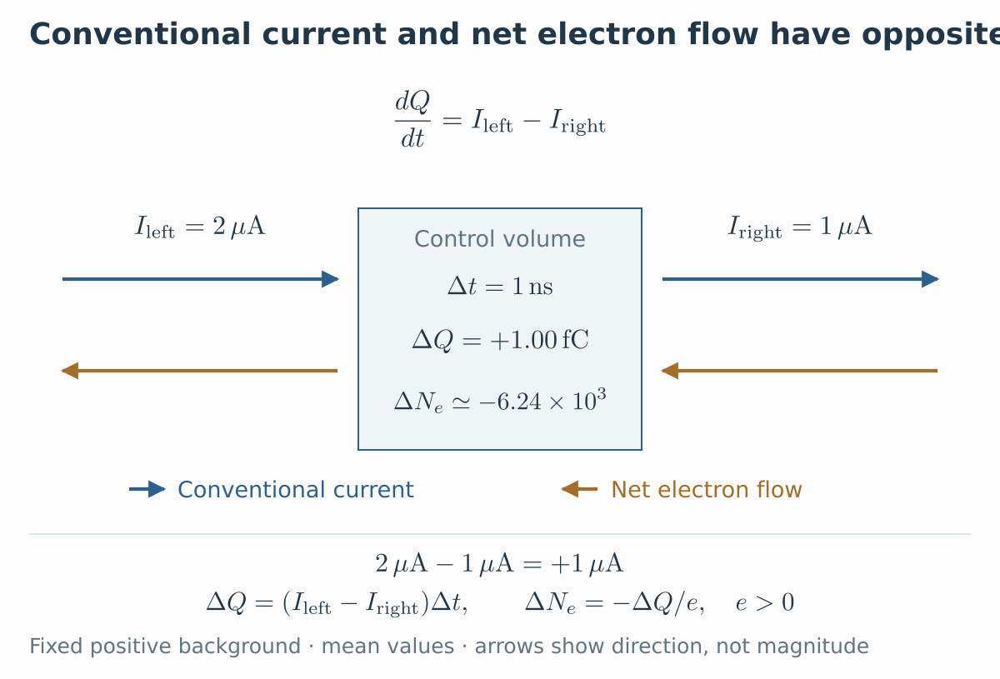
</picture>
<figcaption markdown="span">Figure 1. The two arrow rows distinguish conventional current from net electron flow. Both boundary currents use $+x$ as the positive direction. Keeping $I_{\rm left}=2\,\mu\mathrm A$ and $I_{\rm right}=1\,\mu\mathrm A$ for $1\,\mathrm{ns}$ gives $\Delta Q=+10^{-15}\,\mathrm C$. The electron-count change is $\Delta N_e=-\Delta Q/e\simeq-6.24\times10^3$: more electrons leave through the left boundary than enter through the right.</figcaption>
</figure>

| Relation | What it determines | What it does not determine alone |
|---|---|---|
| Poisson equation | Field from charge and boundary data | Electron drift |
| Continuity equation | Accumulation from unequal fluxes | Current for a given field |
| Transport relation | Response of the carriers to the field | Electrostatic boundary data |
{: .drude-table }

The missing transport relation is where the Drude model enters.

## 2. Electric field and boundary conditions in a bulk-neutral wire
{: id="drude-02" }

First determine the field that will drive the electrons. Suppose the wire's bulk is neutral, $n=N_D$, and its permittivity is constant. Poisson's equation gives $\partial_xE_x=0$, **not** $E_x=0$. With boundary values $\varphi(0)=V$ and $\varphi(L)=0$,

$$
\begin{aligned}
&\varphi(x)=V\left(1-\frac{x}{L}\right),\\
&E_x=\frac{V}{L},\\
&\rho=0.
\end{aligned}
\tag{4}
$$

For $V>0$, the field points right. The electrodes and surface charges that establish these boundary values need not produce a bulk charge density in the idealized interior. A spatially constant field has zero divergence while still exerting a force.

At stationarity, continuity additionally requires $\partial_xJ_x=0$. It fixes the same current through every section of the wire; it does not fix that current's magnitude. A perfect insulator and a good conductor can satisfy the same static Poisson equation with very different currents. Their transport relations differ.

The familiar statement that the field inside a conductor vanishes concerns **electrostatic equilibrium**: charges have redistributed with no sustained dissipative current. Here an external source maintains a voltage while charge passes through the wire. A **steady state** only means that the quantities being followed no longer change with time; it does not require the current to be zero. The field and current can therefore be constant without the wire being in equilibrium.

Figure 2 places the potential and the electric field over the same spatial interval. The potential has a constant negative slope, so the field is a positive constant even though the net bulk charge is zero. This boundary-value calculation determines the field, not the current. The current magnitude still requires an equation for the electron motion.

<figure class="drude-figure">
<picture class="rsna-results-figure">
<source media="(max-width: 560px)" srcset="" width="600" height="1490">
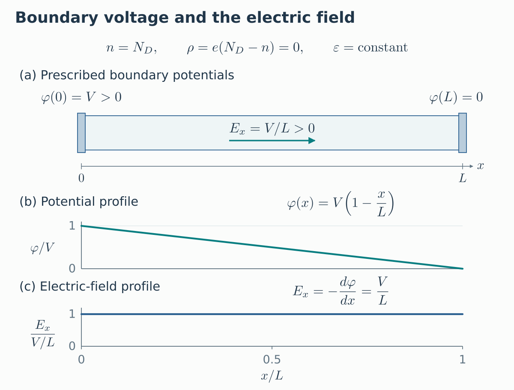
</picture>
<figcaption markdown="span">Figure 2. (a) The rectangle is a homogeneous bulk region; the end faces mark the prescribed potential boundaries. The interior arrow denotes the electric field. (b) The potential falls linearly from the left boundary to the right. (c) Its negative slope gives a uniform positive field over the same spatial interval. Both profiles use the same position coordinate. Charge neutrality, $\rho=0$, requires zero field divergence, not zero field. No current magnitude follows from this electrostatic calculation alone.</figcaption>
</figure>

<details markdown="1">
<summary>What changes if the density is not uniform?</summary>

Then Poisson's equation generally makes the field nonuniform. A density gradient can also drive diffusion, so a drift-only law $\mathbf J=\sigma\mathbf E$ need not describe equilibrium or transport correctly. In a **nondegenerate** electron gas, each thermally relevant single-particle state has a small occupation, so Maxwell–Boltzmann statistics apply. For these electrons in a simple isothermal model, the electron charge current contains $+eD\nabla n$ in addition to $en\mu\mathbf E$, where $\mu$ is the mobility defined in Section 4 and $D$ is the diffusion coefficient in $\mathrm{m^2/s}$. The positive diffusion-current sign follows because particles diffuse down their density gradient while carrying negative charge.

The uniform-wire example avoids that additional term. The small charge-oscillation example in Section 19 instead uses a stated pressureless, long-wavelength linear model. Neither example is a general drift–diffusion device solver.

</details>

## 3. Drude equation for the mean electron velocity
{: id="drude-03" }

We know the field and the relation between mean velocity and current. The remaining task is to find how that mean velocity changes. Start with a spatially uniform electron gas, fixed density and an externally imposed constant field $\mathbf E_0$, switched on at $t=0$. Set the initial mean velocity to $\mathbf u(0)=0$. This is a bulk model: we are not yet calculating injection from contacts or the propagation of a field through a circuit.

### Mean velocity and current without scattering

Write the positive, constant mass coefficient as $m^{\ast}$. For the free electrons considered first, it is simply $m^{\ast}=m_0$, where $m_0$ is the electron's bare mass. The electric force is the same on every electron, so averaging Newton's equation gives the same acceleration for the mean velocity. Integrating that constant acceleration and then using Eq. (1) gives

$$
\begin{aligned}
&\frac{d\mathbf u}{dt}=-\frac{e}{m^{\ast}}\mathbf E_0,\\
&\mathbf u(t)=-\frac{e}{m^{\ast}}\mathbf E_0t,\\
&\mathbf J(t)=\frac{ne^2}{m^{\ast}}\mathbf E_0t.
\end{aligned}
$$

This model does produce a current when a field is applied. But it does not produce a *constant* current: leave the field on twice as long, and the current doubles. The issue is therefore not whether a voltage can produce a current. It is what prevents the mean velocity, and hence the current, from growing indefinitely in this model.

### Mean-velocity relaxation from scattering

In a material, electrons also interact with impurities and lattice vibrations. Such an interaction can change an electron's direction or energy; this is **scattering**. To reduce a mean velocity, it need not stop the electrons. Redirecting an initially biased collection of velocities into many different directions can reduce their average while the individual speeds remain large.

Use a deliberately simple model. During a short interval $dt\ll\tau$, each electron scatters with probability $dt/\tau$ to first order, independent of its earlier history, where $\tau>0$ is a time. Assume that the velocities just after scattering average to zero.

The electrons that do not scatter retain their previous mean velocity and gain the field-induced increment $-e\mathbf E\,dt/m^{\ast}$; they make up a fraction $1-dt/\tau$ of the electrons. The scattered fraction contributes zero at leading order. Field acceleration after an event contributes only at order $dt^2$ to the ensemble average, because both the event probability and the remaining time are proportional to $dt$.

The event probabilities give the statistical weights of the two groups: the model averages over possible scattering histories. Weighting these groups and keeping first-order terms in $dt$ gives

$$
\begin{aligned}
&\mathbf u(t+dt)=\left(1-\frac{dt}{\tau}\right)\mathbf u(t)\\
&\qquad-\frac{e\mathbf E}{m^{\ast}}dt+\mathcal O(dt^2).
\end{aligned}
\tag{5}
$$

Subtract $\mathbf u(t)$, divide by $dt$ and take $dt\to0$. Multiplying by the mass gives the **Drude equation of motion**:

$$
m^{\ast}\frac{d\mathbf u}{dt}
=-e\mathbf E-\frac{m^{\ast}}{\tau}\mathbf u.
\tag{6}
$$

The electric force supplies the first term. Scattering reduces the directional bias in the electron velocities, giving the second term. If the mean velocity points left, that term points right. [TU Delft, Drude equation of motion][drude-notes]

An object dropped from a height speeds up at first, but increasing drag reduces its acceleration. As the upward drag balances the downward force, the object approaches its terminal speed. For a small bead falling slowly through a viscous liquid, drag is approximately proportional to speed. A constant downward force after accounting for buoyancy, opposed by linear drag, gives an equation of the same form as the Drude equation. [OpenStax, drag and terminal speed](https://openstax.org/books/university-physics-volume-1/pages/6-4-drag-force-and-terminal-speed)

At a fixed field, the mean electron drift approaches a constant in the same way. The analogy is about the equation for the mean: the falling bead experiences a drag force, but the Drude relaxation term describes scattering reducing the electrons' collective directional bias, not friction on each electron. This approach to steady drift **over time at a fixed field** is different from high-field velocity saturation, where increasing the field no longer increases the drift speed appreciably.

With the field removed, Eq. (6) becomes $d\mathbf u/dt=-\mathbf u/\tau$, whose solution is $\mathbf u(t)=\mathbf u(0)e^{-t/\tau}$. Thus $\tau$ measures how quickly the mean velocity decays: after one $\tau$, it is $e^{-1}$ of its initial value. This is the **momentum relaxation time**, also written $\tau_{\rm tr}$.

In the complete-randomization model above, the relaxation time equals the mean time between events. Real scattering can leave some of the previous direction intact, so it can take many events to relax the mean velocity. The same equation can then be a useful approximation, but its $\tau$ must be found from the decay of the mean drift rather than identified with the event waiting time. Section 14 calculates that distinction.

For now the mean response is uniform in space, the positive mass is independent of direction and the damping is linear in the mean velocity. Forces from pressure gradients and spatial transport of momentum are excluded. The band description in Sections 7–9 will establish when a crystal can also be described using a constant positive $m^{\ast}$ different from $m_0$.

<figure class="drude-figure">
<picture class="rsna-results-figure">
<source media="(max-width: 560px)" srcset="" width="600" height="1090">
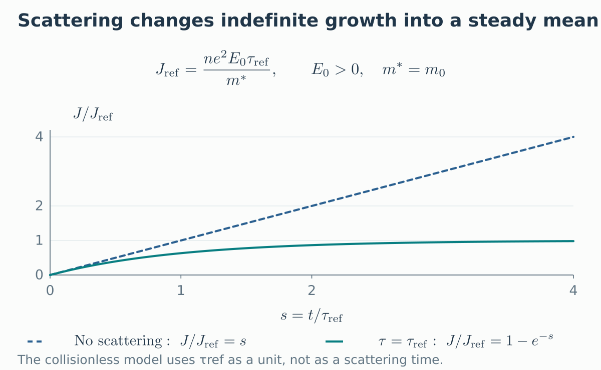
</picture>
<figcaption markdown="span">Figure 3. Both curves use the same field and zero initial mean drift, with $m^{\ast}=m_0$. The axes use $s=t/\tau_{\rm ref}$ and $J_{\rm ref}=ne^2E_0\tau_{\rm ref}/m^{\ast}$, with a finite $\tau_{\rm ref}>0$. The dashed curve has no scattering; the solid curve uses $\tau=\tau_{\rm ref}$. For the collisionless curve, the reference time is only a plotting unit, not a scattering time.</figcaption>
</figure>

## 4. DC mobility, conductivity and channel resistance
{: id="drude-04" }

We can now find a constant current rather than assume one. Denote the constant mean velocity by $\mathbf u_{\rm dc}$, where DC means direct current. At this steady state, $d\mathbf u/dt=0$, so Eq. (6) requires

$$
0=-e\mathbf E-\frac{m^{\ast}}{\tau}\mathbf u_{\rm dc}.
$$

Rearranging gives $\mathbf u_{\rm dc}=-e\tau\mathbf E/m^{\ast}$. Substituting it into $\mathbf J=-en\mathbf u$ gives $\mathbf J=(ne^2\tau/m^{\ast})\mathbf E$: the two electron-charge minus signs cancel. Define DC **mobility** $\mu$ as the steady mean drift speed per unit field magnitude and DC **conductivity** $\sigma_0$ as current density per unit field. With fixed $n$, these relations are

$$
\begin{aligned}
&\mathbf u_{\rm dc}=-\mu\mathbf E,\\
&\mu=\frac{e\tau}{m^{\ast}},\\
&\mathbf J=\sigma_0\mathbf E,\\
&\sigma_0=en\mu=\frac{ne^2\tau}{m^{\ast}}.
\end{aligned}
\tag{7}
$$

The mobility $\mu$ is positive in this positive-mass model; the minus sign in $\mathbf u=-\mu\mathbf E$ accounts for the electron charge. Conductivity $\sigma_0$ additionally includes the number of carriers. A material can have high mobility but low conductivity if few carriers are present.

In the ideal equation above the response is linear in $\mathbf E$. Applying it to a real material requires a **low field**, or **linear-response** regime: the induced redistribution of carrier velocities must be small enough that retaining only the response first order in the field is adequate. The carrier density, response mass and relaxation time can then be kept at their undriven values. Heating or field-dependent scattering must not substantially change the chosen $\tau$. For a crystal, the electrons must also stay in the energy range where a constant mass is usable, as derived in Sections 7–9. There is no material-independent field value separating weak and strong response.

The SI mobility unit is $\mathrm{m^2/(V\,s)}$. To express it in $\mathrm{cm^2/(V\,s)}$, multiply by $10^4$. Density converts the other way in a common trap: $1\,\mathrm{cm}^{-3}=10^6\,\mathrm{m}^{-3}$.

This is the Drude conductivity. A larger carrier density adds more charge carriers, a longer relaxation time lets the field build up more drift before it is randomized, and a larger mass gives less acceleration under the same force.

To recover the wire current, use the uniform-field result $E_x=V/L$ from Eq. (4) and the cross-section relation $I=AJ_x$ from Eq. (1). Thus $I=A\sigma_0E_x=A\sigma_0V/L$. Defining resistance by $R=V/I$ gives

$$
\begin{aligned}
&I=\frac{\sigma_0A}{L}V,\\
&R=\frac{L}{\sigma_0A},\\
&\varrho_{\rm el}=\frac{1}{\sigma_0}.
\end{aligned}
\tag{8}
$$

The resistivity $\varrho_{\rm el}$, in $\Omega\,\mathrm m$, is not the charge density $\rho$. Length and area turn a local material response into a channel resistance. Holding $n,m^{\ast},\tau$ fixed makes the $I$–$V$ line straight. Heating, changing carrier density, velocity saturation, ballistic contacts and field-dependent scattering can invalidate that extrapolation.

<figure class="drude-figure">
<picture class="rsna-results-figure">
<source media="(max-width: 560px)" srcset="" width="600" height="1510">
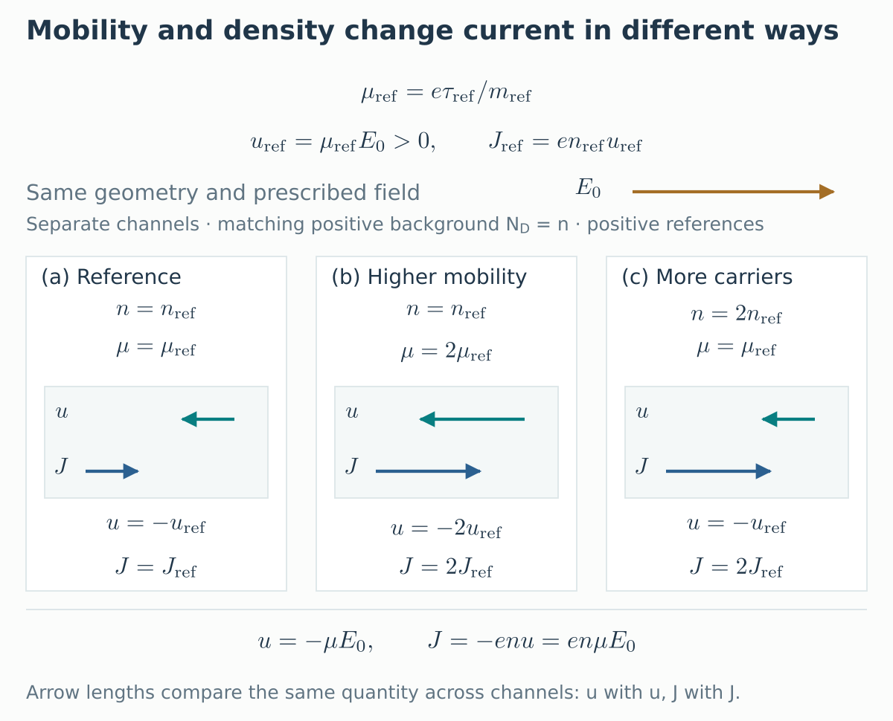
</picture>
<figcaption markdown="span">Figure 4. The three channels have the same geometry and prescribed field $E_0>0$. Each has its own matching fixed background, $N_D=n$, so all three are charge-neutral. Define $\mu_{\rm ref}=e\tau_{\rm ref}/m_{\rm ref}$, $u_{\rm ref}=\mu_{\rm ref}E_0$ and $J_{\rm ref}=en_{\rm ref}u_{\rm ref}$. At fixed density, doubling mobility doubles both drift magnitude and current density. At fixed mobility, doubling density doubles current density without changing mean drift. Electron drift points opposite to the field; conventional current points along it. Arrow lengths compare the same quantity across channels, not velocity with current.</figcaption>
</figure>

The **transport mean free path** is a characteristic carrier speed multiplied by its momentum relaxation time, not the small drift speed multiplied by that time. A **diffusive** channel is long compared with this path, so local directional memory is lost over distances small compared with the channel. In **ballistic** transport, carriers cross the channel with negligible scattering; contact injection and boundary conditions then matter instead of this bulk resistance formula alone.

For an explicit example, choose $n=10^{23}\,\mathrm{m}^{-3}$, $m^{\ast}=0.2m_0$, $\tau=100\,\mathrm{fs}$ and $E_x=1000\,\mathrm{V/m}$. A femtosecond is $10^{-15}$ seconds. Let $L=1\,\mu\mathrm m$ and $A=(100\,\mathrm{nm})^2$. These prescribed parameters give approximately

$$
\begin{aligned}
&\mu=0.087941\,\mathrm{m^2/(V\,s)}\\
&=879.41\,\mathrm{cm^2/(V\,s)},\\
&u_x=-87.941\,\mathrm{m/s},\\
&\sigma_0=1408.97\,\mathrm{S/m},\\
&V=1\,\mathrm{mV},\\
&I=14.0897\,\mathrm{nA},\\
&R=70.9738\,\mathrm{k\Omega}.
\end{aligned}
$$

The code snippets need Python 3.9+ and NumPy. They run in order; the notebook contains the same snippets and embedded figures. Physical constants use the [NIST CODATA values][constants].

```python
import numpy as np
from math import gamma

E_CHARGE = 1.602176634e-19   # Positive e, in C; electron charge is -e.
HBAR = 6.62607015e-34 / (2 * np.pi)
M0 = 9.1093837139e-31
KB = 1.380649e-23
EPS0 = 8.8541878188e-12

n, mass, tau = 1e23, 0.2 * M0, 100e-15
field, length, area = 1000.0, 1e-6, (100e-9)**2
mobility = E_CHARGE * tau / mass
sigma0 = n * E_CHARGE * mobility
drift = -mobility * field
voltage, current = field * length, sigma0 * field * area
print("mobility (cm^2/Vs):", mobility * 1e4)
print("drift (m/s), current (nA):", drift, current * 1e9)
print("channel resistance (kohm):", voltage / current / 1e3)
assert np.isclose(current * 1e9, 14.0897016)
assert np.isclose(current, -E_CHARGE * n * drift * area)
```

<details markdown="1">
<summary>A scale check for the prescribed wire</summary>

Take a carrier with characteristic kinetic energy $K_{\rm char}=50\,\mathrm{meV}$ and keep the example's $m^{\ast}=0.2m_0$, $\tau=100\,\mathrm{fs}$ and $E_x=1000\,\mathrm{V/m}$. Its speed and characteristic transport path are

$$
\begin{aligned}
&v_{\rm char}=\sqrt{\frac{2K_{\rm char}}{m^{\ast}}}\\
&\simeq2.9655\times10^5\,\mathrm{m/s},\\
&\ell_{\rm char}=v_{\rm char}\tau\simeq29.65\,\mathrm{nm}.
\end{aligned}
$$

A useful weak-drive check compares the field work over that path with the carrier's energy:

$$
e\lvert E_x\rvert\ell_{\rm char}\simeq0.02965\,\mathrm{meV}
\ll K_{\rm char}.
$$

The channel length $L=1\,\mu\mathrm m$ is also about 34 such paths, rather than shorter than one path as in a ballistic channel. These comparisons check the field and length scales at the specified carrier energy. For a broad distribution, the relevant energies and transport paths must be checked across the carriers contributing to current; a separate energy-loss mechanism is still needed to hold their temperature fixed.

</details>

## 5. Current turn-on and switch-off transients
{: id="drude-05" }

The steady-state balance fixes a possible final current, but it has not yet shown that the electrons approach it. To find that approach, start again from $\mathbf u(0)=0$ and switch on $\mathbf E_0$ at $t=0$. Equation (6) can be written as $d\mathbf u/dt=-(\mathbf u-\mathbf u_{\rm dc})/\tau$. The difference from the final mean velocity therefore decays exponentially. The resulting velocity and current are

$$
\begin{aligned}
&\mathbf u(t)=-\frac{e\tau}{m^{\ast}}\mathbf E_0(1-e^{-t/\tau}),\\
&\mathbf J(t)=\sigma_0\mathbf E_0(1-e^{-t/\tau}).
\end{aligned}
\tag{9}
$$

At $t=\tau$, the current reaches $1-e^{-1}\simeq0.6321$ of its final value. If the field is subsequently removed, the current falls exponentially from its value at switch-off. The clock for that decay starts at the switch-off event, not at the original turn-on.

At very early times, $1-e^{-t/\tau}\simeq t/\tau$. Therefore $J(t)\simeq ne^2E_0t/m^{\ast}$, the same current growth as the no-scattering calculation in Section 3: too little time has passed for scattering to appreciably change the average. The initial slope is independent of $\tau$. A longer relaxation time increases the final current and the time needed to approach it, not the instantaneous acceleration caused by the same field.

```python
s = np.linspace(0, 6, 121)  # Dimensionless time s=t/tau.
j_on = -np.expm1(-s)       # J/(sigma0*E0); accurate near s=0.
j_off = np.exp(-s)         # J/J_at_switch_off, with a new time origin.
assert np.isclose(-np.expm1(-1.0), 0.6321205588)
assert np.allclose(j_on + j_off, 1.0)
print("Turn-on fraction at 1 tau:", -np.expm1(-1.0))
```

<figure class="drude-figure">
<picture class="rsna-results-figure">
<source media="(max-width: 560px)" srcset="" width="600" height="1450">
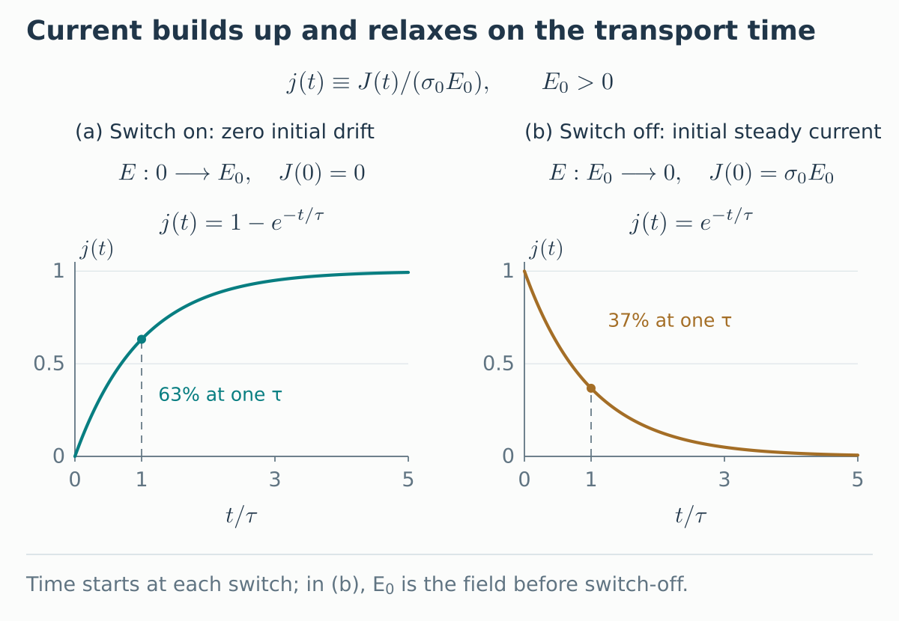
</picture>
<figcaption markdown="span">Figure 5. (a) A field $E_0>0$ is switched on from zero initial drift; the current approaches $\sigma_0E_0$. (b) The field is switched off after that steady current has been reached. Here $E_0$ denotes the field before switch-off; the field afterward is zero. Each panel measures time from its own switching event. Both use the same momentum relaxation time.</figcaption>
</figure>



Change $\tau$ and then $m^{\ast}$ separately to compare mobility and final current. The horizontal axis is $s=t/\tau$, so a plotted slope is $dJ/ds$, not $dJ/dt$. Changing $\tau$ also changes the physical time at the same horizontal position. Eq. (9) gives the initial physical-time slope as $dJ/dt=(1/\tau)dJ/ds=ne^2E_0/m^{\ast}$, independent of $\tau$. Reverse the field to check both current and electron-drift signs. The displayed channel geometry is fixed.

<details markdown="1">
<summary>Where does the electrical work go?</summary>

Multiply Eq. (6) by $n\mathbf u$ for fixed $n$:

$$
\begin{aligned}
&\frac{d}{dt}\left(\frac{nm^{\ast}u^2}{2}\right)\\
&=\mathbf J\cdot\mathbf E-\frac{nm^{\ast}u^2}{\tau}.
\end{aligned}
\tag{10}
$$

The first term is electrical power per unit volume. The last removes energy from the organized drift. At stationarity, the supplied power is $\sigma_0E^2\ge0$.

The factor $u^2$ is the square of the mean velocity, not the mean of the individual squared speeds. Equation (10) therefore describes **drift-energy density**, not the full kinetic-energy density of the electron gas. Elastic impurity scattering can relax the current while conserving each electron's energy in an individual event. Under continued driving the electronic distribution can still heat; energy transfer to phonons, contacts or another bath is needed to sustain a fixed-temperature state. An energy-cooling time need not equal $\tau_{\rm tr}$. An elastic relaxation-time model alone does not determine the electron temperature.

</details>

The limit $\tau\to\infty$ is also instructive. At a fixed observation time, Eq. (9) approaches unrestricted initial acceleration. There is no finite DC steady current in this spatially uniform collisionless parabolic model. A finite ballistic two-terminal conductance is a different boundary-value problem involving injection and contacts, not a contradiction of this statement.

## 6. AC conductivity: current amplitude and phase lag
{: id="drude-06" }

So far the field has been constant after switch-on. If it oscillates instead, the electrons must repeatedly change their mean drift direction. The relaxation time $\tau$ then matters in comparison with how quickly the field changes. After the switch-on transient has decayed, the current has a periodic steady response at the same frequency as the field. Here **periodic steady state** means that the waveform repeats from cycle to cycle, not that the instantaneous current is constant.

Write real fields using the convention $\mathbf E(t)=\operatorname{Re}[\mathbf E_\omega e^{-i\omega t}]$, where the complex amplitude $\mathbf E_\omega$ specifies the field strength and phase. Here $\omega$ is angular frequency in radians per second. The symbol $i$ in this subsection is the imaginary unit, not electric current. Insert $\mathbf u_\omega e^{-i\omega t}$ in Eq. (6): the time derivative becomes $-i\omega\mathbf u_\omega$, so

$$
\begin{aligned}
&\mathbf J_\omega=\sigma(\omega)\mathbf E_\omega,\\
&\sigma(\omega)=\frac{\sigma_0}{1-i\omega\tau}.
\end{aligned}
\tag{11}
$$

Multiplying numerator and denominator by $1+i\omega\tau$ separates the response into

$$
\begin{aligned}
&\operatorname{Re}\sigma=\frac{\sigma_0}{1+(\omega\tau)^2},\\
&\operatorname{Im}\sigma=\frac{\sigma_0\omega\tau}{1+(\omega\tau)^2}.
\end{aligned}
\tag{12}
$$

For a real field $E_0\cos\omega t$ in one direction,

$$
\begin{aligned}
&J(t)=\frac{\sigma_0E_0}{\sqrt{1+(\omega\tau)^2}}
\cos(\omega t-\theta),\\
&\theta=\tan^{-1}(\omega\tau).
\end{aligned}
\tag{13}
$$

The current **lags** the field. At $\omega\tau=1$, the amplitude is $1/\sqrt2$ of $\sigma_0E_0$ and the lag is $45^\circ$. The positive imaginary part in Eq. (12) is consistent with that lag because the convention is $e^{-i\omega t}$; switching the time convention changes the sign of the imaginary part.

The real waveform makes the sign explicit. At $\omega\tau=1$,

$$
\begin{aligned}
&\frac{J(t)}{\sigma_0E_0}
=\operatorname{Re}\!\left[\frac{1+i}{2}e^{-i\omega t}\right]\\
&=\frac{\cos\omega t+\sin\omega t}{2}\\
&=\frac{1}{\sqrt2}\cos(\omega t-\pi/4).
\end{aligned}
$$

The field reaches a maximum at $\omega t=0$; the current reaches its maximum later, at $\omega t=\pi/4$, one eighth of a cycle afterward.

The instantaneous electrical power per unit volume is $J(t)E(t)$. Averaging that product over one cycle gives $\tfrac12\operatorname{Re}\sigma\,E_0^2\ge0$, because the cosine–sine cross term averages to zero. The imaginary part represents the reversible, out-of-phase part of the response rather than an additional dissipated power. [Tong, Electromagnetism, Drude response][tong-em]

```python
omega_tau = np.array([0.0, 1.0, 10.0])
response = 1 / (1 - 1j * omega_tau)  # sigma(omega)/sigma0; exp(-i*omega*t).
assert np.all(response.real >= 0)
assert np.allclose(response[1], 0.5 + 0.5j)
phase = np.linspace(0, 2 * np.pi, 101)
waveform = np.real(response[1] * np.exp(-1j * phase))
assert np.allclose(waveform, np.cos(phase - np.pi / 4) / np.sqrt(2))
print("Normalized AC response:", response)
```

<figure class="drude-figure">
<picture class="rsna-results-figure">
<source media="(max-width: 560px)" srcset="" width="600" height="1800">
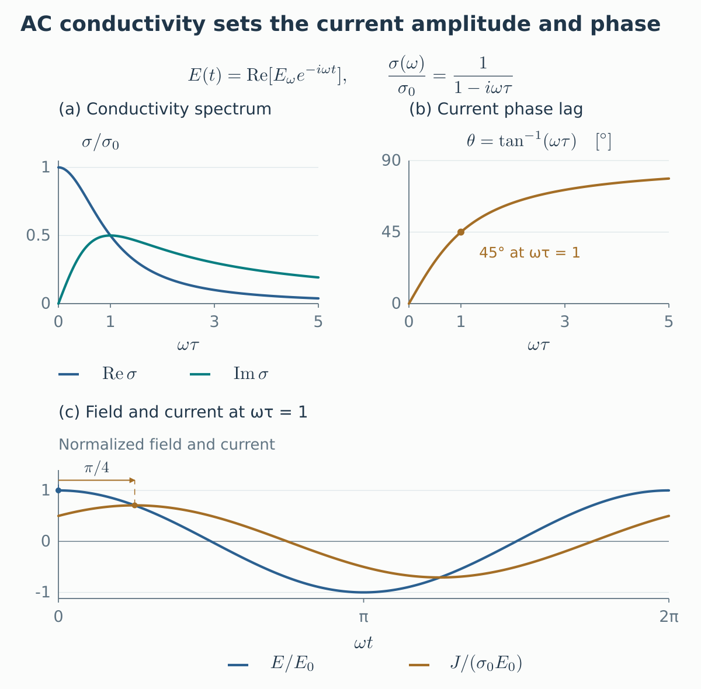
</picture>
<figcaption markdown="span">Figure 6. The real and imaginary conductivities use the $e^{-i\omega t}$ convention. At $\omega\tau=1$, the normalized current has amplitude $1/\sqrt2$ and lags the field by $\pi/4$. The horizontal marker in (c) connects the times of the field maximum and the subsequent current maximum. Conductivity here relates the conduction current to the local field.</figcaption>
</figure>



Move from $\omega\tau\ll1$ to $\omega\tau\gg1$. The current follows slowly varying fields almost in phase; at high frequency its amplitude falls and its lag approaches a quarter-cycle. A zero-frequency setting shows a static field, not an oscillation with an infinitely long plotted period.

<details markdown="1">
<summary>The periodic AC response and its switch-on transient</summary>

Let $J_{\rm ss}(t)$ be the periodic solution in Eq. (13). With the same sinusoidal field applied from $t=0$, an arbitrary initial current gives

$$
J(t)=J_{\rm ss}(t)
+[J(0)-J_{\rm ss}(0)]e^{-t/\tau}.
$$

The extra term solves the field-free homogeneous equation and dies away on the time $\tau$. For a cosine field and $J(0)=0$, the transient cancels the nonzero value of the periodic solution at the initial instant. In the zero-frequency limit, $J_{\rm ss}=\sigma_0E_0$ and this expression becomes $\sigma_0E_0(1-e^{-t/\tau})$, exactly the step response in Eq. (9). Complex conductivity describes the periodic steady part, not the entire switch-on history.

</details>

<details markdown="1">
<summary>Conduction current, displacement current and the dielectric function</summary>

The conduction-current density is still $\mathbf J=\sigma\mathbf E$. Maxwell's equations also contain the background displacement current $\varepsilon_0\varepsilon_b\partial_t\mathbf E$. A measured terminal AC current can involve both, as well as the device geometry.

At nonzero frequency, define an effective relative dielectric function by combining the conduction and background displacement currents:

$$
\begin{aligned}
&\mathbf J_{\mathrm{total},\omega}\\
&=[\sigma(\omega)-i\omega\varepsilon_0\varepsilon_b]\mathbf E_\omega\\
&=-i\omega\varepsilon_0\varepsilon_r(\omega)\mathbf E_\omega.
\end{aligned}
$$

Solving this equality for $\varepsilon_r$ gives

$$
\begin{aligned}
&\varepsilon_r(\omega)=\varepsilon_b+\frac{i\sigma(\omega)}{\varepsilon_0\omega}\\
&=\varepsilon_b-\frac{\omega_{p0}^2}{\omega(\omega+i/\tau)},\\
&\omega_{p0}^2=\frac{ne^2}{\varepsilon_0m^{\ast}}.
\end{aligned}
\tag{14}
$$

The frequency defined using vacuum permittivity is $\omega_{p0}$; including background screening gives the undamped **plasma frequency** $\omega_p=\omega_{p0}/\sqrt{\varepsilon_b}$. This is the angular frequency of small collective electron-density oscillations driven by their own restoring electric field when damping is absent; Section 19 derives that motion. The denominator and signs follow the same time convention as Eq. (11). This local Drude dielectric function omits interband transitions and spatial dispersion; it is not a general optical spectrum of a crystal.

</details>

## 7. Electron states and energy bands in a crystal
{: id="drude-07" }

A Drude current requires a mass and a relaxation time as inputs. The free-electron calculation uses the bare mass, but an electron in a crystal also responds to the periodic atomic potential. That potential changes the relation between force and velocity even before impurities are added. The allowed states and their energies must therefore be known before assigning a mass or calculating transitions between those states.

An electron in a crystal does not have the free-space energy $\hbar^2k^2/(2m_0)$ at every wavevector. Here $\hbar=h/(2\pi)$ is the reduced Planck constant. The periodic atomic potential changes the eigenstates and their energies. A **band** $\epsilon_b(\mathbf k)$ is one continuous branch of those eigenenergies; $b$ distinguishes different branches.

The **wavevector** labels spatial phase variation. For a one-dimensional plane wave $e^{ikx}$ with nonzero wavevector, the phase repeats after a wavelength $2\pi/\lvert k\rvert$; $k$ has units of inverse length. In a crystal, its useful role is to label the phase change from one lattice cell to the next, not the electron's position. A perfectly periodic lattice determines the band states. It is not a set of randomly placed obstacles: impurities or departures from perfect periodicity can instead redistribute electrons among those states.

In one dimension, translating a periodic potential by one lattice spacing $a$ leaves the Hamiltonian unchanged. Its eigenstates can be chosen to acquire a phase under that translation:

$$
\begin{aligned}
&\psi_k(x+a)=e^{ika}\psi_k(x),\\
&\psi_k(x)=e^{ikx}u_k(x),\\
&u_k(x+a)=u_k(x).
\end{aligned}
\tag{15}
$$

This is **Bloch's form**. The periodic factor $u_k$ contains the lattice-scale structure; it is a wavefunction factor, not the mean drift velocity $\mathbf u$. Wavevectors differing by $2\pi/a$ label equivalent translation phases, so one may restrict $k$ to a **Brillouin zone**, for example $[-\pi/a,\pi/a)$. The band index preserves the different states that can share the same translation phase. [Tong, Band Structure][bands]

A concrete **tight-binding** model starts with one localized orbital $\lvert j\rangle$ on each site. These basis orbitals are taken to be orthonormal: each is normalized, and distinct orbitals are mutually orthogonal. The squared magnitude of a site coefficient is then the probability weight on that basis state. The index $j$ labels the sites, and $\epsilon_0$ is the energy assigned to an isolated orbital in this model, not the vacuum permittivity used in Section 1. Let neighboring orbitals exchange probability amplitude through an energy $t_h>0$, called the **hopping parameter**. The diagonal terms assign the orbital energy; the off-diagonal terms mix neighboring orbitals:

$$
\begin{aligned}
&H=\epsilon_0\sum_j\lvert j\rangle\langle j\rvert\\
&\quad-t_h\sum_j\left(
\begin{aligned}[t]
&\lvert j+1\rangle\langle j\rvert\\
&+\lvert j\rangle\langle j+1\rvert
\end{aligned}
\right).
\end{aligned}
\tag{16}
$$

For a periodic chain of $N$ sites, the state with site coefficients $c_j=e^{ikja}/\sqrt{N}$ is an eigenstate at allowed wavevectors $k=2\pi l/(Na)$, with integer $l$. The two neighboring coefficients contribute phases $e^{ika}$ and $e^{-ika}$, whose sum is $2\cos ka$. Therefore

$$
\begin{aligned}
&\epsilon(k)=\epsilon_0-2t_h\cos ka.\\
&\text{With }\epsilon_0=2t_h:\\
&\epsilon(k)=2t_h(1-\cos ka).
\end{aligned}
\tag{17}
$$

The chosen offset puts the band minimum at zero. It does not affect forces or velocities. Neighboring coefficients have the same phase at $ka=0$, giving energy zero, and opposite signs at $ka=\pi$, giving energy $4t_h$. The energy difference comes from how the neighboring amplitudes combine in the Hamiltonian, not from a different number of collisions.

Hopping is coherent amplitude mixing in the perfect-crystal Hamiltonian: the Schrödinger equation tracks both probability amplitudes and their relative phases. It is not a transition probability per unit time. The relative phases can change in time while remaining part of the calculation. A larger $t_h$ makes this band wider; it does not by itself mean a shorter relaxation time.

<figure class="drude-figure">
<picture class="rsna-results-figure">
<source media="(max-width: 560px)" srcset="" width="600" height="1410">
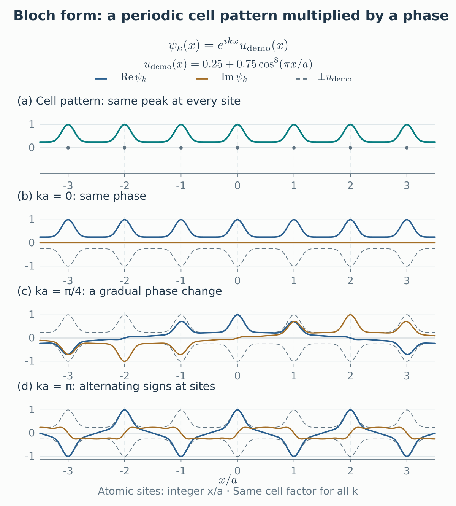
</picture>
<figcaption markdown="span">Figure 7. Each arrow represents the complex number $2c_j$ on a Re–Im plane, with $c_j=e^{ikja}/2$. For $ka=0$, neighboring coefficients have the same phase; for $ka=\pi/2$, each advances by a quarter turn. Both states have $\lvert c_j\rvert^2=1/4$ at every site. Equal site probabilities therefore do not imply equal relative phases or equal energies.</figcaption>
</figure>



<details markdown="1">
<summary>Four sites: a band calculation as a finite matrix problem</summary>

For four sites in a periodic ring, choose $\epsilon_0=2t_h$ and order the basis as $\lvert0\rangle,\lvert1\rangle,\lvert2\rangle,\lvert3\rangle$. The Hamiltonian is

$$
H_4=t_h
\begin{pmatrix}
2&-1&0&-1\\
-1&2&-1&0\\
0&-1&2&-1\\
-1&0&-1&2
\end{pmatrix}.
$$

The corner entries join the last site back to the first. The normalized uniform vector $(1,1,1,1)^T/2$ has energy zero: each row contributes $2t_h-t_h-t_h=0$. The alternating vector $(1,-1,1,-1)^T/2$ has energy $4t_h$. The allowed values $ka=-\pi,-\pi/2,0,\pi/2$ give energies $4t_h,2t_h,0,2t_h$ through Eq. (17), agreeing with all four matrix eigenvalues.

```python
ring_size, hopping_four_eV = 4, 1.0
H_four = 2 * hopping_four_eV * np.eye(ring_size)
for site in range(ring_size):
    neighbor = (site + 1) % ring_size
    H_four[site, neighbor] = -hopping_four_eV
    H_four[neighbor, site] = -hopping_four_eV

ring_ka = np.array([-np.pi, -np.pi / 2, 0.0, np.pi / 2])
band_four_eV = 2 * hopping_four_eV * (1 - np.cos(ring_ka))
matrix_four_eV = np.linalg.eigvalsh(H_four)
uniform_four = np.ones(ring_size) / np.sqrt(ring_size)
alternating_four = (-1.0)**np.arange(ring_size) / np.sqrt(ring_size)
assert np.allclose(matrix_four_eV, np.sort(band_four_eV))
assert np.allclose(H_four @ uniform_four, 0.0)
assert np.allclose(H_four @ alternating_four, 4 * hopping_four_eV * alternating_four)
print("Four-site energies (eV):", matrix_four_eV)
```

No collision rate appears in this diagonalization. The matrix determines coherent energy eigenstates and their energies, while current relaxation requires additional scattering physics.

</details>

One Bloch eigenstate extends through the crystal, so it cannot by itself locate a carrier near a particular part of the wire. A localized **wave packet** combines nearby wavevectors in one band: their amplitudes reinforce in one region and largely cancel elsewhere. Its **envelope**, the broad profile enclosing the lattice-scale oscillations, moves with the band **group velocity**. When the external potential varies little across the packet, its center can be followed with semiclassical equations. This is not an exact trajectory assigned to one extended Bloch eigenstate.

<details markdown="1">
<summary>Why an extended energy eigenstate can still describe local transport</summary>

A Bloch eigenstate is extended and stationary. A moving electron packet combines nearby wavevectors. Near a central value $k_0$, expand $\epsilon(k)\simeq\epsilon(k_0)+\epsilon^{\prime}(k_0)(k-k_0)$. In a superposition with phase $kx-\epsilon(k)t/\hbar$, the slowly varying envelope depends on $x-\epsilon^{\prime}(k_0)t/\hbar$. Its centre therefore moves with the group velocity in Eq. (18).

The packet must be narrow enough in $k$ for this local expansion and small enough in space compared with the variation of the applied potential. Its position and momentum spreads still obey the uncertainty relation. Following the centre is a semiclassical approximation; it does not assign an exact position to one plane wave.

</details>

## 8. Wave-packet motion and effective mass
{: id="drude-08" }

### Position, velocity and acceleration of the packet center

For a normalized, localized electron wave packet $\lvert\psi(t)\rangle$, define its center position, center velocity and center acceleration by

$$
\begin{aligned}
&\mathbf r_c(t)=\langle\psi(t)\lvert\widehat{\mathbf r}\rvert\psi(t)\rangle,\\
&\mathbf v_c(t)=\frac{d\mathbf r_c}{dt},\\
&\mathbf a_c(t)=\frac{d\mathbf v_c}{dt}.
\end{aligned}
$$

The hat denotes the position operator; its expectation value averages over the packet's quantum position distribution. **Acceleration here means the time derivative of this packet-center velocity.** It does not assign an exact microscopic trajectory to an individual electron. The earlier drift velocity $\mathbf u$ involves a further average over many carriers, not just the quantum position distribution of one packet.

A fixed-wavevector Bloch eigenstate in an unperturbed crystal has a stationary probability density and a time-independent velocity expectation, which can be nonzero. Because that state extends through the crystal, it does not supply a localized center for a transport trajectory. A packet combines nearby Bloch states; an external force can change its central wavevector and hence its center velocity.

### The single-band semiclassical approximation

Take a packet narrow in wavevector within one isolated band. The external potential must vary smoothly across its spatial extent, and its strength and time dependence must allow transitions to other bands to be neglected. Scattering is omitted during this part of the motion. In the following equations, $\mathbf r$ and $\mathbf k$ denote the packet center and central wavevector, while $\mathbf v$ approximates $\mathbf v_c$. The packet Hamiltonian is

$$
\begin{aligned}
&\mathcal H_{\rm packet}=\epsilon(\mathbf k)+U_{\rm ext}(\mathbf r),\\
&\mathbf p_{\rm crys}=\hbar\mathbf k.
\end{aligned}
$$

Here $U_{\rm ext}$ is the external potential energy; the periodic lattice is already included in $\epsilon(\mathbf k)$. The packet Hamiltonian uses $\mathbf p_{\rm crys}$ as its momentum variable. Hamilton's equations for these center variables give velocity by differentiating the energy with respect to momentum and external force by taking minus its spatial derivative. Since $\partial/\partial p_{\mathrm{crys},i}=(1/\hbar)\partial/\partial k_i$, they give

$$
\begin{aligned}
&v_i(\mathbf k)=\frac{1}{\hbar}\frac{\partial\epsilon}{\partial k_i},\\
&\hbar\dot k_j=F_j.
\end{aligned}
\tag{18}
$$

These equalities hold within the stated semiclassical approximation, not for a state with an arbitrarily broad wavevector distribution. The indices $i,j$ label Cartesian directions. The first relation gives the packet's group velocity; the second tells how the external force changes crystal momentum. In a periodic potential, $\hbar\mathbf k$ labels the translation phase and is not generally the electron's bare mechanical momentum. Thus the group velocity is not generally $\hbar\mathbf k/m_0$. For an electric field, $U_{\rm ext}=-e\varphi$ and $\mathbf F=-e\mathbf E$. Berry-curvature corrections and magnetic fields are also excluded. [Tong, Secs. 3.2.1–3.2.3][dynamics]

The force changes $\mathbf k(t)$, which changes the group velocity. Its time derivative is the packet-center acceleration in this approximation. Applying the chain rule gives

$$
\begin{aligned}
&\dot v_i=\sum_j\frac{\partial v_i}{\partial k_j}\dot k_j\\
&=\sum_j\frac{1}{\hbar^2}\frac{\partial^2\epsilon}{\partial k_i\partial k_j}F_j.
\end{aligned}
\tag{19}
$$

Equation (19) relates an external force to the change of packet-center velocity. Comparing its coefficient with inverse mass in the free-particle relation **defines the band inverse-effective-mass tensor**:

$$
\begin{aligned}
&\left(m_{\rm curv}^{-1}\right)_{ij}=\frac{1}{\hbar^2}\frac{\partial^2\epsilon}{\partial k_i\partial k_j}.\\
&\text{In 1D:}\\
&\frac{1}{m_{\rm curv}(k)}=\frac{\epsilon''(k)}{\hbar^2}.
\end{aligned}
\tag{20}
$$

A tensor here is a matrix mapping the external force to the packet-center acceleration. In one dimension it reduces to a number. Curvature gives **the change of center velocity per unit time, per unit external force**: inverse mass, not mass itself.

A steeper band slope gives a larger group velocity. A larger positive curvature means that this velocity changes more rapidly as the force changes $k$, hence a larger packet-center acceleration and a smaller positive effective mass. A fast-moving packet need not have a large instantaneous change of velocity.

Near a smooth band minimum $k_0$, the linear Taylor term vanishes. A positive quadratic term gives

$$
\begin{aligned}
&\epsilon(k)\simeq E_c+\frac{\hbar^2(k-k_0)^2}{2m^{\ast}},\\
&v=\frac{\hbar(k-k_0)}{m^{\ast}},\\
&\dot v=\frac{F}{m^{\ast}}.
\end{aligned}
\tag{21}
$$

Here $E_c$ is the energy at the band minimum. The last line describes packet-center motion between scattering events. Within the isotropic quadratic approximation, the same positive mass applies at every wavevector, so averaging over carriers gives the constant-mass force term used in Drude. Current relaxation must still be added separately.

<figure class="drude-figure">
<picture class="rsna-results-figure">
<source media="(max-width: 560px)" srcset="" width="600" height="1220">
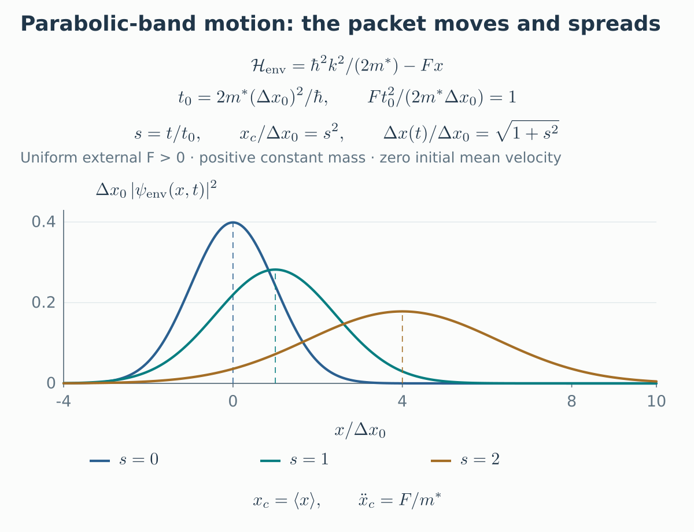
</picture>
<figcaption markdown="span">Figure 8. A parabolic-envelope example starts from the real Gaussian $\psi_{\rm env}(x,0)\propto\exp[-x^2/(4(\Delta x_0)^2)]$, where $\Delta x_0$ is the initial position standard deviation. A constant external force $F>0$ acts on the packet. Define $t_0=2m^{\ast}(\Delta x_0)^2/\hbar$ and choose $Ft_0^2/(2m^{\ast}\Delta x_0)=1$. The curves use $t/t_0=0,1,2$. Their centers move while their widths grow; each curve remains normalized over all positions. The dashed lines mark expectation values, not microscopic electron paths.</figcaption>
</figure>



The electron's bare mass has not changed. In the microscopic scalar-potential description, Ehrenfest's theorem relates the acceleration of the position expectation value to the **sum of the expectation values of lattice and external forces**, divided by the bare mass. The band calculation has already incorporated the periodic lattice into its states and dispersion. Its effective mass relates packet motion in this single-band approximation to the **external** force; it does not follow from discarding the lattice force in the microscopic equation. [Fitzpatrick, Ehrenfest's theorem][ehrenfest]

## 9. Nonparabolic bands and anisotropic effective mass
{: id="drude-09" }

A constant scalar mass makes two assumptions: the relevant part of the band is well approximated by a parabola, and its curvature is the same in every direction. A **nonparabolic** band can violate the first assumption, so the local mass changes with wavevector. An **anisotropic** band violates the second, requiring the direction of the applied force to be retained.

### Group velocity and curvature in a cosine band

Keep the single-band packet-center approximation of Section 8 and first follow motion between scattering events. Applying the velocity and curvature formulas to the full cosine band in Eq. (17) gives

$$
\begin{aligned}
&v(k)=\frac{2t_ha}{\hbar}\sin ka,\\
&\frac{1}{m_{\rm curv}(k)}=\frac{2t_ha^2}{\hbar^2}\cos ka,\\
&m_{\rm edge}=\frac{\hbar^2}{2t_ha^2}.
\end{aligned}
\tag{22}
$$

At $ka=0$, the band is locally parabolic with positive mass $m_{\rm edge}$. At $ka=\pi/3$, the local mass is twice as large. At $ka=\pi/2$, the group velocity is maximal but its derivative with respect to wavevector vanishes: the inverse curvature mass is zero. Writing the mass itself as infinite at that point is a local shorthand, not a claim that an electron cannot move there. Beyond that inflection point the curvature is negative, so the packet-center acceleration can oppose the external force.

These statements concern a packet at a chosen wavevector. A wire's current adds the contributions of all occupied states, which need not lie at that wavevector. A negative local curvature therefore cannot by itself determine the sign of the conductivity.

For $t_h=1\,\mathrm{eV}$ and $a=0.5\,\mathrm{nm}$, $m_{\rm edge}\simeq0.1524m_0$ and the maximum speed is about $1.5193\times10^6\,\mathrm{m/s}$. The calculation must convert hopping energy to joules before combining it with SI $\hbar$.

```python
def cosine_band(ka, hopping_eV=1.0, lattice_nm=0.5):
    # ka is dimensionless. Convert the Hamiltonian energy and lattice spacing to SI.
    z = np.asarray(ka)
    th, a = hopping_eV * E_CHARGE, lattice_nm * 1e-9
    energy_J = 4 * th * np.sin(z / 2)**2  # Same band; avoids cancellation near ka=0.
    velocity = 2 * th * a / HBAR * np.sin(z)
    inverse_mass = 2 * th * a**2 / HBAR**2 * np.cos(z)
    return energy_J / E_CHARGE, velocity, inverse_mass

probe = np.array([0, np.pi / 3, np.pi / 2, np.pi])
energies, velocities, inv_mass = cosine_band(probe)
print("energy (eV):", energies)
print("m0/m_curv:", M0 * inv_mass)
assert np.isclose(inv_mass[1], inv_mass[0] / 2)
assert abs(inv_mass[2] / inv_mass[0]) < 1e-14
assert inv_mass[-1] < 0
```

<figure class="drude-figure">
<picture class="rsna-results-figure">
<source media="(max-width: 560px)" srcset="" width="600" height="1930">
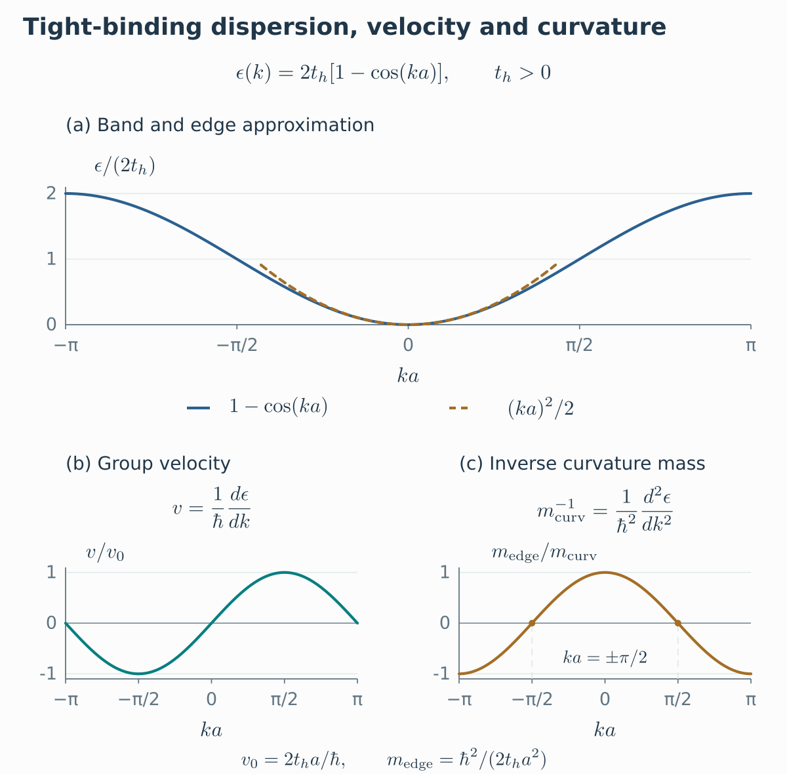
</picture>
<figcaption markdown="span">Figure 9. In the same tight-binding band, the first derivative gives the group velocity of a narrow wave packet; the second gives the coefficient relating external force to the change of its center velocity. The plotted inverse mass crosses zero at the marked inflection points. A single constant band-edge mass describes only a neighborhood of the minimum.</figcaption>
</figure>



Find a point with zero velocity and nonzero curvature, then one with maximum velocity and zero curvature. Increasing the hopping changes both the speed scale and curvature; it does not alter the dimensionless sine/cosine shapes.

<details markdown="1">
<summary>Does negative curvature mean negative conductivity?</summary>

No. A local packet acceleration is not the current response of all occupied states. Near the maximum of a nearly filled band, the missing electrons can be described as positive-charge **holes**, with a positive excitation mass. A completely filled band carries no ordinary intraband DC current: the contributions from its wavevectors cancel, and there are no nearby empty states to rearrange within that band at zero temperature.

Section 10 computes conductivity from the occupied distribution. Its dissipative conductivity is nonnegative under the stated relaxation assumptions even when part of the band has negative curvature. Substituting one negative local mass into $ne^2\tau/m$ while retaining the electron density of an almost full band is not that calculation.

</details>

<details markdown="1">
<summary>Bloch oscillations in a single cosine band</summary>

Keep a packet in one cosine band under a constant field. Then

$$
\begin{aligned}
&k(t)=k(0)-\frac{eE}{\hbar}t,\\
&v(t)=\frac{2t_ha}{\hbar}\sin[k(t)a],\\
&\omega_B=\frac{e\lvert E\rvert a}{\hbar}.
\end{aligned}
\tag{23}
$$

The velocity oscillates rather than increasing forever, because it is periodic in $k$. These **Bloch oscillations** assume that scattering and transitions between bands are negligible during an oscillation. They show why extrapolating a local parabola through an entire Brillouin zone changes the dynamics. Observing them is a separate matter of fields, scattering and interband transitions; a cosine dispersion alone does not establish their visibility in a particular sample.

</details>

### A rotated mass tensor for an anisotropic quadratic band

Consider a two-dimensional quadratic band whose **principal axes**, the directions in which the mass matrix is diagonal, have positive masses $m_1,m_2$. Along the lighter axis, the same force produces a larger packet-center acceleration. Its mass matrix and inverse are **positive definite**, meaning that all their eigenvalues are positive. Rotating the axes does not change those eigenvalues; it changes which components are mixed in laboratory coordinates. The orthogonal matrix $R$ rotates these axes without changing lengths. In laboratory coordinates,

$$
\begin{aligned}
&\epsilon(\mathbf k)=E_c+\frac{\hbar^2}{2}\mathbf k^{T}M^{-1}\mathbf k,\\
&M^{-1}=R\begin{pmatrix}1/m_1&0\\0&1/m_2\end{pmatrix}R^{T},\\
&\dot{\mathbf v}=M^{-1}\mathbf F.
\end{aligned}
\tag{24}
$$

With $m_1=0.2m_0$, $m_2=m_0$ and a $30^\circ$ rotation,

$$
m_0M^{-1}=\begin{pmatrix}4&\sqrt3\\\sqrt3&2\end{pmatrix}.
$$

A force along laboratory $x$ changes both components of the packet-center velocity: the first column of this matrix gives the acceleration ratio $a_y/a_x=\sqrt3/4\simeq0.433$. The external force and packet-center acceleration need not be parallel.

```python
angle = np.pi / 6
Raxes = np.array([[np.cos(angle), -np.sin(angle)],
                  [np.sin(angle),  np.cos(angle)]])
inverse_M = Raxes @ np.diag([1 / (0.2 * M0), 1 / M0]) @ Raxes.T
force = np.array([1e-18, 0.0])  # N; this example specifies a force, not an E field.
acceleration = inverse_M @ force
assert np.allclose(M0 * inverse_M, [[4, np.sqrt(3)], [np.sqrt(3), 2]])
print("acceleration direction ay/ax:", acceleration[1] / acceleration[0])
```

For a constant scalar relaxation time in this quadratic band, the mobility is a tensor $e\tau M^{-1}$, retaining the electron-drift minus sign used in Section 4. This off-diagonal response in rotated coordinates is symmetric; it is not a Hall effect, which requires different physics. Boundary conditions that prohibit transverse current would create an additional transverse field. The matrix above is the unconstrained local material response.

## 10. Occupations, the Boltzmann equation and conductivity
{: id="drude-10" }

The velocity law describes one packet, whereas the drift velocity $\mathbf u$ averages over the carriers in a small region. Fast electrons moving in opposite directions can cancel in that average. To compute the current, each allowed state's velocity must be weighted by how many electrons occupy it, then multiplied by the electron charge.

Consider one band with two identical spin populations and no magnetic field. Assume its dispersion is even under wavevector reversal, $\epsilon(-\mathbf k)=\epsilon(\mathbf k)$, so its group velocities obey $\mathbf v(-\mathbf k)=-\mathbf v(\mathbf k)$. Opposite wavevectors then give a precise pair of states whose equilibrium current contributions cancel.

Write $f(\mathbf k)$ for the **occupation** per spin, between zero and one; it is not normalized to sum to one. An occupation $f=1/2$ means that the state is occupied in half of an ensemble of equivalent preparations, not that an electron has half its usual charge. Including both identical spin populations gives the counting factor $g_s=2$.

The state-counting factor follows from periodic boundary conditions, just as for the finite chain in Section 7. A one-dimensional box of length $L_{\rm box}$ requires $e^{ikL_{\rm box}}=1$, so adjacent allowed wavevectors differ by $2\pi/L_{\rm box}$. In a cubic box, each allowed state per spin occupies a wavevector-space cell of volume $(2\pi/L_{\rm box})^3$. The number of states in a small volume $d^3k$, divided by the real-space box volume, is therefore

$$
\frac{d^3k}{(2\pi/L_{\rm box})^3}
\frac{1}{L_{\rm box}^3}
=\frac{d^3k}{(2\pi)^3}.
$$

The large-box limit turns the sum over these states into an integral. Including both spins gives $g_s\,d^3k/(2\pi)^3$ states per unit volume and density $n=g_s\int f\,d^3k/(2\pi)^3$. For a crystal band, the integral runs over one Brillouin zone. In the ideal parabolic-band model used below, it runs over all wavevectors instead; that extension is useful when the occupied states lie in the energy range where the parabola is accurate.

Let $T$ be a positive absolute temperature in kelvins; Boltzmann's constant $k_B$ converts it to the energy scale $k_BT$. In thermal equilibrium, the occupation is $f_0(\epsilon)=1/[1+\exp((\epsilon-\mu_F)/(k_BT))]$. The **chemical potential** $\mu_F$ is an energy; the subscript distinguishes it from the mobility $\mu$. At a given temperature, its value is chosen so that summing the occupations gives the prescribed electron density. In a **degenerate** gas at low temperature, occupied and empty states are separated by a narrow thermal interval near $\mu_F$, and a weak drive changes occupations mainly there. A nondegenerate gas instead has small occupations spread over a thermal energy range. The equilibrium velocities cancel; current comes from the small change $\delta f=f-f_0$.

At $\epsilon=\mu_F$ the occupation is $1/2$. States far below that energy are mostly occupied; those far above it are mostly empty. Raising the temperature broadens the interval between them. This is the **Fermi–Dirac distribution**, accounting for the exclusion of two electrons from the same single-particle state including spin.

For a small redistribution example, take equally weighted states at the same energy with velocities $+v$ and $-v$. Initially $f_+=f_-=0.500$: their number weight is $1.000$ and their velocity-weighted sum is zero. Change the occupations to $f_+=0.499$ and $f_-=0.501$. Their number weight is still $1.000$, but

$$
vf_+-vf_-=v(0.499-0.501)=-0.002v.
$$

Multiplication by the negative electron charge and the common positive state-counting weight gives a positive current contribution. A directional redistribution can therefore carry current without changing the electron density.

<figure class="drude-figure">
<picture class="rsna-results-figure">
<source media="(max-width: 560px)" srcset="" width="600" height="1160">
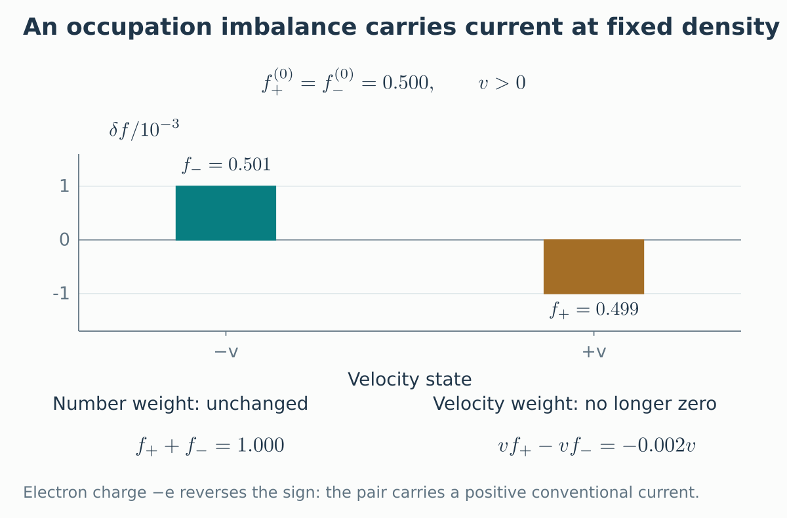
</picture>
<figcaption markdown="span">Figure 10. The bars show the change $\delta f$, not the occupation itself: a negative bar means a decrease, not a negative probability. Equilibrium occupations are $0.500$ in both equally weighted states; the perturbed values are $f_+=0.499$ and $f_-=0.501$. Their number weight is unchanged, while the velocity-weighted sum becomes negative. Multiplying by the electron charge makes the conventional current contribution positive.</figcaption>
</figure>



Wave packets supply the local velocity law; the kinetic description then follows populations averaged over many carriers, rather than the relative phases of one coherent wavefunction. This semiclassical rate approximation does not retain long-lived phase correlations across that ensemble. It is not an exact replacement for quantum evolution.

For a spatially uniform system, the **Boltzmann transport equation** combines motion of the occupations through $\mathbf k$ space with their redistribution by scattering. Without scattering, an occupation travels with its changing wavevector: over a short time, $f(\mathbf k+\dot{\mathbf k}\,dt,t+dt)=f(\mathbf k,t)$. Taylor expansion gives the advection equation, and adding the scattering-induced change per unit time $C[f]$ yields

$$
\partial_t f+\dot{\mathbf k}\cdot\nabla_{\mathbf k}f=C[f].
$$

For a homogeneous stationary response, $\partial_t f=0$ and $\dot{\mathbf k}=-e\mathbf E/\hbar$. Write $f=f_0+\delta f$, where $\delta f$ is first order in the field. The term $\mathbf E\cdot\nabla_{\mathbf k}\delta f$ is then second order and is dropped, while the equilibrium collision term satisfies $C[f_0]=0$. Let $C[\delta f]$ denote the remaining linearized collision term.

Close that equation using a positive scalar transport time depending only on energy. This relaxation form follows on a single fixed-speed energy shell of an isotropic band, with elastic scattering whose angular rule depends only on the deflection angle. For a more general band or scattering law it is an additional approximation, not a result of the Taylor expansion. The linearized balance and this closure are

$$
\begin{aligned}
&-\frac{e\mathbf E}{\hbar}\cdot\nabla_{\mathbf k}f_0
=C[\delta f],\\
&C[\delta f]=-\frac{\delta f}{\tau_{\rm tr}(\epsilon)}.
\end{aligned}
\tag{25}
$$

The second equality describes relaxation of a current-carrying **angular mode**: a difference between occupations moving in different directions at the same energy, such as the two-state redistribution above. It is not a general collision law for every distribution. An isotropic elastic angular kernel justifies it in Section 14.

A stationary distribution does not mean that electrons have stopped moving or scattering. At each fixed wavevector, the field continually brings population in or out, while scattering redistributes it. Equation (25) balances those changes, leaving a constant but directionally unequal occupation and hence a steady current. Removing the field removes the drive; scattering then relaxes that unequal part.

Use $\nabla_{\mathbf k}f_0=\hbar\mathbf v\,\partial_\epsilon f_0$. Equation (25) yields

$$
\delta f=-e\tau_{\rm tr}(\epsilon)(\mathbf E\cdot\mathbf v)
\left(-\frac{\partial f_0}{\partial\epsilon}\right).
\tag{26}
$$

The even dispersion and energy-only transport time make the field-induced perturbation **odd** under wavevector reversal: the paired states have opposite velocities and opposite occupation changes. Their density changes cancel in the integral. The equilibrium density is therefore unchanged to first order even though the current is not zero.

A rightward field reduces the occupation of right-moving electron states. The force on an electron points leftward; the packet-center acceleration also depends on band curvature. Define the conductivity matrix through $J_i=\sum_j\sigma_{ij}E_j$: its entry specifies current in direction $i$ from a field component in direction $j$. The current weights the changed occupation by $v_i$, while that field component creates a change proportional to $v_j$. Multiplying by charge and summing therefore gives the product $v_iv_j$:

$$
\sigma_{ij}=g_se^2\int\frac{d^3k}{(2\pi)^3}\,
\tau_{\rm tr}(\epsilon)v_iv_j
\left(-\frac{\partial f_0}{\partial\epsilon}\right).
\tag{27}
$$

The integrand contains occupation sensitivity, velocity and a transport time—not merely the number of electrons at one selected $k$. For any real direction vector $\mathbf a$, $\mathbf a^T\sigma\mathbf a$ is an integral of $\tau_{\rm tr}(\mathbf a\cdot\mathbf v)^2(-\partial_\epsilon f_0)$ and is nonnegative. This resolves the negative-conductivity misconception from local negative curvature.

For an isotropic parabolic band with constant positive mass and constant $\tau$, integration by parts gives the scalar Drude result. Here $\delta_{ij}$ is the **Kronecker delta**: one for $i=j$ and zero for $i\ne j$. It expresses that each current component responds only to the field in the same direction in this isotropic model:

$$
\begin{aligned}
&g_s\int\frac{d^3k}{(2\pi)^3}v_iv_j
\left(-\frac{\partial f_0}{\partial\epsilon}\right)
=\frac{n}{m^{\ast}}\delta_{ij},\\
&\sigma_{ij}=\frac{ne^2\tau}{m^{\ast}}\delta_{ij}.
\end{aligned}
\tag{28}
$$

With Fermi–Dirac occupations, a nearly constant transport time and quadratic dispersion allow the same compact Drude form. The statistics determine the distribution and affect the relevant scattering physics. [Tong, Sec. 3.2.5][dynamics]; [Giustino, transport discussion and erratum][giustino]

<details markdown="1">
<summary>Integration by parts, and why relaxing toward a fixed distribution can break conservation</summary>

For the quadratic band, $\partial_{k_i}v_j=\hbar\delta_{ij}/m^{\ast}$. Integrate $\partial_{k_i}(v_jf_0)$ over all $\mathbf k$; the boundary term vanishes because $f_0$ decays at large energy. The two remaining terms are $\hbar\delta_{ij}\int f_0/m^{\ast}$ and $\hbar\int v_iv_j\partial_\epsilon f_0$. Rearranging gives Eq. (28). The same argument with a constant positive-definite mass matrix gives $\sigma=ne^2\tau M^{-1}$.

By contrast, using $C[f]=-(f-f_0^{\rm fixed})/\tau$ for arbitrary density variations gives $\int C\propto-(n-n_0)/\tau$, an artificial particle source or sink. Equation (25) was restricted to the odd, current-carrying perturbation at fixed density. A time-dependent nonuniform kinetic model needs a number-conserving collision operator or an appropriately density-matched local equilibrium. The [MS-BTE derivation]({{ site.baseurl }}/posts/Multi-Subband-Boltzmann-Transport-From-Scratch/) makes that conservation test explicit.

For a general anisotropic band or scattering kernel, a scalar $\tau(\epsilon)$ need not solve the linearized Boltzmann equation. One may have to solve for a direction-dependent response rather than insert a guessed lifetime in Eq. (27).

</details>

## 11. Transition amplitudes and Fermi's golden rule
{: id="drude-11" }

The band calculation supplies velocities and masses, but not the relaxation time $\tau$ used in the conductivity. Calculating that time requires probabilities for leaving one state and entering another. Start with a Hamiltonian $H_0$ whose eigenstates $\lvert a\rangle$ and energies $E_a$ are known; for crystal electrons, the perfect periodic lattice is already included in $H_0$. Let $U$ be a weak, static perturbation, such as an impurity potential, switched on at $t=0$ for the calculation. Define the **matrix element** $M_{ba}=\langle b\lvert U\rvert a\rangle$, an energy that measures how the perturbation couples two states.

A state initially equal to one eigenstate of $H_0$ need not remain in that state after $U$ is added: it is generally not an eigenstate of the full Hamiltonian. Amplitudes for other $H_0$ states can then develop. Thus a static impurity can scatter an incoming electron without the impurity potential itself oscillating in time. The exact evolution is still coherent Schrödinger evolution. A transition rate requires further averaging; it is not an extra rule that every encounter instantly resets the wavefunction.

Expand the evolving state in this known basis:

$$
\lvert\psi(t)\rangle=\sum_b c_b(t)e^{-iE_bt/\hbar}\lvert b\rangle.
$$

The known evolution under $H_0$ is written as explicit phase factors; the remaining coefficients $c_b(t)$ change because of $U$. This is the meaning of an **interaction-picture coefficient**. Initially $c_a(0)=1$ and the other coefficients vanish. Inserting this expansion into the Schrödinger equation and using those initial coefficients on the right-hand side gives the first-order transition integral below. A matrix element can be complex even when the perturbation is Hermitian, so the probability depends on its absolute square, not its square without conjugation.

For a distinct final state $b\ne a$, first-order time-dependent perturbation theory gives the interaction-picture coefficient

$$
c_b^{(1)}(t)=-\frac{i}{\hbar}\int_0^t
M_{ba}e^{i(E_b-E_a)t'/\hbar}\,dt'.
\tag{29}
$$

A probability amplitude is a dimensionless complex number. Its phase matters when amplitudes interfere. The transition probability is its absolute square, not the amplitude itself. For $\Delta E=E_b-E_a$,

$$
\begin{aligned}
&P_{a\to b}^{(1)}(t)\\
&=\frac{4\lvert M_{ba}\rvert^2}{(\Delta E)^2}\sin^2\!\left(\frac{\Delta E\,t}{2\hbar}\right)\\
&=\frac{\lvert M_{ba}\rvert^2t^2}{\hbar^2}\operatorname{sinc}^2\!\left(\frac{\Delta E\,t}{2\hbar}\right),
\end{aligned}
\tag{30}
$$

where $\operatorname{sinc}z=\sin z/z$ and $\operatorname{sinc}0=1$. The superscript on the probability records that it was calculated from the first-order amplitude: the displayed probability is quadratic in the perturbation $U$, not linear. The code name `first_order_probability` uses that same amplitude-based convention.

At equal energies the expression is finite: $P\simeq\lvert M_{ba}\rvert^2t^2/\hbar^2$. A resonant isolated pair therefore does **not** immediately have a constant transition probability per unit time. First-order perturbation theory is only reliable while the resulting transition probabilities are small. [MIT, time-dependent perturbation theory, Sec. 4.3.1][golden]

The code calls the energy difference $\Delta E$ the **detuning**. Zero detuning means equal initial and final energies; it does not make the coupling or transition probability vanish.

```python
def first_order_probability(detuning_eV, coupling_eV, time_s):
    # np.sinc(y)=sin(pi*y)/(pi*y), unlike the sinc convention in Eq. (30).
    delta = np.asarray(detuning_eV) * E_CHARGE
    coupling = coupling_eV * E_CHARGE
    z = delta * time_s / (2 * HBAR)
    return (np.abs(coupling) * time_s / HBAR)**2 * np.sinc(z / np.pi)**2

detunings = np.linspace(-0.1, 0.1, 501)
probability = first_order_probability(detunings, 0.001, 50e-15)
p_resonant = first_order_probability(0.0, 0.001, 50e-15)
assert np.isclose(probability.max(), p_resonant)
assert 0 < p_resonant < 0.01  # A weak-transition example, not an exact Rabi solution.
assert np.isclose(first_order_probability(0.0, 0.001j, 50e-15), p_resonant)
print("First-order resonant probability:", p_resonant)
```

A **continuum** means that the final energy levels are so closely spaced that a sum over them can be approximated by an energy integral. Its **density of states** counts how many states lie in each energy interval; it does not say which states are occupied. Sum the finite-time probabilities over those states before taking a coarse-grained limit. Here **coarse-graining** keeps the slow change of populations after averaging over rapid phase oscillations; it requires weak coupling and many closely spaced final states. The energy peak becomes narrower as $1/t$, while its integrated area grows proportional to $t$. That gives **Fermi's golden rule**:

$$
\begin{aligned}
&W_{a\to b}=\frac{2\pi}{\hbar}\lvert M_{ba}\rvert^2\delta(E_b-E_a),\\
&\Gamma_a=\sum_{b\ne a} W_{a\to b}.
\end{aligned}
\tag{31}
$$

The Dirac delta enforces energy conservation inside a final-state sum or integral. It has units of inverse energy. It is not a finite number to evaluate as $\delta(0)$. In a continuum, $W_{a\to b}$ is understood as a rate kernel; the integrated $\Gamma_a$ is a finite inverse time.

Each nearly resonant state's probability grows quadratically with time, but the energy interval that contributes narrows inversely with time. Summing a smooth continuum therefore gives a total probability proportional to time, whose coefficient is the rate. For the static perturbation, the energy delta also makes the scattering **elastic**: the electron can change its momentum or direction without losing energy to the impurity. Occupations still determine which of these transitions contribute in a many-electron distribution.

The finite-time peak has an energy width of order $\hbar/t$. Let $W_{\rm smooth}$ be the energy scale over which the matrix element and density of states change appreciably, and $\delta E_{\rm level}$ the spacing of the underlying levels. The useful window is $\hbar/W_{\rm smooth}\ll t\ll\hbar/\delta E_{\rm level}$: the peak must be narrow on the first scale but still contain many discrete levels. First-order perturbation theory also requires the **total** transition probability $\Gamma_a t\ll1$. A kinetic exponential decay over longer times uses an additional loss-of-memory approximation; it is not the exact evolution of a closed two-level system. [MIT, Lecture 26][golden-lecture]

<figure class="drude-figure">
<picture class="rsna-results-figure">
<source media="(max-width: 560px)" srcset="" width="600" height="1410">
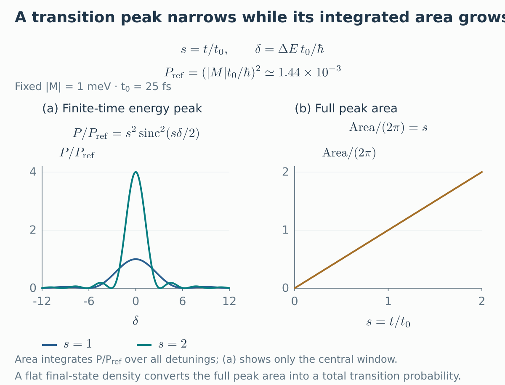
</picture>
<figcaption markdown="span">Figure 11. The coupling is fixed at $1\,\mathrm{meV}$ and the reference time is $t_0=25\,\mathrm{fs}$. (a) The two times give different peak heights and widths; the probability at exact resonance grows quadratically. (b) $\mathrm{Area}=\int_{-\infty}^{\infty}(P/P_{\rm ref})\,d\delta$ includes the tails outside the window in (a); it is a dimensionless kernel area, not the total transition probability. The plotted ratio $\mathrm{Area}/(2\pi)=t/t_0$ grows linearly. Summing over a smooth, broad final-state continuum turns the corresponding energy integral into a total transition probability. The plotted single-state probabilities remain small, as required for the first-order amplitude used here.</figcaption>
</figure>



<details markdown="1">
<summary>How summing a continuum turns a quadratic probability into a linear one</summary>

Suppose the coupling $M$ and the total final-state density $D_f$ are nearly constant near $E_a$. Here $D_f\,dE$ counts final states in an energy interval $dE$ for the chosen initial state; $D_f$ has units of inverse energy, **not** inverse energy per volume. It is different from the volume-normalized DOS introduced in Section 15. Using $\Delta E=E_b-E_a$,

$$
\begin{aligned}
P_{\rm sum}(t)&\simeq\int_{-\infty}^{\infty}
D_f\,P_{a\to b}^{(1)}(t)\,d\Delta E\\
&=\frac{2\lvert M\rvert^2D_f t}{\hbar}
\int_{-\infty}^{\infty}\operatorname{sinc}^2y\,dy\\
&=\frac{2\pi}{\hbar}\lvert M\rvert^2D_f t.
\end{aligned}
$$

The substitution is $y=\Delta E\,t/(2\hbar)$, and $\int_{-\infty}^{\infty}\operatorname{sinc}^2y\,dy=\pi$. Each resonant state's probability grows as $t^2$, but the energy width of the contributing states shrinks as $1/t$. Their sum therefore grows as $t$, giving the rate $\Gamma=2\pi\lvert M\rvert^2D_f/\hbar$. The infinite integration range approximates a peak far from the edges of a broad continuum; it is not an assumption that a real band extends to every energy.

For an explicit weak-transition calculation, take $M=10^{-7}\,\mathrm{eV}$ and $D_f=10^6\,\mathrm{eV}^{-1}$ over detunings from $-1$ to $1\,\mathrm{eV}$. The quadrature grid below samples the continuum integral, not the individual physical energy levels.

```python
continuum_detunings = np.linspace(-1.0, 1.0, 40001)  # eV.
continuum_coupling_eV, continuum_dos_per_eV = 1e-7, 1e6
continuum_gamma = (2 * np.pi * abs(continuum_coupling_eV)**2
                   * continuum_dos_per_eV / (HBAR / E_CHARGE))
for continuum_time in (50e-15, 100e-15, 200e-15):
    continuum_p = first_order_probability(
        continuum_detunings, continuum_coupling_eV, continuum_time)
    continuum_total = continuum_dos_per_eV * np.sum(
        (continuum_p[:-1] + continuum_p[1:]) / 2
        * np.diff(continuum_detunings))
    assert 0 < continuum_total < 1e-3
    assert np.isclose(continuum_total / continuum_time,
                      continuum_gamma, rtol=0.01)
    print("time (fs), total P, rate / golden rate:",
          continuum_time * 1e15, continuum_total,
          continuum_total / continuum_time / continuum_gamma)
```

The golden-rule rate is about $9.54584\times10^7\,\mathrm{s}^{-1}$. The finite-window integrals give rate ratios $0.99156$, $0.99578$ and $0.99790$, while every total probability remains below $2\times10^{-5}$.

</details>

## 12. Computing the matrix element: spatial overlap and momentum transfer
{: id="drude-12" }

The golden rule converts a squared matrix element into a rate. Computing that element requires both the impurity potential and the initial/final states. In position space, multiply the initial wavefunction by the perturbing potential, overlap the result with the conjugate final wavefunction, and integrate over position. Both the spatial shape of the impurity and the wavefunctions therefore affect the rate.

In a scalar **effective-mass envelope approximation**, motion near a band edge is represented by an envelope rather than by resolving the periodic atomic-scale part of every Bloch wave. The plane waves below describe that envelope; explicit periodic-cell overlaps are omitted. These extended waves form a basis for the calculation. A localized incoming packet can be assembled from them, just as the packet in Section 7 was assembled from Bloch states; using this basis does not assign a localized electron to one extended plane wave.

For an isotropic parabolic band with constant positive effective mass, use box-normalized envelope plane waves $\psi_{\mathbf k}=e^{i\mathbf k\cdot\mathbf r}/\sqrt{\mathcal V}$ in a large normalization volume $\mathcal V$. The factor $1/\sqrt{\mathcal V}$ makes the integrated probability of each state equal to one. This is a state-counting box, not a physical device size or a model of contact resistance. A localized potential $U(\mathbf r)$ gives

$$
\begin{aligned}
&M_{\mathbf k'\mathbf k}=\frac{1}{\mathcal V}\int d^3r\,U(\mathbf r)e^{-i(\mathbf k'-\mathbf k)\cdot\mathbf r}\\
&=\frac{\widetilde U(\mathbf q)}{\mathcal V},\\
&\mathbf q=\mathbf k'-\mathbf k,\\
&\widetilde U(\mathbf q)=\int d^3r\,U(\mathbf r)e^{-i\mathbf q\cdot\mathbf r}.
\end{aligned}
\tag{32}
$$

Multiplying the initial wave by the conjugate final wave subtracts their wavevectors, producing $\mathbf q$ in the exponential. A **Fourier transform** resolves a spatial potential into components with different wavevectors; this overlap selects the component at that difference. The vector $\hbar\mathbf q$ is the crystal-momentum transfer. In these conventions, $U$ has units of energy, $\widetilde U$ has units of energy times volume, and $M$ has units of energy.

For a slowly varying potential, a rapidly oscillating overlap largely cancels when integrated, suppressing large $q$. Small transfer means that the initial and final wavevectors are close. In elastic scattering within this parabolic band, their magnitudes agree, so small transfer also means a small deflection angle. A short-range perturbation can instead have appreciable weight at large momentum transfer.

For a transparent one-dimensional calculation, fix the integrated strength $g=\int U(x)\,dx$ and vary the width $\ell$:

$$
\begin{aligned}
&U_\ell(x)=\frac{g}{\sqrt{2\pi}\ell}e^{-x^2/(2\ell^2)},\\
&\widetilde U_\ell(q)=g\,e^{-q^2\ell^2/2},\\
&M_{k'k}=\frac{\widetilde U_\ell(k'-k)}{\mathcal L}.
\end{aligned}
\tag{33}
$$

Here $g$ and $\widetilde U$ have units of energy times **length**, and $\mathcal L$ is a normalization length. Doubling $\ell$ at fixed $g$ halves the peak potential, leaves $\widetilde U(0)=g$ unchanged and suppresses large transfers more strongly.

At $q\ell_0=1$, the normalized Fourier amplitude $\widetilde U/g$ is about 0.6065 for the narrow perturbation and 0.1353 for the wider one. Their squared magnitudes are about 0.3679 and 0.0183. The golden rule uses these squares, so equal integrated strength does not imply equal scattering at a specified momentum transfer.

```python
ell0, box_length = 1e-9, 100e-9
g_1d = 0.1 * E_CHARGE * 1e-9  # 0.1 eV nm; energy times length.
x_grid = np.linspace(-12 * ell0, 12 * ell0, 12001)
dx = x_grid[1] - x_grid[0]
q_probe = 1.0 / ell0
for ell in (ell0, 2 * ell0):
    potential = g_1d / (np.sqrt(2 * np.pi) * ell) * np.exp(-x_grid**2 / (2 * ell**2))
    fourier_numeric = np.sum(potential * np.exp(-1j * q_probe * x_grid)) * dx
    fourier_exact = g_1d * np.exp(-0.5 * (q_probe * ell)**2)
    assert np.isclose(fourier_numeric / g_1d, fourier_exact / g_1d, atol=1e-8)
    print("width (nm), M (eV):", ell * 1e9, fourier_exact / box_length / E_CHARGE)
```

<figure class="drude-figure">
<picture class="rsna-results-figure">
<source media="(max-width: 560px)" srcset="" width="600" height="1510">
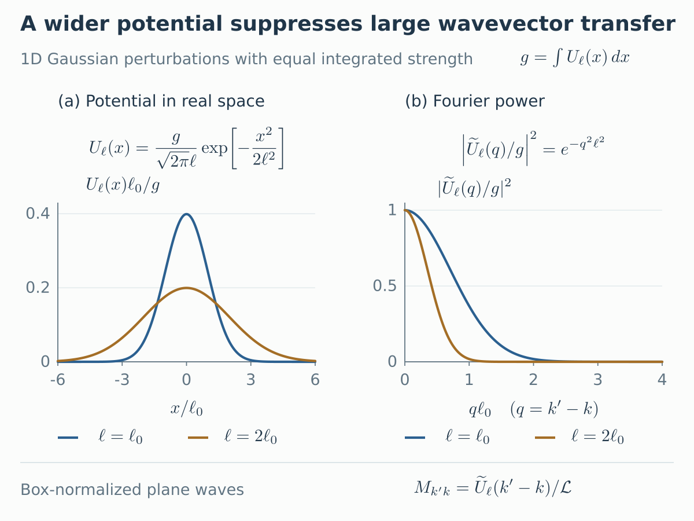
</picture>
<figcaption markdown="span">Figure 12. The reference width is $\ell_0$; the curves use $\ell=\ell_0$ and $2\ell_0$. The two one-dimensional Gaussian perturbations have the same integrated strength $g$, not the same peak height. Here $q$ is the wavevector transfer; the momentum transfer is $\hbar q$. Their Fourier powers agree at zero transfer; the wider perturbation suppresses large $q$ more strongly. The squared matrix element inherits that dependence.</figcaption>
</figure>



A material contains many impurities. Absorb their spatially uniform average potential into the band energy. For the remaining scattering contribution, averaging over uncorrelated impurity positions removes the position-dependent interference, so the mean rate is proportional to the impurity density $n_i$. The arbitrary normalization volume cancels against the final-state count. The density, rather than the chosen box size, must enter a material's lifetime.

<details markdown="1">
<summary>From one impurity to many—and why the normalization box disappears</summary>

For $N_i$ identical impurities at uncorrelated positions $\mathbf R_\alpha$, the matrix element contains $\sum_\alpha e^{-i\mathbf q\cdot\mathbf R_\alpha}$. After averaging over the positions, the incoherent contribution to its squared magnitude is $N_i$. The spatially uniform average potential is absorbed into the band energy rather than treated as a decay event. For the noncoherent scattering part,

$$
\begin{aligned}
&\left\langle\lvert M_{\mathbf k'\mathbf k}^{\rm total}\rvert^2\right\rangle
=\frac{N_i}{\mathcal V^2}\lvert\widetilde U(\mathbf q)\rvert^2,\\
&n_i=\frac{N_i}{\mathcal V}.
\end{aligned}
\tag{34}
$$

Each final-state sum contributes $\mathcal V\int d^3k^{\prime}/(2\pi)^3$. Combining it with $N_i/\mathcal V^2$ leaves the physical impurity density $n_i$, independent of the arbitrary box. Correlated impurities would introduce an additional structure factor; the uncorrelated result is an assumption, not a property of every disordered crystal.

Real Bloch-state matrix elements can also contain periodic-cell overlaps, orbital character, spin and band indices. Equation (32) is the scalar envelope approximation to that more general calculation.

</details>

## 13. Matrix element, scattering amplitude and cross section
{: id="drude-13" }

Keep the three-dimensional isotropic parabolic envelope model and the weak, independent static impurities of Section 12. Golden-rule summation counts the available final wavevectors. Each one is weighted by the squared coupling, and the energy delta retains only elastic final states. The impurity density $n_i$ is the number of impurities per unit volume. For a chosen initial spin, assume that the impurity does not flip spin: only final states with that same spin are counted, so no spin factor $g_s$ is added to this rate. The total rate is

$$
\begin{aligned}
&\Gamma_q(\mathbf k)=\frac{1}{\tau_q}\\
&=\frac{2\pi n_i}{\hbar}\int\frac{d^3k'}{(2\pi)^3}\lvert\widetilde U(\mathbf k'-\mathbf k)\rvert^2\delta(\epsilon_{\mathbf k'}-\epsilon_{\mathbf k}).
\end{aligned}
\tag{35}
$$

The subscript $q$ in $\tau_q$ means **quantum**, not the momentum-transfer wavevector $\mathbf q$. It denotes the **single-particle or quantum elastic lifetime**, within this weak-disorder approximation. In a memoryless rate description, the inverse total rate sets the mean waiting time for leaving the chosen initial state. It counts angular scattering without asking how much current each event changes. It is not a universal many-body lifetime, an electron–hole recombination time or an energy-cooling time.

The same impurity can also be characterized by the directions and flux of its outgoing wave. This gives a **scattering amplitude** with a different meaning from the time-dependent coefficient above. Far from a localized three-dimensional scatterer, a stationary wave with incident direction $z$ has the form below. The first term is the incident plane wave; the second is an outgoing spherical wave, spreading over an area that grows as the square of the distance. Here $r$ is distance from the scatterer and $k>0$ is the magnitude of the incident wavevector. The polar angle $\theta$ is measured from the incident direction, and $\phi$ is the azimuthal angle around it.

The incoming amplitude is set to one to compare outgoing flux with incident flux. Unlike the box-normalized states in Eq. (32), this stationary scattering state is not normalized to total probability one over all space. The **first Born approximation** uses the unperturbed incident wave to calculate scattering to first order in the potential, giving the second line:

$$
\begin{aligned}
&\psi(\mathbf r)\simeq e^{ikz}+f_{\rm sc}(\theta,\phi)\frac{e^{ikr}}{r},\\
&f_{\rm sc}^{\rm Born}(\theta,\phi)
=-\frac{m^{\ast}}{2\pi\hbar^2}\widetilde U(\mathbf q).
\end{aligned}
\tag{36}
$$

The outgoing coefficient $f_{\rm sc}$ has units of length because it multiplies $1/r$. It is different from the energy $M_{ba}$ and from the dimensionless time-dependent coefficient $c_b(t)$. Their units prevent them from being interchanged. [Zwiebach, Scattering, Sec. 7.3][born]; [Tong, Scattering Theory, Sec. 6.3][tong-scattering]

A **solid angle** measures a cone of outgoing directions; the element $d\Omega=\sin\theta\,d\theta\,d\phi$ counts directions on the sphere. The scattered particle rate **per unit solid angle**, divided by the incident flux density (particles per area per time), defines the **differential cross section**, with units of area per steradian:

$$
\begin{aligned}
&\frac{d\sigma_{\rm sc}}{d\Omega}=\lvert f_{\rm sc}(\theta,\phi)\rvert^2,\\
&\sigma_{\rm sc}^{\rm total}=\int d\Omega\,\lvert f_{\rm sc}\rvert^2.
\end{aligned}
\tag{37}
$$

The area $\sigma_{\rm sc}$ is not the electrical conductivity $\sigma$, nor does it have to equal the geometric area of the impurity. It is an effective area converting incident particle flux into a scattered rate. Particle flux counts particles without a charge factor; electrical current instead weights their motion by charge. These are three-dimensional cross-section relations; the one-dimensional Fourier example in Section 12 has different state counting and is not a three-dimensional cross-section formula. For incident speed $v=\hbar k/m^{\ast}$ and impurity density $n_i$,

$$
\Gamma_q=n_iv\int d\Omega\,\frac{d\sigma_{\rm sc}}{d\Omega}.
\tag{38}
$$

The dimensions are $(\mathrm{m}^{-3})(\mathrm{m/s})(\mathrm{m}^2)=\mathrm{s}^{-1}$. Equation (38) agrees with Eq. (35): the radial energy delta contributes $m^{\ast}k/\hbar^2$ when integrating over $k^{\prime}$. It is the same rate written once in momentum-space state counting and once in incident-flux language.

For example, choosing $n_i=10^{22}\,\mathrm{m}^{-3}$, $v=10^5\,\mathrm{m/s}$ and $\sigma_{\rm sc}^{\rm total}=10^{-18}\,\mathrm{m}^2$ gives a total rate $10^9\,\mathrm{s}^{-1}$ and a waiting time of 1 ns. This counts how often scattering occurs, not how strongly it changes the current. A slight deflection and a reversal each count once in this rate, even though their effects on the drift are different.

<figure class="drude-figure">
<picture class="rsna-results-figure">
<source media="(max-width: 560px)" srcset="" width="600" height="1480">
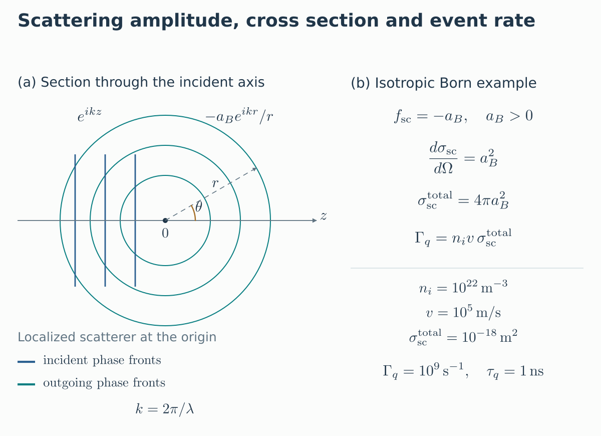
</picture>
<figcaption markdown="span">Figure 13. The left diagram is a meridional slice of three-dimensional waves. Lines mark equal phase, spaced by one wavelength; the dashed radial arrow is a coordinate, not a particle path. The example chooses a constant Born amplitude $f_{\rm sc}=-a_B$, where $a_B>0$ has units of length. Its squared magnitude gives the differential cross section, and integration over all directions gives the total cross section. The numerical inputs at right reproduce the total event rate and lifetime calculated in the text.</figcaption>
</figure>

The Born approximation needs a sufficiently weak scattering potential in the relevant regime. Dilute impurities make independent-impurity averaging plausible, but dilution alone does not make a strong individual scatterer weak. In an actual material one must also specify the potential, screening, wavefunctions and the validity of that perturbative approximation.

## 14. Angular scattering: quantum and transport relaxation times
{: id="drude-14" }

The total rate counts every scattering event once, whether it causes a slight deflection or a reversal. They do not remove the same amount of current: a slight deflection preserves almost all the original velocity component, whereas a reversal changes its sign. To calculate current relaxation, the event rate must therefore retain information about the outgoing direction.

Suppose the dispersion is isotropic and elastic scattering at one energy depends only on the deflection angle $\theta$ between initial and final directions. On the energy shell used here, elastic scattering changes direction but not speed. The isotropic model treats equivalent incoming directions by the same angular rule. Direction alone then describes the remaining change. A hat marks a unit direction, $\widehat{\mathbf k}=\mathbf k/\lvert\mathbf k\rvert$. Define $w(\theta)=n_iv\,d\sigma_{\rm sc}/d\Omega$, a rate per solid angle. Scattering removes electrons from a chosen direction and brings electrons in from other directions. The angularly uniform equilibrium part cancels between these gain and loss terms, leaving the linearized angular collision operator

$$
C[\delta f](\widehat{\mathbf k})
=\int d\Omega'\,w(\theta)
\left[\delta f(\widehat{\mathbf k}')-\delta f(\widehat{\mathbf k})\right].
\tag{39}
$$

Let $\alpha$ be the angle between $\mathbf k$ and $\mathbf E$, **not** the scattering deflection $\theta$. At one energy, Eq. (26) has the dipole form $\delta f=A\cos\alpha$, where $A$ is a small real, signed occupation coefficient, unrelated to the wire area. The two hemispheres gain and lose occupation with opposite signs. For electrons, the field increases occupation for velocities against the field and reduces it for velocities along the field; the negative carrier charge makes the resulting conventional current point along the field. This is the distribution change that carries current; an equal occupation in every direction would give cancelling velocity contributions.

Azimuthal averaging cancels the components of $\widehat{\mathbf k}^{\prime}$ transverse to the incoming direction. The outgoing perturbation therefore averages to $A\cos\alpha\cos\theta$. Gain minus loss is $A\cos\alpha(\cos\theta-1)$ before angular integration. Consequently Eq. (39) becomes $C=-\delta f/\tau_{\rm tr}$, with

$$
\begin{aligned}
&\frac{1}{\tau_q}=\int d\Omega\,w(\theta),\\
&\frac{1}{\tau_{\rm tr}}=\int d\Omega\,w(\theta)(1-\cos\theta).
\end{aligned}
\tag{40}
$$

The factor $1-\cos\theta$ is the fractional loss of the velocity component along its original direction. A tiny deflection produces little loss; an isotropic outgoing direction gives mean loss one; exact reversal gives loss two. For the cosine occupation pattern, the collision operator changes the amplitude but preserves the angular shape. That makes it an angular relaxation eigenmode, whose decay time is the transport time in the scalar conductivity. The same factor is not a universal replacement for a full anisotropic or inelastic collision calculation. [Kim, Woo and Min, Eq. (1) and Sec. II][transport-time]

For example, if every scattering event deflects by $10^\circ$ with random azimuth, the transport rate is only $1-\cos10^\circ\simeq0.01519$ times the event rate. About 65.8 event waiting times make one transport relaxation time. The average current-carrying direction survives many small deflections.

<figure class="drude-figure">
<picture class="rsna-results-figure">
<source media="(max-width: 560px)" srcset="" width="600" height="1430">
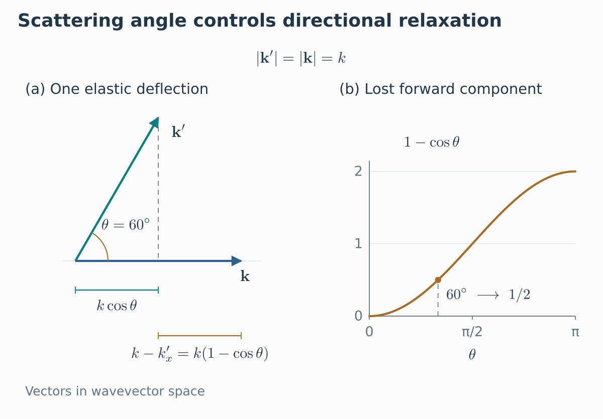
</picture>
<figcaption markdown="span">Figure 14. Both wavevectors have magnitude $k$. The outgoing projection is $k\cos\theta$, so the lost forward component is $k-k_x^{\prime}=k(1-\cos\theta)$. The marked example uses $\theta=60^\circ$. Multiplying the wavevector-component loss by $\hbar$ gives the momentum-component loss.</figcaption>
</figure>



<details markdown="1">
<summary>Pauli-factor cancellation in the elastic gain–loss operator</summary>

For reciprocal elastic transitions between equally weighted angular states, gain minus loss contains

$$
f'(1-f)-f(1-f')=f'-f.
$$

The Pauli factors cancel in this net elastic occupation operator; a common Fermi occupation is stationary. Equation (39) describes relaxation of the distribution, not the blocked exit probability of a specifically tagged electron. This distinction also matters when interpreting the single-particle broadening lifetime $\tau_q$ in Eq. (35). Inelastic transitions and electron–electron collisions generally require additional energy/occupation structure.

</details>

The same distinction can be followed in time. To isolate collision-induced relaxation, imagine removing the field after creating a small directional imbalance. Without further scattering, an electron on this fixed-energy shell keeps its direction. With repeated independent deflections, the average correlation with the initial direction can decay.

In a memoryless kinetic model, represent the unweighted elastic rate by an event process of total rate $\Gamma_q$: its instantaneous rate does not depend on the time since the previous event. Let the mean directional projection retained per event be $\langle\cos\theta\rangle$. This angular mean weights each outgoing direction by its rate divided by the total rate. Averaging over random event histories that start in the same direction then gives

$$
\begin{aligned}
&\langle\widehat{\mathbf k}(t)\cdot\widehat{\mathbf k}(0)\rangle\\
&=\exp\!\left[-\Gamma_q\big(1-\langle\cos\theta\rangle\big)t\right].
\end{aligned}
\tag{41}
$$

Forward-dominated scattering therefore gives $\tau_{\rm tr}\gg\tau_q$. But “the transport time is always longer” is false. In a memoryless two-direction model with reversal rate $r$ in each direction,

$$
\begin{aligned}
&\frac{d(f_+-f_-)}{dt}=-2r(f_+-f_-),\\
&\tau_{\rm tr}=\frac{1}{2r},\\
&\tau_q=\frac{1}{r}.
\end{aligned}
\tag{42}
$$

One reversal changes a velocity component by twice its original magnitude. The event waiting time, decay time of directional bias and energy relaxation time answer different questions.

## 15. Short-range impurities: scattering at a fixed energy
{: id="drude-15" }

A short-range approximation removes the angular dependence of the matrix element. A sufficiently narrow defect has nearly the same Fourier component for every momentum transfer available to the electron. Weakness of the potential is a separate condition needed for the Born approximation. Under both conditions, the Born amplitude is independent of scattering direction, so event counting and current relaxation can be evaluated in the same calculation.

Consider an isotropic three-dimensional parabolic band at kinetic energy $K=\epsilon-E_c>0$. If the defect range is small relative to the relevant wavelength, approximate its Fourier transform by a constant $U_0$. Define a prescribed Born-amplitude length $a_B$ through

$$
\begin{aligned}
&U_0=\frac{2\pi\hbar^2}{m^{\ast}}a_B,\\
&f_{\rm sc}^{\rm Born}=-a_B,\\
&\sigma_{\rm sc}^{\rm total}=4\pi a_B^2.
\end{aligned}
\tag{43}
$$

This is angle-independent scattering, so the outgoing directions are isotropic and $\tau_{\rm tr}=\tau_q$. The parameter $a_B$ is a Born amplitude; its length unit does not make $a_B$ the defect's geometric radius. The constant Fourier transform is a low-momentum approximation to a finite-range weak perturbation in three dimensions, not a specification of the full potential at every momentum.

Knowing the amplitude for a particular final state is not yet a total rate: all final states at the conserved energy must be counted. In an isotropic parabolic band, these states lie on a sphere in wavevector space. The box-state measure used in the conductivity integral counts a thin shell around that sphere. A spherical shell in wavevector space has volume $4\pi k^2dk$. Divide by $(2\pi)^3$ and convert using $dK/dk=\hbar^2k/m^{\ast}$. The density of states per unit volume, per energy and **per spin** is

$$
\begin{aligned}
&D_1(K)=\frac{m^{\ast}k}{2\pi^2\hbar^2},\\
&k=\frac{\sqrt{2m^{\ast}K}}{\hbar}.
\end{aligned}
\tag{44}
$$

It has units of $\mathrm{J}^{-1}\mathrm{m}^{-3}$. This DOS counts states that exist in the spectrum, not just occupied states or empty states; occupations must be supplied separately. Golden-rule integration therefore gives

$$
\begin{aligned}
&\frac{1}{\tau_{\rm tr}}=\frac{1}{\tau_q}\\
&=\frac{2\pi n_i}{\hbar}\lvert U_0\rvert^2D_1(K)\\
&=n_iv\,4\pi a_B^2.
\end{aligned}
\tag{45}
$$

There is no extra factor of two in the final-state DOS for a spin-conserving transition from one fixed spin: the other spin is not an available final spin channel in this model. The total current still includes both identical spin populations through $n$ or $g_s$.

Choose $m^{\ast}=0.2m_0$, $K=50\,\mathrm{meV}$, $n_i=10^{25}\,\mathrm{m}^{-3}$ and $a_B=0.2\,\mathrm{nm}$. Then $k\simeq0.51232\,\mathrm{nm}^{-1}$, $v\simeq2.9655\times10^5\,\mathrm{m/s}$ and $\tau_{\rm tr}\simeq0.67086\,\mathrm{ps}$. At this one energy, $e\tau_{\rm tr}/m^{\ast}\simeq0.58996\,\mathrm{m^2/(V\,s)}$. It is a shell-resolved mobility estimate; a broad thermal distribution needs the average in Section 18.

```python
impurity_mass, kinetic = 0.2 * M0, 0.050 * E_CHARGE
impurity_density, a_born = 1e25, 0.2e-9
k_shell = np.sqrt(2 * impurity_mass * kinetic) / HBAR
v_shell = HBAR * k_shell / impurity_mass
u0 = 2 * np.pi * HBAR**2 * a_born / impurity_mass  # J m^3.
dos_one_spin = impurity_mass * k_shell / (2 * np.pi**2 * HBAR**2)
rate_dos = 2 * np.pi / HBAR * impurity_density * u0**2 * dos_one_spin
rate_flux = impurity_density * v_shell * 4 * np.pi * a_born**2
tau_impurity = 1 / rate_flux
assert np.isclose(rate_dos / rate_flux, 1.0)
print("tau (ps), shell mobility (m^2/Vs):", tau_impurity * 1e12,
      E_CHARGE * tau_impurity / impurity_mass)
print("mean free path (nm):", v_shell * tau_impurity * 1e9)
```

<figure class="drude-figure">
<picture class="rsna-results-figure">
<source media="(max-width: 560px)" srcset="" width="600" height="1340">
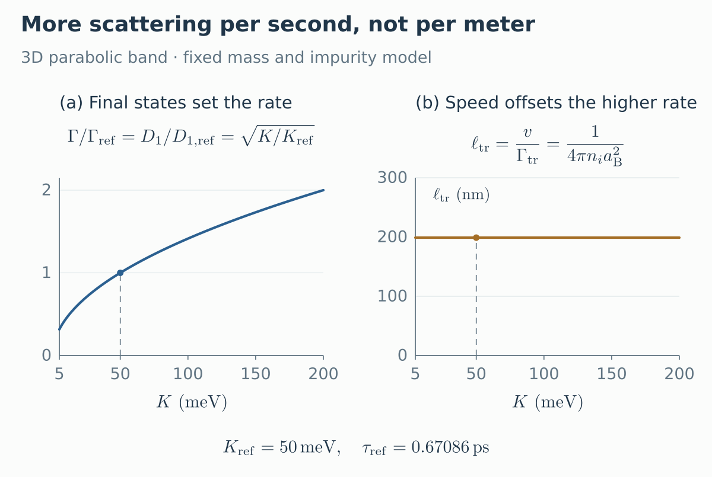
</picture>
<figcaption markdown="span">Figure 15. Mass, impurity density and Born amplitude are fixed. The matrix element is independent of direction, but the spectral density of final states grows with energy. The normalized rate $\Gamma=1/\tau$ therefore increases while its reciprocal time decreases. Both markers identify the same reference energy; the curves use positive energies only.</figcaption>
</figure>



Electrons can move rapidly in nearly cancelling directions while their mean drift is small. Using that small drift speed would therefore underestimate the distance scale associated with their microscopic motion. The **transport mean free path** is the speed at the chosen energy, not the mean drift speed, multiplied by the directional-memory time:

$$
\ell_{\rm tr}=v\tau_{\rm tr}.
\tag{46}
$$

Here $\ell_{\rm tr}\simeq198.94\,\mathrm{nm}$ and $k\ell_{\rm tr}\simeq101.92$. For a local diffusive resistor, the sample scale should be large compared with the relevant mean free path, and the field should not strongly distort the distribution over that path. The inverse wavevector sets a microscopic length scale; a much longer transport path lets a momentum-labelled carrier propagate through many wave phases before its direction relaxes. A large $k\ell$ is a weak-disorder consistency check, not proof that the individual potential satisfies Born conditions. The prescribed $a_B$ example does not specify the range and strength needed for that additional microscopic check.

## 16. Screened Coulomb scattering: quantum and transport rates
{: id="drude-16" }

The equality of the two lifetimes in the short-range example came from a constant Fourier transform, not from elastic scattering alone. A smooth, extended potential can instead favour small momentum transfers. A charged defect provides such a case: its potential extends far from the defect, while mobile charges and the polarizable background screen its electric field. A simple isotropic screened potential energy is

$$
\begin{aligned}
&U(r)=\frac{Ze^2}{4\pi\varepsilon}\frac{e^{-q_sr}}{r},\\
&\widetilde U(q)=\frac{Ze^2}{\varepsilon(q^2+q_s^2)}.
\end{aligned}
\tag{47}
$$

$Z$ sets the sign of the electron's potential energy. In this convention it is negative for a positively charged defect, which attracts the electron. Reversing its sign changes the Born amplitude's sign but not its squared magnitude. The positive $q_s$ is an inverse screening length. The **Yukawa** potential and its screening length are prescribed rather than calculated from the surrounding charge distribution. [Tong, Sec. 6.3.2][tong-scattering]

Elastic scattering preserves $k=\lvert\mathbf k\rvert=\lvert\mathbf k^{\prime}\rvert$. Geometry gives

$$
\begin{aligned}
&q=\lvert\mathbf k'-\mathbf k\rvert=2k\sin\frac{\theta}{2},\\
&x_s=\frac{4k^2}{q_s^2}.
\end{aligned}
\tag{48}
$$

The dimensionless ratio is the square of the largest elastic wavevector transfer divided by the screening wavevector. When the screening wavevector is large compared with the whole available transfer range, the Fourier denominator is nearly constant; otherwise its angular dependence matters. When $q_s\ll k$, the matrix element is strongly concentrated near $\theta=0$. Many events can broaden a momentum state while barely relaxing the current. To evaluate the two rates, set $z=1-\cos\theta$ and $C_U=Ze^2/\varepsilon$. Azimuthal integration gives

$$
\begin{pmatrix}\Gamma_q\\\Gamma_{\rm tr}\end{pmatrix}
=\frac{n_im^{\ast}kC_U^2}{2\pi\hbar^3}
\int_0^2\frac{1}{(q_s^2+2k^2z)^2}
\begin{pmatrix}1\\z\end{pmatrix}dz.
\tag{49}
$$

The two elementary integrals produce

$$
\begin{aligned}
B(x_s)&=\ln(1+x_s)-\frac{x_s}{1+x_s},\\
\Gamma_q&=\frac{n_im^{\ast}kC_U^2}{\pi\hbar^3q_s^4(1+x_s)},\\
\Gamma_{\rm tr}&=\frac{n_im^{\ast}C_U^2}{8\pi\hbar^3k^3}B(x_s).
\end{aligned}
\tag{50}
$$

Their ratio is especially useful because the common strength cancels:

$$
\begin{aligned}
&\frac{\tau_{\rm tr}}{\tau_q}=\frac{\Gamma_q}{\Gamma_{\rm tr}}\\
&=\frac{x_s^2}{2(1+x_s)B(x_s)}.
\end{aligned}
\tag{51}
$$

As $x_s\to0$, the angular dependence becomes nearly constant and the ratio approaches one. For $x_s\gg1$, it grows approximately as $x_s/[2(\ln x_s-1)]$. The unscreened limit cannot be used as a finite total rate by setting $q_s=0$: the forward singularity must be treated physically.

The following quadrature integrates the actual solid-angle measure. Integrating uniformly in $\theta$ without $\sin\theta$ would count directions incorrectly. Its fixed 256-node grid is verified for $0<x_s\le400$; that is a numerical resolution limit, not a bound on the physical model. Larger $x_s$ needs more angular resolution or an adaptive/transformed integration because the forward peak becomes narrower.

```python
nodes, gauss_weights = np.polynomial.legendre.leggauss(256)
z_angle = nodes + 1.0  # z=1-cos(theta) lies in [0,2]; dz=dx here.

def screened_time_ratio(shape):
    if not np.isfinite(shape) or not 0 < shape <= 400:
        raise ValueError("This fixed-order quadrature is verified for 0 < x_s <= 400")
    kernel = 1 / (1 + shape * z_angle / 2)**2
    total = gauss_weights @ kernel
    transport = gauss_weights @ (kernel * z_angle)
    return total / transport

for shape in (0.01, 4.0, 100.0):
    bshape = np.log1p(shape) - shape / (1 + shape)
    analytic = shape**2 / (2 * (1 + shape) * bshape)
    assert np.isclose(screened_time_ratio(shape), analytic, rtol=1e-9)
    print("x_s, tau_tr/tau_q:", shape, analytic)
```

<figure class="drude-figure">
<picture class="rsna-results-figure">
<source media="(max-width: 560px)" srcset="" width="600" height="1600">
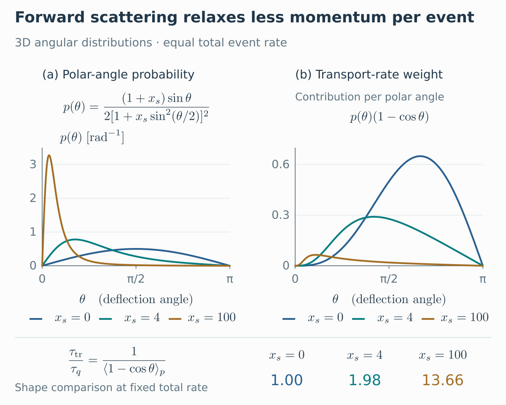
</picture>
<figcaption markdown="span">Figure 16. The angle distributions include the spherical measure $\sin\theta$ and integrate to one. They compare $x_s=0,4,100$ at the same total event rate; $x_s=0$ is the isotropic limiting shape. Isotropic means equal probability per solid angle, not per polar angle: its plotted density is $p(\theta)=\sin\theta/2$, not a flat line. Multiplying by $1-\cos\theta$ reveals how little momentum strongly forward events relax. This normalization isolates angular shape rather than holding a microscopic Coulomb strength fixed.</figcaption>
</figure>



Compare isotropic scattering, increasingly forward-focused scattering and the separate two-direction reversal model. The lab holds the total event rate fixed while changing the angular distribution. In a physical screening sweep at fixed $n_i,Z,k$, both the total rate and its angular shape would change according to Eq. (50).

<details markdown="1">
<summary>Where does the screening wavevector come from?</summary>

In linear static screening, a small electrostatic potential shifts the local electron energy by $-e\varphi$. At fixed reservoir chemical potential, the density change is $\delta n=e\varphi\,\partial n/\partial\mu_F$. Put the corresponding induced charge into Poisson's equation to obtain a screened field equation with

$$
q_s^2=\frac{e^2}{\varepsilon}\frac{\partial n}{\partial\mu_F}.
$$

For a classical nondegenerate gas, $\partial n/\partial\mu_F=n/(k_BT)$, giving the Debye expression. At zero temperature in a simple degenerate band, it is the **total** DOS at the Fermi energy, including the spin populations contributing to screening. That differs from the one-spin final-state DOS in Eq. (44).

This is a linear screening model. Strong defect potentials, nonlocal screening, correlations, multiple bands and low dimensionality can change it. A charged-defect mobility prediction needs a justified screening model as well as a valid Born approximation; Eq. (51) alone does not supply one.

</details>

## 17. Longitudinal acoustic phonons: deformation-potential scattering
{: id="drude-17" }

The static impurity examples change electron directions while preserving electron energy. They cannot, by themselves, describe energy exchange with the lattice. When atoms move, however, their potential is no longer static. A **phonon** is a quantum of lattice vibration, so the perturbation can exchange energy with the electron. The electronic Hamiltonian changes when atoms move; the electron–phonon matrix element is the matrix element of that change between initial and final electronic states.

A uniform translation does not change the bulk band edge, but compression or expansion changes the atomic spacing. This motivates a coupling to strain rather than to the absolute displacement. A simple longitudinal acoustic **deformation-potential** model assumes that a local fractional volume change shifts the conduction-band edge by

$$
U_{\rm ac}(\mathbf r)=D\,\nabla\cdot\mathbf u_{\rm lat}(\mathbf r).
\tag{52}
$$

$\mathbf u_{\rm lat}$ is the lattice displacement, not the electron drift $\mathbf u$. The dimensionless divergence is a strain; $D$ has energy units and measures the band-edge sensitivity to that strain. This deformation potential is not the diffusion coefficient $D$ in Section 2, which has units of area per time. This is one coupling mechanism, not the electron–phonon interaction of every material. [Bardeen and Shockley][deformation]

A normal mode specifies a collective vibration pattern of the atoms. A phonon branch follows a family of these modes as the wavevector varies. For one longitudinal acoustic branch, let $q=\lvert\mathbf q\rvert$ and $\omega_q=v_sq$, where $v_s$ is the sound speed. Longitudinal means that displacement is parallel to the wavevector; acoustic means that the frequency approaches zero with $q$. Quantizing the displacement, with an arbitrary phonon-mode phase absorbed into its operators, gives the electronic coupling coefficient

$$
\begin{aligned}
&M_q=Dq\sqrt{\frac{\hbar}{2\rho_m\mathcal V\omega_q}},\\
&\lvert M_q\rvert^2=
\frac{D^2\hbar q}{2\rho_m\mathcal Vv_s}.
\end{aligned}
\tag{53}
$$

The mass density $\rho_m$ is measured in $\mathrm{kg/m^3}$ and is different from charge density $\rho$. The square root is a displacement amplitude in metres; multiplying by $q$ gives strain and then $D$ turns it into an energy. The factor of $q$ comes from the spatial derivative in Eq. (52). This coefficient couples the electron to one normalized vibration mode; its population and energy conservation still enter when calculating a transition rate.

<details markdown="1">
<summary>Harmonic-oscillator displacement and the absorption/emission factors</summary>

A quantum harmonic oscillator of mass $M$ and frequency $\omega$ has the displacement scale $\sqrt{\hbar/(2M\omega)}$. For a volume-normalized lattice mode, the mass normalization is $\rho_m\mathcal V$. The longitudinal displacement field has the corresponding form

$$
\begin{aligned}
\widehat{\mathbf u_{\rm lat}}(\mathbf r)
&=\sum_{\mathbf q}\sqrt{\frac{\hbar}{2\rho_m\mathcal V\omega_q}}\,
\mathbf e_{\mathbf q}\\
&\quad\left(\widehat a_{\mathbf q}e^{i\mathbf q\cdot\mathbf r}
+\widehat a_{\mathbf q}^{\dagger}e^{-i\mathbf q\cdot\mathbf r}\right),
\end{aligned}
$$

where $\mathbf e_{\mathbf q}$ is a real unit polarization parallel to $\mathbf q$. The gradient in $D\nabla\cdot\widehat{\mathbf u_{\rm lat}}$ contributes $i\mathbf q\cdot\mathbf e_{\mathbf q}$. Its factor of $i$ can be absorbed into the phase convention for the phonon operators, leaving the coefficient $M_q$ in Eq. (53) and the same $\lvert M_q\rvert^2$.

For an integer phonon number $N$, the oscillator ladder operators obey

$$
\begin{aligned}
\widehat a\lvert N\rangle&=\sqrt N\,\lvert N-1\rangle,\\
\widehat a^{\dagger}\lvert N\rangle&=\sqrt{N+1}\,\lvert N+1\rangle.
\end{aligned}
$$

Absorption has a squared matrix element proportional to $N$; emission has one proportional to $N+1$. Thermal averaging replaces $N$ by the mean phonon occupation $N_q$. The extra one in emission remains even when the mode is initially empty. The hats on $\widehat a$ and $\widehat{\mathbf u_{\rm lat}}$ denote quantum operators, unlike the unit-direction hat on $\widehat{\mathbf k}$ in Section 14.

</details>

With equilibrium phonon occupation $N_q=1/[\exp(\hbar\omega_q/(k_BT))-1]$, occupation means the mean phonon count in a mode: a mode may contain many phonons, unlike the single-state occupation probability for electrons. Absorption requires a phonon to remove, while emission can create a phonon even in an initially empty mode. These processes therefore have different occupation factors. Golden-rule absorption and emission contain

$$
\begin{aligned}
&W^{\rm abs}_{\mathbf k\to\mathbf k+\mathbf q}=\frac{2\pi}{\hbar}\lvert M_q\rvert^2N_q\\
&\qquad\delta(\epsilon_{\mathbf k+\mathbf q}-\epsilon_{\mathbf k}-\hbar\omega_q),\\
&W^{\rm em}_{\mathbf k\to\mathbf k-\mathbf q}=\frac{2\pi}{\hbar}\lvert M_q\rvert^2(N_q+1)\\
&\qquad\delta(\epsilon_{\mathbf k-\mathbf q}-\epsilon_{\mathbf k}+\hbar\omega_q).
\end{aligned}
\tag{54}
$$

Absorption removes one phonon and increases electron energy. Emission adds one phonon and decreases electron energy; the extra one permits spontaneous emission. These are unblocked transition-rate coefficients. Electron occupation and Pauli factors enter the gain–loss collision equation. Crystal momentum transfers can require reciprocal-lattice vectors in more general processes; this small-wavevector intraband example keeps only the displayed normal processes.

Unlike static elastic scattering, the two electron energies are different. A generic inelastic collision problem cannot therefore be reduced to independent energy shells or to an unqualified $1-\cos\theta$ replacement.

### The equipartition and quasielastic limits

To reuse the elastic-shell calculation, two separate simplifications are needed: the high-occupation equipartition limit for the phonon population, in which the mode's mean thermal energy approaches $k_BT$, and a small energy change in the electronic transition. A large phonon occupation alone does not make the electronic scattering elastic.

For relevant phonons with $k_BT\gg\hbar\omega_q$, $N_q\simeq k_BT/(\hbar\omega_q)$. If the phonon energy is also small on the relevant electronic energy scale, treat the electron transition as approximately elastic. Absorption and emission then use the same approximate elastic energy delta, so their weights can be added to give

$$
\lvert M_q\rvert^2(2N_q+1)
\simeq\frac{D^2k_BT}{\rho_m\mathcal Vv_s^2}.
\tag{55}
$$

The $q$ dependence cancels in this isotropic approximation. After final-state summation, the volume cancels too, yielding

$$
\begin{aligned}
&\frac{1}{\tau_{\rm ac}(K,T)}=\frac{2\pi}{\hbar}\frac{D^2k_BT}{\rho_mv_s^2}D_1(K)\\
&\ \propto\ T\sqrt K.
\end{aligned}
\tag{56}
$$

Because the resulting angular kernel is constant, its transport and single-particle times agree within this reduction. That equality need not hold for the unreduced inelastic problem. [MIT 6.730, electron–phonon scattering lectures][mit-solid]; [Giustino, Sec. III and erratum][giustino]

<figure class="drude-figure">
<picture class="rsna-results-figure">
<source media="(max-width: 560px)" srcset="" width="600" height="1620">
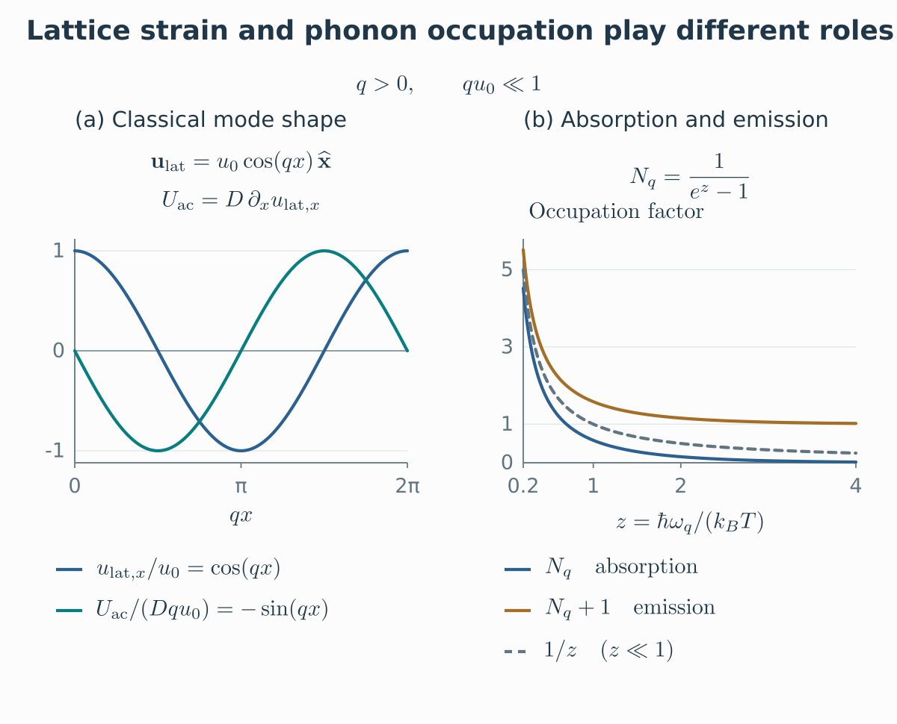
</picture>
<figcaption markdown="span">Figure 17. (a) Differentiating the classical displacement gives strain, so displacement maxima and band-edge-shift maxima occur at different positions. This is a mode shape, not the average displacement of a state with a definite phonon number. (b) Absorption and emission use different Bose occupation factors. The dashed high-occupation approximation works when $\hbar\omega_q/(k_BT)$ is small; it does not, by itself, justify treating the electron transition as quasielastic.</figcaption>
</figure>



```python
deformation_J, lattice_density, sound_speed = 5 * E_CHARGE, 5000.0, 5000.0
temperature = 300.0
ac_strength = deformation_J**2 * KB * temperature / (lattice_density * sound_speed**2)
rate_acoustic = 2 * np.pi / HBAR * ac_strength * dos_one_spin
assert ac_strength > 0 and rate_acoustic > 0
print("Illustrative acoustic tau at 50 meV (ps):", 1e12 / rate_acoustic)
print("Doubling T multiplies this fixed-energy rate by:", 2.0)
q_max_elastic = 2 * k_shell  # Elastic geometry, used to check the approximation.
phonon_energy_max = HBAR * sound_speed * q_max_elastic
print("Phonon energy estimate, kBT, electron K (meV):",
      phonon_energy_max / E_CHARGE * 1e3,
      KB * temperature / E_CHARGE * 1e3, kinetic / E_CHARGE * 1e3)
assert np.isclose(phonon_energy_max / E_CHARGE * 1e3, 3.372, rtol=1e-3)
assert np.isclose(KB * temperature / E_CHARGE * 1e3, 25.852, rtol=1e-5)
assert phonon_energy_max < 0.14 * KB * temperature
assert phonon_energy_max < 0.07 * kinetic
```

The numbers in this code prescribe an illustrative isotropic material model: $D=5\,\mathrm{eV}$, $\rho_m=5000\,\mathrm{kg/m^3}$ and $v_s=5000\,\mathrm{m/s}$. The elastic geometry gives $q\le2k$; using that ceiling to check the approximation gives a phonon energy of about $3.372\,\mathrm{meV}$, compared with $k_BT=25.852\,\mathrm{meV}$ and $K=50\,\mathrm{meV}$. The ratios are about $0.130$ and $0.0674$: the energy changes are small but not literally zero. At lower temperature, near thresholds or for optical, polar and intervalley phonons, the approximations behind Eq. (56) need rechecking.

<details markdown="1">
<summary>How a realistic electron–phonon matrix element is obtained</summary>

One first solves for electronic Bloch states, phonon modes and the change in the screened electronic potential caused by each normal-mode displacement. The matrix element is the overlap of that potential change with the initial and final Bloch states, multiplied by the phonon's displacement normalization. Its indices include initial band, final band, electronic wavevector, phonon wavevector and phonon branch.

The deformation-potential constant compresses this information into a band-edge strain derivative in a particular long-wavelength model. First-principles methods retain the mode-dependent potential derivative and electronic overlaps instead. Even with those matrix elements, mobility still requires occupations, energy conservation and a transport equation, not just summing all transition probabilities into one guessed $\tau$.

For a computational route, [EPW][epw] provides electron–phonon interpolation and transport implementations. [Giustino's review][giustino] develops the underlying matrix-element formalism; its [2019 erratum][giustino-erratum] corrects, among other expressions, the current-density normalization and linearized transport equation.

</details>

## 18. Energy averaging of transport times for mobility
{: id="drude-18" }

The impurity and acoustic calculations have so far selected a single electron energy. A gas contains carriers at many energies, and those carriers can have different speeds and transport times. If $\tau_{\rm tr}$ depends on energy, which value belongs in $\mu=e\tau/m^{\ast}$?

The velocity enters the current response twice: the field-induced occupation change is proportional to velocity, and each changed occupation contributes its velocity to the current. The DOS counts how many states receive this weight.

For an isotropic three-dimensional parabolic band, let $D(K)=g_sD_1(K)$ be the total DOS and $K$ the energy above the band minimum. This energy-dependent DOS function is distinct from both the deformation-potential constant and the earlier diffusion coefficient. Angular averaging gives $\langle v_x^2\rangle=v^2/3$, so

$$
\begin{aligned}
n&=\int_0^\infty D(K)f_0(K)\,dK,\\
\sigma_0&=\frac{e^2}{3}\int_0^\infty D(K)v^2(K)\tau_{\rm tr}(K)
\left(-\frac{\partial f_0}{\partial K}\right)dK,\\
\mu&=\frac{\sigma_0}{en}=\frac{e\tau_{\rm eff}}{m^{\ast}}.
\end{aligned}
\tag{57}
$$

The last line defines a transport-weighted $\tau_{\rm eff}$; it is not generally the particle-average waiting time. Fast carriers and occupations that can change under the field contribute differently. Deep inside a filled region, a small shift leaves the occupations filled; the change occurs near its edge. For a degenerate gas, whose low-energy states are densely occupied, at low temperature $-\partial_Kf_0$ is concentrated near the Fermi energy. For a nondegenerate gas, it is spread over a thermal energy range.

For a nondegenerate gas, $-\partial_Kf_0=f_0/(k_BT)$ and $D(K)v^2(K)\propto K^{3/2}$. Integration by parts over the positive-energy range gives

$$
\begin{aligned}
&\int_0^\infty K^{3/2}e^{-K/(k_BT)}\,dK\\
&=\frac32 k_BT\int_0^\infty K^{1/2}e^{-K/(k_BT)}\,dK.
\end{aligned}
$$

The endpoint terms vanish. Substituting this relation and the density in Eq. (57) yields the normalized average

$$
\tau_{\rm eff}=
\frac{\displaystyle\int_0^\infty K^{3/2}\tau_{\rm tr}(K)e^{-K/(k_BT)}\,dK}
{\displaystyle\int_0^\infty K^{3/2}e^{-K/(k_BT)}\,dK}.
$$

The same weight in numerator and denominator ensures that a constant $\tau$ is unchanged. A particle-number average would instead use $K^{1/2}e^{-K/(k_BT)}$, omitting the extra velocity-squared factor. If $\tau_{\rm tr}(K)=\tau_{\rm ref}(K/K_{\rm ref})^r$, the reference quantities specify the time at a chosen positive energy, and the power describes its energy dependence. Substitute $y=K/(k_BT)$ into both integrals to obtain

$$
\begin{aligned}
&\tau_{\rm eff}=\tau_{\rm ref}
\left(\frac{k_BT}{K_{\rm ref}}\right)^r
\frac{\Gamma(r+5/2)}{\Gamma(5/2)},\\
&r>-5/2.
\end{aligned}
\tag{58}
$$

The bound on the exponent ensures that the conductivity integral remains finite near the band minimum. Here $\Gamma(z)$ is the gamma function, not the scattering rate $\Gamma_q$. It is defined by $\Gamma(z)=\int_0^\infty y^{z-1}e^{-y}dy$ for positive $z$ and extends the factorial: $\Gamma(n+1)=n!$. The power $r+5/2$ comes from the three-dimensional DOS proportional to $\sqrt K$, the velocity squared proportional to $K$, and the energy integral.

For constant $\tau$, Eq. (58) gives that same $\tau$. For the high-temperature acoustic model, $\tau(K,T)\propto T^{-1}K^{-1/2}$. The thermal average supplies another $T^{-1/2}$, so $\mu\propto T^{-3/2}$ when the mass and coupling parameters are fixed and the carriers remain nondegenerate. This is a conditional scaling law, not a universal mobility–temperature curve.

The short-range impurity model in Section 15 also has $r=-1/2$, because its rate is proportional to speed. Keeping its $\tau_{\rm ref}=0.670864\,\mathrm{ps}$ at $K_{\rm ref}=50\,\mathrm{meV}$ and taking a nondegenerate gas at $300\,\mathrm K$ gives $\tau_{\rm eff}=0.701837\,\mathrm{ps}$ and $\mu=0.617202\,\mathrm{m^2/(V\,s)}$. The particle-number average of the same times is $1.052755\,\mathrm{ps}$; substituting that value into mobility would overestimate the conductivity by a factor of $1.5$.

<figure class="drude-figure">
<picture class="rsna-results-figure">
<source media="(max-width: 560px)" srcset="" width="600" height="1570">
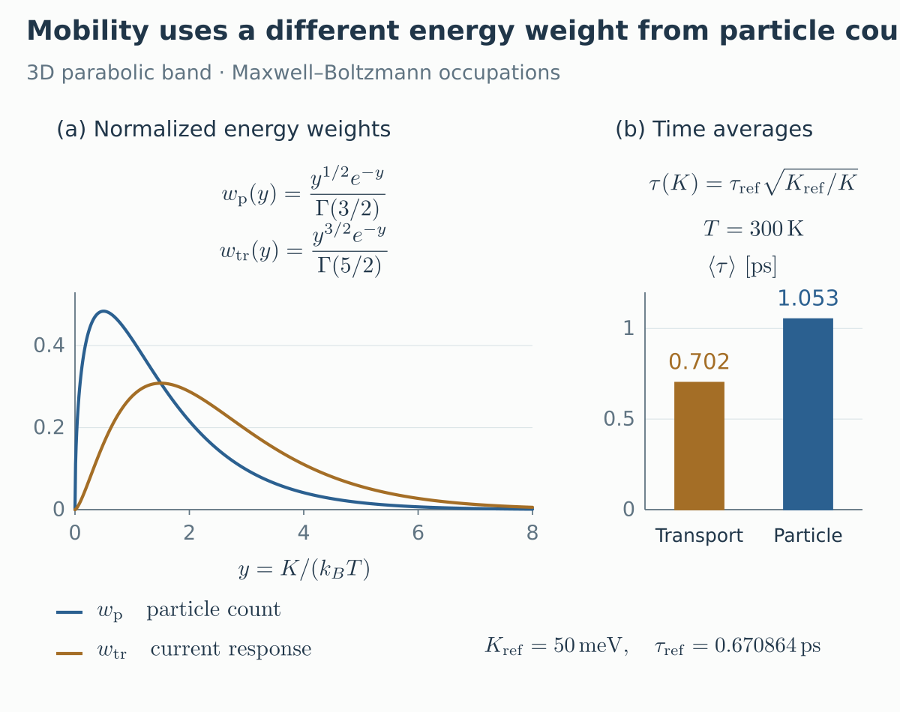
</picture>
<figcaption markdown="span">Figure 18. (a) The normalized particle-count and current-response weights both integrate to one over all positive energies. Transport gives more weight to larger energies. (b) Applying those weights to the same energy-dependent relaxation time gives different averages; only the transport-weighted value belongs in the mobility formula.</figcaption>
</figure>



```python
def mb_transport_time(tau_ref, energy_ref_J, temperature_K, exponent):
    if tau_ref <= 0 or energy_ref_J <= 0 or temperature_K <= 0 or exponent <= -2.5:
        raise ValueError("Positive scales and exponent > -5/2 are required")
    return tau_ref * (KB * temperature_K / energy_ref_J)**exponent * gamma(exponent + 2.5) / gamma(2.5)

assert np.isclose(mb_transport_time(100e-15, 0.05 * E_CHARGE, 300, 0) / 100e-15, 1)
tau_ac_300 = 1 / rate_acoustic  # Reference energy is the same 50 meV as above.
eff_300 = mb_transport_time(tau_ac_300, kinetic, 300, -0.5)
eff_600 = mb_transport_time(tau_ac_300 / 2, kinetic, 600, -0.5)
assert np.isclose(eff_600 / eff_300, 2**(-1.5))
print("Acoustic-model mobility ratio mu(600K)/mu(300K):", eff_600 / eff_300)
impurity_eff_300 = mb_transport_time(tau_impurity, kinetic, 300, -0.5)
impurity_mobility_300 = E_CHARGE * impurity_eff_300 / impurity_mass
impurity_particle_tau_300 = (tau_impurity * (KB * 300 / kinetic)**(-0.5)
                             * gamma(1.0) / gamma(1.5))
assert np.isclose(impurity_eff_300 * 1e12, 0.701836862, rtol=1e-8)
assert np.isclose(impurity_mobility_300, 0.617202357, rtol=1e-8)
assert np.isclose(impurity_particle_tau_300 * 1e12, 1.052755292, rtol=1e-8)
assert np.isclose(impurity_particle_tau_300 / impurity_eff_300, 1.5)
print("Impurity transport tau (ps), mobility (m^2/Vs), particle tau (ps):",
      impurity_eff_300 * 1e12, impurity_mobility_300,
      impurity_particle_tau_300 * 1e12)
```

When independent weak mechanisms relax the same angular mode, combine their rates at each energy before performing the thermal average. Averaging each mechanism's time first can give a different mobility, because the average of an inverse is not generally the inverse of an average.

<details markdown="1">
<summary>Independent scattering mechanisms and Matthiessen's rule</summary>

Independent weak mechanisms add their collision operators. If they relax the same isotropic angular mode at a given energy, their rates add:

$$
\frac{1}{\tau_{\rm tr}^{\rm total}(K)}
=\sum_\alpha\frac{1}{\tau_{\mathrm{tr},\alpha}(K)}.
\tag{59}
$$

This is the rate-level form of **Matthiessen's rule**. If every time is constant in energy for the same mass, it also gives $1/\mu_{\rm total}=\sum_\alpha1/\mu_\alpha$. But energy averaging and taking an inverse do not generally commute. With different energy dependences, first combine the rates at each energy and then integrate Eq. (57). Correlated disorder or different angular eigenmodes can invalidate the simple rate addition itself.

The band mass and transport time are also not independent material knobs. Changing a band mass changes velocities, DOS, screening and often matrix elements. “Smaller mass gives higher mobility” is reliable only while the relevant transport time and the other model inputs are actually held fixed.

</details>

## 19. A periodic bulk density mode: decay and oscillation
{: id="drude-19" }

The uniform wire used a prescribed boundary voltage and no density accumulation. Now imagine a slight excess of electrons next to a slight deficit, with initially zero drift. Their electric field starts moving electrons, which changes the density pattern and hence the field itself. A prescribed field is no longer enough: continuity, Poisson and the momentum equation must evolve together.

To isolate bulk redistribution without contacts, repeat the pattern periodically. Take a three-dimensional bulk electron fluid whose density, field and drift vary only along $x$, with a periodic cell in that direction. The drift velocity, electric field and current below are the components along this direction. The number density $n_0=N_D$ is still per volume. This is not a strictly one-dimensional wire, whose Coulomb field and plasma dispersion would require its actual transverse geometry. Keep $m^{\ast},\tau,\varepsilon$ constant, with no applied voltage and a small density perturbation $\delta n$. Linearize in the perturbation and drift velocity:

$$
\begin{aligned}
&\partial_t\delta n+n_0\partial_xu=0,\\
&\partial_xE=-\frac{e\delta n}{\varepsilon},\\
&\partial_tu+\frac{u}{\tau}=-\frac{eE}{m^{\ast}}.
\end{aligned}
\tag{60}
$$

To linearize, count $\delta n$, $u$ and $E$ as first order in a small perturbation size. In the particle flux $(n_0+\delta n)u$, retain $n_0u$ but drop $\delta n\,u$, which is second order. Following electrons into regions with a different fluid velocity would introduce the convective acceleration $u\partial_xu$; it is also second order. Pressure does not disappear for that reason: a density gradient can produce a pressure force already at first order. Omitting pressure and diffusion is a separate pressureless, long-wavelength approximation, chosen so the Coulomb restoring force dominates. A thermal or Fermi-pressure term would otherwise change the dispersion at finite wavevector. The background permittivity remains the real positive $\varepsilon$ defined in Section 1.

The electric field is treated **quasistatically**: Poisson's equation determines it from the instantaneous charge distribution, neglecting electromagnetic propagation delays and inductive fields on the system's scale. This approximation does not require $\omega\tau\ll1$; the electron inertia in Eq. (60) is retained.

A cosine density pattern alternates excess and deficit while keeping the total electron number unchanged. Its wavelength must fit the periodic cell. Choose the pattern's nonzero spatial wavenumber $q>0$ with $qL_{\rm cell}=2\pi$, one wavelength in a cell of length $L_{\rm cell}$. Continuity converts converging motion into a density increase; Drude gives the changing velocity; Poisson relates the field gradient back to that density. To close this loop, differentiate continuity with respect to time, replace $\partial_tu$ using Drude, then use Poisson for $\partial_xE$. A density mode $\delta n=\mathcal A(t)\cos qx$ obeys

$$
\begin{aligned}
&\ddot{\mathcal A}+\frac{\dot{\mathcal A}}{\tau}+\omega_p^2\mathcal A=0,\\
&\omega_p^2=\frac{n_0e^2}{\varepsilon m^{\ast}}.
\end{aligned}
\tag{61}
$$

$\omega_p$ is the angular frequency of this density oscillation without momentum damping. A sufficient scale condition for a small pressure correction is $qv_{\rm char}\ll\omega_p$, where $v_{\rm char}$ is a representative thermal or Fermi speed.

$\mathcal A$ is a signed number-density amplitude, not the wire area $A$. When its sign changes, the regions of excess and deficit exchange roles; the total density remains the background plus a small modulation. The density excess creates a restoring electric field; carrier inertia permits overshoot; momentum relaxation damps the response. Choosing zero spatially averaged field and current over a cell, the associated spatial profiles are

$$
\begin{aligned}
\delta n(x,t)&=\mathcal A(t)\cos qx,\\
E(x,t)&=-\frac{e\mathcal A(t)}{\varepsilon q}\sin qx,\\
J(x,t)&=\frac{e\dot{\mathcal A}(t)}{q}\sin qx.
\end{aligned}
\tag{62}
$$

Differentiate the last line with respect to $x$: it exactly cancels $\partial_t\rho=-e\dot{\mathcal A}\cos qx$. The density is redistributed, not destroyed. A periodic cosine has zero spatial mean, so the total number stays fixed even while its amplitude decays.

Initially choose $\mathcal A(0)\ne0$ but $\dot{\mathcal A}(0)=0$. There is already an electric field, yet $J(0)=0$. That is possible because Drude contains inertia; the instantaneous steady-state rule $J=\sigma_0E$ does not apply at that instant.

The outcome depends on whether momentum is lost before the electrons can overshoot the uniform-density state. Comparing the momentum-relaxation time with the restoring-motion timescale makes this competition explicit. Define dimensionless time $s=t/\tau$, dimensionless frequency ratio $\Omega=\omega_p\tau$ and normalized density amplitude $a(s)=\mathcal A(t)/\mathcal A(0)$. Then

$$
\begin{aligned}
&a''+a'+\Omega^2a=0,\\
&a(0)=1,\quad a'(0)=0.
\end{aligned}
\tag{63}
$$

Primes here mean derivatives with respect to $s$. The characteristic roots distinguish purely decaying solutions from oscillatory ones. Insert $a\propto e^{\lambda s}$ into Eq. (63):

$$
\begin{aligned}
&\lambda^2+\lambda+\Omega^2=0,\\
&\lambda_\pm=\frac{-1\pm\sqrt{1-4\Omega^2}}{2}.
\end{aligned}
$$

For $0<\Omega<1/2$, both roots are real and negative. At $\Omega=1/2$ they coincide, giving critical damping. For the stated initial conditions, the boundary between monotone and oscillatory decay is therefore $\Omega=1/2$. Above it the roots have an imaginary part and produce damped oscillations; $\Omega=1$ is one such oscillatory case. At and above the boundary,

$$
\begin{aligned}
&\Omega=\tfrac12:\quad a(s)=e^{-s/2}(1+s/2),\\
&\Omega>\tfrac12:\\
&a(s)=e^{-s/2}\left[\cos(\nu s)+\frac{\sin(\nu s)}{2\nu}\right],\\
&\nu=\sqrt{\Omega^2-\tfrac14}.
\end{aligned}
\tag{64}
$$

Below the boundary there are two real negative decay rates per unit dimensionless time, $-1/2\pm\sqrt{1/4-\Omega^2}$. With damping, the actual angular oscillation frequency is $\sqrt{\omega_p^2-1/(4\tau^2)}$ in the oscillatory regime.

```python
def density_mode(s, omega_tau):
    s = np.asarray(s, dtype=float)
    if omega_tau <= 0 or np.any(s < 0):
        raise ValueError("Positive omega_p*tau and nonnegative time are required")
    discriminant = omega_tau**2 - 0.25
    if discriminant > 0:
        nu = np.sqrt(discriminant)
        sine_over_nu = s * np.sinc(nu * s / np.pi)
        a = np.exp(-s / 2) * (np.cos(nu * s) + 0.5 * sine_over_nu)
        derivative = -omega_tau**2 * np.exp(-s / 2) * sine_over_nu
    elif discriminant == 0:
        a = np.exp(-s / 2) * (1 + s / 2)
        derivative = -0.25 * s * np.exp(-s / 2)
    else:
        kappa = np.sqrt(-discriminant)
        slow = -omega_tau**2 / (0.5 + kappa)  # Avoid subtracting nearly equal numbers.
        divided = -np.expm1(-2 * kappa * s) / (2 * kappa)
        a = np.exp(slow * s) * (1 - slow * divided)  # Stable near critical damping.
        derivative = -omega_tau**2 * np.exp(slow * s) * divided
    return a, derivative

for omega_tau in (0.2, 0.5, 1.2):
    a0, da0 = density_mode(0.0, omega_tau)
    assert np.isclose(a0, 1.0) and np.isclose(da0, 0.0)
print("Charge snapshot a,a' at Omega=1.2,s=1:", density_mode(1.0, 1.2))
```

<figure class="drude-figure">
<picture class="rsna-results-figure">
<source media="(max-width: 560px)" srcset="" width="600" height="1820">
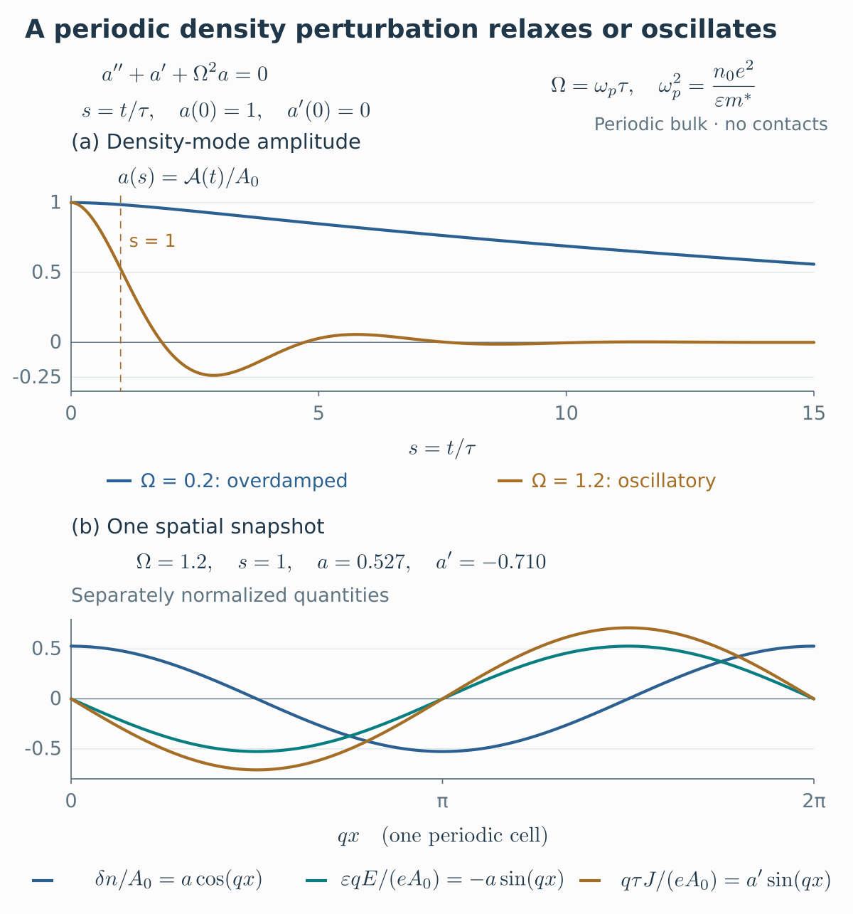
</picture>
<figcaption markdown="span">Figure 19. Density-mode amplitudes at $\Omega=0.2$ and $1.2$ start from $a=1,a^{\prime}=0$. The marked time in (a) supplies the spatial snapshot in (b): $\Omega=1.2,s=1$, where $a\simeq0.52664$ and $a^{\prime}\simeq-0.71020$. The figure's $A_0=\mathcal A(0)$ is the initial density amplitude. Density, field and current use the separate scales $A_0$, $eA_0/(\varepsilon q)$ and $eA_0/(q\tau)$; their plotted heights are not directly comparable physical magnitudes. Its electric field and current satisfy Poisson and continuity with those same values. This periodic, pressureless collective mode has no contacts or applied terminal voltage.</figcaption>
</figure>



Cross $\Omega=0.5$ and compare monotone relaxation with overshoot. At the initial instant, inspect the finite field and zero current. The lab starts from a 5% density modulation and displays the normalized field and current. Converting these to SI fields and currents requires the mean density, permittivity, wavevector and relaxation time of a chosen system.

Only when momentum adjusts much faster than the density changes can the field and current be treated as obeying their local DC relation throughout the slow evolution. A long wavelength alone does not remove the inertial transient.

<details markdown="1">
<summary>When is the simpler charge-relaxation time epsilon/sigma valid?</summary>

If inertia is negligible on the density-evolution time, substitute $\mathbf J=\sigma_0\mathbf E$ directly into charge continuity. Uniform $\sigma_0$ and $\varepsilon$ then give

$$
\begin{aligned}
&\partial_t\rho=-\frac{\sigma_0}{\varepsilon}\rho,\\
&\tau_M=\frac{\varepsilon}{\sigma_0}
=\frac{1}{\omega_p^2\tau}.
\end{aligned}
\tag{65}
$$

This **Maxwell charge-relaxation time** is not the momentum relaxation time. It is the slow decay scale of Eq. (61) when $\omega_p\tau\ll1$, after the fast inertial transient has relaxed. In that limit, the two rates per unit physical time are approximately $-\omega_p^2\tau$ and $-1/\tau$. Applying an instantaneous Ohm law to an underdamped mode would erase its oscillations rather than explain them. [Haus and Melcher, Sec. 7.7][charge-relaxation]

</details>

## 20. Exercises: fields, band curvature and scattering rates
{: id="drude-20" }



Each quiz diagram states the field, curvature, scattering direction or phase convention needed for its question. First identify what stays fixed: lengthening a wire at fixed voltage is a different change from lengthening it at fixed field, and changing an elastic scattering angle is not adding an energy-loss channel. The numerical coding exercise below can be edited and tested in the notebook.

### 1. A longer wire at the same voltage

Double $L$ while holding $V,A,n,m^{\ast},\tau$ fixed. What happens to the field, current through the wire, mobility and bulk charge density in the uniform neutral model? Does continuity require the current to remain the same as in the original wire?

<details markdown="1">
<summary>Answer</summary>

The field and current are halved; resistance doubles. Mobility is unchanged because the material-response inputs are unchanged. The bulk remains neutral: both constant fields have zero divergence. Continuity requires a spatially constant current **within each stationary wire**, not the same current for two different boundary-value problems.

</details>

### 2. A moving packet with zero instantaneous change of velocity

Take a narrow wave packet in the cosine band with central wavevector $ka=\pi/2$. Explain why its center velocity can be nonzero while the instantaneous time derivative of that velocity under a small constant force is zero. Is it valid to use the band-edge mass at this point?

<details markdown="1">
<summary>Answer</summary>

The first derivative of the energy is maximal, but its second derivative is zero. Equation (18) gives the packet-center velocity; Eq. (19) gives its time derivative. The band-edge quadratic approximation is not valid that far from the minimum. As the force changes $k$, the packet moves into regions with a different curvature; the zero center acceleration holds only at that instant in this semiclassical approximation.

</details>

### 3. Same event rate, different current relaxation

In the fixed-energy isotropic angular model, independent elastic events occur as a memoryless process at rate $5\times10^{12}\,\mathrm{s}^{-1}$. Each deflects the direction by $60^\circ$ with random azimuth. Find $\tau_q$ and $\tau_{\rm tr}$. Does either value determine how quickly the electron gas cools?

<details markdown="1">
<summary>Answer</summary>

$\tau_q=0.2\,\mathrm{ps}$. Since $1-\cos60^\circ=1/2$, the transport rate is half the event rate and $\tau_{\rm tr}=0.4\,\mathrm{ps}$. The events conserve electron energy, so neither time is an energy-cooling time for the gas.

</details>

### 4. A field exists before a current builds up

For the periodic bulk mode with zero spatial-mean electric field, let $\delta n(x,0)=\mathcal A_0\cos qx$ with $\mathcal A_0>0$ and initially zero drift. At a point with $\sin qx>0$, what are the signs of $E$, the initial $J$ and the initial $\partial_tJ$? Check both electron charge and continuity.

<details markdown="1">
<summary>Answer</summary>

The field is negative. Initially $J=0$, but $\partial_tJ=(n_0e^2/m^{\ast})E<0$. Electrons begin moving toward positive $x$, so conventional current begins toward negative $x$. Globally $\partial_t\rho+\partial_xJ=0$ holds; no charge disappears. The initial density derivative is zero, while its second time derivative begins restoring the density toward uniformity.

</details>

### 5. Coding test: event rate versus transport rate

**Input.** Two equal-length one-dimensional NumPy arrays. `rate_weights[i]` is the rate assigned to angular bin `i`, already including its solid-angle integration weight. `cos_theta[i]` is the cosine of that bin's deflection angle. Inputs are finite, rates are nonnegative and cosines lie in $[-1,1]$.

**Output.** A new two-element array `[Gamma_q, Gamma_tr]`, in inverse seconds. Do not normalize the rates: doing so would throw away the total event frequency. Do not mutate either input. Return rates rather than lifetimes so that zero scattering or perfectly forward scattering needs no division by zero.

For `rate_weights=[4,6]` and `cos_theta=[1,0]`, the answer is `[10,6]`. The exactly forward entry is a null-deflection test channel: it contributes to the supplied rate sum but not to directional relaxation. A quantum transition to the identical state is excluded in Section 11, so the unweighted sum for this artificial input is not a physical quantum out-scattering rate. For `[8]` and `[-1]`, the answer is `[8,16]` because a reversal counts twice.

<figure class="drude-figure">
<picture class="rsna-results-figure">
<source media="(max-width: 560px)" srcset="" width="600" height="1300">
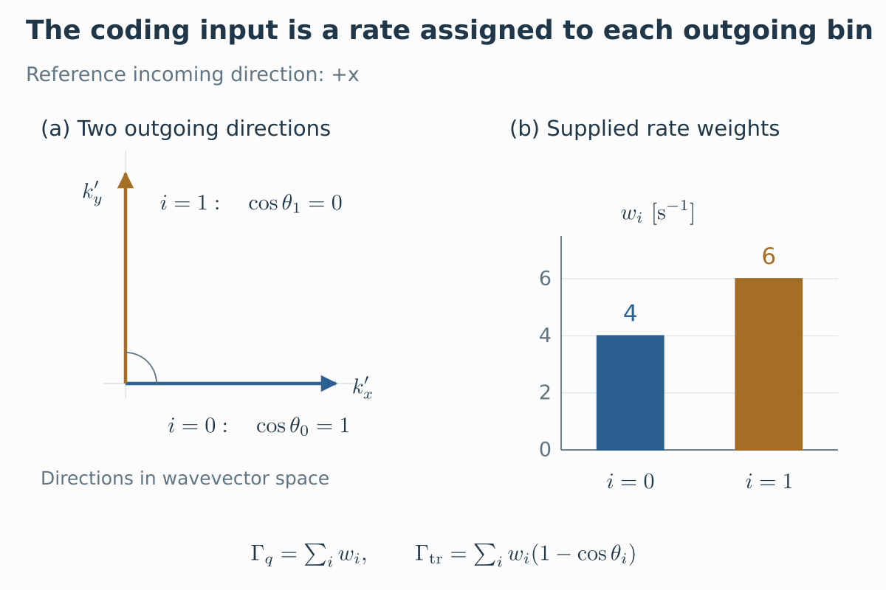
</picture>
<figcaption markdown="span">Figure 20. The incident direction defines the positive horizontal axis. The two outgoing bins are forward and perpendicular, with the supplied rate weights shown at right. Each input weight already includes its angular integration measure; the required sums use those rates without renormalizing them. The exactly forward entry is an idealized null-deflection test channel, not a quantum transition to a distinct state.</figcaption>
</figure>

```python
def angular_relaxation_rates(rate_weights, cos_theta):
    # Return [event rate, transport rate] without changing either input.
    raise NotImplementedError("Implement the angular sums in Eq. (40)")

def check_angular_rates(candidate):
    cases = [([4., 6.], [1., 0.]), ([8.], [-1.]),
             ([0., 0.], [-1., 1.]), ([2., 3., 5.], [0.8, -0.4, 0.0])]
    for rates, cosines in cases:
        rates, cosines = np.array(rates), np.array(cosines)
        before_r, before_c = rates.copy(), cosines.copy()
        expected = np.array([before_r.sum(), np.dot(before_r, 1 - before_c)])
        actual = np.asarray(candidate(rates, cosines))
        assert np.array_equal(rates, before_r), "Rate input was mutated"
        assert np.array_equal(cosines, before_c), "Angle input was mutated"
        assert actual.shape == (2,) and np.allclose(actual, expected)
        assert not any(np.shares_memory(actual, a) for a in (rates, cosines)), "Return a new array"
        assert 0 <= actual[1] <= 2 * actual[0] + 1e-12
    return "4 cases passed"

# After implementing your answer, uncomment:
# print(check_angular_rates(angular_relaxation_rates))
```

<details markdown="1">
<summary>Reference solution and the lifetime-ratio bound</summary>

```python
def angular_relaxation_rates_reference(rate_weights, cos_theta):
    rates = np.asarray(rate_weights, dtype=float)
    cosines = np.asarray(cos_theta, dtype=float)
    return np.array([np.sum(rates), np.sum(rates * (1 - cosines))])

print(check_angular_rates(angular_relaxation_rates_reference))
```

Every factor $1-\cos\theta$ lies between zero and two. Therefore $0\le\Gamma_{\rm tr}\le2\Gamma_q$. For positive finite rates this gives $\tau_{\rm tr}/\tau_q\ge1/2$, with no finite upper bound as the distribution becomes perfectly forward-focused. Isotropic scattering sits at one, not at either extreme.

The starter and reference have different names. Running the notebook does not silently replace your answer with the solution. The checker tests values, non-mutation and the physical angular bound; the browser quiz does not execute arbitrary user code.

</details>

The resistor law combines distinct physical calculations. Poisson and boundary data determine the field; continuity constrains accumulation and flux; the carrier dispersion sets the semiclassical velocity and its response to an applied force. Microscopic transition matrix elements and final-state counting give scattering rates, while angular weighting determines the transport time. A neutral bulk can still have a driving field, and a total scattering rate does not by itself specify how quickly current is lost. Mobility and conductivity combine those ingredients under the stated low-field assumptions. A change in any of those ingredients can require more than changing one number in $ne^2\tau/m^{\ast}$.

## References and further implementations
{: id="drude-references" }

- H. A. Haus and J. R. Melcher, [*Electromagnetic Fields and Energy*, Chapter 7][electrostatics] and [Section 7.7][charge-relaxation]. Charge conservation, conduction and electroquasistatic charge relaxation.
- TU Delft, [*Open Solid State Notes*: Drude model][drude-notes]. Mean-velocity equation and the relation between conductivity and mobility; the angular refinements above distinguish event and transport times.
- D. Tong, [*Electromagnetism*, Sections 7.6.1–7.6.3][tong-em]. Drude AC response, dielectric response and plasma oscillations.
- D. Tong, [*Solid State Physics*, Chapter 2][bands] and [Chapter 3, Section 3.2][dynamics]. Bloch states, tight binding, group velocity, inverse-effective-mass tensor and Bloch oscillations.
- R. Fitzpatrick, [Ehrenfest's Theorem][ehrenfest]. Position and momentum expectation values, total force and the conditions for a classical-like packet-center description.
- B. Zwiebach, MIT 8.06, [Chapter 4: Time-Dependent Perturbation Theory, Section 4.3.1][golden] (2018). Finite-time transition amplitudes and the continuum golden-rule limit. Also MIT 8.321, [Lecture 26][golden-lecture] (2017).
- B. Zwiebach, MIT 8.06, [Chapter 7: Scattering, Section 7.3][born] (2018); D. Tong, [*Topics in Quantum Mechanics*, Chapter 6, Sections 6.2–6.3][tong-scattering]. Cross sections, the Born approximation and screened Coulomb scattering.
- S. Kim, S. Woo and H. Min, [“Vertex corrections to the dc conductivity in anisotropic multiband systems”][transport-time], *Physical Review B* **99**, 165107 (2019), DOI: 10.1103/PhysRevB.99.165107. Conditions behind the angular transport factor and extensions beyond a scalar relaxation time.
- J. Bardeen and W. Shockley, [“Deformation Potentials and Mobilities in Non-Polar Crystals”][deformation], *Physical Review* **80**, 72–80 (1950), DOI: 10.1103/PhysRev.80.72.
- MIT 6.730, [*Physics for Solid-State Applications*, lecture notes][mit-solid] (2003). Effective-mass and electron–phonon-scattering derivations.
- F. Giustino, [“Electron-phonon interactions from first principles”][giustino], *Reviews of Modern Physics* **89**, 015003 (2017), DOI: 10.1103/RevModPhys.89.015003; [Erratum][giustino-erratum], **91**, 019901 (2019). Matrix elements, quasiparticle lifetimes and transport; use the corrected current and kinetic-equation expressions.
- [EPW documentation][epw] and its [source repository][epw-source]. First-principles electron–phonon and transport implementation, beyond the scalar models used in the examples.
- [NIST CODATA constants][constants]. SI constants and the electron mass used by the executable calculations.

[electrostatics]: https://web.mit.edu/6.013_book/www/chapter7/7.html
[charge-relaxation]: https://web.mit.edu/6.013_book/www/chapter7/7.7.html
[drude-notes]: https://solidstate.quantumtinkerer.tudelft.nl/3_drude_model/
[tong-em]: https://www.damtp.cam.ac.uk/user/tong/em/el6.pdf
[bands]: https://davidtong.org/pdfs/teaching/solid-state-physics/solidstate2.pdf
[dynamics]: https://davidtong.org/pdfs/teaching/solid-state-physics/solidstate3.pdf
[ehrenfest]: https://farside.ph.utexas.edu/teaching/qmech/lectures/node36.html
[golden]: https://ocw.mit.edu/courses/8-06-quantum-physics-iii-spring-2018/89ef6d5958ee59bae9a91345c3d8c8e4_MIT8_06S18ch4.pdf
[golden-lecture]: https://ocw.mit.edu/courses/8-321-quantum-theory-i-fall-2017/81f6e90a6cdd311ca5f3afb32e9da1f2_MIT8_321F17_lec26.pdf
[born]: https://ocw.mit.edu/courses/8-06-quantum-physics-iii-spring-2018/45dbd7038c3e969491eceeae86c44d42_MIT8_06S18ch7.pdf
[tong-scattering]: https://davidtong.org/pdfs/teaching/topics-in-quantum-mechanics/topicsinqm6.pdf
[transport-time]: https://arxiv.org/html/1901.04135v2
[deformation]: https://doi.org/10.1103/PhysRev.80.72
[mit-solid]: https://ocw.mit.edu/courses/6-730-physics-for-solid-state-applications-spring-2003/pages/lecture-notes/
[giustino]: https://doi.org/10.1103/RevModPhys.89.015003
[giustino-erratum]: https://doi.org/10.1103/RevModPhys.91.019901
[epw]: https://docs.epw-code.org/
[epw-source]: https://gitlab.com/epw/q-e/-/tree/develop/EPW
[constants]: https://physics.nist.gov/cuu/Constants/Table/allascii.txt
